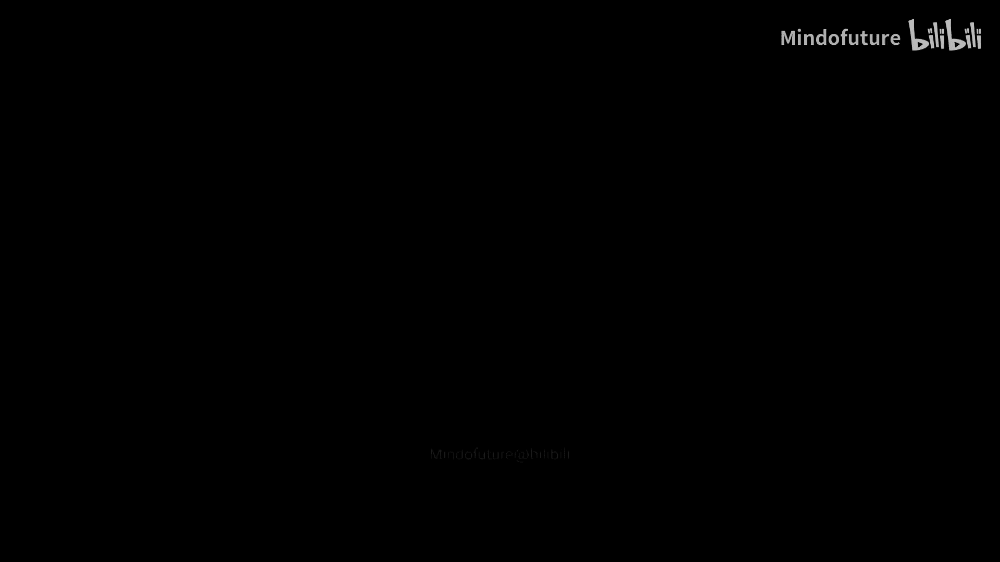
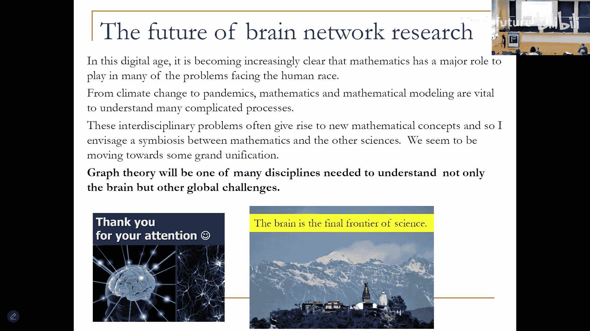

# 【菲尔兹研究所】网络科学领域实验室 ｜ Fields Lab For Network Science p03 P03_马尔可夫过程与脑网络枢纽 -BV1Ty6qBJEvZ_p3-

嗯。This is yeah，s working。It just going to to whole。Oh， okay， okay。

So let me begin by saying a few words about。Interdisciplinary thought。Mathematics， for example。

 in physics have been interconnected for a long time。

Throughout the centuries mathematics and physics have inspired each other and because of this symbiosis。

 both disciplines developed rapidly and enriched each other。

 I mean the classic example of course Newton's laws and the discovery of calculus。Physic studies。

 the threefold cosmos of space time and causation and these have inspired the development of geometry。

 algebra and analysis so I just want to give you a visual definition of geometry a visual definition of algebra and a visual definition of analysis in one picture you know a picture worth a thousand0 words say so here's a simple example so that's geometry。

咁。Um。The fact that we coordinateize space and write down an equation。Is algebra。

And the fact that we understand after having quadized space。

How things are changing in that space time dimension is analysis。So。

What is out there we can't understand without coordinization？

without bringing symbols into the picture， and this is very interesting because in Indian philosophy。

 it's not spacetime causation， it's spacetime causation number。thank you嗯。

And the idea is somehow without measurement。Without coditization， you can't really understand things。

So thus we have an understanding of the external world， whatever that might be。

 but what about the internal world of the human mind， are these in fact the same？Thiss the question。

And this may require the confluence of many fields， and I think in particular。

 mathematical neuroscience。That's the challenge of the mod。

 I haven't seen this kind of phenomenon interaction of so many different fields as we have seen as we're seeing today。

 especially with artificial intelligence， it begs many questions like what is the mind。

 and how does the mind work and what is intelligence， you know these basic questions。

So the human brain and its mysteries of course， is the final frontier and very exciting to be working in this final frontier so basic questions like what is consciousness。

 the hard problem of consciousness。What is mind， what is brain。

 these the simplest questions are actually the hardest to answer， but here's one way to proceed。

The brain is now can be viewed as a neural network， it's not going to be the complete model。

 but it' beginning。And currently neuroscience used the mind and consciousness as emergent functions。

 whatever that may mean of this particular network。

 so you're not going to be able to point to something and say there's consciousness。

 but it's an emergent function， the sum is larger than its parts。So this is。

 these are the questions of philosophy since the dawn of time and Indian philosophy， for example。

 there's this combination of energy and consciousness， object and subject。

 and several systems of philosophy then make the claim that actually there is nothing else but consciousness。

There's nothing because every perception after perception is an experience of consciousness。

 so there's no nothing beyond consciousness。Now in the 21st century。

 neuroscience has made significant advances in describing neural network of the brain。

 but the work has really only just begun， perhaps by understanding the brain network we may understand。

Mind and consciousness， because these are very hard questions to answer。So in this task。

 graph theory is now the primary tool to describe various aspects of brain connectivity。

 how different parts of the brain interact。 So my goal in this talk is to give you a general introduction to the interdisciplinary theme。

Of graph theory and neuroscience with my colleague who's here， Professor Prassad。

 who got me interested in the interaction between math and neuroscience。

He actually handed me a sheaf of papers to read and I kind of meditated on them and then slowly。

 slowly this joint work emerged out of that。So I won't be assuming any knowledge of graph theory or neuroscience。

 of course there are experts in both here， but so you'll just have to bear with me and you know gloss over things that you might know so let me begin with Emmamannuel Kant。

One of the heroes of philosophy。He。Wrote this beautiful essay。Called a critique of practical reason。

Two things fill me with awe。And admiration， the starry heavens above。And the moral law within。

And so I think that's a very profound statement because the world out there we really don't understand。

 but is there really a world out there？And is there I mean so in trying to understand the internal world。

 maybe we'll understand the outside world and maybe they're actually the same So in what sense can we try to understand this So we've explored vast tracts of outer space。

Remarkable technological advances， but when it comes to exploring the closest of the close。

 the human mind， which is the nearest of the near。We are really。Mute in this aspect。

So part of the reason is that we have not had the tools to do so。

But with the technological advances like electrophysiological monitoring methods like EEGs。

 we're slowly determining some sort of neural architecture or the brain。

So now we can use methods of graph theory to study brain networks which may be a gateway to the mind。

 we're not saying the brain network is the mind as some people might say。

 but we're trying to say what the mind is we can' actually define。

 we can certainly study the brain network。So the microscopic structure of the human brain。

 so this is stuff probably many of you know， but I've learned it from Professor Prasad。

The pioneer in this is Santiago Romanmoni Kaal， I hope I pronounce it correctly。

 he is discredited with the discovery of the neuron。

So a neuron is a nerve cell which communicates with other nerve cells through electrochemical impulses transmitted via connections called synapsis now my understanding of basic understanding of neuroscience is that the synapsis maybe they are not bidirectal necessarily so they may only one direction or so this so this leads us to usage of directed graphs in trying to model the brain network as opposed to undirected graphs and if you have ever taken basic courses in graph theory。

Even today， basic courses in graph theory， 90%。It deals with undirected graphs。So in some sense。

 the problems of neuroscience forces us to go back to classical graph theory and redo the whole thing。

For directed graphs， so this is going to come up later on in what I' going say。

So his neuronal theory is considered the foundation of neuroscience in a lecture given to the Royal St in 1894。

 he said the ability of neurons to grow in an adult and their power to create new connections can explain learning。

 so this is a fascinating quote because now maybe we can understand the process of human learning。

Through neuroscience， try and understand it through neuroscience。

So this is considered to be the basis for a synaptic theory of memory。

 and Kahalal was awarded the 1906 Nobel Prize in medicine for this work。

 so it's a big time in human civilization。So the emergent functions of neural networks were investigated by his successors。

 Ka student Raphael Lourentino， advanced the theory that many of the brain functions are emergent functions of the network working in concert。

 so you can't there's no physical location， but it's kind of the totality of everything working in concert。

He advanced the theory of recurrent connectivity and showed nervous transmit electrical impulse。

 this was a big big idea in neuroscience， and his work was further developed by Donald Habb who I believe has a Canadian connection whose work was led to the basic mantra of neuroscience that says neurons that fire together wire together。

And giving a neurological basis for habit formation， human behavior and even learning。

 the theory of learning。From a neurological perspective is right here。

 so if you want to train your own mind in learning a new skill。

 you just have to keep on repeating this book by Malcolm Gladwell， you know， the outliers's book。

 if you want to be the world's expert， you have to clock 10，000 hours or。Of practice。

 so it seems to be connected with this particular mantra。😊。

So the connectivity matrix of neural networks， so these researchers have now established that brain functions are the outcome of neural assemblies that are interconnected and these interconnections can be visualized through mathematical concept of graph where the vertices are either neurons or assemblies of neurons and the edges are the interconnections between them。

 There's no way you're going to map。you know 10 billion neurons of the brain。

 but you should map assemblies of neurons as people have been doing talking about these various centers we want to be you know so and so forth。

 so this is the idea behind much of the connectivity matrices that have been emerging in this context。

 the edges are not undirected but directed and syninaptic connections are not necessarily bidirectional。

In addition， the edges may be weighted， so now we come to not just a graph。

 but what's called a weighted graph， so you may put a little weight on each edge。

 not all edges are the same。So these are called weighted graphs。In some sense。

The adjacency matrix of a graph is a weighted graph， you're just giving0 or1。

 whether it's connected or not， but supposing you change that and make it weighted。

That that concept is going to come out in this thing。

 so we're thus let to represent these brain networks as weighted directed graphs and now we can try to use methods of graph theory and linear algebra in particular。

Okay， so the papers that Professor Prad had presented to me， I was。

 you know interested in and he gave me hand half a dozen papers where mathematical ideas of graph theory were being discussed in the context of neuroscience and。

And I kind of rummaged through all those papers。And from a clinical neuroscience perspective。

 apparently it's important to identify regions of the brain network。

Where there's more electrical activity and these are called hubs。

In his particular clinical studies of epilepsy， it was important to identify these hubs where these major activity take place。

 so several metrics have been introduced to determine hubs ranging from the naive to the profound。

So how are you going to measure？What's the hub what is centrality you know so so degree centrality is the most naive that is that vertex in the graph that's got most number of edges coming out of it that's called degree centrality that seems to be the most naive way of recognizing an important hub。

But it may not be actually， as we'll see in a second， so this is one one method。

Another measure is between the centrality in which a hub is recognized where all these geodesic paths kind of pass through this particular node between the centrality and then another measure which is called eigenvector centrality is closely related to viewing the brain network as a Markov process and it's very close to Google Page rank algorithm。

 it's very close to artificial intelligence learning algorithms。

 chat ET will work on Markov chain processes I mean even that little small thing that works on your cell phone predicting the next couple of words that you might be using in your thing is a Markov process so I want to kind of give you an illustration of how Markov models can be applied in this context。

So how to understand the brain network using graph theory so we know that neurons communicate with other neurons and cells via chemical and electrical interactions and these communications can be partly measured by these EEGs and fMRs and so on and so forth so an initial model can begin by using graph theory with the nodes of the graphs either being neurons or neuron groups assemblies and rate directed edges can indicate lines of communication giving us the strength of the signals so there you so in that sense so this is what neuroscience is now attempting to do the human connectome project seems to map seeks to map out all the neurons of the human brain which is a big project work began apparently only 20 years ago but it's still in its infancy some of more lesser and simpler organisms have been mapped out I talk about a few of those in in this talk later on so far we know the entire neural network of one。

Organism called the Cgonza probably nobo has a total of 300 neurons and also the fruit flies。

 Drophilia that we can look at as well， so these are simple organisms I think in the case of the fruit lie we have about 20。

000 neurons as opposed to 300 so still it's a large from a computational perspective。

And we'll discuss these later on。So the humble origins of graph theory for some of you who may not know any graph theory at all。

 I thought。It actually arose as many profound ideas arise somehow from recreational mathematics。

And it's an Euler's problem of the famous Cols Bridge， so here's Euler。

 one of the purest of the pure mathematicians， by the way。

 I don't know if you know this or not the RSA encryption。

used for credit card transactions and so on so forth is due to boiler。I mean。

 it's rooted in Euler's theorems。It's it and it was the RSA encryption started at MIT。

 but it really uses Euler's theorem in a fundamental way。

 so this is pures to the pure mathematics that's being used。So the problem was this。

 you have this Kexburg bridges or as you can see， there are one， two， three， four， five， six， seven。

 seven bridges， and the question was can I go through each bridge exactly once？

And visit all the bridges。And come back to the starting point。

 that was the question recreational mathematics。And。

So problem was to walk across each bridge only once cross all the bridges and return to the starting point。

 Eulers showed that there's no solution。So you see people try in an experimental fashion that's actually absoluteute and the way you do it is very simple。

 you set up a graph。😊，Like this and then you realize that the out degree has to be the in degree if you're going to only visit at once and then you see that certain vertices have a degree3 and there's no way you can go out and come back in again and tour the whole thing so it's a very simple idea。

 but that simple idea is the beginning of a new subject of mathematics。有好。I think it is。Yeah。

 it is maybe I should put it up a little bit higher， maybe。Does this help Okay， okay， sorry， yeah。

 sorry about that。So basic graph theory。嗯。So a graph is a collection of nodes。

Call vertices and edges。Edges can be weighted and edges can have direction。

 and the most general graph is a directed weighted graph。So here's an example， so it's the graph。

That's the visualization remember I talked about geometry， algebra and analysis， okay。

 so visualization， but now how do you work with this picture？

And you work with this picture by moving to matrices。So we can associate a matrix。

So rows edge the rows are the vertices and the columns are the vertices。

 and in the Ijath component you're going to put the weight。That the vertex from I to J has。

 so this is the adjacency matrix。就。Again， you know， coming back to space time causation and number。

 there's no other way you're measuring things see without measurement。

 you're not going to understand anything， so this number these numbers encode。Information。

 and somehow now you have。AMa， by the way， I don't know if you know this or not。😊。

The root word matrix is the word mother and matrix are the same root。

And this is actually Herman Grasmant， who was a mathematician Sanskrit scholar who discovered linear algebra。

 and he had an epiphany， a spiritual epiphany when he discovered the concept of a matrix because he realized this is this is the generalization of a number。

And that's what's going on right now， we have too much data。And there are numbers。

 quards of numbers coming at you。How are you going to make sense of this？

And so he came up with this remarkable idea of。Matrix。And some of you know。

 matrix multiplication is not easy and why do you do it that way， well。

 there are good reasons for this。😊，Because the' general number。

And it was a spiritual epiphany that he had， he said so， and Matra， you know。

 is the Sanskrit word for mother。And matrix seems to be the mother of everythings that's his intuition and I think it was rightly named anyway that graph theory deals with these matrices。

So the importance of graph theory， apart from its intrinsic beauty as part of pure mathematics。

 graph theory has been useful in understanding complicated interconnected processes that's our problem things are not so simple。

 there are lots and lots of things interconnected and we don't understand those connections。

So they've been used to model communication networks， so here's example using airline routes。

 global airline routes。So here the cities are the nodes and connect the different edges there's an air route between the two of them。

 So this way we get to understand the whole totality of airline routes and then once we have such a visual representation of this complicated data。

 we can talk about efficient gllaze of going from point A to point B whatever that may mean cost efficient。

Time efficient and so on and so forth。 We have many， many different parameters。

 So one could view it as a rateed directed graph and the problem with graph theory is how do you get from point A to point B with minimum cost。

Now these are measured by what are called radius and diameter of a graph in the previous example。

 it's important to know how to go from point A to point B and the radius in the diameter so you can meize。

 define a distance between two points in a graph by how many steps does it take from point go from point x to point Y in a directed path you have to follow the directions。

 you can't change the direction。So the eccentricity is defined as the maximum of the distance function at that node。

So the diameter and the radius of the graph are the maximum and minimal nodal eccentricities。

 and it turns out that the brain network is highly connected and the diameter and radius are both small。

This is what I learned while reading these neuroscience books。

It's a beautiful book by Olaf Sporns on Network of the Bra， which is full of this matrix notation。

 but it's interesting to note that the brain network is highly connected。

 and so this is an important problem in mathematics I think you know in algebra。

 what is connectivity。You know， you have all this algebra topological techniques to understand what connectivity is。

 what does it mean for highly so apparently the brain network is very highly connected in the sense that the diameter and the radius are small。

I can go from point A to point B Zap， you know， very quickly， if you have nodes for it。

 but the funny thing is that you don't have everything connected to everything else。😊。

That's the most efficient way of getting one point at point view connect everything to everything else。

 but you kind of you try to minimize the amount of hardware。

That you're using and maximize this connectivity issue this has been this research very well in mathematics。

 so this small world phenomenon is one of the surprising things that I learned from some of the books and papers that Professor presented to me。

So the connectivity matrix， so we've already saw this weighted graph and the adjacency matrices。

 so both because it's undirected the matrix in an undirected graph that the matrix is symmetric。

 which means the IJ entry is the same as the JI entry。

Go back and check graph theory as it has been studied for the last century。

 it's all undirected graphs and symmetric matrices are the most beautiful object we just had a talk where symmetricmetries were emphasized and underlined symmetric matrices have lots of beautiful properties and there's a very elegant mathematical theory and these symmetric matrices were also partly used in the Google algorithm by the way。

 but when it comes to the brain network the things are not so symmetric and so simple。

So now let me give you an example， so these are undirected graphs and so that you can see all these matrices that you have here。

These mates they're all symmetric in the sense that the IG8 entry is the same see when you when you take the diagonal。

 it's a mirror reflection that's what symmetric means。😊，嗯。

So modeling the brain network though requires a directed graph so so I introduced this Markov matrix the X Y entry is the reciprocal of the out degree of x now why this is we know that this is not perhaps the best model but we started there and this is the beginning of a so we're trying to figure out how do you get from point A to point B well if there are let's say 10。

Synapssees moving out in this direction， maybe the probability of moving from one neuron to the other will be one over 1。

If you assume that each of these things have equal probability， they may not。

 it's more complicated to factor in the signal stuff， I will maybe make a brief mention。

 we do it in the paper we talk a little bit about it in the paper but maybe in this talk I will not discuss that so now the matrix P is row stochastic which means each row adds up to one。

Why， because if you just check probabilities it has to add up the one。

The advantage of this perspective is that we can now view the graph as describing a Markov process in probability theory。

So one can view the Xy entries that probably going from node X to node y or state x to state y。

 and it's ending the probability now spectral graph theory。

Has focused on relating the eigenvalues of the connectivity matrix。

To the properties of the graph this is the this is。This is。

 I find absolutely fascinating and beautiful。So here we are。

We had this visual representation of a graph。What can you do with it， not much？

But if you take that graph and make it into a matrix。

 you can now start applying methods of linear algebra。

And apply the great theorems of linear algebra and see what is going to come out of this thing。

So and that is and the matrix has associated with it eigenvalues and eigenvalues were mentioned in yesterday's lectures。

 so these eigenvalues， the study of the eigenvalues of the matrix is what's called spectral graph theory。

😊，So again， it goes back to can we hear the shape of a drum。

 somehow the eigenvalues of the differential equation or eigenvalues of the operator tells me something about what's going on in the geometry。

You know， from the spectral knowledge， we get back to the geometry of the thing。

 so this is this is the idea behind the use of the Markov matrix。So what is a Markov process。

 well let me try to give you a crash course on Markov chains。Marov chains are used。

 have been used for more than a century to understand complicated processes。

where many things are going on at the same time， so to give an illustrative example。

 suppose only two things are going on it's either sunny or it's rain it's a say okay。

 so if it's and then we observe if it's sunny today。

How often is it rainy tomorrow so we observe this data over a course of time。

 so if it's sunny today then let's say there's an 80% chance it'll be sunny tomorrow and a 20% chance of rain。

And if it's rainy today， let's say there's 60% chance of sunshine tomorrow and 40% chance of rain。

 so you now made these observations over a period of time and now you would like to encode this data。

 which is the statistical data。Meaningless in some sense。

 but how do you encode it as a two state markov process you can represent it as a directed graph so if I'm in the sunny state here where is it yeah how do I move into the rainy state if I'm in the rainy state。

 do I stay in the rainy state or do I move into a sunny state？

You can apply this to moods of the mind too， if I'm happy today。

 am I depressed tomorrow or something， you know， so how often is this cycle moving？Anyway。

 so you now represent the graph， the director graph as a matrix。Whi I've done here。

Right there and now。Here's the amazing theorem， you know somebody asked me。

People who are not you know， Professor Prassad himself was asking。

 what are the theorems of math that he should know？Well， I pointed to two theorems。

First is the central limit theorem。You wouldn't have modern medicine without central limit。

You can't tell which drug is a better drug than the other drug without central limit。

Hyposesis testing， central limit。And the other theorem is Markov still。

Which I'm going to talk about now so Markov's theory Markov was actually a number theorist I'm I started out number theory got to see another person who started out a number theory here Professor Minak we both started out number theory Euler was a number theorist。

Or is say encryption。 So there's something about numbers。That is universal in this sense。

 So Markov asked himself this question。If I have this matrix P， what？

How is the situation going to be two days from now， he said， well， square the matrix？

A what it going to be， you check the probabilities。

 the square of the matrix will tell you what the weather is going to be in terms of probabilities two days from now。

M days from now。Take the un power。 and that explains， by the way， the complicated。

Definition of matrix multiplication because I get this question asked， you know。

 our Dean was a psychologist and she was asking me。

 why do you multiply those matrices in that funny week？

Well is that you know Harman Grassmann's big insight this is the way to do it and so now we're seeing if you take the end power of that matrix it's going to get you're going to figure out end days from now and here's the remarkable theorem Markov's main theorem。

 this thing tends to limit。Moulular some minor conditions， okay， not get into the conditions。

Generically， this thing tends to limit。Isn't that amazing？See， you've got so many complicated things。

 you don't know what's going on， but you here are 10 states， an epidemic， you know。

 it can move from one strain to another strain and you've got all these probabilities encoded into a matrix。

And all of a sudden， where is this silly epidemic going to go let's say， a year from now？

You do this calculation and all of a sudden it gives you a window into the future， you know。

 so this is this is an amazing theorem。This is markups。

Proud to say that it comes from the study of continued fractions。You see these recurrence relations。

 they actually come from continued fractions so that limit vector is obtained by solving linear algebra problem which we give to first year undergraduates VP equals V。

😊，You just， you solve for V。It's an eigen it's a linear algebra problem。 It's a pieces of matrix。

 Okay， you got this and you know this's real reduction that you learned in linear algebra。

 This is a new solve for me。 and that's the stationary vector。 That's where this thing is moving。

 So this is an amazing theorem。😊，So in this particular example。

 if you calculate the stationary vector by doing this thing。

 it turns out that the stationary vector is three quarter one quarter， which means it'll be sunny。

 it's three quarters at a time and raining one quarter at the time， which is an amazing insight。😊。

Based on this， I mean， I just gave you two pieces of data。

 but but supposing you had hundreds and thousands of pieces of data。

 how are you going to figure this out， how do you find a needle in a haystack？

That's exactly what Google is doing。And it's using this theoryem。Markups still。

How do you find what are the words that come after the sentence that you just started in your cell phone？

Markov zero it's got the language probabilities encoded in it and it's trying to tell you what is going to come next。

And with so these toy examples are enough to understand this big idea。It is a big idea， Probably。

 as I said， central limit theorem and Markov theorem。

 These are the two big theorems of mathematics that have kind of。Gone into other branches of science。

So what is Mark Opster what you envision the process at any given time。

 a process can be one of M possible states。Now in the previous example。

 we talked about sunny and rainy。You could talk about mood swings。You could apply to many。

 many cases and you M states， you get an M by M matrix。

And now you can see that for a computer to handle a 50，000 by 50，000 matrix is no big deal。

But for a human being， it is a big deal。But now once you get the idea。

 you see immediately that this thing converges to a limit。

 I said essentially so the experts in the room will know you need to put some small， small。

 small commission， which are generically satisfied。Very rarely do they doesn't miss。

So the Js component of that vector encodes the probability of the process being in state J a time infinity。

So it doesn't tell you what's going to happen in the future itll tell you。😊。

These are the possibilities and these are the probabilities that go with these possibilities。😡。

And so the one with the highest probability is going to be the one that's most likely to happen that's your top know in the Google search engine you put the keyword and it's done this Markov limit process and then it spits out your data it's using the same thing it's the same theorem。

So Markov and the philosophy of Markov chains， so here's one of my heroes， now Markov。

Heres he was actually a cripple most of his life， and his wife was very helpful there she is in the study。

 if you can see that picture， oops。So she was very helpful in writing his papers and helping them along。

 the scenariothere of Markov chains can be described as a mathematical study of recur。See。

 someone askeds me， what is knowledge？Knowledge is the recognition of patterns。

That's what knowledge is， knowledge is the recognition of patterns， pattern recognition。I mean。

 the computer can't tell a difference between them。A dog and a cat。

And you train it with billions of examples。Finally， it gets it right。See。

 pattern recognition is the essence of knowledge。😊，And the pattern is dependent on recurrence。

 mathematical recurrence。That's that's what so mathematical study of recurrences Markov chains。

 Markov started out number theory working under chubby Cha。You may have heard of Chebuachev。

 chbuachev's inequality and probability， but Chebuv was a number of the as well。

His doctoral thesis developed the theory of continued fractions。

 he was outstanding and was immediately appointed extraordinary professor at Petersburg University in Russia。

His first paper developing the theory recurrent chainins was written in 1906。

And it was 20 years later， 1926 that Bernstein saw the importance and gave it the name Markov chainins。

 Markov chains are exactly 100 years old。Amazing， isn't it？

So for most of his childhood Markov used crutches due to a severe inborn deformity of his knee。

 at the age of 10 he had an operation on his knee and afterwards he was able to walk only with a slight limp。

And later in life， he developed an aneurysm in his leg and that led to multiple surgeries and one of the operations was not。

Successful， July 20th， 1922， he died， he died of sepsis， he was only 66。So it's an amazing story。

 the story of Markov。So'll give you a little idea of his genealogy。

 so here's Markov's teacher was Chebichv。And Markov taught Tnerkin。

 who was a Jewish refugee from Nazi Germany。And he ended up at Brown。And。Tmer can caught DH Lamer。

Famous number theorist， Laer Tot Stark， Carol Stark， famous number theorist at MIT。

And Stark taught yours truly， so my genealogy goes back to Markov。😊。

Rather proud of that so the director graph is a Markov process the idea of viewing director graph as a Markov process is not new the Google search algorithm is based on its idea and but the idea can be used to model many complicated processes such as the pandemic mutations of the virus and so on and so forth and applying Markov theorem allows us to learn how the virus mutates and gives us a probabilistic understanding of the future states of the virus and in our particular model we started off with the simplest as I told you just one over the number of out degree a number of neurons coming out of the thing and we use that as a model this gave rise to what we call the Markov matrix。

And now we have two matrices， I said the connectivity matrix and the Markov matrix。

 so we have many other matrices you change the weights you have more more may change the problem。

 you may think the signal strength is important and then you may change the matrix and study the whole thing from that perspective so you have a whole slew of matrices associated to the graph。

 so the spectral theory of these matrices， the eigenvalues of these are going to tell you something about。

😊，The process。Okay， so the brain network and the hubs it's only in the last 20 years that neuroscientists have found the language of graph theory convenient to model the neural network of the brain and are using to study its architecture and functioning。

 So you know， when Prassad gave me these papers and I went to the library。

 tried to find these books and tried to read them and I was looking at the sports book networks of the brain。

 all I could see was what was going on is。People were just using the language of graph theory to tabulate data。

 but they were not using any heavy duty theorem， per se， to get some new thing。

 and it seems to me that we should do that now， in the case of the human brain that you've got something like 100 billion neurons and you have these directed graphs that you can use and then the model hubs。

 so if I was wondering we were wondering that is it possible to identify hubs through this Markov process。

It is natural natural idea and can we test it in the organisms you know like the Cgons and and the fruit fly so in that case model hub the brain regions are these large number of connections that are situated at the junction of important fiber pathways and they're crucial for the network communication so such hubs are apparently vulnerable to pathological insults and consequently develop structural alterations that enhance the network excitability I mean these are implicated in the studies of many disorders。

 brain disorders and epilepsy in particular which is Professor Prassad's expertise。

So this is we were thinking of trying to apply this Markov theorem to identify these hubs。

So how to determine centrality so I told you the centrality this is now eigenvector centrality which is coming out is the same thing。

 you know in Google if you some of us are old enough to know that before Google there were many other search engines。

 you know， Altavissta， LOs and whatnot and they weren't that good。

Because they were using antiquated computer science algorithms。Binary searches， you know。

 and things like that。 so all of a sudden。And I think you know the story， Sergia Brennan。Page。

 Larry Page were two graduate students at Stanford studying under Raji Mkwani。

 who was a professor who was teaching about Markov chains and all of a sudden these two students jumped up and realized this can be market。

They never finished their PhD。😊，So the idea， somehow detroubling importance。😊。

In this in this way so this was a big deal， so here we have a picture of various forms of centrality but here you can see the eigenvector centrality doesn't require you to have too many connections and necessarily it's the eigenvector that dominates the scene and in our case。

 by the way， the fact that every row adds up to one means one is an eigenvalue。

And the fact that it's a doubly stochastic matrix means the other eigenvalues are actually smaller than one。

So the one eigenvalue is going to be the dominant thing in the limit process。So in the， well。

 I don't I， by the way， how much time do I have？Okay， five questions。Okay， if anyone is interested。

 I will be happy to send you the paper。Some of this is going to be taken out of the paper。

So I might go fast。So we'll confine our attention to simple models at the moment。

 number of neurons is finite， all neurons are recurrent and non also that the experts in the room。

 the fundamental theorem of Markov chain applies so there's you have to check certain conditions before you apply Markov's theorem。

 they are satisfied。And the theorem is the stationary probability distribution is determined by solving this linear algebra problem。

 Vp equals we。The coordinates of V are the highest encode probabilities for the candidates。

 so now applying this thing now this is an interesting thing。So there is the limit。

And this is where I'm saying， I was fascinated by this thing because this is really research in mathematics。

You know， everyone knows when you have a limit theorem。

 the very most important thing is how does it get to the limit。

 that means what's called the error term。or rate of convergence to the limit how does it get there what's the rate of convergence and that's a big deal because if it's going to take eons to get to the limit you don't want to apply this thing。

 but you need to know that error term and where is that error term coming from it's actually coming from the other eigenvalues。

And trying to figure out the best error term is now we do one。

ussing what's called a condition number， but afterward， after we finished this paper。

 I had a student who was looking for a PhD thesis and I gave her this problem of trying to figure out error terms and now we have some new work where the error terms are not only determined by the other eigenvalues。

 but the spacings between the eigenvalues。The spacing distributions of the eye。

 so this is really getting exciting， you see now spectral graph theory means you study the eigenvalues and then you get information about the process。

😊，But now not only do you study the eigenvalueil， you have to study the distribution of the spacings between the eigenvalues and you seem to get very much new information。

 so anyway， to make a long story short， you can define what's called the condition number。

 as I told you， symmetric matrices have been dealt with in the books。😊，Classic material。

 but asymmetric matrices， we dealt with it by using this what's called this condition number。

 So if you have a symmetric matrix， by the way， this condition number is just simply one。

Nothing to do， but if you have an asymmetric matrix。

 this condition number factors into the error error estimates。So we apply various theorems。

 as I told this famous theorem of peron androbinius。

 I'm just going to flash it because I don't want to belabor too much about this thing。

 the key point here is that the maximum absolute value of the non-trivial eigenvalues of the matrix that we started with makes its appearance when I told you the main eigenvalues the eigenvalue1 and the nontrivial eigenvalues are the other eigenvalues and they all have absolute value at most less strictly less than one。

All right， so then you apply it， as I said I'm going to jump through this and we got a theorem about the radius and the diameter remember connectivity of the brain network。

 how fast can you go from point A to point B well it's all determined spectrally in this picture here。

 this estimate， the condition number the eigenvalues and that eigenvector from the Markov limit process。

That's the determin the， the diameter of the graph。So this work， which we started。

Turns out that it improves on classical work that I was taught when I was a graduate student on this stuff。

But remember when I was a graduate student。Braph theory wasn't really paying attention to director graphs。

 although it was a topic。It wasn't central。Somehow undirected graphs and these things called raogen graphs were being studied。

 which was again a confluence between number theory and graph theory， highly connect Raogen graph。

 by the way raogen graphs are also used in communication networks so if you want to connect network of cities using telephone lines。

 you don't want to be joining every city to every other city that's a stupid way of connectivity so to minimize the number of the hardware used。

 but to increase the connectivity is a problem in graph theory and it will solved using raogen graphs which is coming right out of number theory。

So this is again a beautiful piece of work， anyway this improves Fs work。

No I will just skip this for the experts in the room。

 the key idea is somehow that the end power of the Markov matrix satisfies a certain recurrence relation and here are your eigenvalues here so we analyze this and get the limit here so let me just skip this。

Yeah， let me just。Kind of skip all this as I said， if anyone's interested please write to me and I'll be happy to provide you with the paper but the key idea here is it's telling me how it's approaching the limit process and this is a sub exponential error term that means it's really going to zero fast because row remember row is less than one and if you keep on taking n power of some number which is less than like take a half half squared is a quarter。

Go on and it gets。To zero very fast， so that's the kind of error we're talking。

 which is very pretty good。ok 嗯。Okay， from technical issues， these are again。

 some the reason I put them in is because these are some of my heroes in mathematics。

 they're all number theorists or algebraists， you know。😊。

But it's interesting that it all starts from number theory or algebra and then it takes off from here so they came up with a subtle refinement of these things and this is a theorem that applies to any matrix not just to symmetric matrices。

😊，So when you apply it you get you get this version and it's interesting。

 I couldn't find this when I needed it for our paper。

 I couldn't find it in a standard linear graph theory book or a linear algebra book。

 I had to find it in。A paper book dealing with stochastic processes。

 of course you all know that artificial intelligence is based on these stochastic models even the human mind apparently works on probabilities there computational neuroscience is again it's probabilistic determination。

All right。Skip， skip skip all this this is a technical part and apply it to this Cla glance worm that we talked about earlier。

 we had graduate student work out the connected you using this is all publicly available data and you。

Apply our Markov theorem process and to find where are the hubs for this worm。

 and it turns out the hubs are labeled PCVL and PCVR。

 one of it is basically to move forward and the other one is the neuron that tells whether somebody stepped on it。

Okay。嗯。Very important， so those are your hubs for this particular worm。😊。

And we did the similar thing with the fruit light。Because by the time when we started this paper。

 the connectome for the fruit fly was not available。

 but by the time we finished it it was now variations on the kind of algorithm that we were trying to use here。

This is we use the discrete time markov process。Clearly。

 this is not the way it's probably going to work it maybe continuous time markov process has to be used now the continuous time markov process is another fascinating chapter it's as beautiful as I just you know gave you here。

And what we would like to do is it's not just probabilities。

 but these probabilities will have to be functions of time。

And they will have to encode synaptic strengths。So if you're trying to practice playing the piano。

 but you only practice five minutes， the synaptic strength isn't very strong that has to be encoded somehow so anyway you。

To make a long story short， the Markov theorem in this context is that。

You take those functions and then you calculate these derivatives and you get a new matrix called Q。

And this time。In the classical Markov theorem， you had to solve Vp equals V。

 but this time you have to solve V times q equals 0。Again， a linear algebra problem。

And then by solving for V， you figure out the stationary distribution in the continuous time process。

 so it's again， stuff that we have not applied yet。

 but I'm just putting it out there because I think in if you really wanted to do this correctly。

 you have to figure out those functions of synaptic strengths or assemblies of neurons that have these strengths so that the markov matrix now becomes a continuous time variable in PFT。

And we plan to explore this in future work hopefully there will be somebody here who will be interested and we can collaborate so I want to put out a few ideas stimulated by number theory and algebra。

 what we callzeta function of a finite network so just as I said before in graph theory you're taking this geometric configuration。

 moving it to a matrix and trying to analyze the matrix and getting information out of this。

In number theory， we have always taken complicated things and encoded them into a what's called a generating function now this time we're proposing not a generating function but a generating matrix of functions。

we callzeta function of a finite network and essentially taking the Markov matrix and motivated by algebraic geometry。

 we're defining it as exponential sum P to the andan over n。

So our zeta function is a matrix function resembleszeta function as a number theory。

 for instance ideas of a paper can be used to show that it is actually a matrix of rational functions and this leads to some intriguing questions how are the singularities of this particular zeta function related to the function of the brain some you know talks yesterday alluded to trying to understand。

Brain disorders by studying eigenvalues of the matrix process。

 So somehow is there some deeper connection between the two。嗯。Now， again。

 pouring over these papers that Praad had given me。

 we noticed that there's this paper by Barabbassi and Albert that many networks exhibit a power law in their degree distribution。

 so degree of over ver Texas， the number of things coming up， so they exhibit a certain power law。

 how often，There's a random node。Have degree K。Good question and it turns out it looks like it's1 over K thes for a suitable value of S。

😊，And I'm not making this up okay， and this is in strikinging contrast to random graphs that exhibit a plus distribution。

 so for the for the networks here so we have。A probability distribution which is basically rooted in thezeta function。

And Zeta S is the remanzeta function， which has been for the central object of study and number theory。

So many intriguing questions arise that will be taken up in future work， by the way。

 I have another student working on the Zeta distribution and some interesting stuff is coming out of this just from a probabilistic perspective。

😊，So summary in future directions we presented new models to identify brain network hubs that maybe have used in treatments of epilepsy and other disorders。

 various modalities of measurements are available， it should be possible to clinically test and at least simulate the validity of this hypothesis so the worm and the fruit fly are just two of the examples more connectomes that have been mapped maybe test it and figured out whether this is working or not the study of brain network using graph theory suggests a retrospective of graph theory from a neuroscience perspective so as a mathematician I said to myself。

 wow， I've got a whole bunch of problems I can give my graduate students see go back。

And you look at classical graph theory and you do redo it for directed graphs。😊。

Every every single theorem so as the indicate in this talk this leads to new theorems in classical graph theory in terms of spectral theory of Markov matrix。

 so this leads to a very exciting time between graph theory and neuroscience not only can graph theory lead to insights in neuroscience but questions in neuroscience can lead to new theorems in graph theory and that's the direction that I。

😊，Fascinated by。So the future of brain network research and well in this age in this digital age。

 it's becoming increasingly clear that mathematics is going to play a major role so you can't think of math as pure math anymore。

 you can't think of math in the classical sense of the word anymore you really have to think of math and an interdisciplinary way and in a serious interdisciplinary way not just a notational sort of way。

 maybe it can help in dealing with the problems of the human race so from climate change to pandemics。

 mathematics and math modeling are vital to understand many complicated processes。

 these interdisciplinary problems often give rise to new math concepts so I envisionvisage just symbiosis between mathematics and other scientists so we're going to this grand unified theory that Einstein somehow dreamed of right graph theory one of the main disciplines needed to understand this not only for the brain but other global challenges as well。

So with that， the brain is the final frontier of science， thank you very much for your attention。Oh。

