# 【菲尔兹研究所】网络科学领域实验室 ｜ Fields Lab For Network Science p04 P04_时空人工神经网络的计算归纳偏置 -BV1Ty6qBJEvZ_p4-

你给他有这。

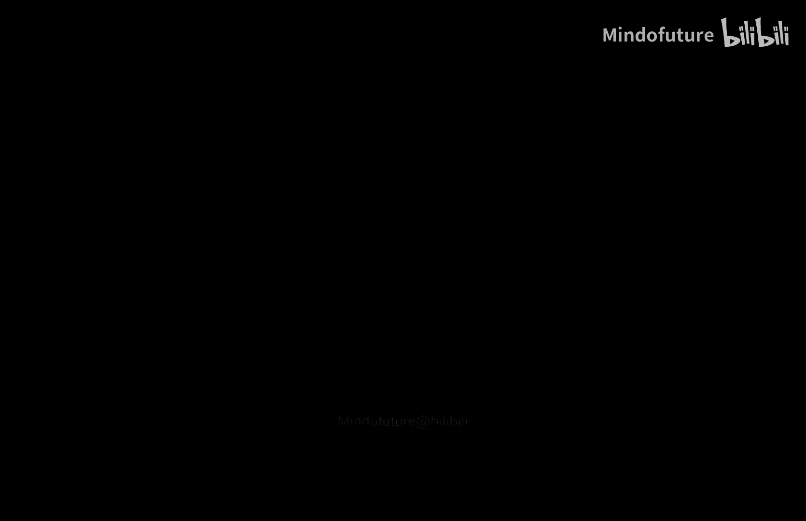

这块。Okay。All right， go ahead and get started with the second day of the symposium。

 Thank you everyone for attending and being prepared today I'm really looking forward to the first block。

Talks so the next lot of talks here we'll move on to neural network models。

 spatial temporal dynamics and neural network models and also approaches and mathematics and looking more broadly to how we canfuse these things together to gain insight into the computations that are happening and。

So with that， I will introduce Andy K， who will get the first off。P。你干嘛。你第一。F。Yeah。Thank you。

All right。It's a good distance to where this， does that work？Thanks so much for having me。Yeah。

 so my background is in machine learning I did my PhD in machine learning with Maxwelling and Amsterdam I'm now doing a postdoc position at the Kempner Institute at Harvard where the goal is to be somewhere between AI and machine learning and study just intelligence broadly so I got involved in some projects related to computation with spatial temporal dynamics and with Lyle and I'm super grateful to be here today so I'm going to start off with very high levell stuff and then go into some experiments so please interrupt any time with questions or clarification and we don't have to finish everything that I have here so this slide is about two years old and yet still I was looking at it again thinking okay this is still somewhat impressive so this was video generation from two years ago a teddy bear washing dishes we can also see。

They're all generative model type of applications。🎼A generative model making some。Mediocre music。

Based on some text prompt， and then this is an example of the Game of Go， which of course。

 famously Deepmind beat the World champion in back in 2016。These are all super impressive。

 but how does this differ from our natural intelligence does it differ a lot of people in the machine learning world will say whyhy do you even bother looking at the brain when we have this incredible performance well the first thing I think is if I can get this to go forward if we just consider the amount of training data that these models take so this。

😊，Video generation tools， 400 million text image pairs。To make this audio is 2 million clips。

 this go game is 100 million matches。 And you see these numbers。

 and I just wanted to give an example of what this really means。

 So if this is the entire lifetime of Lisa Dole， who was the world go champion and every little go piece here is 1 thousand matches。

 this is estimated how many games he's played in his lifetime，50000。😊。

Doesn't sound like that much but if you calculate I went through the math and like okay it's kind of maybe a rough approximate so then let's see how many do we think Alpha Go had to play in a similar amount of time and this was on a crunch timeline to get it to work and time to play him if you watch the documentary like theyre really they didn't have time to go too much further than this So this is a lot right？

😊，But this is just the first slide so and remember these are in units of a thousand00 so this the second。

😊，Third， if we can guess how many this goes for it's actually 212 of these slides worth so this is actually like an astronomical ratio right this is like a factor of 2000 times as many and this is compared to today's standards relatively small if you if these large language models when I was building this and writing my thesis it was like。

😊，A difference of。A couple hundred lifetimes worth of like a single model you had to be reading for a couple hundred lifetimes straight in order to read the same amount of text that this model was learning。

 and this was like G2 g3 Now we're on five or whatever right you can only imagine so astronomical sample complexity the number of data points you need to train these models thats that's a problem right The second problem is I was calling unintuitive generalization So this is one of these image generative models。

 you ask us to generate an image of a teddy bear on the moon and it does this incredibly well right which is。

Impressive like I don't think I could make a picture that looks this impressive of a teddy bear on the moon。

 but at the same time you ask it to draw a blue cube on top of a red cube and it fails it does this incredible 3D rendering like I could not draw these shading and these reflections like this but it doesn't understand these object relationship and so I call this intuitive generalization because there's a relationship here between the bear on top of the moon and the block on top of the other block。

 which is a really simple relationship that I think we all understand and you can think of it kind of like a symmetry which I'll get to but the model clearly doesn't have this structure and its representation to be able to perform this kind of generalization。

So。In the machine learning world， the way that I like to think about solving both of these problems or one。

Kind of facet that solves both of these problems is the notion of inductive bias。

 So really simply an inductive bias is like the choices you make when you are picking your model that constrain what is possible to learn and also how you generalize and it also constrains how many samples you need to learn that。

 So for example， if this is your data set， which is the price versus your house size you can see that there's some relationship here。

 if you just pick a linear fit， you're gonna have a high bias。

 you're not gonna to hit all the data points， but maybe you only need two data points and you're gonna get a relatively good fit。

If you pick a degree2 polynomial， okay， I was trying to justify why a very large house would be cheaper。

 I couldn't quite figured it。 maybe it's like a farm or something。 a lot of land。

 not like no electricity， something like this so it goes down if you pick a really high degree polynomial right。

 this is a different type of inductive bias you can fit all the data but you're not going generalize but probably not going to generalize as well。

 for example， to this house price or this house size right here you're gonna predict some really high value of the house price。

 This is just one example of inductive bias It's a choice of your model that determines how you generalize in how much data you need。

And I think one of the most famous examples recently in the deep learning space is this idea of convolutional neural networks where're sharing rates over space。

 this is arguably what caused kind of the resurgence of deep learning in 2014 these things working on the imagenet image classification data set is that type of inductive bias and so my question and what I was really interested in is what are the inductive biases of natural intelligence that separate them from these models。

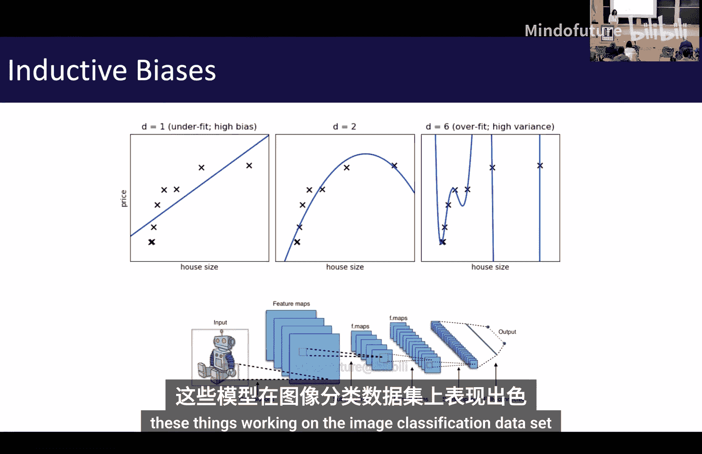

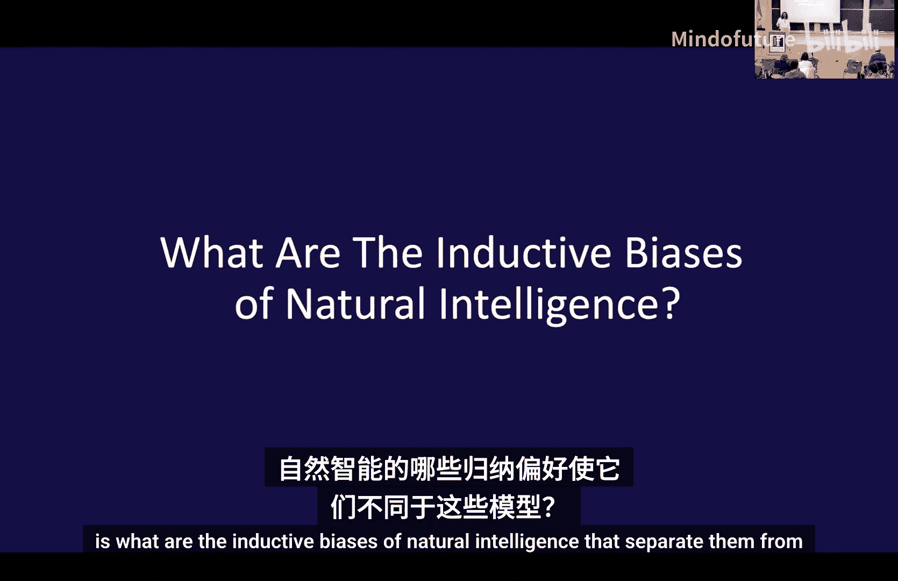

And I guess what I got interested in， what I'm not going to kind of。

The labor or I don't know what the right word is talk about too much is these traveling ways。

 spatial temporal dynamics and neural systems we got amazing talks yesterday I'm just going show the videos so everyone believes still we refresh that they're still there this is on the left is video of fadeta waves traveling over the hippocampus and this is a video from one wild papers on these waves during sleep these global waves。

😊，嗯。And then again， we saw this video yesterday， this was in area Mt of the Marmaset。

 these waves that John was showing。So I got really interested in these types of dynamics and thinking。

 okay， we know that the brain is spatially organized。

 we have these kind of smooth spatial temporal dynamics， might these in some sense。

 if you have a computational system that's based on these types of primitives。

 what are the inductive biases of that system in general so what are the inductive biases。

 a spatial temporal dynamics in this talk， I'm going to try to convince you at a very high level。

 one argument is that。

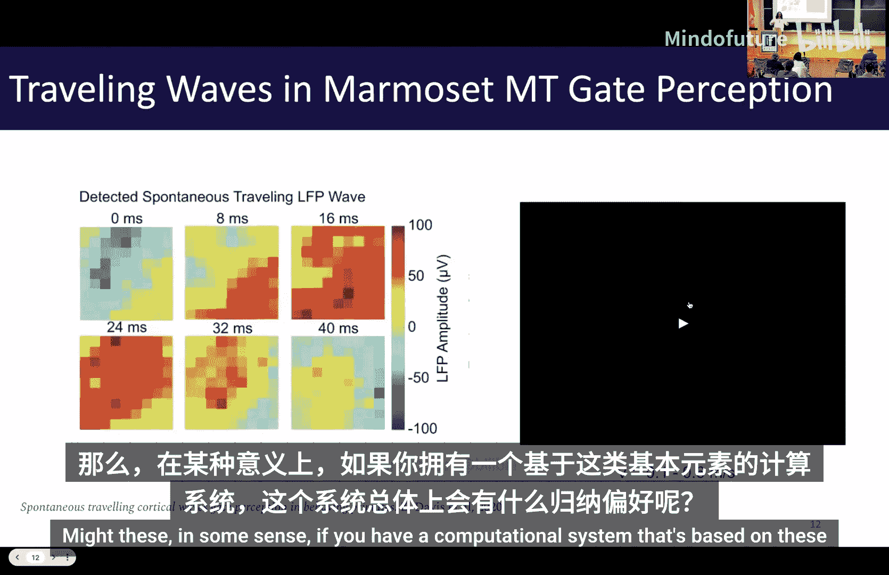

This is a relatively new idea， so please feel free to tear into me at the highest level maybe you can think of the inductive bias as something like a conservation of energy so。

😊。

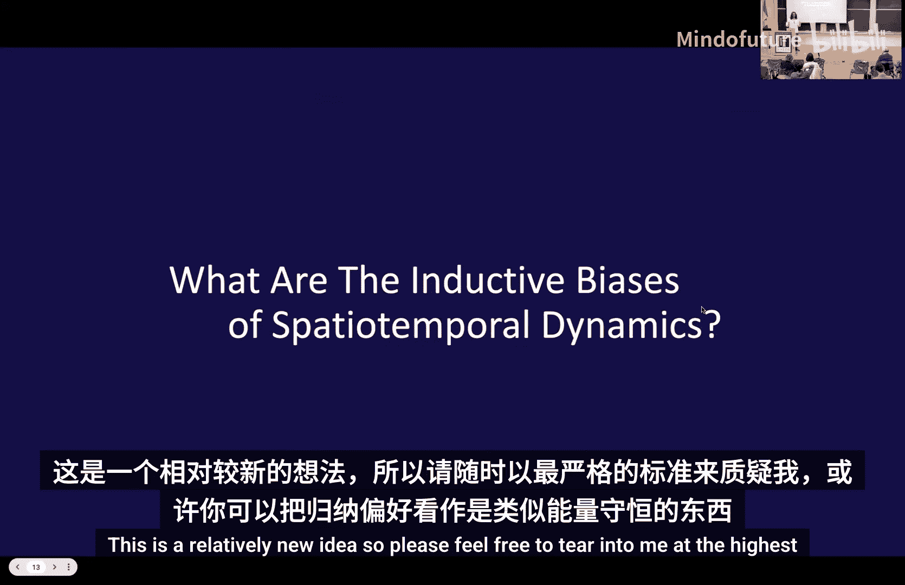

The wave equation。The simplest fossil wave equation。Is known to have a conserved energy。

 we can figure out what that energy is， combination of your kinetic and potential energies。

 this energy doesn't change over time， but if we think of this more abstractly。

 maybe there's just some kind of conserved quantity in this system and if you think of spatial or temporal dynamics it's kind of flowing。

 moving activity from one space to another and conserving some overall quantity and maybe that can be used by a model to store important facts about the world that are invariant that aren't changing or as like a sort of place to put things when the time is evolving so。

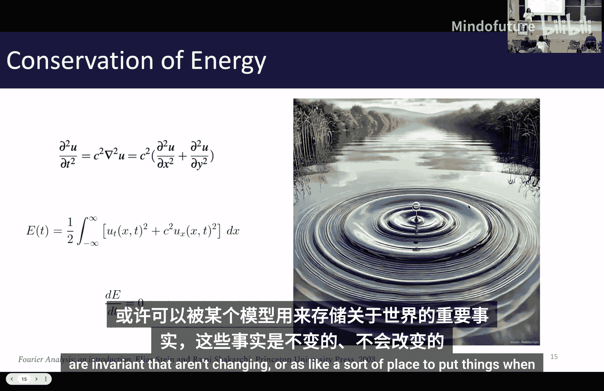

This idea of conservation of energy， I put it in quotes because obviously these waves in the brain are not kind of like perfect wave equations。

 we may have some damping decay， but I would say maybe over short time scales， small spatial regions。

 it's a fair analogy and I'm going to argue that this leads to a bias towards this integration of information both over space and time。

And what I call encoding of continuous symmetries and so these are two super like high levell abstract ideas so if it doesn't make perfect sense。

 please interrupt me and feel free to argue or don't worry about it and just look at the results but I have a lot of models here so what do I mean by spatial integration information this is a paper that we just submitted to CCN and they're going to be presenting in a workshop in ICl imagine looking at this little piece of an image here you're a single neuron and this is your receptive field you're looking at this。

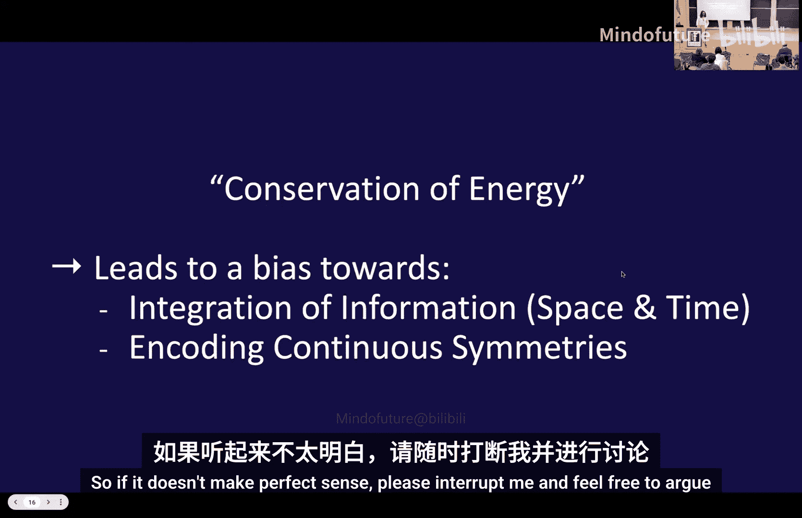

Maybe hard for you guys to see， but this kind of looks like a little patch of sky or something there's clouds here so if you are this neuron how do you know what you're looking at in that receptive field well it turns out。

Maybe it's not scary， maybe it's a reflection off a lake or something like that。

 and so the only way to figure that out is to actually integrate information from other parts of the image。

 especially if you're a little locally constrained neuron。😊。

so this is what I mean by integration information you can imagine neurons in V1 that have a localized receptive field。

 how do they actually know about what's coming from outside。

 and I think people will call these like these extended receptive fields or nonclassical contextual effects。

😊，So。Motivation for how maybe waves are related to this。One way that you can think about it。

 the way that we chose to think about it for this project and I think is kind of inspiring mathematical motivation comes from this problem。

 can one hear the shape of a drum from Markck， I think is。The 60s or something， the idea being that。

If you run a wave equation on some surface that has a fixed boundary condition。On a drum。

 you have a drum and you have a surface on it and you hit the drum and the drum starts vibrating like this。

 Can you tell what the shape of this boundary is just from the frequencies that this drum is vibrating at So to give you a little bit of an example。

 if we look at a slightly larger drum。 So this is a drum with side length 13。 This is 23。

 you can see the larger drum looks like maybe the fundamental frequency is a little bit slower。

And if we go even larger still you can see okay it seems like it's getting even slower and maybe like an intuition for why that would be is these waves have to go all the way from the center to the periphery and back and the whole thing has to oscillate to get the fundamental frequency so these are the eigenmods of the lapplaceian operating on this surface so if we look at this more precisely。

 we take a single point on this surface， we plot a displacement。

 we take the FFT of that we see that or the Fourier transform we see there's a peak and the frequency spectrum if we look at a larger drum you can see okay yeah definitely the fundamental frequency is a lot slower and again this peak has actually moved a little bit lower just the lines of our intuition that larger drums make lower frequency sounds like boom boom versus pop so。

Potentially then the idea is that if you have a drum or a surface of some sort and a wave is propagating on this when it hits a boundary condition and reflects。

 potentially it's actually bringing information about that boundary back to the center and these waves kind of mix until eventually every point at the interior of this drum is going to have a frequency spectrum that looks。

Similar for for at when you've reached kind of this study state， the idea is okay。

 maybe waves can propagate and this is like the way of sharing information about what's happening。

So we thought we would like to use this for something like。Some sort of image feature extraction。

 so the idea of being you have an image。You have little neurons that have little localized receptive fields。

 we run some sort of ascillatory local wave dynamics on that。Kkindind of space。

 this whatever we want to call it we'll call it our simulated cortex or something like this and when we can record from a single one of those neurons and we get out this time series representation of its activations over time and this is actual recording from one of these artificial neurons and then maybe we can use this to try and classify what that individual neurons saw and if what that if we can decode from this signal that that neuron was able to see something larger than its。

actctual receptive field， for example， this neuron only has a receptive field on the inside of this square it doesn't know if this is a square or a star or a Pentagon if we can decode the actual class of the image here。

 maybe that tells us that these waves are actually integrating this information over space and I'll just say that this was。

Really driven and inspired by this work from Lyle and Roberto and Alexandra and Lua。

Which when we saw it and they have this analytic solution of waves kind of traveling over these shapes for image segmentation。

 it really， yeah， is what made us think about this， so highly recommend checking out this work。Um。

Okay， so we wanted to run this on more complex shapes so we did。

 this is a video of us running it on a Pentagon shape just to show a pretty video。But the idea being。

Like I said before， we've feed in these input images。

 individual neurons have relatively small receptive fields and then what we need to do is classify the different shapes so the color corresponds to the class label here so we want the network to output for example。

 value of zero here one here two here even though all of the individual neurons only see a very small fraction you can imagine if this neurons at the center。

 how does it know whether it's inside of this Pentagon versus inside of this triangle it needs to get information from the outside。

So this is a video of the network actually doing this it's a network that's simulating the wave equation。

 but with learn parameters both in the。Laterral couplings and also in the input encoder and in the decoder and what you can see is that。

Oh， the videos are very choppy up here。You can see that the network has learned in the encoder to process a feature kind of on the side of the objects here。

 the waves propagate around。And because of the way that the model has learned to encode the images。

 this is the location of the input stimulus here， the waves are actually bouncing off of this boundary。

 the boundary caused by differences in natural frequencies of the object and I'm not going go into the details here but basically at the end if this was a little less choppy you would see that there's different dynamics on the inside of the shapes versus on the outside of the shapes and you can quantify these with something like a Fourier transform so that's what we did if you just look at the Fourier transform of these dynamics at every point in space separately for these images you can see that the different shapes really pop out in different frequency bends so at the higher frequency maybe have the triangle and these lower frequencies you have the Pentagon or something in between and then the very lowest ones you have the background here。

And so this is just showing over the entire data set。

 you can see that the different shapes such as the background are the lowest frequencies。

 you have the triangle here， and then maybe the square up here or something like this。

 this is the spectrum of these different shapes in this model。Um。This was just for fun。

 you can also hear， you can actually hear what these。

 we can synthesize these sounds and hear what it sounds like， let's see。嗯。So that's the background。

And then maybe let's go to the square。Co。So I can hear the difference that's the Okay。

 so also this extended to slightly more complex data。

 obviously this is not like the most complex thing another image of。😊。

Different like simple polygons we also did it for this mIS data set so these simple handwritten digits having the model try to classify what type of digit was written there based on the waves that were propagating around i'll note that one of the cool things about this was that。

😊，These models， I didn't go into the model details here。

 but this model is a model where the recurrent dynamics are derived from the wave equation。

 so it's really trying to model wave dynamics in the hidden state of the model。This model is。

Not at all like that it has no bias towards wave dynamics it's actually an LSTM model a long short term memory。

 a type of standard recurrent neural network model that doesn't have a notion of wave dynamics。

 but it looks like the models kind of learned to do something kind of like waves in order to solve this integration of information task and I'll show another example later where basically it looks like if we have。

Moels that have locally constrained connectivity and they need to solve a task that requires this integration of information they end up learning something that looks like a wave type of solution。

 which I think is pretty interesting just to give some numbers actually I don't even know if this is worth showing。

These wave models do better than some other machine learning models like units for segmentation。

 it does better than if you just stack a bunch of deep convolutional layers。

 normally the way that people integrate information over space in an image model is by stacking a lot of layers I can show you the image of that。

This CNN again here， you can see you have a bunch of layers and you do this pooling and subsampling and basically you think as you go deeper in the hierarchy。

 you're getting more information because you're kind of this tree grows outwards。

But what we showed is that actually you don't need this depth。

 you can just have a single layer and this kind of local recurrence in here。

 and this is equivalent and we're able to actually do some of these tasks better than having a lot of depths。

Obviously， this is a super simple task and so we need to extend this to。

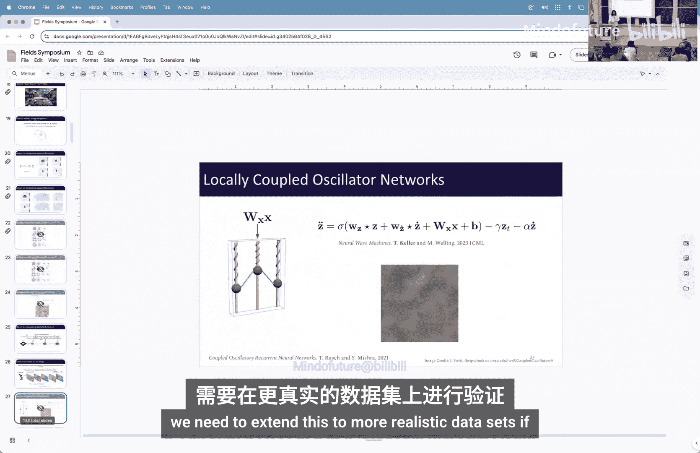

More realistic data sets if we're going to convince anybody in the machine learning community。

 but I think it's an interesting result regardless。

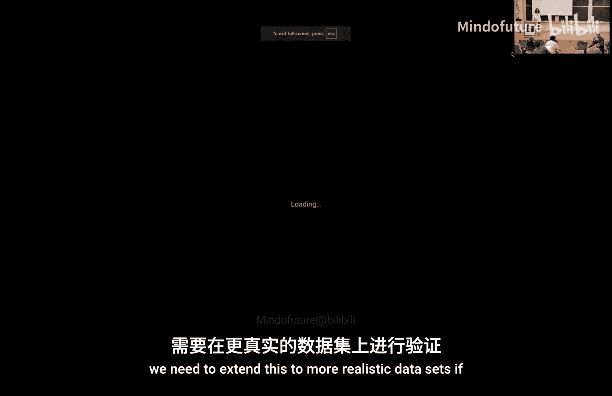

Something that people were discussing yesterday which I think is really cool that I decided to include this slide so what we were comparing with these models was how we read out the information from this time series of activations of our neurons so every neuron is doing its recurrent dynamics and it has this kind of waveform and we have to try to predict what。

Thing that neuron is looking at based on the waveform so we can either take the final hidden state of that waveform and use that to classify that works relatively poorly we can take the foier transform of that waveform and try to classify。

 that does a little bit better， but it actually seems to do the best if we just give an arbitrary linear transformation of that waveform over time and then learn what that linear transformation is。

 which makes it's like fully flexible， but I wanted to see what we would learn in that case and the cool thing is and these are these are rows of that。

😊，Matrix on the left。 So these are all different features that the model is pulling out of this time series。

 And to me， what this looks like is something like a kind of like a windowed Fourier transformer like a wavelelet transform type thing right So it's looking at one frequency you can ignore these now is looking at one frequency。

😊，At this point in time and then later in the time series， maybe a different frequency。

 or it's just kind of。Ignoring it picking up noise and so it seems like there's maybe these kind of transient dynamics that it's trying to pick up。

That really depend on time。In order to do this classification process so I thought that was potentially relevant to in the discussion yesterday so that was Was integrating space what time are we ending。

Okay。直接找。Okay that's good so the the next start is ways potentially integrating information over time so how do we think about that this was a generated video by Sra last night so if it looks weird it's because it is。

😊，The idea being that intuitively you drop pebbles in a pond。

 the surface of this pond encodes information about the time and the position where you drop those pebbles at different points in time and so we can think of this kind of like wave feel this kind of integrating this information of the disturbances over time you can always look at the surface of the pond and it'll tell you a bit of history。

😊，So what we wanted to see is okay can we integrate something like this into a recurrent neural network architecture can we add waves to recurrent neural architecture similar to we did before in order to get a sort of memory type of benefit in the machine learning sense and on a really simple tasks so if i'm going to show you some plots here i'm going to try to。

Have them make sense these are our units our neurons on the Y axis and we're plot time steps for some generic sequence classification。

 sequence processing task on the X axis。And the color is the value of the activation for a simple RN。

 these are RNNs that have relu activation function and then linear weights so all these neurons are connected to all the other neurons there's some input vector X that's being fed into my hidden and stated every time step and then I'm thresholdholding it and you can see the dynamics maybe not so well but。

They're just kind of like。I would call them like bump activity a given neuron comes on for a while and then it goes off and maybe the activity goes to other arbitrary neurons where it's connected to through the recurrent matrix if we plot this as a video we see okay yeah we get these sort of bump type of dynamics so how do we build something like a wave model well。

😊，The simplest idea and there's a lot of explanations for this and I can a lot of intuition to get from this。

 but at a high level basically all we have to do is replace this fully connected recurrent matrix with a locally connected version in this case we're using a convolution operation so convolution of a small kernel with our head state so over this spatial dimension we do a little convolution operation and。

😊，What this results in is our dynamics start to。Follow these like flow trajectories。

 So the slope here is the velocity of a wave or advection， the activation kind of moves。

Over space through your time。And if we plot it as a video。

 we get something that looks slightly more wy and you can derive this from if you take the advection equation。

 so just first order and time derivative of the hidden state is equal to first order and time derivative with respect to space you can and you do a finite difference approximation。

 you can get this equation now。So it's kind of like an approximation to a simple wave。Okay。

 so what do we want to do， we wanted to test these models on really simple tasks。

 there's a copy task， the idea being you give the model this input sequence。

 this is the time dimension again， you give it this input sequence of some arbitrary combination of these points。

 you give it a go signal at some later point in time after a delay period and then after that delay has to repeat this signal that you gave it in the beginning so this is the input this is the target。

And what we see is if we compare our wave model in red to basically the exact same model here。

 but the difference being that this U matrix is initialized to an identity matrix which has been shown to work well for long sequence processing because it has these nice kind of stability process or properties and instead we replace it with this simple convolution。

We learn kind of exponentially faster on this copy task for a variety of different delay periods。

 and it gets much better or the gap gets much more significant as we increase that delay period T。嗯。

So this is kind of exciting。 We had a ton of different experiments that were showing the same thing。

 Yeah。😊，right。So these simple RNNs are relatively bad at waiting for any amount of time before trying to repeat and I can give you intuition for that。

We tried this on a variety of different tasks， this is like a little simple adding tasks with different lengths of sequences。

 sequence integration tasks， I'm not going to go into all of them。

 basically just look at the red curve versus the blue curve and you see that this type of model does better on these sequence integration tasks than the simple baseline R&N model。

So these are two really simple RNNs， but I think it kind of did。

To some extent show this argument that。Wave dynamics。

 at least in a simple form can be used to do something like storing information over long periods of time。

 and I really do think it has to do with this conservation of energy property and one thing I didn't mention but。

I will now is this convolution operation inherently gives you a symmetry over space of your weights and that's actually crucial to getting this conservation of energy and I think that's really important。

Basically， if you don't have a symmetry of your connectivity over this spatial dimension。

 your waves will die out at some point or they could die out at some point。

 and you're not going to get this nice memory property so okay。然。OhYeah。

 sorry with respect to the apatial dimension here， so if I imagine laying all my neurons out。

 this is all my neurons laid out kind of like this in a line then I'm applying a little convolutional kernel and it's the same as it is here as it is over here so if I actually look at you can write this as a linear operator in the same form as that and it's going to be like a diagonal tops matrix yeah。

Actually， so that way of looking。Is from the conflict is actually quite related to the play。

 we look at it。Rin grab over the circuit of matrix。

 both of which are clearly have clear relationships the convolution。

And the ci matrices that we study in so and we think about those in terms of like ci matrices。

 which are a special form of totals。Yeah。Okay。Thank you yeah so okay that was in these really simple models can we extend this I don't know if people have heard about state I know some people have heard about state space models here I was talking to them yesterday。

 but can we extend this to kind of larger models that people are really interested in in the machine learning community today。

😊，Again， I'm not going to go too into detail because I don't think it's super interesting from a neuroscience perspective。

 but it is interesting from the waves perspective， so these large safe space models are models that are used to compete with transformers if you've heard about these architectures is kind of a recurrent version recurrent。

😊，Competitor to these transformer models for doing language modeling tasks and things like that。So。

A paper came out where they were making these models work well for language modeling for the first time previously they were working really well for long sequence modeling but they weren't working for language nobody could figure out why these people wrote this paper called hungry。

 hungry hippos and they built this specific block architecture that was meant to it really looks something like a transformer if you're familiar with a transformer you have these key value query and they're trying to emulate this idea of attention the details don't matter so much but what is interesting is that it's actually made of two of these state space models so when people say state space model。

 you can think of it as just a linear recurrence relation so you have a hidden state if you're previous hidden state you have some matrix that maps you between the two and you have an input that's kind of getting read in you also have an output that's getting read out at each point in time。

What they did is say， okay， in machine learning literature。

 you can make this really fast with some computational tricks。

 you can initialize A in a fancy way to give you nice properties and dynamics。Here。

 they stack two of these things on top of each other。

 So this is the state space model with a diagonal a matrix。

 This is a state space model that has a shift。😊，A matrix， which is interesting。

 So what is what is this shift SSM part。 Well， it's actually just a is this kind of off diagonal shift matrix。

 What's cool about this is that this is actually very similar to like you said these ciulent matrices or the tops matrix that we were talking about before。

 and you can actually derive this from like I was saying the finite difference approximation of thiseddvection equation。

 it' really simple wave equation if you want to call it that。

 but this is velocity equal to one and no boundary conditions here。

 So the boundary is like things fall off the edge。 So this is velocity equal to one。

 and they put this in here and they argued that this thing actually in their paper was to serve as a little form of memory。

 I like a shortterm memory for the model to allow it to compare different tokens to each other。😊，Um。

 so I told people there's waves in these models， there's waves in Mommba and nobody believed me。

 so I had to like make a million visualizations of this so this is video。

It hidden state again over time and you can see these diagonals， I plotted these waves。

 I took the 2DFFT was doing the stuff that Lyle showed me and taught me how to do so like really tried to convince you okay they're are waves in these models and it's constrained to a velocity of one and actually it's not just this one model that's doing this。

 all of the state of the art state space models that people have come up with from a variety of different groups all build on this exact same architecture because this seem to work really well for them。

😊，So I was showing people okay there are waves in these models。

 but the velocity is constrained to one， so in the previous work we found that if we let the velocity vary a little bit。

 it worked significantly better so I thought maybe I could do the same thing with this Mba model so I did I allowed it to have a more flexible velocity you can see that causes kind of some blurring between the elements over time but we can have like a larger hidden state and we can have this is a visualization of the activity propagating over this one-dial hidden state you can see waves are kind of propagating at different velocities in different subspaces or different channels we call them。

So I called this new wave mamba， yeah。那就在上面你现在可。嗯不一该。Which matrices you mean？Yeah。

 so this is I guess it's。In the original state space model papers。

 this thing is actually not trainable， the shift SSMA matrix and MMba is not trainable。

 so what we allow is we allow it to be trainable but just kind of this velocity parameters is trainable。

So it is a type of initialization， but with slightly more flexibility。And。And so again。

 we tested on this copy task where。Oh， wow， the colors on here are very different。

 It sees a sequence， it gets the separated， it has to repeat the sequence。😊。

And basically compared to the original model， this is this new wave MMba learns exponentially faster。

 reaches lower training loss so that's cool like adding variable velocity waves in our model。

 which you can think of maybe as like multi time scales type of memory seems to help a lot。

Yeah people got a lot of press recently they wrote this paper transformers are better than state space models at copying and they showed all these plots that state space models really suck at copying transformers do really well it turns out if we add our。

Variable wave velocities。 we can approach the performance of transformers。

 So these are two transformers here。These two lines， this is the original mamba model。

 and then this is our model here。 And you can see it's reaching somewhere in between these two transformer models。

 And then if we go even really long sequence length。

 This is training iterations and our training loss。

 We can see the the kind of this new wave mamba models approaching these transformer models or the regular mamba model is taking like。

100 or1 thousand times longer to train。嗯。So this maybe goes a little bit to your point。Like I said。

 when we are building these models， you can think of it like a convolution to get this symmetry over space。

Even if you， it's helpful to initialize that convolutional kernel to something that approximates a wave。

This the advection equation。 So that that ends up being something like this。

 we can go over the derivation of that later if you want， but this gives you。

The finite difference implementation of the advection equation。

 but even if you just initialize it randomly， the model will eventually learn to do something that looks like。

Wavaviiness kind of similar to like I was talking before in order to solve this memory type of task。

 so it seems like this is a a kind of a I don't know。

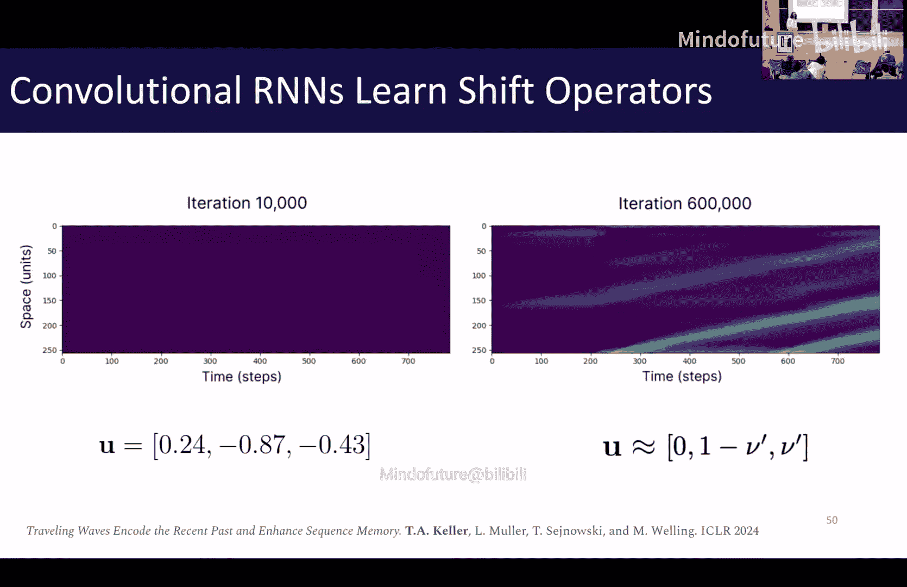

Good solution I won't say optimal but good so that's that's the integration of information part now i'm going to go into what is maybe slightly more confusing but I think exciting encoding of continuous symmetries which is still。

😊，Yeah， going to be a little bit hand wavy again， but have hopefully have some interesting results。

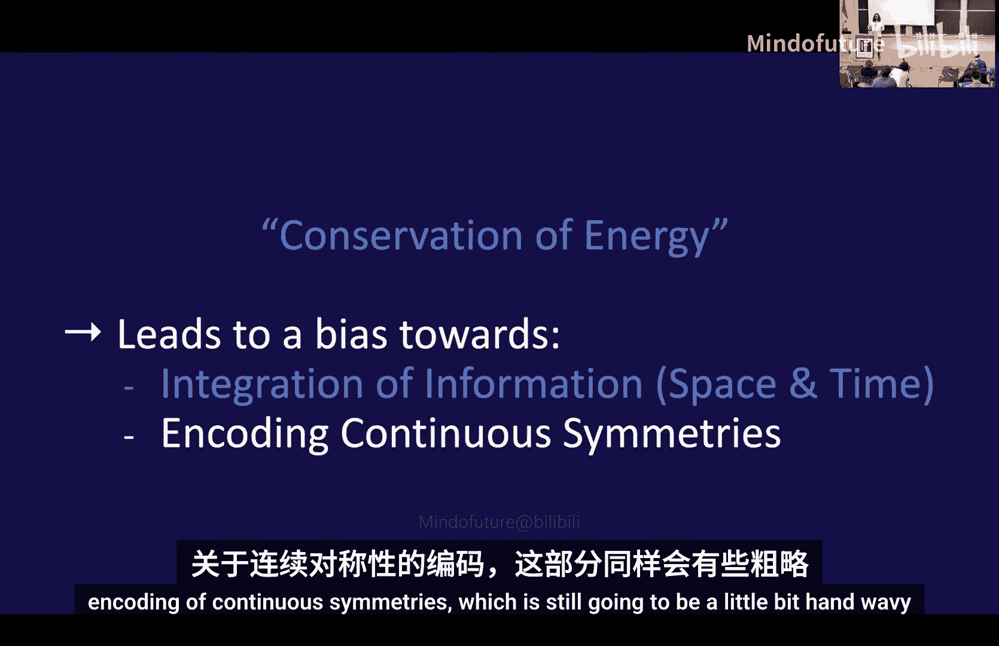

What I'm going to argue is that having these spatial temporal dynamics is potentially a bias towards encoding the symmetries of the world。

 this is a super cool paper that I mentioned at dinner last night。

 symmetry and simplicity spontaneously emerged from the algorithmic nature of evolution。

It's just cool and not super related to what I'm going to talk about right now， but the idea being。😊。

Nature has a lot of these symmetries in it。Maybe if we have a model that wants to encode nature efficiently。

 it can respect these symmetries。Maybe at a simple level why do we bother kind of thinking about symmetries in a machine learning model there's a number of papers from the lab where I did my PhD and others who are arguing that symmetries are kind of the most natural decomposition of the world into its constituent parts such as you can think of spatial position being a translation symmetry maybe color as a rotation symmetry through color space。

 the symmetries of like SO3， the rotations of an object or another symmetry and I think there's some evidence that animals even also have kind of innate biases towards some symmetrymetries and humans as well。

 so I recommend these papers if you're interested in that from the kind of machine learning representation theory side so how do we build networks that respect symmetry。

 well there's this field of machine learning called equivariant neural networks it gets relatively technical。

So I'm not going to go too much into the details， but that the basic idea for you to remember in order to make sense of。

What I'm going to show you is that。If F is your neural network and you have some transformation that's acting on your input。

 so you imagine a rotation of your input or a translation of your input。

 what I want for my function F is that it's equivalent to if I did just process the original input and then I'm doing some equivalent。

Transformation in the output space， so their F is kind of like a mapping that respects the structure of this transformation。

So the simplest example of this is convolution if I have an input image。

And I apply a transformation to it such as translation。

 so I'm shifting this F from here to the other side of the image。

 and then I apply my convolution operation。This is convolution with this little kernel I get out this little edge detector feature map up here。

 this is like a little grabor filter this is equivalent to if I had first convolved my image I get this feature map。

And then I translate the output of that right， so this is this commute commutation relation between these two things。

 these two arrows meet up over here。And so if you have this property。

 you can say my network respects this symmetry， this translation symmetry and this is super beneficial like the main this is convolutional neural networks。

 how they are data efficient parameter efficient I'm sharing the parameters of this little kernel over all of space right if I learn something over here it automatically generalizes to something that's happening at a different spatial location and so。

People have argued that this is not super biologically plausible。

 despite the fact that the original convolutional neural networks were inspired by retinaatoppy in the brain and the idea that you have kind of similar feature detectors at a bunch of spatial positions。

When I talk to people everyone says well yeah， but you can't share weights in the brain。

 I can't constrain my neurons at one location to exactly be have a exact same receptive field as they have at another location and so I think there's a variety of mechanisms that maybe could come into play to induce something like that but what I'm going to talk about here is how。

At a really high level， what is the relationship that I think between space or temporal dynamics and these types of。

Symmetry respecting models， and this is from this perspective paper that we were working on with Lyle and Terryowski and my Ph advisor。

 Max Welling， the idea being。If the world transforms slowly。

 you're observing some kind of slow continuous symmetry transformation in the world。

And your kind of hidden state is undergoing this slow continuous spatial temporal transformation。

 I say hidden state， but I guess like your neurons in your brain the activity of those neurons maybe this kind of closes this loop that I was showing you before so your input undergoes some transformation you have maybe like a little orientation hypercom or something like this and the activity is flowing around that simultaneously here is an image of some animal undergoing a some。

😊，Motion transformation， which you can think of like as symmetry， this is preserving the。

The identity of the horse despite the fact that it's changing its position and you have your activity kind of flowing in the the head and state simultaneously this is super high level conceptual sketch Okay。

 so how do we operationalize this to build something that's actually interesting in the machine learning world well we can take。

This oscillator model from before the model that I introduced the very beginning that was doing these waves to integrate information over space。

 these wavy dynamics， we're going to take the exact same thing so this is a recurrent neural network that's parameterized as a network of coupled oscillators。

You can ignore the equation， it doesn't really matter if it it's a basically a harmonic oscillator。

The second order and time derivative， and then each oscillator is coupled to all the other oscillators。

And again， we're using this convolution。 So we have the symmetry over space。

 I can turn this equation into two。Discrete time equations， so second order time。

Different equation I can turn into these two first order equations and then I can train the model so basically at every time step Z is kind of where my little how my neurons are activating and they're doing this oscillation and every time step I can decode from that Z to try and reconstruct the input at the next time step so the model is trying to do one step ahead forward prediction of the sequence that it's seeing so for example here the input is this little rotating five digit over time this gets encoded as some driving force on the hidden state。

The hidden state undergoes these wayy oscillator dynamics。

 and then at every time point I try to decode that back to reconstruct the input at one step ahead in the future。

 something like predicting the future a little bit。And so okay。

 we see we can do that for MNIS and we get cool wave dynamics in the latent state。

 but what is this really telling us so we used again。

 the method that was introduced before of taking this Hilbert transform computing the phase。

 the gradient of the phase， we can see at the beginning of training。

 the model has no sort of dynamic， no spatial temporal structure but then by the end of training in order to learn these rotation transformations。

 the waves have aligned and someone introduced this phase。

alignment or gradient alignment metric which I want to measure on this。

 but you can see very clearly the waves are all going in a single direction I'll note that we do have circular boundary conditions here so the waves are kind of on a tous。

😊，Um。And so to show to argue roughly that this is really learning something like this equivariant structure automatically。

 we can try to see if it satisfies something like a commutation relation like this so the input transformation is this rotation happening down here if I encode the initial input I get some hidden state we know what our waves look like because we figured out this kind of flow field from before so I can just take my original input。

 apply the waves and then decode and what I see is that I actually match up with what the input transformation would have been for that period of time and I can keep going so basically I can trying to show here is that。

There's kind of this homomorphism between the model has learned this homomorphism between the input transformation and the wave dynamics in the latent space。

And we see that this is for all of the digits of the MNIS data set for digits that the model was not trained on。

 these are held out， we show it these sequences， it produces a different wave pattern for each different type of input。

 and then these are able to reconstruct these sequences。

So it's like the identity is somehow encoded in the so the actual details of the specifics of the image are encoded in the wave fronts themselves。

 and then the propagation direction is encoding this rotation pattern。

We can do this on other data sets， so these are really simple。

It was called the Hamiltonian Dynamics data orbiting bodies or a bouncing ball。

 we see we get other types of interesting dynamics here in some cases it's these standing waves we can do even more complicated data sets there's a really small network so at some point the hidden state starts to not look as smooth and continuous but I still think it's really relatively interesting。

And it competes relatively。Well with kind of the state of the art sequence prediction models at doing。

 this is forward prediction on a bunch of these different sequence modeling tasks like the spring or the pendulum。

 this is our model over here， we see that we can predict 300 steps into the future relatively accurately are 150 steps and this is similar to these other models like the LSTM or neural ODE。

Okay， the last thing I'll show is something that we found that's really I thought was cool and I didn't quite know how to explain it。

 but I think it is related to the ideas at a high level this is the。The hidden state of that model。

 processing one of these rotating mnist。DidDidits again， or actually， this may have been a。

Like just a rotating kind of sinusoidal grading。And what I measured was， okay， for every neuron。

What is its selectivity with respect to different oriented graings？

After I train it to do this task of like forward prediction。

 just like a simple sequence modeling task。And what I found is that without kind of imposing anything like this。

 we get。Spatcially smooth continuous selectivity with respect to these different orientations。

 So this is how much does this neuron respond to。This line versus this line and I can measure the normalized difference of response properties between these different oriented graings so I thought that was pretty cool looks maybe very roughly similar to something like these orientation pinwheels and visual cortex have not quantified it more than that so please take it easy on me so that's a cool thing and I think a lot of people wonder when you talk about traveling waves。

In in cortex。How does it align with this idea that you have this kind of crystalline organization are these things fighting each other。

 and I think maybe we can start to think of them as being more complementary than the other way around and I think yeah some of like the modeling work that you guys are doing as well as pointing to that。

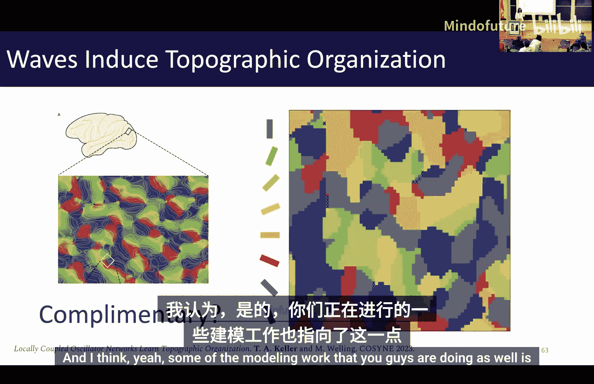

Okay， so。But I have time for one last part。Okay， the final part is a bit crazy。

 so here we are mostly talking about symmetries with respect to these kind of feet forward transformations like rotation or translation or something like that that you think of the transformation is not really changing in time。

😊，嗯。If we think about recurrent neural networks generally and especially like in an embodied setting。

 a natural setting， a common transformation is motion transformations and this is also one of the like big symmetries in physics is like symmetries with respect to inertial reference frames。

 reference frames that are moving over time so changing over time so if we think of an equivariant neural network as processing doing the same processing in different reference frames。

 so it's doing the same processing of my image， whether I'm in this reference frame or this reference frame。

Maybe the ideas of relativity and Galileile in relativity and also Einstein so that the laws of physics are the same in all inertial reference frames。

 so whether you're moving at some velocity or you're stationary because velocity is this relative quantity。

 the laws of physics are going to be the same。😊，So I wanted to see okay。

 maybe we could build a Galilean equivariant recurrent neural network or just a relativistic type of recurrent neural network where it's processing that it's doing is the same in all inertial reference frames。

 what would that mean for a recurrent neural network to have an inertial reference frame so in physics。

 an inertial reference frame you have you're given two reference frames。

 you have to define yourertial reference frame with respect to another one it's one that's moving at a constant velocity with respect to some other ones this is a little boat。

😊。

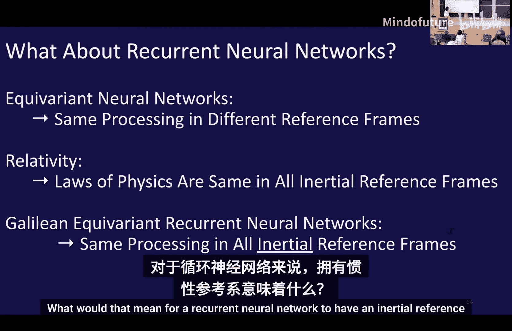

嗯。And in a recurrent neural network， what would be a inertial reference frame well if we take our hidden state H and this is a bunch of neurons here I'm drawing it continuous。

 but you can think of it as discrete as well and we lay out those neurons and we call each one of those neurons like a discretization of space So these are my hidden state neurons。

 this is the activity of those neurons and maybe so these neurons are showing a little bump of activity here what would be an inertial reference frame。

 if this is space， it would mean that we're looking at this space over okay sorry there's some time dynamics that are happening as well to this hidden state So maybe over time there's like kind of like a standing wave type of pattern that's happening on this hidden state what would be the equivalent of looking at this from an inertial reference frame it would just be seeing this thing in motion right maybe this thing is moving。

Maybe I am moving， you can't say loss is a relative quantity。

 but we know that this is kind of the transformation of this into an inertial reference frame。

Reviewed from a moving frame。So what would it mean to build a network which is equivariant with respect to this motion and I guess to give a bit of motivation first it is like we have these properties of generalization from convolutional neural network that they can automatically generalize to different spatial positions right like if something's here versus up here。

 I automatically can what I learned down here generalize this up here What I want to do is I want the same thing to happen for a recurrent neural network if I see something static and I learn how to do a task that's static if suddenly I'm moving my head or the thing is moving a little bit I want to be able to still be able to do the task I want to be able to perform the same So okay how do we formalize that in terms of equivariance if I have my input sequence and I apply this Galile and transformation that shifts my input over time。

I want this to be the same or and then I process this kind of new input sequence that's moving with my recurrent neural network。

 I want this to be the same as first just processing the static input and then shifting my hidden state right the idea being that if my input is shifting in time。

 my hidden station should also be kind of shifting in time。

Another way to say this is that my recurrent neural network should work the same in all inertial reference frames。

A simple linear RN does not have this property， so what I'm showing here in these top plots is actually the difference between those two arrows in the previous plot so if I were to plot transforming the input and then processing it versus processing and then transforming the output I'm going to get two different lines。

 these are my hidden states over time。And they should match up if it's equivari， in this case。

 they definitely don't match up。And this is a linear RNN。

 which is some random initialization processing this moving input down here。

If I build a convolutional R and you may think， okay， convolution， spatial equivariance that'll work。

 actually it doesn't quite match， it matches when the variance is relatively low and things are constant。

 then as soon as it starts to differ a little bit you see this massive separation。

 it's kind of like it's lagging behind。So how do I build something that doesn't have this property that where these things actually exactly match I'm again not going to go into the details。

 but the idea is that。Your hidden state actually needs to be moving。

 you need to apply the Galile transformation to your hidden state simultaneously as your input is moving so you have to think of it as like your neural network is in the same reference frame as the moving input so if your input is transforming but your neural network is kind of also moving simultaneously with it。

 then you're going to be processing it as if it was static so to speak。Um， where this， yeah。

 this transformation is this this Galilean transformation that I showed you before。

so this is just comparing the two things the cool thing about this。

 I guess in relation to waves is that this transformation is exactly like that advection equation that I had showed before。

 which was generating these kind of。😊，Wave trajectories and that simple RNN model。

 so this idea being if you can kind of track an input as it's moving with a moving reference frame。

 you gain this property of processing it in its reference frame and then as if it were static。Okay。

 so I'm going to show really quickly， I'm not going to show these videos anymore。

 I'm going to show these space time plots。Okay。诶。It's just a version of this that's static in space and time。

 and then if it's moving， it looks like it's shifted like this。

I train this on these really simple classification tasks。This is space。

 there's an activation here over time and it has to detect if this kind of like one column is slightly more elevated than the others。

 there's a bunch of negative examples where there's no signal it's a binary task it just has to tell me。

 is this bump here or not。And then at test time， I apply this Galileian transformation so I move the bump。

And I want to see， can it classify this still？Basically the convolutional RnN fails miserably。

 this is the difference between training and testing。

 but the move data set versus the original stationary data set。

 we see that when I move the when the input is moving a regular RNN fails miserably。

 if I have these Galilee and equivariant models that have this kind of moving reference frame they work really well and similarly on other data sets that I'm not going to go into comply it to like。

Fish tracking data sets you have these little fish that are swimming around the model has to detect these fish。

 turns out it's able to detect these fish a little bit better if I have this property of this Gallowayan equivariance built into my model。

嗯。Marginalally better。Okay， the final point， which is kind of crazy is that that was for these first order advection equation dynamics。

 so this equation。😊，The reason this works is because this equation doesn't change if I do this Galileian transformation of my coordinates。

 the equation is invariant with respect to this change of coordinates。If you use a wave equation。

 it's no longer invariant with respect to this change of coordinates。

 it's actually now this is special relativity， this equation is now only invariant with respect to a Lorentz transformation right so this is where you get the weird effects of time dilation。

 length contraction。😊，So what does that mean well it means if no dynamics do follow something like this you you might get some sort of weird perceptual effects when things start to move really fast and it turns out that this is something I'm working on now more speculatively there are some。

Pychophysics experiments where they show that people have these subjective Loren transformations in some settings。

 so that's something I'm quite interested in and maybe related to this。

 so conclusion spatial and temporal dynamics or maybe an inductive bias or integration of information over space and time。

 I think this is potentially somewhat。Not too controversial and then this is the maybe more controversial part of encoding symries in the world。

 so yeah thanks to everyone here for listening and people who contributed this work and my funding。😊。

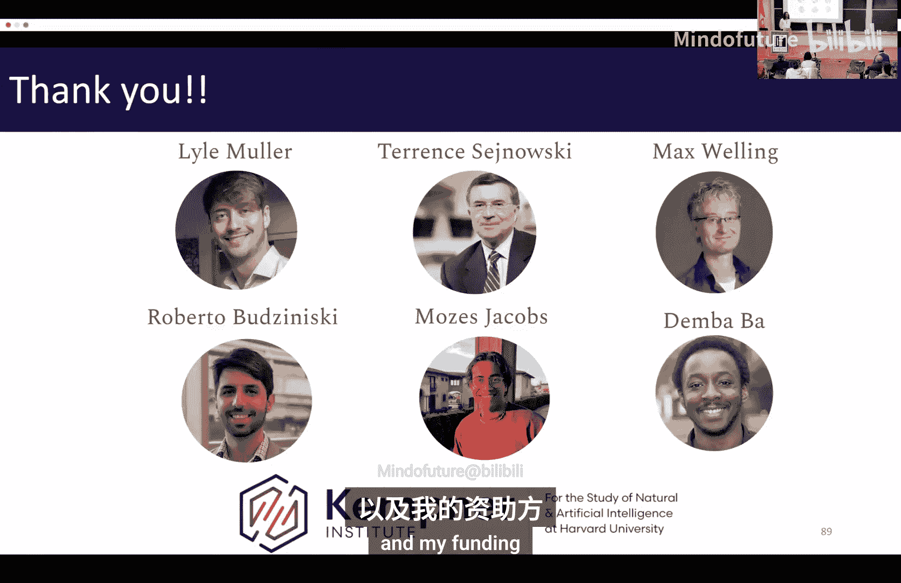