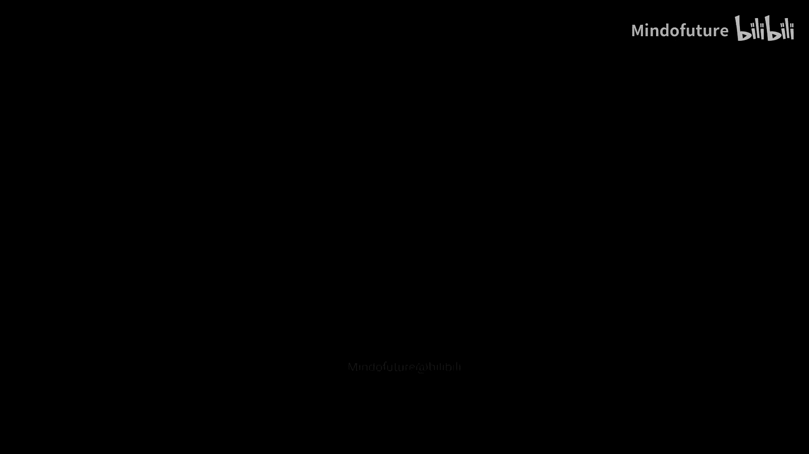
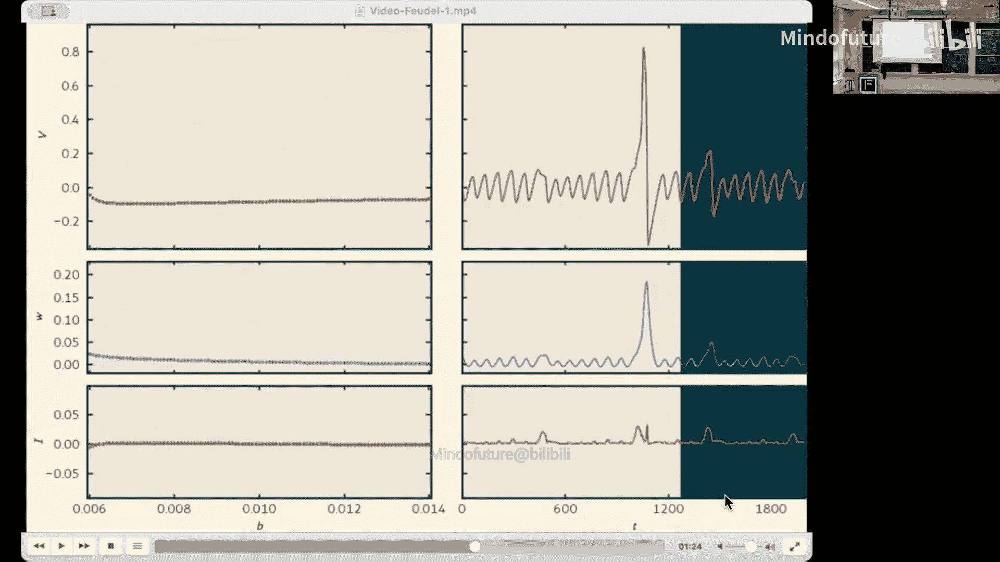
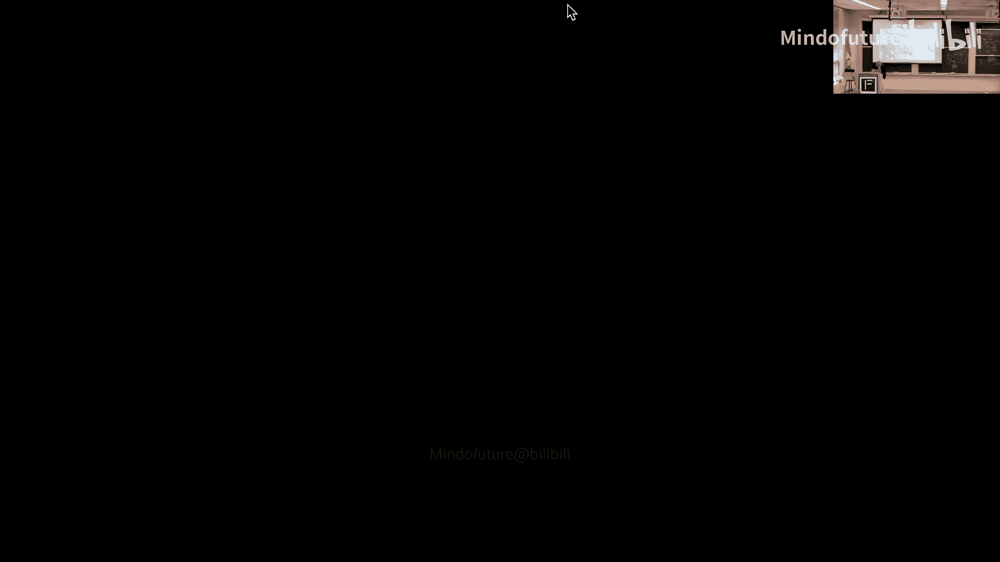
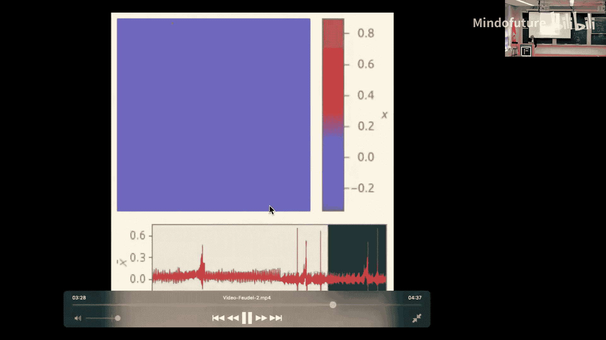
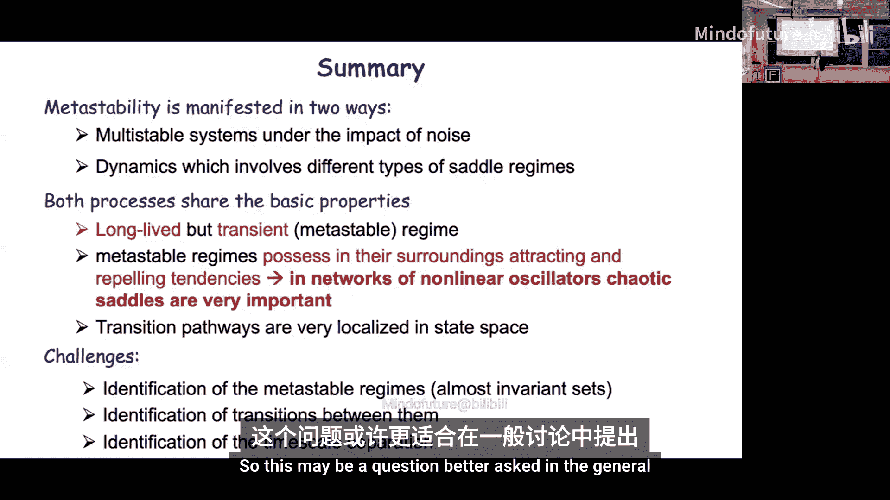

# 【菲尔兹研究所】网络科学领域实验室 ｜ Fields Lab For Network Science p05 P05_神经科学中的亚稳态与瞬态动力学 -BV1Ty6qBJEvZ_p5-

好收到。

First of all， I would like to thank the organizers for inviting me to this very interesting meeting。

 so I got already a lot of inspiration already on the first day so I hope this continues for the next days。

 and so I would like to present work so with a couple of co authors as you see including co authorss who are here in the room。

 so I'm very grateful to them so that they participated also in this work。😊。

And so I would like to talk about meta stability and transient dynamics in neuroscience。

 but since the neuroscience is going to be a little bit squeeze。

 so to say since I already noticed that I will be over time and so I'm a dynamic systems person。

 so I'm not a neuroscientist even though from time to time I work in neuroscience。

 but I'm very much inspired by dynamics in neuroscience。

 so to shape theories and construct theories in dynamic systems theory。

 so to say which can explain mechanisms how things work and we try to come up with ideas so how things can work。

And so the motivation I can in principle cut very short because it just shows us different and they are just chosen arbitrarily from the literature。

 so examples where we have meta stability or what we would like to explain as such。

 so where we have different patterns of neuronal activity so which pop up in a certain sequence and this could be either so to say EEG recordings with eyes closed where we have microstate。

 EEG microstates which pop up or we have up and down states where we have some neuronal activity for a while and then there is silence or we have patterns here of different of different。

Activity so we have here so to say spiking activity here and here we have busing activity or we have seizure like activity so which is even stimulated and gets into a completely different state for a while and so this type of dynamics which look very very different in terms so to say of the internal dynamics we would like to describe the kind of general framework so we try to to get say a common view on this type of patterns。

😊，And so this is what has been called metastability in neuroscience。

 very different things come together， so for instance。

 the variability of different activity patterns is called metast or variability of regimes so that you get to different regimes or variability in the landscape here。

 synchrony patterns， which we had just the previous talk， so as a brilliant example of this。

 so that you had variability in the synchronization state， or you go to different states。

 so to say in the brain or there is this concept of integration and segregation。

 so that different parts of the brain either work together so to say or or not。

And so you have spontaneous meta stability so that there is a spontaneous hopping between different patterns。

 but it can also be driven so by an external signal。And it can repeat or it cannot repeat。

 so you see there's a whole variety of different say understandings of what meta stability could be。

 and so we try to to now look for a common framework and this common framework so to say is basically in our definition and I completely discuss it now from a dynamic systems point of view。

😮，Is characterized by certain properties。 So we have long live。But transients made us stable regimes。

 so the system is in a certain dynamical regime， either for instance。

 in a blasting or in a tonic firing state or in more complicated states like synchronized or nons synchronized。

 cluster synchronized， completely synchronized， there are lots of different possibilities for these regimes。

And so these regimes are almost invariant， so that means you dwell on this for a certain while。

 and then you go away。😮，And what is the most important property is that these type of meta stable regimes have to be sort to say or have to possess a certain property because you have to reach them。

😡，At some point， so you come from here basically， so this is attracting this regime。

 you stay for a while and then you go away so that means this attracting and these repelling tendencies have to come together otherwise it's not made us stable so because made us stable means that it is transient and you go away again。

😮，So that means you stay here with a high probability for a long time， but then with probability one。

 you will leave at some point， even though you don't know when this point is going to be。😡，Now。

 when we look at this。So we have two different options， how to realize this thing。So on the one hand。

 so what is long known is that you have multis stabled systems subject to noise。

 what is a multis stable system a multis stable system is a system where you have different regimes。

 dynamical regimes。Quiteex。😮，This is subject to noise。

 so this is usually shown with this type of cartoon here it's only a bistable system where you have two stable states in this wells。

 but you can think of yourself sitting in the meadow look back to your childhood and you play with little balls and then all these little valleylls in the meadow will be these stable regimes and then your ball will land in one of these valleylls and then there are the unstable sets which are here in between and then you have initial conditions。

 a whole set of initial conditions which go to this valley。

And so this would be the basin of attraction of this stable regime。

 so they can be rather simple like here smooth basins of attraction so that these are lines or many faults in state space so in all the variables you have。

Or it can be fractal， so with a very complex structure where you only have around each of the stable regimes。

 you have just all initial conditions converging， but if you go a little bit away so there's no way to predict which of those states you really reach。

The second part， which is the more interesting， by the way。

 is that you have subtle type regimes with these attracting and repelling directions。

 and these could be simple setups like here so that it's points。

But it could be also something complex， and this is what I would like to discuss more in detail in the following。

So now to give you an idea， so what is happening is best to be explained。

 so when we look at the bistable system， so the ball is here。

 the yellow one but you see due to the noise it's dwelling around so you have these attracting directions because it wants to roll back into the valley belly。

 but you have also this repelling direction that the noise can you kick over the hill and then goes here and goes back to this。

😮，So this is what you get as a metaga stability， so when you have noise in a multis stable system。😊。

But the escape from this valley is also something which is not really random。

 even though it's noise and this is an argument you can read so to say in the literature so that it's questionable we we can call this meta stability because it's totally random but this is not so so because when you think about such a landscape so then of course you go over the smallest hill so you try to escape from a valley。

 this is what you would do as a hike also when you stand in the valley you look around or what is the lowest attitude I have to climb up and this is what the trajectory always doing so there are certain paths and these are called the most probable exit path so which you would go so there are certain channels of escape which you would take。

How more involved when the basins of attraction are like this？

And this is what we discuss also in this talk。😡，When you have these fractal basins of attraction。

 then you have unstable chaotic sets which are embedded in this basin boundary。

 which determine how your hopping process really happens。

And so the structure of these sets is then responsible for what you are really going to observe。😮。

But so there is， of course， so to say something I have to add。

M of fi realized in a multistable system by noise。😡。

Happens only for certain noise strengths if the noise is too large， then。😡，This is what's happening。

 so you have different attractors here， this is a mechanical system。

 and so you see the probability density of your dynamics has peaks always where the former attractors now made our stable states。

A and then if you increase the noise strength so then the ones which have the smallest basin of attraction are buried under the noise。

 Finally your mighty stability disappears and everything goes over into a diffusion in state space where you don't recognize any mighty stability anymore and then it's a purely random process。

😡，So coming back to this， this is what we would like to explain and provide mechanisms how this can happen。

 So what are the mechanisms which we could have。😡，This one we have just discussed。

 so myability would have attractors， these are invariant。😮。

And so that means once you reach an attractor， you sit there forever， if there is noise。

 you don't sit there forever， so you will leave so this attracting regime here。

 therefore it's almost invariant。😡，And then you have a whole region in state space where your trajectory will dwell。

 so because you're not localized run to this regime only， but you will always be a little bit around。

 but still sort to say recognizable where in which regime you are。😡。

Now there are other mechanisms and there is far away from being a comprehensive view here。

 so this is not all the mechanisms which we can think of。

 but so the noise we have just discussed here I have a bunch of others so which we can discuss and this is stable heteroclinic cycles。

 attractor crises， attract tractor emerging crises， there are other cr as well。

 type1 intermittency I will explain it what it is and chaotic settles to which I will pay particular attention。

Now let me give you an idea now so how it would look like so for this heteroclinic cycle so you have three regimes here in the commas and your trajectory stays in one regime hops to another one and then hops right here again。

 so it's jumping here between these three regimes and each of the regimes has certain properties so this does not need to be fixed points it can be periodic orbits it can be something chaotic so what we have here。

 so different it can be even different patterns so which you would see here basically in the commas。

 but then you have again attracting directions repelling directions so it's again the same property which we have already learned about。

So now for the attractor merg crisis， this looks very similar to the noise induced vent。

 but it's not noise， so because formally， so to say before the merging crisis。

 you have two different attractors now they start touching and the touching is mediated by an unstable periodic orbit。

And that means this unstable periodic orbit it acts like a bridge。

 so when the trajectory and the system is chaotic so that means the trajectory goes around and comes very close to this bridge once in a while and once in a while when it comes close to the bridge it has the opportunity to just jump over to the other side well here for a while comes again。

😡，At random so to say again close to the bridge hops to the other side and so on。

 so this is an tractor merging crisis in the logistic map just for you to see so that two bands of kotic attractors are touching each other and it is mediated by a periodic orbit which loses stability here in the first period doubling。

So this would be this type of behavior， there are other crises of attractors。😮，Which we could see。

 so this is basically here in the period three window of the logistic map。

 it's a so called interior crisis。😊，Before you have basically a small attractor。

 So this is this object。 here is the mediating orbit， which is going to be the mediating orbit。😮。

And then after the crisis you see a big attractor， but it consists in principle of the former chaotic attractor and a chaotic settle。

 I will explain in a moment what it is and these two merge and again this periodic orbit is the bridge between them so that means we see here immersed excursions to this huge object。

 and we will see it in a simulation。😮，Here so the yellow ball is dwelling most of the time on the green stuff。

😮，But then once in a while， so now we have to wait a little while until it's happening。

 so there is a little excursion coming up right now so but it's too short probably to see but when we end up in this one we will see it quite clearly so that this yellow dot is leaving this green set here and is then jumping over the blue set here and then going back to the green so now it's going to happen。

So now we start getting into it and now you would see now let's see where are we here。

 so the yellow dot is really jumping on this purple set here before it goes back to the green。😮。

Again， we have a bridge， so this periodic orbit， which is mediating this transition。So we have。

Other things as well， so that means we see here the next and we can also run this。

So we have here an intermittency， so there are different types I show only one。

 but the others would also work in the same way， so you have a periodic orbit here。

 so then you get to the green chaotic stuff which is right here so you dwell a while on this dynamics and then you go back again to something。

So which is periodic because now you come back to this periodic orbit and dwell in its neighborhood。

 so this happens also in the periodic window by the interior crisis which we saw previously is here。

 then the type1 intermittency is on this side， so where we would see this type of behavior。

So finally we have a boundary crisis which is also a crisis of a chaotic attractor where the chaotic attractor so in the literature is called usually that it disappears this is not true so it's not disappearing because it's still existing here but then it's of transient nature so that means it's a settle and so you will leave this settle eventually but you still see the remnant of this chaotic dynamics and this is again what we can see here in the video so we are dwelling on this object for a while。

So you see the yellow point jumping around here， but at some point it really escapes and gets to a novel solution。

 all these kind of mechanisms are well known in dynamic system theory and lead to such meta stable behavior。

😮，So when we look at these transitions， so we have a whole plethora of possible mechanisms。

 how meta of stability can occur。😡，So and so they are also characterized by the lifetime of the different structures。

 which is basically mostly exponential， so meaning that this looks like a random process。

But so what is this transient chaos so let me just say some words about it so because transient chaos and chaotic levels which we have just seen are not so known as chaotic attractors kotic attractors most of the people have of course already known about this。

 this is an irregular behavior which is characterized by by the property that additional initially neighboring initial conditions separate exponentially and so one can quantify this mathematically with La of exponents。

 they have to be positive at least the largest one。😡。

But these are settles and settles means you can reach them along their stable directions and you can leave them along their unstable directions and so you would leave them with probability one if you would put lots of initial conditions on your chaotic settle and you look how many of your trajectories pop off so and when does it happen then you would see so that there is this decay here。

 you have an exponential decay and this is the so-called escape rate。

And the object itself looks like this for a periodic panda pendulum and the stable and unstable directions look a little bit more complicated as what you would expect so to say from a subtle point。

 you know there are there is a bunch of trajectories coming there and going back in a twodimensal system it's just two which go there just two which go away。

 but of course in the chaotic motion so this looks a little bit more involved。

 so this is the stable direction， this is the unstable direction and the overla of the two is the chaotic settle this is this yellow thing which is plotted here once again。

So chaotic settles are quite common， so this is a very common object。😮，in。Tyna systems。

 it happens beyond the boundary crisis。 As I already mentioned， it happens in periodic windows。

 either in period doubling or period adding cascades or it happens embedded in the basin boundaries when the basin boundaries become fractal。

 So these are large classes of systems， and therefore we have to expect that these kind of things happen in high dimensional systems。

 And if we think about so to say。We wrong our networks， so then we have high dimensional systems。

And we have ocillatory behavior。 And now， let me show you the role of these chaotic settles。

 So in meta stability。 So for networks of。Exciitable and oscillatory units。

 so which are described by the Fitzsunakumo equations。

 so which is a very oversimplified of excitability， very oversimplified model of excitability。

 so excitable means that you have an excitatory variable which grows so to say suddenly and then there is an inhibitory variable which grows also and finally kills the excitation。

😊，Now let's have a look at the network of these kind of things。

 and before doing so we look at two of them carpet。😡，And this is what's happened。

So for certain coupling strengths， you see only low amplitude oscillations。

 so these two is excitable or say oscillatory units because they are in a regime of oscillations here。

 so they suppress each other and we have some small amplitude oscillations。

Once in a while when you increase the coupling， something totally different happens。

 so we see this type of extreme events， so self generated and terminated events。

 we to say in synchrony， the two oscillators do the same and form such an extreme event。

And how it happens， so what's the distribution of those and what's the waiting time between them？😡。

This is also something which is exponential， and it's also a pois process。 So it'， again。

 looks like random， even though it's completely dataministic。Now how does it work？😮。

So we look at one in more detail。😮，And then we see our two oscillators and it looks like these are two friends talking with each other and one wants to go in the pub and the other doesn't and so the one which goes to the pub is the right one so it shoots off and it's pulling the other one so to say behind and say come with me so and then they form this kind of event here so which is this kind of extreme event。

😡，So how does it happen is when we look at the mechanism。

 how this goes is that we have a chaotic motion here with low amplitude。😮。

But then so to say the transition to this extreme event is also not random so there is a channel like structure which pops up here。

 so where one of the trajectory goes the other one is pulled behind and then together they form this event so this reminds us to the stochastic system in the stochastic system we had also we have to go over the lowest hill。

😡，Here we have to get into the channel， therefore it's rare that you hit the channel but it's also recurrent because when you come in here。

 so you dwell around here and with probability one at some point in time so you will reach the channel and then you develop another extreme event。

 so it looks like if you play this type of game so you have to get the real right so to say direction to go into this channel and form this extreme event。

😡，So this is how it looks like for a network。😮，So where we have exactly this extreme events for a complete network which is heterogeneous in frequency so these nodes but fully connected。

 and again we see the type of behavior which we just which we just saw and this type of behavior happens when an interior crisis which we just saw。

 so to say a little earlier has happened where a period adding and a period doubling cascade come together and this is a situation which is a neuroscience very often。

 so I know a lot of neuron models which do that that you come with a period doubling cascade from one site with a period adding cascade from another side and then。

😊，This type of behavior can be expected。Now， let's get。呃 to。Video， wait a second。

 I have to stop you here。And I want to show you this。😮，No， I'm。嗯。

So how it happens for the whole network， let's play this。😮，And so you see， no， you don't see。

Yeah yeah yeah， yeah， I know I know， but so now I have even stopped it。I should take my classes。

 this is probably if I want to see this without glasses， it's dangerous。So。Because then I don't see。

What I'm doing。And I share my screen again。And you should see that no。So why it's not showing？

I have to go to the full screen。嗯嗯。Maybe we can share it like this。So， okay。

So it has not happened yet， so we have still time。So there is some event so which we just saw。

 So we have this kind this。Oscillators here wanted to go off， but it was not strong enough。

 so not everybody else comes along， so but there will be as we see very soon here。

 so to say this extreme event where also now sufficiently oscillators together start so to say taking off now this should happen in the next route。

😡，And so。Here we are。And then they pull。Everybody else。To get to this extreme event。😡，So okay。

 so we can stop this here now。And。Go back to the presentation。

Wait。老嗯了。I have to stop again， and。Good there aunt。嗯嗯嗯。Wait， wait， wait。And。Share it again。

Yeah。So now let's get a little bit more involved again。😊，Now we change our topology in the network。😡。

So again， we start here now with with a square letters， basically。

 but now we go to what is called a small network， So where we have。The majority。

 so to say next neighbor coupling or a coupling radio say around each of the nodes。

 so this is just a bunch of excitable units or oscillatory units which are coupled and then we exchange some of the connections with long range connections now something completely different is happening。

And we will see this again in a video。

So we see waves and now you will see， so to say there is something happening right here。

So watch out so there it looks like an extreme event， but it's too small。

 so we will see that the waves are interrupted by something which is like like a flash and then the waves come back and then we will speed it up now。

😮，So just by going here， so this is all waves， waves， waves， so now we go here。😮。

So now you will see there is a transition to something else。So it's coming。

 so we still see the waves。😮，Now there are no waves any further， but now we see another pattern。

 so what we see is clusters of oscillatory units coming together。😡，So firing together。😮。

And then disappearing again and these are always different clusters sometimes so they look a little bit the same。

 but mostly so this is something else， but now we see some extreme events that means there is a huge event so we are almost all network so to say is flushing but then we have a little so we have a little spell spell span of waves now we go back to these clusters coming up and then there will be another extreme event coming here so we will see another so to say flash of now so of。

Activity on so on， this I could we could see forever for to say， so if we want to。

 but we don't want to， so we want to go back to the。

APresentation。So but this is what we see， so this is what we have seen。😡。

And so when we look at the dynamics of this thing， then this is transient。So we have so in principle。

 we have three attractors in this system， so these low amplitude oscillations。

 these traveling waves and this global oscillations where it's basically sort of say extreme events all over the place all the time。

 so to say we have boat。And so when we now look at the dynamics once again sort of say as a still phase。

 so then we see this kind of relationship so these are now sort of say still pictures of the movie so we have wave structures we have these little clusters which are not very nicely seen but then we have hear these extreme events and so they go and of course when we want to analyze the transient dynamics so what are the times how long we dwell what are the waiting times before we go to the next patterns so then we have to classify these structures and so there are different types of classifications so we can either do it with theov exponents。

So instantaneous La of exponents， which measure also to say the exponential divergence so that we have a very different pattern when it's waves。

 very different pattern when it's these kind of clusters popping up and also for the extreme events。

also do another kind of classification so extreme events of course have to cross a threshold here。

 so this is something we could see then we can classify waves and low amplitude oscillations to get a real good statistics and when we look at the statistics of the whole thing so then what we see here that basically the waiting times and the durations at least for the ones where we have a good statistics because。

😊，Extreme events， what we have already heard are rare so therefore the statistics is horrible so we cannot really say something for the waiting times it's okay but for durations of course since they are short。

 but there could be also clusters of extreme events so here。😡，But we see again this random process。

 so we see that this type of switching， even though it's completely datatinistic so in terms of the dynamics it appears random。

 so you see the same as if you would think noise is here in place but no。

 so it's purely datatinistic but we still get from one direction to the other and now we look at this in parameter space。

😡，So here are the different attractors we see sometimes it's bistable so to say so this is 100% of all the simulations we have done and then these are the percentages。

 how often we end up with which attractor but in the yellow and this is the most important part in the yellow part。

 this is the parameter here is the revivring rate， so that means it tells us how many long range connections do we have。

So at this point， so to say we don't have any and here also to say when we go further and further。

 we come to a completely random network。And there is a certain interval。😊，So we are。

 first of all the convergence to any attractor is very rare。

 so we have very long transients and we have a large interval where also to say this long hopping process between the different patterns and this is an irregular switching between those patterns happens。

We can also change the heterogeneity in the network and the same picture。

 so to say here we have also two big intervals where this type of pattern switching happens。

And the whole thing， yeah。So iss for the oscillators and this is one parameter in the fits of nauma which determines the frequency。

😊，So， and this is the backbone of the whole thing。 So this is a chaotic set。 It's a chaotic set。

 which is unstable and which comprises three different patternsals。 We are on this chaotic settle。

 We are moving between the different spacetime patterns without。😊。

Stims from outside so there is no noise， there is no stimulus and this is a purely deterministic process which enables through switching so we can get to the different patterns in this cha。

 etc cea。😊，And now let us look at the transitions。😡。

So we have seen already in two coupled units there was this channel like structure for which we have to go that we develop this kind of extreme event and we see here the same type of behavior even for so to say for the different transitions from low amplitude to waves from low amplitude to extreme events so this is what we had already seen here it's not so pronounced that it's really a narrow channel what we see but here again when we come from the extreme events into either low amplitude oscillations or。

😡，Wave flight structures， we see this type of behavior so that we have a certain channel for which we have to go。

 otherwise there's no transition。And this is sort to say a cartoon picture how it happens and the decisive quantity here and we see that in largege now。

 so is the set point here， which is in the middle of this low amplitude oscillations so this is a settle and its manyifolds it organizing the dynamics so if you go on one side of the manifold you go to the waves from extreme events if you go on the other side of the set point you go to low amplitude oscillations。

 so that means the dynamics is completely organized by unstable sets。

 so the unstable set which is the set point and the unstable set which is basically this chaotic settle they organize the whole meta stable behavior in this type of system。

So let's have for the last couple of minutes a look。At another chaotic settle。And another dynamics。

 again， fitsuk Nagumo。Yes， of course。So you get to the extreme events through this satellite this channel like structure here。

 so which we have which we have shown already in the in one of the previous slides so where you go through this low amplitude oscillations and then you enter this type of channel and then you go to the extreme events it's here the same thing。

 you can even measure also to say with probabilities the size these of these holes。

And so and what I forgot to mention is these holes are not always there。

 so they are opened when you change parameters， so the location of the stable and unstable manifold is moving in state space and they make a room so to say for the hall to appear so where the trajectory can go through。

Yeah。Soability of the Delta B call。Sorry， once again， please for both you would see that yeah。

So let's have a quick look。😮，At a homogeneous network now we had a heterogeneous now we look at the homogeneous and one cannot even say network because we never considered networks here。

 but we could， so but it's identical node。😡，And so but they have a heterogeneous couplingutling in a way that we have two different delays here。

 so which connect the two。And then so to say， we again see a type of meta stable behavior which I would like to explain to you。

 so because now we have identical oscillators， identical oscillators are capable of synchronizing completely。

😡，So that means you would have for a low coupling， so to say with a second delay。

 so you would have only in phase oscillations in the synchronization manifold。😮。

And for very large coupling strength with the second delay。

 you have only out of face oscillations which are out of the synchronization manifold。

 so you are jumping off。😊，But in the middle。You have a wonderful meta stable dynamics where you switch between so in phase and out of phase oscillations you have both types。

 so your trajectory is going somewhere in the so to say in the synchronization manifold。

 then it hops out， makes an event so which is。😊，U of phase。

 come back to this synchronization manifold because here the small amplitude oscillation lies in this and so this type of dynamics。

😊，So here it is once again shown as a time series just to see red and blue are the different in face and out of face just for you to see that this is also a chaotic dynamics。

 which we see。And we have， again， this random process of inter eventt intervals。

 so the waiting times， again， a random process， seemingly random process。

 though everything is completely dataministic。And here's the dynamics。 So this is what's happening。

 This is the mechanism， which is now at work。So if we have this low coupling strength for the second delay。

 so the synchronization manifold is attracting so everything goes attracted to this and we are here in mixed mode oscillations even so this is not even chaotic。

 so we have mixed mode oscillations， but then there is what is called a bubbling transition and the bubbling transition has the properties so that it leads to certain unstable。

😊，Points or say regions， regimes， I should say， in the synchronization manifold which are transverly unstable。

 so the trajectory finds again the whole to escape。

So what it does is so to say we have still the synchronization manifold attracting so that means we have a chaotic attractor here so in the long term limit we would end up here。

 but so there is a chaotic settle here and there is a mechanism as we said。

So that we come close to this unstable regime here， we are ejected， dwell outside and get back。

And if there is a blowout bifurcation coming with another critical transition here for the time delay。

 so then this thing here becomes transversly unstable so it's a chaotic settle。

 but so this thing becomes a chaotic attractor but still comes close to the synchronization manifold so that it looks like a remnant of the stable solution。

 the synchronized stable solution as we had previously but it's not stable anymore so we will not reach we come only close and then we go so to say again in this outof face oscillation state here。

 so it's only close so to say when we are here close to this low amplitude oscillations which are part of the dynamics so that means we have also a kind of loop here。

Because this is what is called in out intermittency。

 so that means you go close to the synchronization manifold along one orbit， so this is this one。

 then you dwell in the synchronization manifold to another orbit which ejects you again。

 so to say to the outside world out of the synchronization manifold and this is also a process which you can have for very。

 very long time， the transients are extremely long sometimes much longer than your integration time so you would never see that it ends basically。

😡，If you're not integrating long enough。😡，And so associated with this type of behavior is also that you have even worse basins of attraction than the ones we have seen previously。

 so we have fractal basins of attraction where you still have these open sets where everything converges。

😡，But you have also what is called ri basins of attractions where in any arbitrary small neighborhood and let me show this basin along so that it is visible so because this is the basin of attraction of the attractionor in the synchronization manifold and so they are in any arbitrarily small neighborhood of the attractor there is a point of another basin of attraction where you can be kicked out and this is again so to say a situation which leads to this type of which leads to this type of meta stable dynamics so this brings me to the end of my talk。

And so what I have shown here is that so there are two mechanisms。😮。

So which can go or can be identified as metata stability。

 one of them is that we have a mighty stable system where different stable regimes co exist。

 which become， of course metata stable when noise is in place。But then we have also these dynamics。

 which I just showed where different subtle regimes， So to say， play a role in nating the whole。

The whole meta stable dynamics， so which has improved processes， so to say。

The noise and the subtle type behavior， so both share the same properties so because they are long lived。

 they are transient。😮，So then they possess， as we saw indoorward surroundings attracting and propelling tenencies so this is very important and this is for both is this true so both have this kind of property。

😮，But these chaotic settles in high dimensional systems are of。

Very high importance because the higher the dimension of your system。

 larger the probability that you have chaotic settles which are embedded in the basin boundaries。

 that means so this is a mechanism which in highly multis stabletable systems we have always to take into account。

 but also so even in systems， where so we have networks where the single unit would not process the chaotic settle。

 but the network root。And the transitions we have shown also in both cases are very localized in state space so you have always this type of channels so for which the trajectory goes so that means it's not just random where you jump off but there are certain parts of state space which which seem to play a very important role we identify those this is of course a challenge and not only that so the challenges of course how we identify this meta-s stable regimes so there are methods of course available so we have seen some in the previous thought already which have been mentioned there are others also so how you can identify them and you can identify the transitions between them what I was not talking about but which is of probably equal importance is timescale separation particularly in neuroscience so because what you have is that different processes。

The electrical ones are fast and the chemical ones are slow and this timescale separation plays a very important role probably for the transitions。

 so we have just recently shown that so that the noise inducedd transition of in the fitu naummo system depending on the timescale separation is not going over the saddle point anymore。

 so because the timescale separation pushes the system away from the saddle point and that means all transitions which I have described previously are now again question level whether this would happen if we increase the timescale separation in our systems which would be again very important in neuroscience。

 but this is something we want to tackle in the future with this， thank you very much。😊，きた。

So this may be a question better asked in the general。

