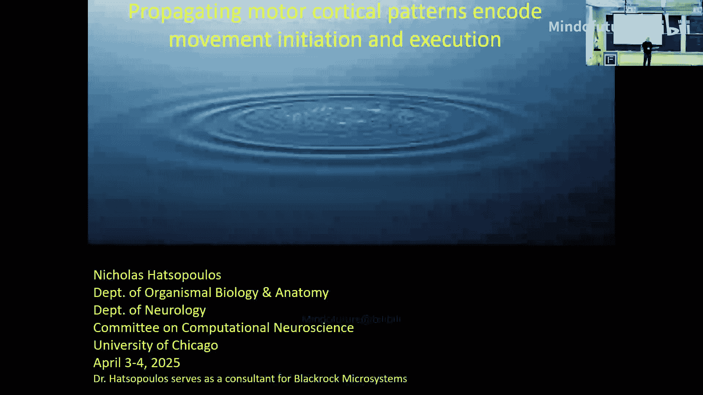
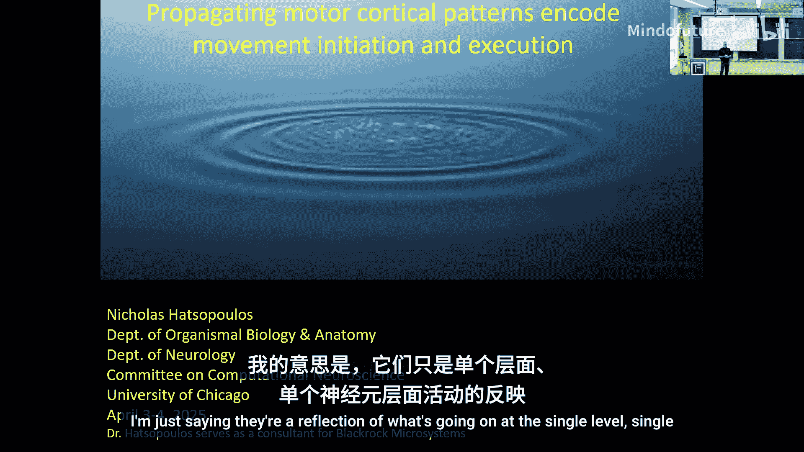
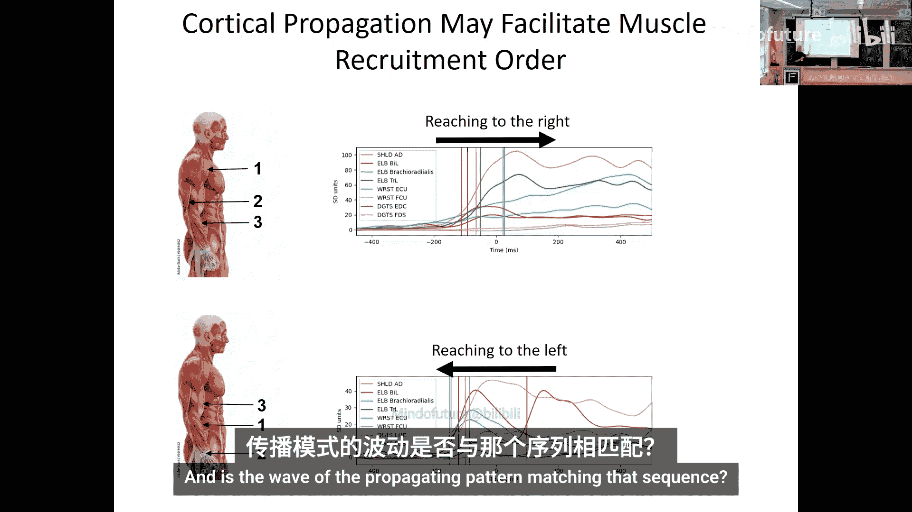

# 【菲尔兹研究所】网络科学领域实验室 ｜ Fields Lab For Network Science p08 P08_传播运动皮层模式编码运动的起始与执行 -BV1Ty6qBJEvZ_p8-

Thank you for inviting me， it's great to be in the 51st state。

But it's just a joke。I just。I want Canada to remain sovereign forever。It's just a joke。

 I'm really upset about the situation。In America these days。

So today what I'm going to talk about is propagating patterns of activity across the motor cortex that might signal information about movement initiation and movement execution。

And I want to start， well， first of all， I think you asked a really interesting question last time and about this idea that there might be。

Influences of these waves back onto neurons I think that you who asked that and and I agree with John that I don't believe that's the case I think these waves are reflection of what's happening at this neuronal level at the single neuronal level they don't sort of turn back although you know I respect Earl Miller at MIT I think he's doing very interesting work but I don't think there's any evidence yet if there is evidence in the future I'm open to it but right now I don't believe that so when I talk about waves or propagating patterns。

Well， certainly some of them， I'm just saying they're a reflection of what's going on at the single neuron level。

Okay， I'm going to start with this famous map actually from a famous Canadian。

 the Penfield map that many of you may know about。And。And this becomes kind of important because it。

I't get rid of that。This is important because。It's relevant to the spatial patterns that we're seeing in the cortex or it actually motivated me to look for spatial patterns so you have this crude map。

啊。I guess okay， the pointer doesn't work， but basically going from the leg。

 which is the most so this is a cross section of the cortex。

That's the human brain through the motor cortex， you've got a representation of the legs， the hand。

 arm， the face。And including the tongue。And。And this was mapped out many years ago。

 it's been replicated many times and it's generally true at the gross level， though。

 but at the finer level not it's misleading and in fact， Penfield never made this claim。Oh， great。

 thank you。Pent it turns out it's misleading because it makes you think that there's like a little thumb area right there。

 there's an index finger area and so forth and a wrist area。And so forth， that is not true actually。

 there is not a one specific area within the arm hand area。

 which is the area that I focus on the upper limb。It's likely not true for the leg as well。

And I also study the orac system。Different parts of the mouth， the lips， the tongue。

 you do not find specific zones for different body parts at that finer scale at the growth scale it's accurate。

At the final scale it isn't。When we are looking within this sort of this localized area。

 the arm hand area。It's kind of a mess， you kind of see what you see is that is highly distributed representations for example。

 a thumb is represented in many locations in the arm hand area。

 the wrist also and they're sort of intermingled so there doesn't seem to be any spatial structure。

And so I was like， well。You know， I'm envious of the visual people。

 people in the visual system or in the somato sensory system for。By the way。

 there is a somatotopic map in the somato sensory system。

 which is much more crystal and then very clear there is a thumb area， an index finger area。

 a wrist area。But that's a sensory cortex in the motor cortex， it seems to be。

kindind of organizing a way that doesn't make sense or is highly， it's just it appears random。

 so that kind of motivated me to look for spatial patterns and in fact we did find that。😡。

So actually， before I go on， I should also note that。If you look。

 these are array recordings using Utah arrays， the same arrays that John mentioned。Yeah。

Two of them implanted in the motor area， the arm hand area of motor cortex， this is the central scus。

This is the front of the brain， this is the back of the brain。

 so right behind this central sulcus is the somatoensory cortex。Now there is。Just so I don't make it。

 there is some spatial structure。So if you look here。In the more medial part。

 you do see representation， this is based on stimulation， electrical stimulation。

 microelectical stimulation of single sites， you tend to see more representations of the shoulder and elbow more medialy and then as you go more laterally you see representations of the wrist and the fingers。

So there seems to be proximal to distal gradient of representation， but again， there is not a。

Thumb area， a wrist area， it's distributed and not localized。Okay。

 so so besides this crude static amount of topic， is there any other former spatial temporal structure in motor cortex so over 20 years ago oh not over almost 20 years ago we found these find evidence of propagating waves that propagate across the motor cortex and this is one rendition it's smooth to make it look nice。

 it's measured with a local field potential。😡，And unlike in MT。

 there is this very prominent oscillation in motor cortex of the beta oscillation between somewhere between 15 and 35 hertz。

And so these waves are mediated by these oscillations that we see。

In the motor cortex and if you look and because。There there's evidence of different kinds of wave patterns in the motor cortex since the work that we did。

 but we've been focusing mainly on planar waves， waves that propagate in terms of a plane in a single direction。

Part of the motivation for that is that's frequently observed。

 it's probably the most observed type of wave we see。It's also。

It seemed like a good approximation for the given the size of the array relative to the motor cortex size。

 you know， like unlike。know，MT in the Marmot， which is， you know the array covers the entire area。

 in the case of these arrays， they only cover a fraction of the entire area。

 so sort of a local approximation of these patterns would be a plane or a single direction。

So if you look。This is now the central sus right here， if you look。And this towards the front。

 so these are now， this is the front of the brain， the back of the brain is here。

These are the directions of propagation that we saw in four different monkeys。Color coded。

 and they tend to propagate in one of two directions， either rostrally or coly。Interestingly enough。

 we also implanted arrays。In another structure called the dorsal pre motor cortex。

 this is an area that's involved in the early planning of movement。

And not and less intimately involved in the actual execution of the movement， and we also see waves。

 but now they're oriented。In the medialateral direction。

 so if you now consider the entire area encompassing both motor and pre motor。

 then you do see something that may be more complex。You know， although we haven't studied this yet。

 you know， one could argue that the waves are propagating you know。

 this way and then changing direction and so they're not just a single plane。

 single sort of direction。So they made me more complex at a larger scale。

 which is also something you brought up I think and that's something that's super interesting you this larger scale by the way these are McCag monkeys right so I would like to do some of these experiments in the marmas set where you have a smaller brain record from larger a larger fraction of the brain。

嗯。In the Marmoet。Okay， so I'm not going to talk any more about these waves because。For many years。

 we were trying to figure out what these ways actually， what function they may serve。

And we just couldn't find any anything that linked these waves that we see these propagating waves of going Rostrtro Caddle。

 any link between these waves and behavior。And maybe there is something there and it's ripe for investigation。

 but we were struggling with trying to find what what function it might play。

 so we investigated some other propagating patterns that are related to these waves。

And the first question we wanted to address is。And we found evidence for if propagating patterns that might explain this question how come movement doesn't occur during motor preparation or action observation。

 so when you prepare to make a movement，嗯m。You're sitting there in our experiments with monkeys。

 they're sitting their armies。Sitting on a toollink exosal robot with their hand on a handle。

 they see a cursor that they're controlling and the cursor is at some center of the screen theyre then presented with a target that they have to reach for。

But they're given we design the experiment so that there's a period of preparation where they have to sit there。

They're given the visual cue， they're told where they're going to go in the future， but wait until。

The target starts blinking and then initiate the movement。And of course， it's hard， you know。

 it takes。Months to train the monkey because of course the monkey associates hitting the target with juice with a reward now you're telling them no。

 you need to wait。And so during that waiting time， there's presumably preparation to move and so we have that preparatory activity。

If you record for motor cortex， you see activity during this preparation activity。

 preparation period， so how come the monkey doesn't move because we know the motor cortex sends projections down the cortical spinal tract that inte them ultimately inte the muscles。

 so how come。You activate the motor cortex， but you don't move。That was the question。

 one of the questions we wanted to address。And sorry， I'm getting confused with Mike。So similarly。

 you actually see activation in motor cortex when monkeys。And for that matter of humans as well。

 observe movements， actions。So this is a study by Dennis。

 former graduate student of mine Dennis Catch， where he had monkeys make reaching movements。

But then he we played back the videos， the movies， the actions the monkey had just performed on the computer screen。

 so they basically see a cursor moving to targets， but they're just watching it passively。

And interestingly enough， we saw that in many cells。嗯。Very similar modulation。

 like the cells will respond in very similar ways when they actively made the movements versus when they observed the same movements。

So again that begs the question， okay， during action observation。

 how come you actually don't move because we actually train these monkeys to just passively watch the screen。

 not make any our movements， how can they do that？Yeah， yes。Do you have。In different experiments。

 sometimes we vary it， so we have a random period from one second to 1。5 seconds。

And that varies from trial as trial。Sometimes we keep it fixed。But the question yes， well， they do。

 yeah， they do predict， they do predict the timing of the go if you have a fixed delay， that is true。

And they。And so in that case， there， well， their reaction times would be very fast because it'll say。

 oh okay， I know when the when the gocu is going to come on。

 I start moving and the reaction times are faster than normal。

 typically monkeys with a random interval。Or even without an instruction just。See a target。

 make a movement typical reaction times are around 300 350 milliseconds。If it's predictable。

 their reaction times are going to be faster。Okay， so。

What explains this phenomenon that you activate the motor cortex either when you plan or when you observe movement but that you don't actually move so there are different hypotheses one is a gating hypothesis。

😡，That was proposed by Bullock and Grosberg many years ago saying there's something that gates the signals coming from the motor cortex that gates the signals arriving at the spinal cord to drive the muscles。

Some sort of off switch。Or gate。😡，Another one。Hypothesis is a threshold hypothesis well。

 maybe these cells are activated， but they're not activated quite as strongly and that in fact。

 we do see that typically cells when they。When you're preparing or when you're observing action。

 they don't fire quite as strongly as when you're executing a movement。

 so maybe the cells are activated， but they haven't reached a threshold for actually triggering a movement。

 so downstream there may be some nonlinearity that hasn't been reached to execute to initiate the movement。

Another hypothesis is this hypothesis by my colleague Matt Kaufman， the null space hypothesis。

 and this is the idea that well， you have this high dimensional neural state space。

You know millions of neurons active， there are dimensions or subspaces in that multidimensional space that don't actually lead to movement and so during preparation you're sort of in the null space of the matrix that projects from neurons to movement if the neurons neural activity meandering through this null space of that matrix。

 you can see activity but no movement is generated。Does you all buried。

Interesting and plausible ideas， but we had another idea。

I think one thing that's missing from all these solutions is。

Another an observation we saw is this idea of deynchronization of local oscillatory activity。

So I mentioned to you about the beta oscillation。The beta oscillation is prominent oscillation。

 you can actually see it。Right here。嗯。So this is a raw local field potential trace。On one trial。

Where zero is when the instruction queue comes on for the where the animal is given the target to reach for。

 there's now a preparatory period here until a go cue happens right here。

And then the movement happens。In this solid line。And you can see particularly during。

This preparatory period， these very strong kind of saw tooth patterns。

 those are the beit oscillations。And these are the oscillations that mediate these waves。

 I mentioned a few slides ago。And if you band pass filters of the signal within that narrow band of the beta。

 you see them very prominently。So they're very prominent and high amplitude during preparation。

What's interesting， though， is。After the goQ。They started attenuating。They're still present。

But they're highly attenuated。And in fact， the waves that we see。Are still present during movement。

But they're just the signals are very weak。嗯。So here's another way to represent it if you look at the power spectrogram。

Of many channels。In the motortor court to externality instructorstructive delay here。

 this is when the instruction queue comes on， if you see very strong be oscillatory power。

It might weaken a little bit， but still present there。Until now during the movement period。

 this is when movement begins。The goQ has happened somewhere before that。

 not clear when maybe out here。The GoQ happens， then the beta amplitude attenuates。

And it remains attenuated until the end of the movement， and then it comes back on。Okay。

So that we're not the first to show this， this has been shown for decades and it was actually shown in humans way very early soon after the discovery of EEG。

So that's nothing really that new。What's new though， oh， actually， before I get to that。

If you look at the timing at which this attenuation occurs。

The timing tells you something is time locked to the movement initiation。So right here。

 what we did here was。We took different groups of trials based on the reaction time。

These were trials that where you had very short reaction times。

And the yellow ones are trials that were had longer reaction times， and you can see that。

The timing at which the beta power attenuates varies systematically with the reaction time。😡。

If you now align these attenuations to movement onset， they're all aligned。

So they the beta attenuates consistently at some time delay before movement onset and that's shown right in this red line。

 so a fixed time before the movement begins。So the attenuation of the beta might be a signal。😡。

For movement initiation。Okay， so that's。Relatively。

 no one would dispute this and it's sort of been documented in the literature。Before us。

What does this attenuation represent？So these oscillations are occurring， then they shut off。

 they tend to wait some evidence from inhu。Studies using transcranial magnetic stimulation。

They would deliver non invasiveively stimulation over the motor cortex。And。And then at different。

When the oscillatory power varied in the beta frequency the in the different frequency ranges and they found that。

嗯。In。In the beta frequency range， you saw a negative correlation。Between。The beta power。

 the power in the beta frequency range and the evoke potentials evoke by TMS。

 meaning when the beta was strong， the TMS。😡，Evoke potentials were small and vice versa。

The beta power was small， the evoke potentials were large。So that suggested to me。

 at least that maybe these attenuation phenomenon reflects the sort of excitability of motor cortex。

So you're sitting along preparing to move， you're at a low excitability state。

And then the GoQ comes on， something happens in the network and switches you to a high excitability state。

Resulting in attenu low amplitude beta oscillations。Yeah。Okay， so。As you。I think John showed。

Some examples of single trial data in the oscillations， they're kind of a mess。And if you look。

Although I did show you。Let's if I go back。Sorry。Here's a single trial。

This is a particularly good example， and you take you could compute the amplitude of this signal。

And and look at when the timing occurs， but generally they they're noisy。

 so we had to find a way to dennoise the signals。So this former postdoc of myth fellow Burmanian use an auto encoder。

To clean up the signals on single trials。And what I'm showing you right here is。

Across different electrodes， each color is a different electrode， the amplitude of the beta。😡。

The beta signal， beta envelope。On a single trial。And if you look。The red electrode。

 which is shown here， attenuates a little later in the blue electrode which is over here。

 if you now map the attenuation times on the electrode grid， you can see a propagating pattern。😡。

It's not that like the entire cortex attenuates at the same time synchronously。

 but rather you see a systematic。Progression of attenuation beginning with these electrodes and progressing to those electrodes。

This is on a single trial on a different trial， this is now a separate trial。

 you see the opposite pattern。These electrodes attenuate first， followed by these electrodes。Okay。

 so this is something novel that we discovered， which is。The entire cortex doesn't just。

The oscillations just don't attenuate synchronously， but show this。Proagating pattern。Okay。

And in fact， if you look at many， many trials and build a circular histogram。

 you can see how most of them propagate in one of two directions and completely opposite directions。

And it turns out this。Is roughly comparable to the directionality that we see with the beta waves。😡。

It're going roughly rostrll， not exactly， but approximately one direction is in the more rostrll direction。

 the other one is in the more caral direction。And very few examples of attenuation patterns。

 propagating patterns in the orthogonal direction。And this is what we saw in all our monkeys now what we sometimes we saw some subtle differences。

 for example， one direction was predominant， the second direction was much weaker。

 many fewer examples， but we always saw this sort of bimodal distribution of propagation。

So I'm getting confused with these。Okay， so。That's interesting and an analogy I like to make is and may be the wrong analogy。

 but you can imagine。The motor cortex。Sitting idly while you're preparing to move。

 right and you' you're。Imagine you're in a car with a clutch。

So you have these clutches that are down。You're pushing down on the clutch， your engine is revving。

 but it's actually not moving。And then you release the clutch to engage the engine。And so the cortex。

 the attenuation of the beta is like a clutch being released。😡。

And so you basically have a series of these clutches that are being released in us a sequential manner。

 that's the way I like to think about it。嗯。Okay， so。

Can we provide causal evidence that these propagating patterns of attenuation or excitability is a necessary component for movement initiation？

so we saw this。Phenomeon during movement initiation， it happens on every trial。

But do we have any causal evidence that it may be playing a role。

 so what we did was we designed an experiment where we electrically stimulated。

But not on the same electrode array， but stimulated with patterns of electrical stimulation。So。

Imagine。On a given trial。You have an attenuation pattern that's progressing。

From the right side of the array to the left side that's。

So now a match so let's say on that trial that's what's happening and we now stimulate electrodes in this manner。

 so we stimulate all of these eight electrodes at the same time with a single pulse。

Then the next time point， we stimulate this column and the second column。And then progressively。

 we shift。Temporally shift the set of electrodes we stimulate so that it mirrors the natural pattern of propagation that we see。

😡，Of attenuation， that would be called a congruent pattern of stimulation。

Or with the natural pattern。Alternatively， I imagine we have that same pattern。

Of propagation going from the right side to left side。

 but now we're stimulating this set of electrodes first。

 then these two sets of electrodes and these two and so forth。

That would be incongruent so it's going against that natural pattern of propag and the idea we wanted to test was。

If we stimulate against that natural pattern， do we actually slow reaction time？😡，Okay。

 and what's important here to note is。In both the congruent and the incongruent case。

 the electrodes that were stimd are exactly the same。

 the currents we're using on each electrode are exactly the same， and the frequencies are the same。

The only thing is the order， did you have a question Yes yes。Yes， it's in the context。

 so what we do is we stimulate。After the GoC。We estimate when。

Roughly when we think the attenuation is going to occur based on previous experiments。

Do not have interference of。转积病到呢。generate。Well that's yeah that's the idea we are interfering it with it。

 the question is， is the incongruent case interfering more strongly than the congruent case？But yes。

 we're interfering in both cases。Oh， I should also note。

 the stimulation currents that we're using are sub thresholdre。

 so they're low enough so they don't actually evoke a movement。was thinkingYes yeah， sorry。

 if you just deliver this pattern you will an outsider of a task， you will not evoke a movement。ok。

I mean， you might， I mean， we haven't tested it， I mean。

 you can sometimes measure very weak EMG muscle activity， but you don't evoke a movement。

 so there's subthre。嗯。Okay， so that was the hypothesis we wanted to test and what we did find was in fact。

 in three monkeys。And in one of the monkeys in two different movement directions。

 we saw a slowing of reaction on time somewhere between 10 and 20 milliseconds for the incongruent stimulation pattern versus the congruent。

So when we deliver that perturbation against that natural progression。

 we actually can slow reaction time， not by a lot。But significantly。Did you have a question。Okay。

The other thing we wanted to look at and is like how do these patterns？Of propagation。

 of attenuation。Compared to the soattoppy。So。We focus， so these are three different monkeys。

 these two monkeys had two arrays， this monkey had one array。

 we only focused on these top arrays for these two monkeys。

The blue double sided arrow is the bimodal distribution of propagation directions of the attenuation。

And the brown arrow shows you the gradient。The somatotopic gradient from。

Proximal up here to distal up here that is from arm。And shoulder。I'm sorry， shoulder and elbow。

Down to wrist and hand。And。Although it's not perfect， it seems that they're nearly orthogonal。

 these two different。Spatial patterns， the soaty is nearly orthogonal to the propagating patterns of attenuation。

Which actually， to me kind of makes sense。YouIf you want to initiate a movement or allow for the possibility of movement。

 you don't want to initiate necessarily one body part first and then another body part you want to allow for all body parts of the upper of the upper limb to。

To initiate if they need to。🤧嗯。The other question we had was， okay。

 so this pattern that we see seems to signal a movement initiation。

 we had causal evidence that this pattern is necessary， maybe not sufficient。

 but necessary for movement initiation。How about in other behaviors？

So we focused so far on planar reaching movements， but how about tongue protrusion we actually train monkeys to stick their tongues out。

And apply a force with their tongue on a force transducer。

We also had a precision isometric pinch gripped with our hands。

And we also had a human participant as part of a human brain computer interface study on participating in this human was a spinal cord injured person。

Who volunteered to have a rays implanted in his motor cortex？But he had some residual function。

He was not completely paralyzed， so he actually couldt make。

Extension movements and and it can isometric extension forces。With his native limb。

So in all these four different kinds of behaviors， we saw beta attenuation。On the electrodes。

And we saw them organize in a spatial way that is they propagated from one side to the other。

Or the opposite。 So they typically。Except for in this case where the two directions are slightly off。

 but for the other three cases， they're nearly exactly in opposite directions depending on the trial。

 some trials they get propagated one way， other trials are propagated in the opposite way。

Which I thought was kind of cool， even with things like the tone。By the way， in the tongue。

We're recording from the or facialal area motor cortex， not the upper limb area。

 so we have the erasin plant in a different location。O。So we see this pattern。

 the other question we had was， is this pattern tells us anything about movement。

 the actual movement to take place besides the timing。

Besidesdes when it's going to occur and the answer is no， it doesn't tell us anything。嗯。

I'm going to skip that。Basically。嗯。If you， for like plainar reaching movement， for example。

 this is the modeled von Mi' function that models the bimoral distribution of the propagation directions。

For either movements away from the body， so like this way。Or towards the body like this。

And you see almost nearly identical。Distributions。Likewise， the speed of propagation。

This is in centimeters per second， which actually matches pretty closely to what you see in MT of Marmaets。

嗯。You also， you see no difference in speed。Likewise in the human。

The human subject was asked to apply istrometric forces with their risk。

Either at low forces or high forces。Almost identical distributions。

 both in terms of directionality and terms of speed。So， and， you know。

 we found no evidence of actual information provided by this propagating pattern as far as what movement was going to take place。

So that leads me to the。I'm going to skip actually。

 I'm going to skip this for a second and maybe come back to it， well how much more time do I have？

I think it's up around 1 around 12， okay。I'll skip this and then this is stuff that hasn't been published yet。

 so I wanted to get to it and if we have time， I'll go back。Um。

 so are there spatial temporal patterns associated with movement execution patterns that actually tell us something about what the movement is is。

 what kind of movement is happening？So。We said， we have to sort of abandon the beta。

The beta oscillation and other people have have looked for information in beta oscillations about movement and haven't found much they weren't like for example。

 decoding studies where they tried to decode movements from beta amplitudes they didn't show they couldn't find much at all so we had abandoned beta and we looked at。

A different signal altogether， the high gamma oscillation。So what I mean by high gamma。

Buts actually it's a misnomer， it's not really an oscillation， it's power in the high gamma。

Frequency range。Of the LFP between 200 and 400 hertz。So that's quite high。And it's probably。

It's very close to the spiking frequency， so it's probably being it's including spiking activity and sure enough we wanted we did this on purpose because we wanted to look at a signal。

That carries movement information and serves as a proxy for multi unit activity。

Something that's related to a group of neurons firing locally with。Surrounding the electrodete。

And and previous people have used this high very high frequency signal to decode movements and brain computer interface studies and sure enough it works quite well so that's that was a rationale for choosing this frequency range。

And if you look。If you do trial average， high gamma amplitudes。

You can see that as you vary the movement direction that the monkey makes。

 you can see how the signal varies， so it carries information about what movement is going to make you know。

 so you see this very strong for movements to the left， a very strong signal movements to the right。

 a very weak signal。嗯。So it seems to carry information about what kind of movement's happening。

If you actually compare the tuning curves。😡，Of the high gamma amplitude with multi unit activity because we can also record multi unit activity from these electrodes。

 in fact， that's very common with the u rays， you're not recording from one isolated unit。

You're recording from maybe a handful of units。Or more this shows you。The firing rate。

In red of the multi unit activity as a function of target direction。And in blue。

 it's the high gamma amplitude。Again， matching almost identically。

 so across a whole population of electrodes， we see very similar tuning between the high gamma and multi unit。

So now we know what and here I feel much more confident I know what this signal means。😡。

Whereas with the beta it was。We said excitability， but was yes how many hertz detect oh。

 we detected by typically what you do is you band highpa filter the signal above 350 hertz so you're overlapping you're overlapping。

 you're overlapping but but the way you're processing the data is different， so you highpa filtering。

 then you're using a threshold crossing， you're looking for spikes that cross a threshold and you're counting those spikes is just the envelopeable power。

Yeah， but yeah， there is an overlap in the frequency range just。Okay， so that's trial average。

 sorry shoot。That's trial average， beautiful。Here are single trials。On the left。

Each color represents a different electrode。On a single trial。Kind of a mess。 So again。

 we had to use。Different signal processing methods like principal component analysis first。

 then applied an auto encoder， then a low pass filter。To get these kind of smooth， single trial。啊。

Envelos of the high Yamma。So there's a lot of preproces required to get these kind of smooth。

 nice signals。嗯。So。So with these signals， we could have just used the amplitudes like other people have used。

To decode。But actually my postdoc Millan Rebar， came up had a really ingenious idea。

 he said instead of looking the amplitudes， let's look at these as treat them and as if they're just an oscillation。

 the envelopes themselves， not the high gamma， but the envelopes of the high gamma as an oscillation。

Between zero and five hertz。And let's compute the phase using the Hilpert transform like we did way back with the beta oscillations。

嗯。So we compute the phase of each of these electrodes。As a function of time。

And we can lay it out on the array， so this is now at one moment in time。

The phase of every electrode， but it's now the phase of the high gamma envelopes。😡。

That have been low pass filtered below five hertz。And then you can compute phase gradients like John talked about。

And from that， and we can use this measure that we used in our original paper with the beta waves。

 this measure called phase grading directionality， which is it's a measure。

Of the degree to which these phase gradients are aligned。So basically， it's the。

Magnitude of the phase gradient average divided by the average of the phase gradient magnitudes。

And so a PGD value of one， it would be a case where all these phase gradients are aligned。

Showing evidence of a planar wave。A phase PGD of zero where they're just kind of randomly moving the gradients are in random directions。

So。Yeah a one is a good fit， yeah exactly that's the whole point。

 so we can now measure the goodness of fit of parity as a function of time。

 that's the whole point of that。So that's one approach。

 another approach we took was inspired by paper we published。A year and a half ago。

Using a different method a slightly different thing， but we just fit planes to the phase。

 the phases of themselves， we didn't computefuse gradients， so we had to unwrap the phases。

And so we now have unwrappped phase on the Z axis， and then on the x and y axis is the phase on that particular electrode。

And then just fit a plane to it。And then we can measure the goodness of fit of a plane to those unwrapped phases。

And that's。Comparable to the PGD for the phase gradient， okay？

So what was cool was using both methods， using the linear regression。

 goodness of fit and the spatial phase gradients， using PGD。

What we find is a transient increase and goodness of fit。

ro starting at around 200 milliseconds before the movement begins and lasting to about 100 milliseconds after the movement ends。

And that's true in both measures。If you look at the direction of propagation。Now it's the。

The direction of those phase gradients or the direction of the plane that's fit。

 we see comparable directions and they're more stable across so these each black line is a different trial。

 I should say， and the red is the average。So each trial shows us increase。In R squared or PGD。

 and then the average shows it more cleanly， but if you look at the direction of propagation。Again。

 it's more consistent around this period of time when the goodness of it is high。

And they match pretty closely。Now， if you。Look at。The direction of propagation at every moment in time。

Trial averaged。You get plots like this now these plots are a little weird to。

To digest so they're polar plots。Where。Time is on the radius， so you're going from 300 milliseconds。

This inner circle here is from 300 milliseconds before movement onset to 300 milliseconds after movement onset。

That's the radius。And along the circle is the instantaneous direction of propagation。Of。

The high envelope。The high gamma envelope propagation。

And each color represents a different movement direction the monkey was making。

So this is the key to the different colors， the little arrows tell you which way the monkey is moving up left。

 right， so forth。And what's cool is you see very similar patterns both with both methods。

They kind of start out very similar， and then they diverge for different movement directions。

Suggesting there is information there。About the movement。

In the direction of these propagating patterns。Now notice something interesting here。

Notice these three guys right here， the blue， orange， and gray。These guys are kind of form a cluster。

And they're kind of distinct from the others。What's special about those？

I was trying to rack my brain until I realized what we had done， we had overtrained the monkey。

 this was just a complete accident。We had overtrained the monkey。To make movements。

Out up or out into the right， so this blue target。I'm sorry， sorry， this orange target。

So they were making lots of movements like this， they were highly overtrained because the way we。

Because the biomechanics of the robot that we use， these kinds of movements and this kind of movement are really easy for the monkey。

 so these movements are harder。So he making he was highly overtrained for these movements。

And so what ended up happening for the blue target， which the blue target end is here。😡。

He started moving towards the orange target and then switched directions。啊。Likewise。

 for the gray target， which is out here， he also said， oh， okay。

 my default is I'm moving to the orange target and he's like， oh shit， I got to change direction。

So I'm going to move。U， so that might explain why these three are clustered because the movement command。

 so default movement command is very similar for those three different target directions for this monkey who's been overtrained。

So again， providing further evidence that these propagating patterns。

Tell you something about the kinematics of the movement。

So we applied in a very simple decoding algorithm。Basically linear， it was a weener filter。

Decoder to try to decode the X and y velocity of the hand。As a function of time。嗯。

Using either the directions computed from linear regression or the directions of propagation based on the spatial gradients。

And you saw very similar results， if you look at the green line。

 which is the composite for both the X and y velocities together。At the beginning， the goodness。

 the decoding is weak， and then it reaches a peak。Ata。Around 100 milliseconds after the movement。

And interestingly enough， it starts decreasing as the movement unfolds。Now。

 this is interesting to me because。嗯。I'm starting to think about the motor cortexes in a kind of a different way than what people typically think。

And it's the same， the common view is while the motor cortex is controlling the limb continuously。

Throughout。and that's the basis for brain computer interfaces right what we're doing is we're taking signals from the motor cortex。

That the subject is thinking about and we're continuously decoding a robot device a cursesor or whatever。

Continuous control。But it's starting to lead me to think that maybe in the natural system。

 the motor cortex is actually using an intermittent control strategy。

It's actually not engaged throughout a movement， it's only engaged in certain critical points。

And then subcortical structures are taking over for the rest。嗯。We also。Yeah， so。

This might be consistent with this idea that there's， okay， the cortex is forming these patterns。

 these propagating patterns。Those are mediating the commands to generate a movement。

But then those commands disappear。Later on in the movement。

 when these propagating patterns disappear altogether。And the continuation of the movement。

 the movement， by the way， continues out to at least 400 milliseconds。

So it's going quite a bit beyond this point in time this pattern。

If this pattern reflects the actual motor commands from the motor cortex。

 they just no longer exist after that and some other structures taking over。

Until the motorors has to that brain interfaces do work。Yes。Andy Schwartz。

 yes example of the robotic yes woman herself yes， so that and that is I think reading out it is。

So is this something that you envision， it can go into a fire and forget mode but if it needs to be more closed loop。

 it can engage over a longer period。In fact， I think and we have some data。To suggest this that。

In our current BCciI subjects， because they can both。Use a BciI and use their natural limbs。

So I think what's happening with DCI is they're using an。Quote unquote， unnatural mode。

 they can do it。But it's not the way they normally would use their arm。

They need a lot of concentration and they have to continuously。

They get into this different mode of operation。That's a conjecture I don't have hard evidence to support that。

 but that's what I'm thinking is happening because these experiments that we just finished looking at these BCI subjects that are using their native limb。

When we build a decoder。With NATO limb movements and then apply it to the BCI context。

 it doesn't generalize and vice versa。So the decoders， it's working in a different mode。

 I'm thinking。It's not to say it can't happen， yes， you can get to that mode。😡，嗯m。Okay， so finally。

 I just want to， again， this is complete conjecture。I have no hard evidence to support this。

 although I know a way to actually test this。In fact， I just， I have a grant that's。

Hopefully if the NIH still exists will be reviewed to test this idea。

 so the basic idea is that maybe these cortical propagation patterns may facilitate recruitment order of muscles。

So these are actually EMGs， muscle activity patterns for movement to the right。

 and you see the sequence of muscles that are activated。That's for movies to the right。

 for movies to the left， you see a different sequence。So。

So if you look at like the first three muscles for this movement moving to the right。

 it's first the anterior deltoid， then it's the triceps， then it's the Bchio raialis。

For this movement to the left， it's first the Bcar Alls， then it's the。Let me think。

 I think it's the extensor carpeal Norris， I may have that wrong or。Anyway， a wrist muscle。

Extensor wrist muscle， and the third is the biceps。So maybe that's what's。

What function these cortical patterns？Waves or are not waves， propagating patterns might serve。

And there's a way to test this because we can actually。Measure these propagating patterns in monkeys。

And also。Measure on each site what muscles are activated by electrically stimulating and saying。

 okay， are these muscles being activated in this pattern？When the monkey makes this movement。

And is the or the propagating pattern matching that？

Proagate that sequence。So with that， I will stop。This is my lab and thank you for your attention。对不。

questions， if anyone has any questions then we'll move on to panel discussion where we get sta on the questions as well。

Okay。😊，So one of them， so when you stimulate the monogos area。

