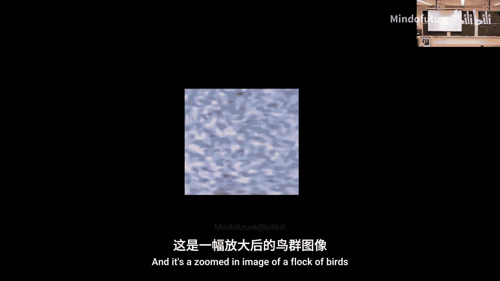
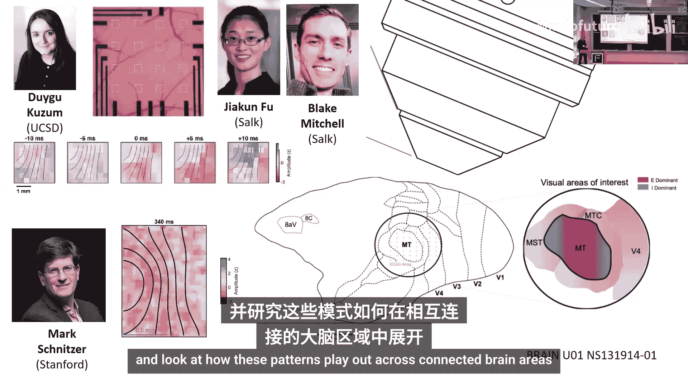
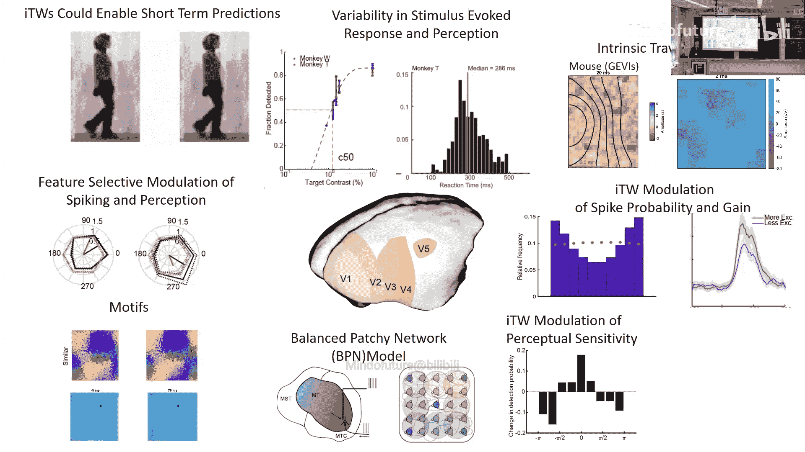

# 【菲尔兹研究所】网络科学领域实验室 ｜ Fields Lab For Network Science p09 P09_固有传播波与视觉感知 -BV1Ty6qBJEvZ_p9-

Thanks to Alex and Roberto。And Lyle and the Fields Institute for inviting me to speak today。

 I think this looks like it's going to be an amazing couple of days and I'm really very happy to be here。

嗯。The work I'll describe today was。Initiated。By Zach Davis。

 who was a very talented postdoc in my laboratory and since gone on to set up his own laboratory at the University of Utah。

 and he worked closely with Lyle Mueller， whom we all know and love。

Who was at the time a postdoc and Terry Sowski's lab at the Salk Institute where I work。

And both Terry and Julio contributed meaningfully to the work I'll describe today。

What I will describe is evidence that within the visual system of the primate brain and in the mouse brain。

 there are。Patterns of activity that traverse the cortex in the form of waves。

They occur several times per second。And I'll show evidence that they reflect the action potentials that traverse the horizontal unmyelinated fibers that。

Occuppy the superficial layers of the cortex。Throughout the entire neocortex。

And I'll show some evidence that these include long range， feature selective。

Patterns of anatomical connectivity that connect neural populations that have similar tuning to one another。

But the very most important message that I want to give you is the importance of looking at the dynamics of neural activity in space and time。

And I want to illustrate this with this image， which looks a little confusing， perhaps。

And it's a zoomed in image of a flock of birds。 So you can see there's some structure here。

 but it looks a little disorganized。

But if we zoom out， we can see that it's really part of a larger hole， in this case。

 a form of traveling wave， which is a murmation of starlings。

And you can really only appreciate that by taking this broader view。

And what I'm going to show you is that patterns similar to this are present within the cortex。

And that it's only really by looking at activity patterns across entire brain areas that we can begin to see the order that is present there。

Now we've taken a particular approach to studying this。

 which is to consider the fact that sensory perception is variable。

And one way of appreciating this is to look at events that occur right at the very boundary of perception at perceptual threshold。

We've trained Marmoet monkeys， this is a new world monkey from Brazil。

To perform a very simple task where they just have to detect the appearance of the target。

So the monkey initiates the trial by phoviating a point at the center of the screen。

 which we call the fixation point。And then after a variable duration delay。

A target appears somewhere on the screen and the monkey receives a juice reward if it moves its eye to the location of the target very soon after the appearance of the target。

We vary the luminance contrast of the target so that we can control how difficult it is to detect。

And we can derive what we call a psychometric function。Which is right here。

And this just shows the probability that the monkey will detect the target as a function of the salience of the target。

 the luminance contrast of the target， and what you can see is that for both monkeys。

 they reliably reported the target when it was presented at 10% luminance contrast。

 which is easy to see， but we could reduce the luminance contrast and make the task more difficult until we could identify a luminance contrast just above 1% where the monkey could only detect the target half the time and we call that perceptual threshold。

These are reaction time plots that just show that the monkeys both reacted to the appearance of the target with an eye movement with a latency of about 250 to 300 milliseconds。

 so they see the target they go to it， so they really understand that the task is detect the target and move your eye to it and they were highly motivated to do so。

Now if we look at the action potentials of an isolated neuron in area MT， motion selective area MT。

We see a pattern that will look familiar to those of you who have looked at spiking activity before。

So these each row here is just has a tick mark indicating the time of an action potential。

And the red vertical line shows the time of appearance of the target over five different presentations of the target。

And what you can appreciate is that despite the fact that we're very good at monitoring the eye position of the animal。

 we know exactly where the eye is looking， and so we know where the receptive field is located and we can place the stimulus at precisely the same location within the receptive field。

So the sensory conditions on the photoreceptors are to all practical purposes identical。

 despite this， there's a lot of variability from trial to trial in the particular sequence of action potentials that are revoked。

And so one wonders whether that variation in the strength of the stimulus ofvo response might be related to the probability that the monkey detects the target on a given trial。

And indeed， if we sort the trials。Into trials where the monkey did not detect the target。

 mess trials and trials in which it did detect the target。

We can see that the stimulus evoked response is indeed stronger on trials when the monkey detected the target than when it failed to detect the target and it suggests that relationship。

But。That's on。So if we look then across many trials， so this is a single well isolated。MT neuron。

 you can see again， a lot of variability and shortly after the appearance of the target。

 there is a strong and clear stimulus evoked response that's time lack to the appearance of the target。

Now I've just shown you this variability and where does that come from well。

 it's not coming from the spiking mechanism， that the mechanism that evokes a spike。

Which is highly reliable。Rather， it is a property of the network。

 the network is entering into various states that determine what that spike rate will be on any given trial。

And to get a handle on this， we can look at the local field potential。

 which is a measure of the local population of activity around the tip of the electrode。

And we can see that during the period of。Time before the appearance of the target。

 the network activity is relatively quiescent。And then there is a downward deflection that coincides with the action potentials that are eoked by the stimulus。

And then after a fluctuation， the system returns to its baseline state。

But this is actually a misrepresentation of the data， it's very familiar to many of you。

 this is what we see when we average together many trials。

But if we look at an individual trial shown here in this pink on my screen purple on yours。

 we see that the fluctuations in network activity prior to the appearance of the target are similar in magnitude to those that occur when the stimulus of oak response occurs。

 so the brain， the spiking activity of the brain is highly active and fluctuating very strongly prior to the appearance of the target。

😊，It's only through averaging that we can see that there is a tendency for there to be a variation around the time of the target。

Now these， I'll show you evidence that these spontaneous fluctuations of neural activity are not random。

 but they are actually taking the form of traveling waves， traversing the cortex。

And I'll show you that these waves travel across individual cortical regions of the visual system。

In animals performing this task several times per second， so they're a very ubiquitous feature。

And I think they may represent a previously unappreciated form of neural computation that we should think about。

Now， what are the sources of these fluctuations in network activity？Well。

 the anatomy suggests that they。Are probably due in part at least to the intrinsic connections that are present within the network。

And the reason for saying that is that if you look， for example， in the primary visual cortex。

 only about 5% of the synapses in primary visual cortex are feed forward and coming from the lateralgeniciculate nucleus。

 and I should say please feel free to interrupt with questions if you have a question。Yeah。

 I thought I saw that question coming up play anytime you I say something that doesn't make sense。

 let me know。About 80% of the connections of the synaptic connections within the primary visual cortex are local recurrent connections。

 and the majority or many of those are right in the superficial layers of the cortex。

And they're fairly limited in scope about。90% of them。

Beg within a couple of millimeters of a recipient neuron。

And so I'll present some evidence that these horizontal connections are really driving these traveling wave patterns。

And as Lyle mentioned， we've recorded in Are MTT， which is a motion selective extra state visual area。

 and this is in the brain of the Marmast which is a new world monkey。

 and the marmast has a couple of critical virtues， one of them is that the brain is relatively wrinkle free。

 itslyos symbollic。So the entire playing out of neural activity on the brain of the Marma Ed and the cortex of the Marmaed is right there like a movie screen for us to watch。

And it just so happens that the size of area Mt， which is about 13 square millimeters。

Can be covered with a single array that's commercially available called a Utah array。

 and this is an array with about 96 electrodes。Spd at about 400 microns apart from one another。

 and this array can be placed right over MT and so we can sample the neural activity from all of MT as the animal performs the task。

And I want to stop here and just acknowledge that the work that I'm presenting today was really inspired by a series of papers。

 early papers from Grinbalald， arts and Arielian colleagues and later work from Meor Carandinian colleagues in the primary visual cortex of aesthetized animals。

 where there are very clear wave patterns that one can discern。

And also strongly inspired by the work of Nico Hadopolis who will be speaking after I speak today。

 whos really did pioneering work looking at traveling wave patterns in the awake behaving monkey with focus on the motor cortex。

However， oops， h， it doesn't look good。Hm， something is missing。Well。

 let me see if I can step back out of this， do want you to see this， oh， something went wrong。嗯。

Let me see if I can get rid of something。女儿。Sorry about that。Oh， gosh。I'll drag this down then。但是这是。

嗯。Yeah， it got cropped， I don't know what happened。So what you would see？

If this were working as I intended。Is。Okay。I'll draw it with my pen here。

 so this is the power spectrum of the local field potential。

So take the local field potential and just drive power spectrum and what you would see is that it's fairly flat。

 there are no peaks in the power spectrum， and so unlike in the motor cortex and unlike in the anesthetized visual cortex where there are really prominent and narrow oscillations in the data in the awake state in the visual system during this quiescent period before the target appears。

 there's no evidence for any sustained narrow band oscillations。And so that。

Meant that we needed to develop techniques to define phase in this spectrally complex system that we're studying。

And it does look actually， you can see the top of the power spectrum there somehow this thing just got separated that brother goes up with this sister and they fit together to form a power spectrum。

 I hope the rest of the slides are better。So if we zoom into the period of time right before the appearance of the target when the animal is waiting for the target to appear。

 there's nothing on the screen， we can look at the local field potential。

 and this is an example of what you typically see and you can see that there are some solitatory patterns here but they're transient and there's a lot of spectral complexity here and if you were to filter the local field potential with a bandpas filter in this case the8 to 13 hertz alpha filter。

 you would see that the result is not really faithfully reproduce or reflect the patterns in the brain。

And even though others do， for example， this beta frequency。

 15 to 30 hertz narrow band filtering does capture something of the dynamics during this period of time。

 though with notable phase distortions and discrepancies in amplitude。

But other time periods it just doesn't really apply so if you were a person who studies beta oscillations in the visual system you would say aha。

 that's what I study and you'd focus on that period of time and you'd make up a story about it。

 but even there they're really only capturing transient fluctuations that are really not all that narrow band。

And so we developed an approach， this is really the work that Lyle did in the project or part of many steps that he did in the project。

 to define a metric that is a measure of phase that is invariant to frequencies and the point to be taken here is here we have filtered the data much more broadly from five to 40 Hertz。

And the color code here indicates the phase， the generalized phase， this new metric。

 which is a generalization of the analytic signal approach that was originally pioneered by Denny Ga Bor。

嗯。So the point is that we can track the phase in a meaningful way and it's sort of following the phase of the dominant signal over time。

Now。How can we sort of validate this Well one way that we can do this is we can look at the action potentials which are the currency。

 the primary currency of the brain and ask how they relate to the phase that we measure using these different phase metrics and we can do that by computing spike phase coupling just asking how reliably aligned or the spikes to a particular phase when we compute the phase as this generalized phase measure versus various narrow band filters。

 the ones that one of them I just showed you the theta band and what you can see is that the spike phase coupling is much better for the generalized phase than for the narrow band phases。

But I did show that there were times when there was notable power in the narrow band phase and if we pick those off in this stateta band they make up about 7% of the time and 12% for the alpha and we just look at those places where you' say aha that's what I study that's where it is。

 even there we see that the spike phase coupling is inferior once you narrow band filter the data。

And so armed with this meaningful notion of spectrally complex phase。

We can now use that phase metric as a way of defining， detecting， tracking traveling wave patterns。

And we do this by computing the phase across all of the electrodes on the array。

 and then computing the phase gradient。And within the phase gradient。

 looking for points of maximum divergence in the gradient。

And those are potential sources of waves they could be radiating out from that point。

And then we compute the phase as a function of distance from that point of maximum divergence and ask if it varies systematically over time。

 over space rather。So to illustrate this， here is a made up data， this is just simulation。Here。

I was just， that's the point of maximum divergence。Let me illustrate it here with a movie first。

 so here is synthesized data made up data and each red point is a maximum divergence point which didn't result in a wave。

 but when a wave propagates away from a particular point the point in green is the point of maximum divergence and it correctly detects the appearance of the wave。

And this。Approach is advantageous because it doesn't require spatial smoothing。

 which can create artifactual waves out of noise。It's an improvement on other methods like singular value decomposition which can break down in noisy conditions。

 and it provides a quantitative moment by moment test for traveling waves in these sorts of high noise multichannel data。

When we apply that approach to detecting waves in vivo， this is what we see。

 so here you're looking at the amplitude in millivolts。Of each electrodeorate on the array and。

Although they're complex， they don't appear like waves traveling from the sea into the shore。

 let's say you can clearly make out that there are patterns of spatially temporally organized patterns that travel across the electrode array。

And I should note that this is not spatially smoothed so this is really the patterns that you see when you detect waves in the cortex of the marmosat。

Now， when we。Look at the。Frequency of spiking as a function of the wave phase。

We see that it varies so now we're recording simultaneously local field potentials。

 computing these traveling waves on the local field potentials。

 and then looking at how the spiking activity， which was simultaneously recorded is time locked to the phase of the wave。

 we see that the probability of spiking in the spontaneous activity varies considerably as a functional wave phase。

And we'll out refer to the period of time to the phase of the wave during which the spiking activity is elevated。

 I might call it the depolarized phase of the wave in the talk。

As compared to the so called hyperpolarized phase of the wave。

And these little red dots just correspond to a control condition where we averaged all of the local field potentials and looked at the dependence of spiking activity on wave phase。

With the idea of， are we seeing a synchronous pattern or are we seeing a wave pattern。

 we really are seeing a wave pattern， not a synchronous pattern。

If we look at the speed of the propagation of the waves。

 these are the distributions from two monkeys。We see that they tend to fall in a range indicated by the vertical lines here that corresponds to the range of action potential velocities that occur across these unmyelinated fibers。

And so that's one line of evidence that the waves are related to the horizontally propagating action potentials。

And we've built a model， a large scale， recurrently connected model。Um。

Which is we're currently connected with distance dependent connections that fall off as a Gaussian from each neuron。

And we critically incorporate delays into the propagation times to reflect the time that it would take an action potential to traverse the horizontal fiber at that distance。

These are very large scale models on the order of 500，000 neurons。

 500 million or so synaptic connections。And at those scales。

 it's possible to build a model that uses biologically plausible。

 excitatory and inhibitory conductances at the synynapse。And when we do this。

 we find that over a wide range of parameters， the model can create waves that look similar to what we see in vivo。

嗯。The simplest way to look at it is here， so this is just a simulation of the model。

 now this is a higher resolution image than I just showed you with the 96 channels in the electrode array。

 but you can see that qualitatively there are similar patterns of complex wave dynamics。

And the statistics of the waves， theirs speed of propagation， for example。

 their wavelengths are comparable to what we see in vivoO。

 and so we think this is a good working model for what network may be generating the waves。

If we look across the space of excitatory and inhibitory conductances。

We see that there is a range of these parameters where waves occur。If we step outside that range。

 the network becomes epileptic or goes silent， but within this range。

 we see wave patterns that vary in their networks in their wave strengthth and also wavelength systematically as a function of these parameters。

The key point there is that over the range of parameters that give rise to ongoing spiking activity。

That activity takes the form of waves， and so it really seems to be the natural operating mode of a connected network like this is to form traveling wave patterns。

And for those who are really interested in spiking data， I'll mention that over that same range。

We see that the spiking activity of individual neurons are very much very similar to those that we see in vivo。

 so they're stochastic， sort of like rate varying Poisson processes。It need some very about very。

 very agent whichmetrics are most important。Which which parameters well。

 so we're just so we've looked at a larger parameter space。

 but the critical one here is the space of excitatory and inhibitory conductances。Yeah。

 so we've systematically explored this， let me come back to that as I go further into the talk。

So conceptually， what do we think is the relationship here between the spiking activity and the wave and the behavioral effect of behavior？

So imagine that we're recording from MT and this color code indicates the hyperpolarized or depolarized data network。

 which we think actually reflects the ratio of excitatory to inhibitory activity so that that ratio of E to I。

Shift and we think that is actually driving the gain change so that's the critical the critical consideration so in this at this point in time。

If I were recording from this pyraidal neuron， I might see only a single action potential evoked when three action potentials enter the cell。

 but as the wave，State changes placing the cell in a more erich or depolarized state。

 the spiking output is elevated and so for the same input。

 we might now see more spikes evoked by the pyraidal cell because the network as a whole is now in an erich regime。

And so to look at this， we went back into the data that we had recorded during this spontaneous period。

嗯。And we。Divided trials out according to the depolarized state immediately before the appearance of the target。

And the prediction that comes from that conceptual model， it also comes from the theoretical model。

 is that in the e rich state in the state that drives higher spontaneous activity。

 there should be also an elevation in the strength of the stimulus evoked response。And indeed。

 this is what we see， so here shown in purple is the average across the population of cells。

 the average evoked response to the target on trials when immediately prior to the appearance of the target。

 the state of the network was in this hyperpolarized phase。And in green。

 we see the elevated responses when the stimulus bug response coincides with the eri regime but you said immediately before the time。

250 if we have the most may not be yeah so that's right so so what seems to be happening is that when the stimulus evoked response occurs so there's more to the story that I would need to unpack for you to tell this right。

 but you know we looked at we looked at the phase of the local field potential wave leading up to the appearance of the target and we identified the time period that was best predictive of a change of gain。

And that time period， we think。Initiates a stimulus evoked response which then persists over a period of time after the initiation of the phase。

 so I think there's an intermingling of the state at the moment that the stimulus evoked response begins and then the response itself has an impact that maintains its elevated gain and this is consistent with experiments that for example。

 Lyle has analyzed data looking at stimulus evoked response waves So when you present a visual stimulus they generate their own traveling waves。

 so once we step from the pre-stim period into the stimulus evoked regime we're moving into a different regime and it has the capacity to persist in driving the elevated gain state beyond that initial window。

So the main observation is that depending upon the wave state immediately prior to the appearance of the stimulus。

 the gain of the stimulus ofvo response is elevated or depressed depending upon the wave phase。

And how does this relate then to behavior so the prediction of the model is that elevated gain will drive those changes that I showed you at the beginning that elevated spike rates on hit trials versus mistrial and consequently there will be an increase in the probability that the monkey detects the target。

And if we look at the detection at the behavioral level。Indeed。

 over the same hyperpolarized and depolarized phases we see reductions or elevations in the probability that the monkey will detect the target and these are pretty substantial if you think about it we've titrated the luminance contrast of the stimulus of the monkey is detecting the target half the time and here we see variation on the order of 20 or 30% in the probability of detection that is wave phase dependent。

To quantify that further again， I'm sorry my slide is slipping all over the place。

 we just constructed a generalized linear model in which we used wave phase as one of the predictors of the monkey's behavior。

And also other measures， including pupillary diameter。

 which is an index of the arousal state of the animal， the strength of the target of oak response。

 which I already showed you is elevated on hit trials relative to mistrials as well as。

Pre targetar alpha power， which is a measure that people who study EEG use as a measure of attentional state and also pre targetar firing rate。

 so the baseline level of the activity is elevated when attention is deployed to a receptive field so that's another predictor of attentional state。

And of all of these factors， the wave phase is the factor that best predicts。

The monkey's performance and to me that was a little disconcerting because I've spent a lot of my time studying visual attention and how it regulates perception。

 but here are some indices of visual attention which are not as predictive way phase it tells you that the way phase really is a strong predictor of the monkey's performance。

Now I'm going to make， I think one final major argument， which is that。

We think that as I've laid it out， according to the model。

 the waves are actually a consequence of the propagation of action potentials along these unmyelinated horizontal fibers。

 but it turns out that those fibers are not homogeneous。

 isotropically connected patterns like I've been showing you in the model。

 there's actually a lot of interesting anatomy there。

And we have evidence that these intrinsic traveling waves。

 ITWs are sculpted or shaped by the structure of that anatomical connectivity。

And this originally came from work in the primary visual cortex。

 so including work from Charles Gilber and colleagues。

So this is a map of the orientation preference of V1 that was taken with bolted sensitive die。

 and they just varied the orientation of stimuli and what you see here is a color coded map showing where on the primary visual cortex are the neurons that let's say prefer this particular orientation or that particular orientation and so these are the pinwheel patterns that you've heard about in the primary visual cortex。

It turns out that if you make an injection in that same cortex of a tracer that's taken up by the axons and goes back to the cell bodies。

 you do see this strong connectivity locally， this was the horizontal connectivity I mentioned earlier about 90% of it is sort of local。

But layered on top of that are these patches of tracer。

 which show that there are anatomical connections from here to that injection site。

And it turns out that if you look at what those patches correspond to in terms of orientation preference。

 they're the patches that match the orientation preference at the injection site。

And you can see that here， this is the probability of there being a connection as a function of the orientation difference in these patches。

And so the primary visual cortex is made up of these feature selective patchy networks that connect like minded populations of neurons to one another。

And you know initially Charles Gilbert argued that this has to do with contour completion。

 that it has to do with seeing a modal completion， things behind occrs and so forth。

 but since that work was done，Other tracer studies have been done in a host of other areas and this pattern of connectivity is really throughout the cortex everywhere you look。

 so it's been seen in primary visual cortex， but it's also been seen in area V2 in area MT in the inferroemporal cortex and it's also seen in the primary motor cortex。

And so it's really a anatomical motif that's looking for an explanation for what it's useful for because it can't be serving some limited focus like just solving contour completion。

And so we went back to the initial model and modified it to take into account this pattern of anatomical connectivity。

 and I want to highlight here that this is a work led by Alex Bush。

Who's here and so what Alex and colleagues did here was to just。

Add additional connections to connect the like minded orientation domains within the network。

And so this is a prediction of the model， which is that。Unfortunately。

 the color codes are a little bit messed up， so it's not quite as obvious on this screen。

But the prediction is that we should see patterns。As action potentials traverse these horizontal networks。

They are predicted to result in。Different types of wave patterns that reflect that anatomical connectivity。

 and so the prediction is that we should be able to see patterns like this where this is showing the phase of the wave at a particular point in time and we should be able to see that there are similar wave phase patterns。

That we can group together into motifs， and these reflect the anatomical connectivity patterns that we've placed into the network。

And as compared to a randomly connected network where we can see more of a tendency for the data to be able to be grouped into these motifs。

And furthermore， the prediction is that because we're elevating subpopulations of neurons that prefer a particular feature。

 in this case， direction of motion。That we should see that these groups of。Waves， these motifs。

In some cases we'll show feature selective modulation of gain of the responsiveness to the stimulus。

 so here is an explanation that I should have put earlier。

 this is the phase of the local field potential at a particular point in time and so we're just mapping with a color code the phase across phase。

And this is what we see， so in MT here is an example of two very similar wave phase patterns。

 and below you see an example of a repeated wave pattern。

So this is a really striking example where if you look at these two patterns which are separated in time。

 you see very similar wave patterns and we think that those wave patterns are a reflection of the action potentials traversing one or another network。

The model prediction is， as I mentioned that because we're potentiating one of these networks that is itself feature selective。

 we should see in some cases feature selective elevation of gain， so here's the prediction。

Showing that in。Black the if we， if we if we。During the activation of one of these motifs。

 if we look at the spontaneous activity of neurons where we've organized them around the clock according to the direction of motion preference。

We should see， in some cases a systematic preference。

 elevation in the spontaneous spiking activity of neurons that prefer a particular direction of motion。

Which is not present if we randomly shuffle the connectivity matrix。

And when we look within MTT we see striking examples that support this view。

 so once again here is a shuffled control condition a null distribution and this is the sort of elevation in the spike rate。

 the ongoing spiking activity that for this motif increase the activity of neurons that happen to prefer direction of motion downward into the right and here's a different motif that happen to prefer leftward motion and so consistent with the idea that these anatomically patchy networks which are feature selective or driving these motifs we see in vet that when we group the motifs together we can see we can see examples of this。

とをも。高知。In the initial modeling， just it was the simplest model and it's not too different from the pattern in the brain。

 it was only later that we were interested in seeing whether there was more that could be gained by adding this this additional anatomical feature and we're seeing that there is evidence for that。

And if we compare the tuning predicted by the model。And the motif spike tuning that we see in vivovo。

 they're comparable in size。嗯。And here is， oop， sorry。谢试。And here here is。で、すね。

Here is just data showing the magnitude of the effect that there are these feature selective increases。

 so what that means is that if we take the stimulus that matches the preference of the motif and record the stimulus ofvo response。

 if it matches the orientation of the motif it's elevated as compared to if it's moving in the opposite direction so it isn't just the spontaneous spiking that is sculpted by this。

 but it's also the regulation in gain and the sensitivity of the network to the stimulus as feature selective。

And。嗯。Consequently， we predict that there is also a feature selective change in perceptual sensitivity and that is shown here。

So here is Fourier motif that drove spiking activity in this direction as shown by the red line。

When that motif was activated and we looked at the monkey's probability of detecting the target。

 it was improved in a way that agreed with the preference and you can see that for some other examples here。

And。So here is the modulation of the spontaneous activity about a 10% modulation in spontaneous activity and here is the modulation of the monkey's performance when the target that was presented either matched or didn't match the preference of the motif。

 yes Roberto that's right yeah。So this is the very same task， the very same data set。

 it's the same data， yes， Andrew。So is。Yeah， so the preference is defined by looking across the population at the spiking activity and organizing the cells according to what their measured orientation or direction of motion preference was。

And then we look at that curve and we pick off the preference when a particular motif is present。

So one motif will upregulate。Neurons that prefer upward motion and another one will prefer will elevate spiking activity in the spontaneous state of the ones that are downward and that's the definition of the motif preference we then apply that to the stimulus evoke response and we find that when a motif that upregulates spontaneous activity in the upward direction is activated a upward stimulus then has an elevated gain。

And the monkey is elevated in its sensitivity to that target。

 if we present the opposite target when that motif is active。

 we don't see that elevated gain and we do not see that increase in perceptual sensitivity so they're all aligned。

And I will mention that we are also doing work with Adam Cohn and Andrew Parker looking at this in the MaAque monkey。

 we see patterns that are very similar and we're in the middle of that project。

And we're also working separately with Mark Schhnnitzer at Stanford using a different method。

 so I've been talking about local field potentials。

 those are a bit of an indirect measure of neural activity they're an extracellular measure。

 but here we're seeing waves in the mouse cortex using genetically encoded voltage indicators so these are fluorescent markers that fluctuate with very high temporal resolution according to the membrane potential of the local population under the microscope and we are in the process now of building a microscope to do these experiments using genetically encoded voltage indicators in the marmast which I。

Can't go into too much detail， we're just now injecting the virus and beginning to we've constructed the microscope and we'll soon be making these recordings。

But this is pretty exciting because it's an eight millimeter diameter imaging window。

 meaning that we'll be able to visualize the activity across not only MTT。

 but the surrounding visual areas and look at how these patterns play out across connected brain areas。

But before I finish， I just wanted to take a step back and say that I presented a variety of lines of evidence showing that waves exist in the awake primate visual system。

 that they occur several times per second， that they regulate the gain of neuronal responses。

 they regulate perceptual sensitivity， they do it in this feature selective way which maps onto anatomy。

But everything I've told you though it has is built on the ability to look across a brain area。

 it's sort of old school， you know， you're looking at a stimulus evoking response in a receptive field of a neuron and there's a nice way of looking at it。

 it's productive way of looking at it， but we're in a position to do so much more right now。

And I think it I want to use my final little vignette here to motivate the idea that we really。

 as a field of systems neuroscience need to start thinking in terms of what are the computational capacities of these。

Of these waves， what are they doing for us and more than just what do they do to the little window we're looking at through a cell' receptive field？

And so I just wanted to highlight some really beautiful work that Roberto has been critical in advancing。

In which we are sort of taking a big step back and saying what are waves potentially useful for evolution did not create these this old wave infrastructure to allow us to detect a target on a blank screen on a computer。

 it's a very quantitative and hardnosed way of looking at it and we've made a lot of progress in demonstrating it that they're there。

 but I don't think that's what they're doing。And so in this little final chapter I'm just going to touch on a published paper which you can go to。

 showing that they potentially have a lot more power。

 so in particular they have the capacity because waves are unfolding in space and time。

 there's a lot of information in a wave and it has the capacity to encode complex spaoempal events in the brain。

And this is a very nice illustration on the left， you see a person walking back and forth backward and forwards。

 this is just a movie from the Weiseman movie database。

And what I'll show you in a moment is how this was done。

 but on the right is a network that's wired up to generate waves and it has the capacity to encode in its synaptic connections。

 the entire movie and you'll notice also that because the movie is moving backwards and forwards it has context。

 the same frame appears in the forward walking direction and in the backward walking direction and the network distinguishes those two states even though they're physically identical at any point in time。

 and so the state of the network really enables empowers this network to generate really real- worldor level complex events。

And I think that's really very exciting so what how did we get here so the model is structured as follows so we have。

A movie playing out in the whiz。We have a movie playing out。

I think my little cursor button to activate the laser is somehow malfunctioning， but we have a movie。

 which is the input of the network and it passes through a feed forward set of connections onto a topographically organized network。

 which is re' currentlyrently connected， complex valued oscillator network。

And that is the way the world gets into the network。

And but the network itself is similar to the recurrently connected network that I've been telling you about。

 and so it has its own internal dynamics and when you ping it with an event sent in from the outside。

 it generates a wave pattern， when you ping it with a complex series of frames of a real movie。

 you have very complex dynamics。UAnd。So the input to the network comes from the external world。

 and then we adjust the output weights of a feed forward output to make a prediction of what the next frame in the movie will be。

And we want to minimize the difference between the prediction that the model makes and the actual next frame of the movie。

 and so by adjusting the weights appropriately， we can do that。If we do that for every single pair。

 yes。Sector network not trade on the。But it comes back in a form of recurrence in just a second。

 so yes you're right we're not adjusting the local connections within the recurrent network。

 that serves as as something analogous to a reservoir computing concept right？

And so the output weights are what are adjusted to predict the next frame in the movie。

 but if we do our job very well in the whole and we predict from every frame and the dynamic state of the network。

 what the next frame will be， then we can take the prediction。

Turn off the external world and allow the prediction to feed in as input to the network。

And if we're good at making that prediction， that's as good as the world and so what I was showing you just now。

It is。A big blown up version of this， but here's the ground truth。

 the person walking across the room， this is the forecast that the model makes of each next frame。

This on the third panel is the dynamic state of the network itself， the recurrent network。

 and then on the right is the forecast that you get if you remove the recurrent connections and don't have traveling wave patterns。

嗯。And so you can see。That there's this somewhat complex pattern of activity within the network。

Which is。It has these interesting spatial dynamics。And so the point is by imposing this recurrent。

Connectivity on the recurrent network， we can recapitulate the move。

And so from my point of view there's two really interesting things there。

 one of them is this is a way of thinking about how the brain makes predictions and we see lots of evidence in the physiology of the brain predicting。

The future。Or in the case of the visual system lightating the retina。

 and it takes 70 milliseconds or so to activate area V4 and Macque and we see that the。

areaa of V4 is predicting the likely current state of the world。

 It's not reflecting what the state was 70 milliseconds ago。

 so we have physiological evidence that shows that the brain makes predictions like this。

 We haven't closed the loop and done this experiment。

 but this is a way of thinking about how that happens and I think it also is potentially an interesting way of thinking about how we form the kinds of really rich memories that we have in our lives。

 I know walk across the street almost get hit by car。

 you have a whole very vivid image that movie that you can replay with your own free will and cause it to play out within your within your network so you have the ability to activate。

 but no one's really had a clue about how that kind of process could be happening。

 I think this is really pointing in that direction Yes useful。not just this particular absolutely。

We get to universal October。We're in the middle of developing that right now， but yes。

 so so the goal at present and the current work is to do exactly what you're saying and you're absolutely right to ask that question。

 but we really are thinking very most broadly is not just do you encode a particular memory in this way。

 but can you generate something new。Could we train the network on。

Hundreds of thousands of real world movies I mean you move your eye about 120，000 times a day。

 you make that many sadds per day， so you're constantly sampling the environment。

And there's good evidence that your brain is constantly being updated。

According to your experience of the world and so it's。

A very large database that's constantly streaming through your visual system and training it。

 and so what we are very interested in doing now is training the network on many realistic movies and seeing if it can extract a statistical regularity in the environment so that when we then present a new starting condition。

 a few frames of something it's never been shown， will it act like a generative model and create a plausible。

Movie of what is probably about to happen based on its knowledge of the statistics of the environment。

 but yeah that's the next generation of work。Yes。So I find the rest of could to go out of exactly police also because they don't need the full input to prediction can work。

Absolutely。So I have a connection and that question and I don't know if this is connected to your previous part。

That when you were giving the first part of the talk how I interpreted。

 it was exactly in the framework of the reservoir computer and there is a lot of work done on the topology of。

The reservoir。The connectivity that even the random network actually can work as a result。

So the statistics of your。The first part of the fall， the statistics of topology of tobacco。

 does it match to any of the theoretical work on the topology of the reservoir in。

Well that's a very broad question and I don't have a very good answer。

 I can only and I'm a neurophysiologist not a computer scientist or a theoretician。

But what I can say is that our view of the patchy connections that we。

That are observed throughout the visual system is。A hypothesis at this point， nobody knows this。

But the hypothesis would be that those。Connections form through tuning。

They are to some extent formed prior to eye opening。

 so they're not entirely based on the statistics in the environment， but once the eyes open。

There's very nice examples showing that individual neurons can change their tuning based on experience。

And I could give you some nice examples of that， but I think what's。

Probably happening is that that patchy connection is the most obvious。

 anatomically obvious pattern that reflects。Conjoint statistics across the environment。

 so in the case of the primary visual cortex。We see lots of continued edge。

 if you just look in the natural statistics of the environment。

 there are lots of edges that tend to have constant curvature。

 and those are exactly the kind of patterns that would give rise to that pattern of anatomical connectivity in the primary visual cortex and I suspect that as we look in MT we'll find that continuous motion drives these patterns。

In MT。And so on and so forth， maybe there's a motor motor correlate at that because a continuous motion might be driving these things。

 but at a smaller scale there would have to be less obvious anatomical connections that reflect more subtle contingent statistics。

 but we don't have any way to look at that right now。

 that's one of the reasons we're building this microscope。嗯。

So let me just summarize so that we can wrap up， I've shown you that in a task where the monkey had to detect a faint stimulus。

We see wave patterns that traverse area MT， we see similar patterns in the mouse。

In the intracellular potential of the cells。I've shown you that the spiking activity is aligned with the phase of the waves。

 meaning and we think the waves are being driven by the spiking activity。

And that there's a change in the gain of the stimulusvo response。

 which is dependent upon the phase of the wave。I have shown you that it affects perception very strongly。

 the wave phase predicts detection reliably。And I've presented evidence that the long range feature selective patchy network sculpts the shapes of the waves and that we can group waves according to their reflection of activity across these networks and that this leads to。

Motifs that we can register。And the motifs drive tuning both at the level of the stimulus evoked response and also perceptual sensitivity。

And then I've laid out an example， I think， where the presence of the waves in the network endow the network with the kind of spaia temporalal complexity that is needed to encode complex spaiaemp events。

And with that I'll take any question， thank you very much。

Although there were lots of questions during the talk。Go ahead。So wonderful felt really stimulating。

So many questions because there are some things that。Okay， so first of all， you have this older view。

 right。Yeah。And your model， tries to explain how these waves could be generated and auto almost。Yeah。

Part。That could be noisy or something， and then those weights would be generated。

Going back to the first video that you showed at the beginning with the swarm of birds。

 it looks like I mean， how did you validate that these wave patterns that you see in this piece of cortex are not part of the big you know of the big swarm Oh beyond beyond this one visual area of course yeah because when I look at that ice I see it as a small batch right I don't know that and how also when you show this spontaneous situations we see transient heats red in alpha so they could be part we know that there are these collected microsscale waves alpha beta so this would be a big zoo。

Region of the superposition of multipoulatoratory modes so are'm not even able to decompose it right and we are seeing and that in a way。

 as you show the phase of those waves modulates the perception or the attention。

Could have even bigger systemic level attentional state absolutely yeah this is very these are very good questions and you know don't I don't want to be a prophet but the answer here right there's a lot of complexity to this what I can say is that work including work that Lyle did early in his career looking at patterns of waves that are revoked by stimuli there they were this gets at the question of whether these waves are more global than we're looking at we just happen to be looking at MT but maybe they're really sweeping across the whole cortex。

😊，What Lao found in recordings made using voltageed sensitive dieim in awake monkeys。

Was that when you presented a visual stimulus， you could see a wave propagate out from the position of the stimulus。

 but it collides with a wave that propagates out in V2。

So there's this sort of beautiful mirror image as they approach their common word。

And so they appear to reflect to respect the boundaries between areas。

 at least in the stimulus evoked case。And number two。

 there was a work last year in rodent came where they autogenetically induced micro。

typicallyically they show that there are waves ionic waves propagated through the peranhuma at the twin level。

 right？And。So this would change the x several fields。

When you showed there that you're saying intracellular activity based on the membrane potential it is important to have in mind that the membrane potential is the difference between the potential it's a voltage between inside and outside so' outside the extracellular changes from the wave pattern it could also change the membrane potential or not yeah no I think so these are sort I don't if you're alluding to this idea。

 but the idea that the extracellular voltage itself could be modulating the neuronal activity Yes as opposed to dis propagating it could be generated in m like you say or in5 or whatever。

 but then they interact through the field。So let me I was preparing and answer to your second question and then you're adding in the third one so let me take them as they come。

 you know there are people like Earl Miller at MIT is really making the argument that traveling wave patterns are an extracellular phenomenon that regulate and determine computations and he may be right but I disagree with him。

 I think the reason that I disagree with him is that I think the from the work I've already presented here。

 the wave patterns travel at a speed which is consistent with the propagation speeds of action potentials along the horizontal fibers。

 so I think that's preaac evidence that the local field potential is reflecting those wave there's no evidence that the speed of the action potential propagation is dependent upon the extracellular。

 I think it works the other way around。The fact that we see that the。

Anatomical feature of patchy connections。Predict in the context of the model。

 feature selective changes in game。That is another example where the anatomy is dictating the effect of the wave。

 and I think militates in favor of the idea that the local field potential is an indirect index of what's happening in the network。

Those two pieces of data they don't lend themselves to an explanation in which the extracellular voltage is modulating the spiking activity of the neurons。

 neither of those two data points can be explained in that way。嗯。

But it's still an interesting possibility and there is direct evidence that if you cut anatomical connections。

And stimulate on one side， you can see changes that occur in the other side in the membrane potential of the other neuron。

 those are modest effects I don't know of any evidence that they have any effect on behavior。

 but if someone could do the experiment where they could disentangle the effects of the extracellular on the cell and show that it has behavioral consequence。

 I am very excited to hear that。So I'm open to it， I just don't necessarily see any evidence to support that view。

嗯。The other question you asked okay， so you okay， great， right and I think there was。😊。

Nico was next and then the question right behind you。

So I wanted to ask you so about the behavior of this F energy network。

 So when you have long range connections， So which you put in your network。

 but also you local connections。

