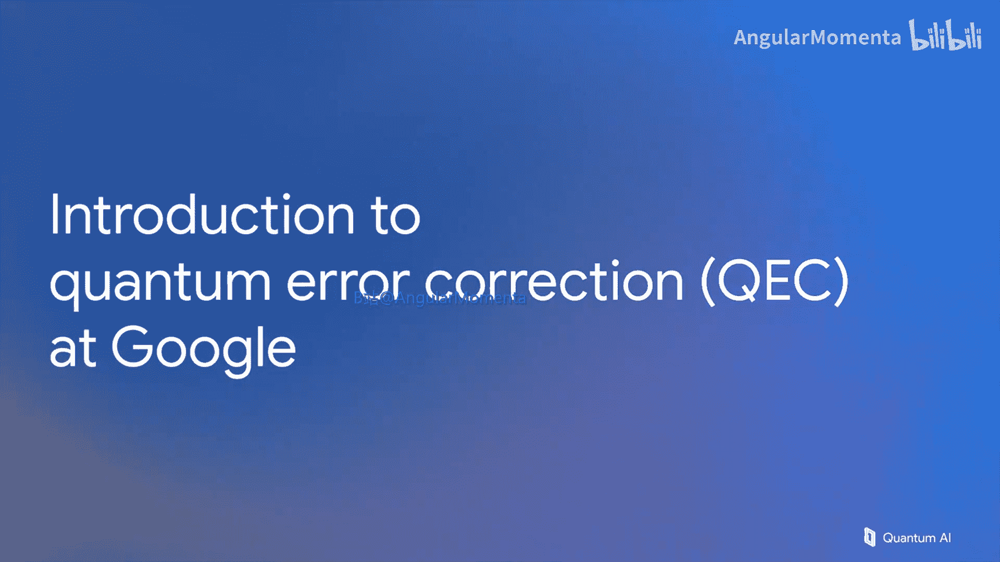
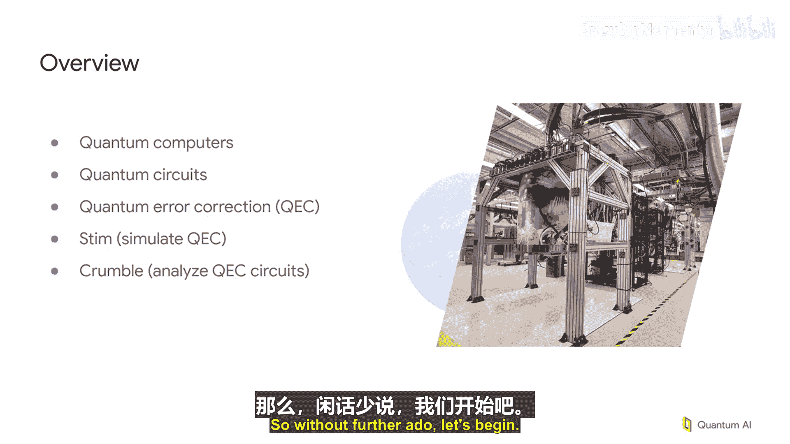

# 【谷歌量子人工智能】借助谷歌量子人工智能进行量子纠错实践-｜-Hands-on-quantum-error-correction-p01-01_01_01_introduction-to-qec-at-google--BV1LirPBzEaJ_p1-

嗯。

Welcome to Google's In to Quantum error Correction I'm must Fowler。

 I've been working in this field for over 20 years and it will be my pleasure to talk you through the course material。

Before we get started， there are a few people that I'd like to thank Dave。

 Abe and August all helped shape this course and get it in motion。

 And also that the production team of Jessica Iva and Es all helped polish this final result。

 to overview what we hope to achieve in this course。

 we're going to start with an overview of quantum computer hardware。

 there's a diverse range of hardware out there all very exotic， very interesting。

 So we'll start there and make sure you have a good grounding in what it is the people are trying to build  moving on from there。

 We'll go through the theory of quantum circuits。 We'll go quickly。

 but we will start from the beginning。 So even if you've had no prior exposure to the field。

 I hope after a few repetitions of the material， you'll be able to follow the remainder of the course as well。

  moving on from there with that grounding will move on to quantum error correction。

 building up the basic circuits that actually achieve the detection of errors and the classical processing of what to do with that information and layer by layer through stabilizes many things that you won't have heard of yet through simulators that。

Handle the large scale of quantum circuits and still return results quickly。 We'll talk through ST。

 Our state of the art simulator  for quantum error correction circuits and all the way up to crumble。

 which helps us manage the complexity of doing computation。

 manipulating the data protected by quantum error correction。 So without further ado， let's begin。

