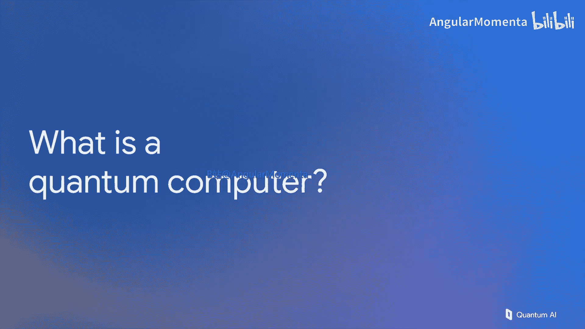
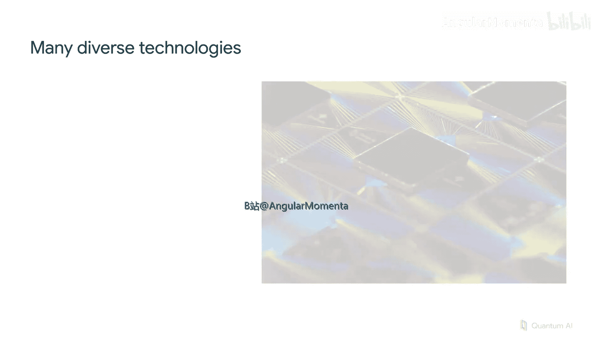
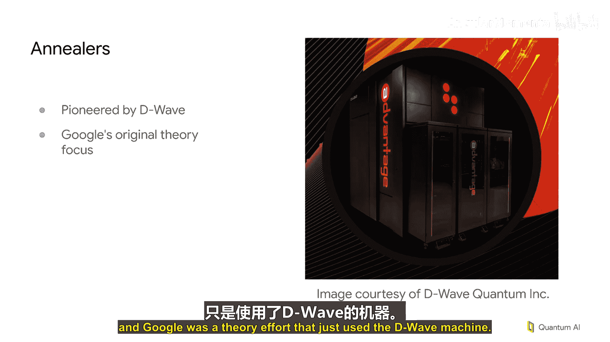
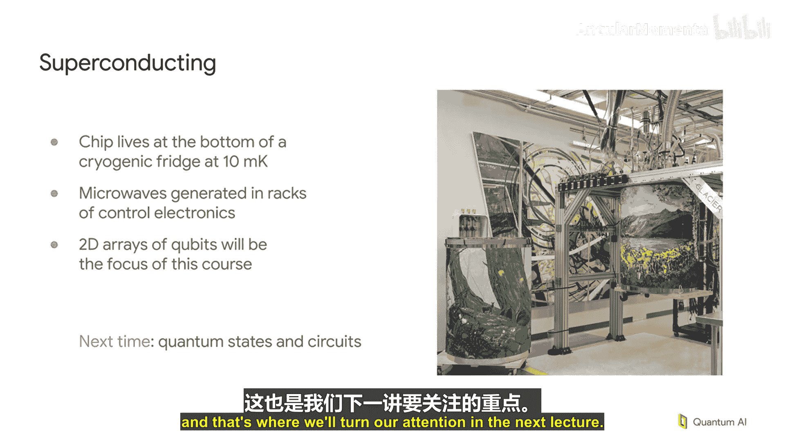

# 【谷歌量子人工智能】借助谷歌量子人工智能进行量子纠错实践-｜-Hands-on-quantum-error-correction-p02-01_02_01_what-is-a-quantum-computer--BV1LirPBzEaJ_p2-

In this video we'll turn out attention to what is a quantumcomp and the answer is many different things。

 it's still very much a research field， there are many very different technologies under investigation and this will just be a sample of some of the major technologies in this area。

The ones that we'll focus on， and I stress this is just a selection of many we could have chosen to focus on are as follows。

 We're going to start the journey with an Ne other technology。

 which is actually where Google began its journey in quantum hardware and then work our way through ion traps。

 neutral atoms fornicbased quantum computing quantum dots pursued by Intel and many others at this point in time and last but not least the superinducting qubit technology we focus at Google。

 So in the beginning， there was Dwa and Google was a theory effort that just used the D wave machine。

 So this is a very different way of doing quantum computing。

 you have qubits but the focus is not on high coherence。

 it's not on well-controlled manipulations of their states。

 rather you have many couplers which each individually touch many qubits。

And so it becomes a process of applying constraints to the states of those qubits and then allowing the computer to settle into states that satisfy as many of those constraints as possible in general it's an optimizer。

 the catch however is that there's no known way to apply error correctionction to this approach so as the system gets bigger。

 you need lower temperatures， more control， it's not fundamentally and obviously scalable and it remains an open question as to whether you can build a big enough computer well enough using this approach and solve things that will have an impact in the real world。

Iron traps completely different approach。 You use an electromagnetic trap。

 So the most popular approaches these days you have a surface on which have been patterned many electrodes。

 those electrodes can trap very close to the surface individual atomic ions and it's the internal states of the electrodes on those ions that you use to do computing。

 you can manipulate those states with microwaves you can manipulate with lasers。

 there are multiple approaches to achieving fast and high fidelity gates。

 but this system being based on atomic ions has some of the cleanest properties of any system and therefore achieve some of the very highest fidelity gates of any approach to quantum computing The challenges are primarily speed and can you make it very big。

 Can you make a very high quality vacuum system with many， many。

 many ions manipulated with many lasers or many microwave sources and make it all work together。

 So these systems are typically not very large。Yet。

 typically at most a few dozen ions and time will tell as to whether the fidelity can preserve as the scale is increased。

Another approach again atoms， but this time neutral atoms。

 The advantage here is you can trap these with lasers so you don't need a physical set of hardware you don't need all of these electromtic rails to trap your atoms you can set up an egg card-like potential well where your atoms sit in the various holes trapping is probabilistic。

 but you can then move the atoms around to fill a dense grid and there are a number of very successful companies pursuing this technology the ability to not need physical hardware to trap your qubits means that these systems have some of the largest qubit counts。

 hundreds of atoms in a trap and some of the biggest quantum computing experiments performed to date have been done in this technology just like with ions。

 the primary challenges are speed in addition with this approach in many approaches the measurement of the information itself leads to its destruction the atom。

Lve their wells， and you need to continuously load new atoms These are the kinds of technology challenges that this approach needs to solve to scale to even bigger systems。

To be a little bit more detailed， this shows the fundamental setup。

 you have an ultra highigh vacuum cell So that is this unit here marked UHV cell。

 You have a source of atoms that gets trapped randomly and you can then compress it to a dense pack of atoms with the arrangement that you wish to have。

 We won't say any more about that one and move on instead to yet another approach again。

 completely different based on light。 So if you have a photonic chip。

 you can generate single photons probabilistically entangle them to build a bigger quantum state。

 probabilistically。 And what the diagram on the page is intended to tell you is that if you have enough of these sources and enough way of routing the successes to bigger and bigger assemblages of states throwing away the failures as you go。

 you can at least in principle， build a system that builds a very large quantum state that can be used as the foundation for。

Quantum computation The challenges here。 Well， you need to route the protons。

 you need to do this quickly。 So when you decide success failure。

 you need to respond very quickly and furthermore， you need to make sure that photons would typically love to be absorbed by materials of all kinds are not lost in a numbers that that prevents you building one of these large states。

 So overcoming loss and rapidly switching phototons are things that this approach really needs to get under control。

 Yet another approach， quantum dots fundamentally an arrangement of electrons that trap single electrons。

 you use the states of your electron to represent the states of your data here this is a very well supporteded approach by Intel and many other labs around the world you can see here。

 one of the state of the art chips at time of creation where 12 electrons are held in place to do computation。

 The challenge here is scale。 So these are very， very small。

Tendens to hundreds of nanometers separation between your electrons。

 you really need to have at least a two dimensional array of qubits and as yet the research devices don't support that。

Without a two dimensional array， if a single qubit fails maybe be because the qubit being an electron just got absorbed into the device itself or at time of creation。

 the electrodes were not set out right and it's incapable of holding electron in the first place。

 You don't now have a small problem。 You have two computers。 They can't talk to each other one。

 And so this is not fundamentally fault torrent until you have a two dimensional array and a single dropout can be worked around。

Last but not least is superconducting qubits， so here you take a regular silicon wafer。

And you pattern electrical circuits。 A good analogy is to think of these circuits as a guitar string。

 a tunenable frequency resonator。 You can imagine that if the guitar string is not moving， that's0。

 If you pluck it， that's one。Just like a guitar string， however， there are more states。

 If you've ever played music， there are harmonics so you can make the guitar string vibrate twice as fast as normal。

 that would be a two state and just like there are higher harmonics on a guitar string so too with our superconducting electrical resonators。

 we have higher states that we need to deal with。 and so dealing with those is one of the big challenges with our hardware preventing our ground state。

 our zero and our first excited state our one becoming twos or threes or fours which are not useful for computation。

 Note that in contrast to many the other approaches where we're talking about single electrons or single atoms and those are very。

 very small systems indeed these circuits are big。 So the qubit center to centers about a millimeter。

 you can see these with the naked eye and it's a great example of how quantum doesn't always mean small。

It does， however， mean cold in this case， for the data to be faithfully stored for any length of time in either the zero or one state。

 the thermal energy of the system needs to be small compared to that energy gap and that energy gap is so small that the thermal energy needs to be reduced to the 10 millkelvin level So we need a cryogenic fridge。

 We need a very well shieldded environment。 And with that。

 you then have a tunable frequency resonator that can be manipulated with microwaves。

 we'll go through the kinds of things you can do to qubits in the next lecture。 First， however。

 let's have a look at a few more challenges to realize this technology。

They don't always work when you build a superconducting circuit， there are breaks in the circuit。

 Joseph's and Junctions whose thickness very sensitively determines the resistance and properties of the circuit。

 So if this is not very carefully controlled， some of the qubits will not work in the way they were designed。

 So you can see on the right， a picture of a real device and actual error rates of that device。

 and you also see some of them are missing。 Some of the qubits that should be there are not。

 these are qubits and couples that were determined after manufacture to simply not work well enough to be included in the computer itself。

 I the yield going to larger sizes。Getting that chip designed in such a way that the data lasts longer。

 enabling higher fidelity gates are the things we focus most of our effort on in our Google Labs。

 Let's zoom out a little bit。 That's the chip。 But that is， again， certainly not a quantum computer。

 A quantum computer is everything。 The fridge， the wiring， the microwave electronics。

 which you can see here in a rack， that drive the signals that change the states of those qubits。

 So just keep in mind that that is pretty common statement for all of the technologies that we've viewed here。

Quantum is not small， it typically requires a very large set of apparatus to make the whole thing work and what we really focus on the states that's a tiny fraction of the entire setup。

But it's the states that we will spend the vast majority of this course talking about。

 and that's where we'll turn our attention in the next lecture。

嗯。