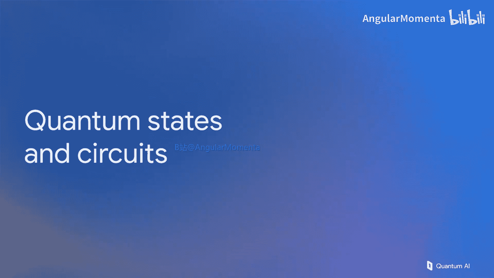
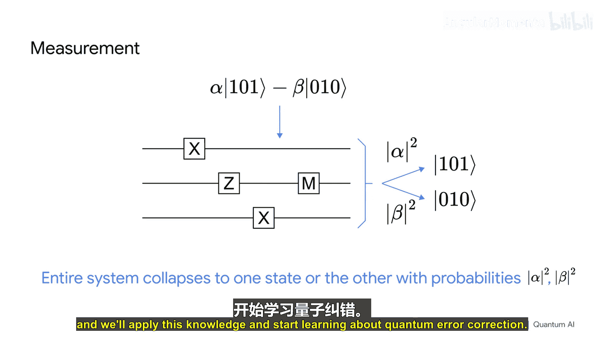

# 【谷歌量子人工智能】借助谷歌量子人工智能进行量子纠错实践-｜-Hands-on-quantum-error-correction-p03-01_03_01_quantum-states-and-circuits--BV1LirPBzEaJ_p3-

嗯。

In this video， we're going to abstract away all of the hardware details and focus just on quantum states。

The zeros and ones of quantum computing， how we can manipulate what their properties are。

 What are the rules to kick off the discussion， We're going to just very briefly talk about the classical case。

 So in a classical computer。 the regular computers we're all very familiar with you have bits。

 bit strings， typically 32 bits，60 poor bits and we manipulate those。 And again。

 in the classical world， we don't think about the physical implementation。

 there' will be nothing in this lecture about the quantum physical side of the implementation。

 we just focus on the rules of manipulation and we know we can do certain things。

 we can take two registers and we can add them。 We can multiply them。

 We can do logic operations on them。 We can bitship them and in a typical processor。

 there will be literally hundreds。 not thousands， but hundreds of different things that you can do to the data。

 Those are the rules of manipulation。 in practice， we don't typically。rite code in assembly anymore。

 you have higher level languages， and there is a very direct analog of all of that in the quantum case。

 we'll start with the very very basic operations manipulating bits， small collections of bits。

 and little by little as we go along， we'll start talking about how you do larger scale operations。

So， let's begin。What can you store in a quantum computer， It's not just a string of bits anymore。

 If you have a collection of quantum bits， collection of qubits。

 what you're allowed to store in that or what's possible to storing that is a set of complex numbers。

 one for every possible state of that system。 So if I have three qubits，8 possible states。

 you can store8 complex numbers， if I was to represent the state of the quantum computer in a regular computer。

 I would need an array with length 8，1 space for each complex number that can be represented。

And it's really worth pausing here and thinking about what that means physically and accepting the fact that no one really knows。

 how is it possible that a small amount of hardware can store an exponentially large amount of information。

 where does that live？How do all of those different numbers physically manifest themselves in the universe？

Now' say no one really knows。 Nevertheless， we can verify experimentally that this is indeed possible。

 you can in fact one by one change the amplitudes of each of those states to store all of this information and you can manipulate it So this is what can be in a quantum computer with just one extra condition Each one of those amplitudes means something its modular square is the probability of observing the computer in that state and those probabilities should sum up to one the computer has to be in some state so hence that condition other than that each amplitude is an arbitrary complex number provided that condition is satisfied Now let's have a look about how we're going to manipulate those amplitudes and probabilities with gates。

The first gate that we want to focus on is the bitf gate。 So an x gate。 notationally。

 when it's given a state0， it produces the state1。 When you give it the state1。

 it produces the state0 of more interest is what happens when you give it a more complicated state for example。

 some complex number alpha amplitude of the state all zeros plus some complex number beta amplitude of the state or1。

 if we use the x2 gate， the gate that is applied to qubit 2。

 and if we use the number in convention that the rightmost qubit is qubit 0 and the numbers increase to the left。

 then that x2 gate will flip the leftmost bit and the result is shown。

 you end up with alpha 100 plus beta 011。And again。

 it's healthy to pause here and just think what we've done。

This could have been an exponentially large superposition of different complex numbers。

 and we have just shuffled them all around with the application of a single bit while this is a very simple example。

 it gives you some feeling for where the power of quantum computing comes from the ability to manipulate an exponentially large amount of information with simple basic operations looking through the remaining two the x1 gate qubit 1 gets flipped。

 the middle qubit in this case， you can see the result on the right and finally with an x0。

 we are using notation where that is the rightmost qubit， unfortunately being a research field。

 the notation is not consistent， but in this course we will be consistent with this notation and you would get the state alpha 001 plus beta 110。

You can do a lot more than just bit flips in a quantum computer。 since we have amplitudes。

 complex amplitudes that can have a sign。 we can also change that sign。 So this is a phase flip。

 a Z gate， the Z gate applied to the state 0 does nothing。

 The Z gate applied to the state 1 inverts the sign of the amplitude。 It makes it negative。

 And again， you can see this inaction on the same set of states we looked at on the previous slide。

 Z 2 will flip the first qubit， meaning the one on the left。 However， mechanically。

 that means the state alpha 00，0 is unchanged because it has a 0 odd qubit 2。 And on the state 1。

11 where we have a one， we have a negative sign appearing。 interesting， here。

 it doesn't actually matter which qubit we apply the gate 2。

 because the states are all zeros plus or ones in all positions。 Any one of Z 2， Z 1 or Z 0。😊。

Just flip the sign of Beda doing exactly the same thing in a completely physically indistinguishable manner。

Now， when we have many gates and a state at input， the standard way of representing that is with a quantum circuit。

 This should be thought of as music。 You have a line for each qubit time runs from left to right and as time runs from left to right。

 you encounter gates that then applied to the state。

 So let's trace through the action of this circuit in the beginning。

 we have the state alpha or 0s plus beta or ones， but then what happens when we hit that first bit flip gate。

 that first X gate。 Well， it's going to be applied to qubit 2 within an our convention is the leftmost qubit。

 and you'll get alpha 10，0 plus beta 0，11。 moving on to the next gate。

 We're going to apply a phase flip a Z gate to qubit 1， the middle qubit。

 So wherever the middle qubit has a1。 we'll get a minus sign。

 and you can see the result on the right。 and we're not done， one more bit flip。This time， qubit0。

 the right most qubit。 and that turns the input on the left to the final output。

 Al 101 minus beta 010。 and you could， of course， have a longer， more complex circuit。

 and you would just continue to apply these gates 1 at a time。

 These are just the beginning of the story， though。

 there are many more interesting quantum gates we wish to introduce the next pair of them are as shown a hadamide gate that takes a0 as input and produces an equally weighted superposition of both0 and1。

 This state has the property that with 50% chas。 when you measure it， you'll see either a 0 or 1。

 Add is a common enough state that it has a name， it's called the plus state。

 and we will see that quite regularly throughout the cost on an input of one。

 it produces almost the same state just with the minus sign。

 and it should be stressed This is still a state with a 5050 chas of giving you either the0 or the one output。

 You might。Ask yourself well how is it then any different to the state up the top you know how is the plus state in the state really any different if you run through a second application of the H gate。

 you will find that a minor state goes back to being a one state I encourage you to do that substitute the action shown on the screen into the plus state and the minor state and see that you get back to where you started and in particular you'll see that if you start with a minor state you get back to one if you start with a plus state you get back to zero So these are indeed physically different states which have an observable difference after manipulation Next we want to actually do some more meaningful computation To date we've only talked about manipulating single qubits to do anything interesting we have to also interact qubits and the most common gate to do that is a controlled not gate if the control qubit。

 the top qubit the one with a small black dot is in the state。One， then flip the target qubit。

 aptly named as it's hit with a target symbol The table of states here should illustrate that clearly。

 you can see that if the leftmost qubit in this case， qubit 1 is0， nothing happens and if it's 1。

 it flips the rightmost qubit qubit 0。There's another gate that we wish to introduce。

 as it will be useful later。 And that's a controlled Z gate。 Very similar to the controlled knot。

 except when the control is one， it flips the sign of the target。

 If the target is in state 1 as well， This makes it symmetric。

 It doesn't actually matter which one you call the control and hence its circuit symbold more like a dumbbell than anything else with two controls。

In essence， if the state is 11， the sign is flipped and in all other cases， nothing is done。

So let's test your understanding of the material so far。 We've talked about quantum circuits。

 how it's the systematic application of the gates from left to right。 Put the states shown into this。

 each one of them， or four of them and see if you can calculate the output。Pause the video。

 take the time， work out those four answers。Hopefully you've had a chance to work that out and what you should find。

 for example， for the 10 case， is a sequence of algebra that looks as follows。

 you start with applying the Haama gate toqubit zero， the rightmost one， expand that out。

 you can rearrange the terms。You can then apply the controlled Z gate。

 which flips the sign of the 11 state。 Lastly， you can then again apply the Hadamama transform to the rightmost qubit。

 And when you expand that out and gather the terms。 you'll find the only thing left is the state 11。

 doing this for each input。 will give you this set of solutions。 And if you look at that。

 it should be familiar。 That's exactly the same effect as applying a c n gate。

 And this is your first circuit identity。 the sequence of gates on the left。

 Haamud CZ Haamard is exactly equivalent to a C n gate。

 So you can interchange these gates in circuits to simplify them and manipulate them。

Now we need to introduce measurement， very critical ga in quantum computing。

 We'll go back to the example we had before。 After the application of these first three gates。

 we had the state alpha 101 minus beta 010。 Now we want to ask the question。

 What happens if I measure that central qubit。 What happens next。Well。

 we'll get one of two possible answers with probability Al mod Alpha squared we'll get the state 101。

 so just by measuring one of those three qubits， we collapse the computer state to just one of the two possibilities All of the qubits are affected similarly with probability mod beta squared we'll get the state 010。

 so these are the two results that are consistent with measuring either a0 or a one on that central qubit main takeaway is the state of the entire computer collapses only to those possibilities that are consistent with the measurement observed on any one qubit。

For those new to quantum computing， weve covered a lot in this video。

 it may pay to rewatch it before moving on and thoroughly check your understanding of the algebra and how quantum circuits manipulate quantum states。

 rework the examples， rework through the quantum circuits。In the next video。

 we're going to assume you're pretty familiar with quantum circuits and we'll apply this knowledge and start learning about quantum error correction。

灯。