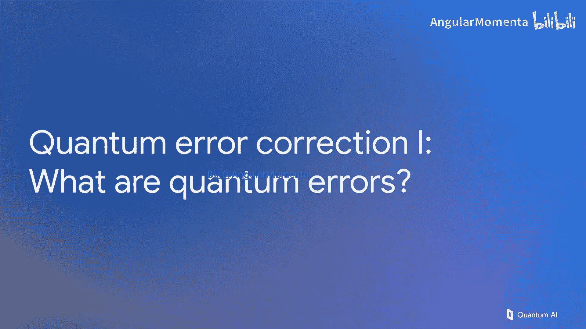
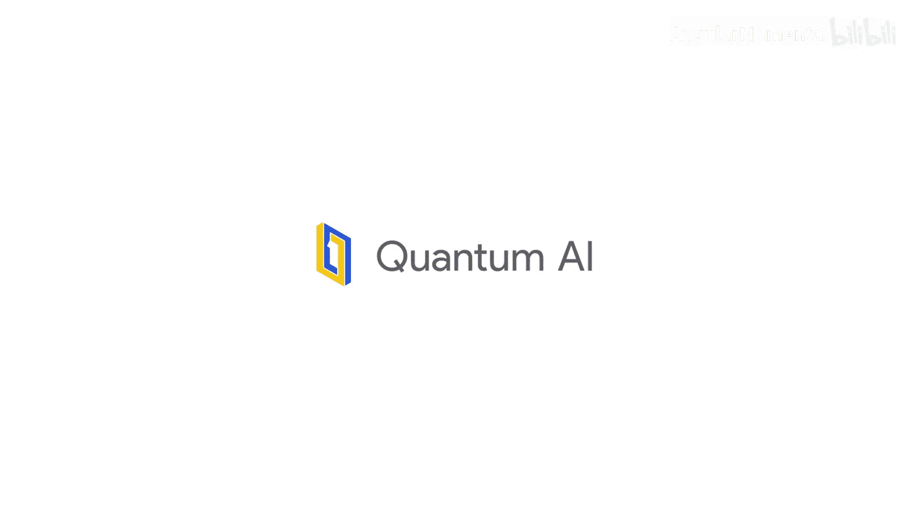

# 【谷歌量子人工智能】借助谷歌量子人工智能进行量子纠错实践-｜-Hands-on-quantum-error-correction-p04-01_04_01_quantum-error-correction-i-what-are-quantum-errors--BV1LirPBzEaJ_p4-

灯。

In the last video we talked about quantum circuits and we assumed everything just worked， no errors。

 in the real world that is simply not the case， it's very difficult to implement quantum circuits and get them to do what you want them to do so we're going to spend a lecture talking about errors。

All the things that can go wrong when you try to run a quantum computer。

As before we're going to start by building on our intuition with classical computers。

 classical errors。 it's simpler， it gives us a lot to work with when we build the concepts。

 So we're going to start with just the classical problem of storing a bit a zero or a one and in particular in the scenario where our hardware has errors。

 It has a probability per unit time of a bitflip。 The question here is well how do we do better if we can't accept a probability P per unit time of a bitflip。

 whether that unit time is a second or a century， if we want to store the data for longer than that unit time with high probability of success what can we do So just pause the view for a moment and think about what you could do given that type of hardware。

So a natural thing to do if you have imperriect hardware is to have more of it， make copies of it。

 that alone is not enough if you just have copies and they each have a probability P of failure。

Then after a time the scales is one over pe， they're all going to be random and you'll still be done。

 You have to introduce some kind of intelligent processing for this to work。

 And a good example of such processing is simply taking a majority vote。

 If you wait for a while and a single error occurs。 but we have five copies as shown in this example。

 and by taking the majority， you'll get back to where you started， the majority is0。

 reset the odd ones out， youre done。 for the moment we're going to assume that this majority processing is both instant and perfect。

 we will progressively remove that assumption as we go。 Supp now that two errors occur。

 Well that's still a minority， And when when we take the majority， we get back to where we started。

 If however， three or more more than half of our bits are flipped， we fail。

 So this is not a perfect protocol， no matter how many bits we use to increase the probability that we are successful。

 there'll always be some probability of failure。 However， this is already pretty good。

 we've gone from a single bit with the probability per unit time of。Of failure to just five copies。

 and now we need at least three， so order p cubed least three errors to occur before you get a failure in terms of terminology。

 what we now have is a logical bit our collection of five physical bits forms a logical bit with higher reliability than any one physical bit。

 we'd like to upgrade the processing even further however。

 and the terminology further so first we want to introduce the notion of a code distance with five bits it takes five flips to get to the opposite state to get from logical0 to logical one。

 That means the coded is5 Once we formalize that notion we can say that a distance decode can only fail if at least D plus one on two errors occur in general。

 if I want the probability of error to be arbitrarily small。

 I can achieve that simply by using more and more bits increasing the。

Distance of the code arbitrarily， and we will suppress errors exponentially。

 We'd like to do a bit more with this example。 We're not done with it yet。

 We've talked so far about taking a majority vote， which implicitly means you're going to look at each and every bit work out what its state is and then take a majority This would not be a quantum compatible operation So we're going to manipulate our processing。

 so we still do the same thing but in a way that we'll be able to grow into quantum error correction as we'll see later。

 So bear with me let's now instead of taking the majority look at pairwise parodies So in the first example with a single error you'll find that we have four parodies。

 the first two of which are one the bottom two of which are0 we can take that information and do anything we like with it。

 we choose to form a graph out of it a four node graph with five edges two of which a colored red because that's where we had our ones our odd pary results。

 This then defines。Graph problem and if you solve the following problem connect the highlighted vertices in pairs or to the nearest boundary such that the minimum number of edges are used this is called a minimum weight perfect matching the edge highlighted in green is that solution a single edge that connects those two highlighted nodes together that tells me which bit went bad specifically the second from the top and I don't actually need to go back to my data at all I can just leave that as knowledge in my compute system that bit is wrong later when I go and look at it flip its result more errors can then occur in the computer and I can use my existing knowledge to calculate parodies correctly so instead of saying that the first two bits lead to a one an odd parody we know that the second bit is wrong and so we correct that to give a zero that allows us to just see the endpoints of the chain of errors。

That is these two new ones， these two new bitfs give us a new graph with two highlighted nodes。

 a new solution with two more green edges， and we're left finally with a belief of where errors are we believe that the middle3 bits are wrong should we then go and actually look at those bits work out what each one is and get the result as shown0 triple10 we are going to use our knowledge of errors to flip those middle bits and get back to the state we wanted It turns out that everything we've talked about is completely equivalent to taking a majority vote take a moment to think about why that is we're going to use this analogy in the quantum case。

 but first we need to upgrade our understanding of errors errors in quantum computers are much richer and much more diverse than simple bitfs As mentioned in the hardware video the hardware we study at Google is not really a quantum bit a qubit。

 It has more than two levels。Just ground state first excited state there are higher excited states too and if our system goes to these higher states that's called leakage and that's a problem because when we interact with a qubit that has leaked to a higher state it corrupts everything it touches worse that leakage can spread around the computer so in this picture we started with a single qubit in the middle about chip that has leaked and then just run a quantum circuit that's intended to detect errors but what it's actually doing its spreading that error around the circuit so this is an example of something that needs to be designed away in hardware if we leave it to the error detection system this is going to cause failure the leakage will accumulate and ultimately the computation will fail here's another way we can get leakage in our system from the measurement process itself so when we measure our qubits we use a particular microwave tone which you can think of as being。

Reflected slightly differently by the two different states。

0 and1 it introduces a shift in the signal that is detectable back at room temperature。

 If you put a lot of power in in principle you get faster measurement you also have dumped more energy into the system and you can excite it to higher states since we have many qubits attached to a single line that can lead to a lot of error on a lot of different qubits so it's something we need to manage。

 we want to measure quickly but we can't do it too quick we introduce a lot of error。 Next。

 because our chip is sitting at 10 millvint very cold and the energy scales of our qubits are so low。

 energy that gets dumped is very significant and you can see a plot of that here This is an impact on our chip that has dumped a lot of energy causing all of our data to heat up become randomized and during a period of time equal to tens of milliseconds which works out to many hundreds of rounds of error detection the chip。

Essential is nonfunctional with probabilities of error close to the 50% level。 This clearly， again。

 is something we can't cope with in software。 we have to mitigate that effect in hardware。

 So what are we left with。 we're definitely left with the conclusion that real quantum computers are not ideal。

 We want gates that look like this。 You apply to a state it gives you exactly what you want at output。

 but in reality that doesn't occur。 We've also shown examples of types of errors that we don't even expect to be out correct using quantum software。

 So how we going to proceed。 We're going to have to rely on the hardware engineers to give us the advice that at least satisfies the following we are going to assume that no matter what errors can happen but they leave us in the states 011 that allows us to represent these two states as a vector with only two entries。

 So the case of the zeros state can be represented by10 and the case all state1 can represent by the vector 01。

If we didn't make this assumption， then we would need longer vectors to represent those higher states and that would become problematic when it came to doing error detection and correction so we are going to focus on this case Similarlyly when we have more than just one qubit2 qubit system by assuming that we have no leakage to higher states that allows us to represent that system as a vector of length for no more this is very useful because when we think about the action of each gate we can now write them as matrices so here is our same hadard gate。

 our same C n gate， but this time expressed as a matrix acting on a vector so the vector alpha beta replaces the original state alpha0 plus beta1 same thing we've chosen representation with say0 and1 that allows us to write it in this form by doing so we can now write H as the shown matrix and the same for c by choosing to limit ourselves to。

The state0 and1， it admits a clean form as a matrix with that done。

 we can now talk about the errors which we can handle using quantum circuits themselves。

 so we're going to allow ourselves to have a single qubit gate。

 which is a two by2 matrix followed by an arbitrary matrix anything at all that's our error Similarlyly a twoqubit gate4 by4 matrix followed by an arbitrary4 by four error matrix。

 I want to reiterate this is still a restriction but this is explicitly ignoring leakage and assuming those things have been handled in error measurement is preceded by an arbitrary error。

 initialization the state0 in a box is followed by an arbitrary error we now want to discuss how do we handle only errors of this form。

 Well， some more definitions these are the poly matrices the identity matrix X Y and Z very handy well use them a lot we're going to focus。

on just the X and Z matrices， bitflip and face flip matrices these are particularly useful because we can use those as a basis for the space of arbitrary matrices I can take an arbitrary2 by two matrix and write it as a linear sum of just the identity gate。

 bitflip face fliplip and both at the same time， and this is actually a profound small piece of math。

 it means that an arbitrary error really is just a combination of these simple errors。

 possibly nothing， maybe a bitflip， maybe a face flip maybe both。

This means we can just focus on bitfs and face flips when it comes to detecting errors and correcting errors。

 because even though they can be very complicated， these arbitrary matrices。

 that arbitrariness is really just a linear sum of simple things。

You can also do the same for multicubbit gates， so this is an example with a two qubbit gate。

2 qubit error can be decomposed as a sum of 16 terms。 Those terms make use of the tensor product。

 the definition of which is shown you essentially take two matrices and you substitute the rightmost matrix everywhere in the leftmost。

 There's an example here of the identity tensed with the matrix Xed。

 you'll see that the matrix Xed has been substituted in the two locations where there is a one。

So we can decompose errors and we're going to make sure that we focus on just finding bitfs and phase flips。

 so our goal now will be to build circuits that do this and then track these detected errors in software something very analogous to what we did in the classical case we'll start discussing these specific circuits in the next video。

