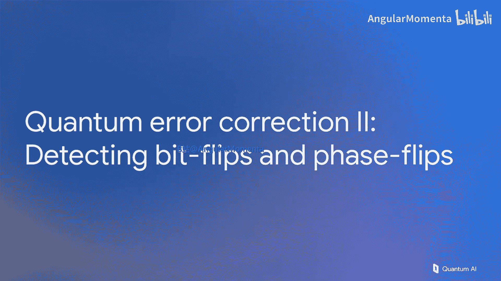
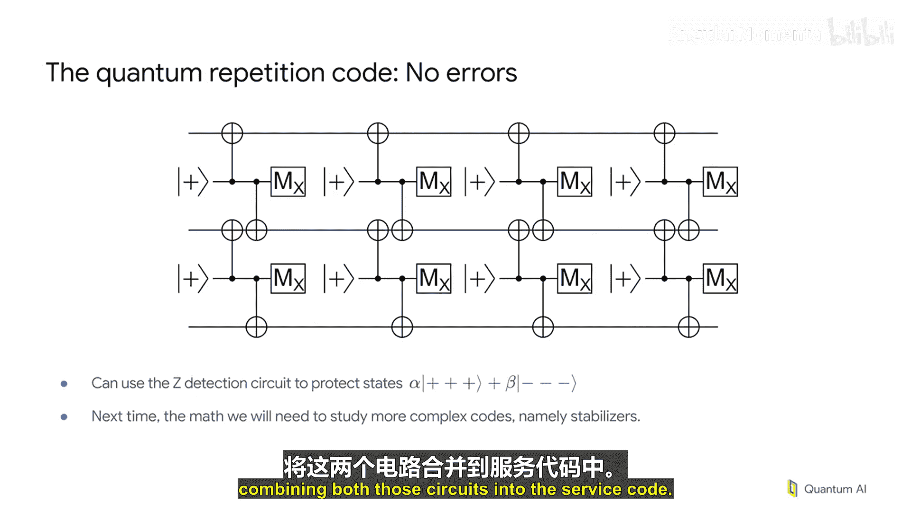

# 【谷歌量子人工智能】借助谷歌量子人工智能进行量子纠错实践-｜-Hands-on-quantum-error-correction-p05-01_05_01_quantum-error-correction-ii-detecting-bit-flips-and-phase-flips--BV1LirPBzEaJ_p5-

嗯。

In this video we're going to start building up the quantum circuits that we need to actually perform。

 quantum error detection and correction in software， we've already talked about quantum circuits。

 the errors that can occur on the gates， now we're going to be very explicit and build the structures to do the work we need to do。

So these are some examples of things that we will need to understand well to build up the circuits that we need to do the quantum error correction work and before we go any further this is a great time to pause and make sure that you understand how to calculate the output of these circuits so please do that now we've talked about quantum circuits。

 make sure you understand what these things do and what the measurements will report with these inputs。

So what you should have found are these outputs and again， check your understanding if you don't。

 because you'll need that in the remainder of this video。So his useful definition。

 when we measure under normal circumstances， the result will be either0 or1。

 we can also define a measurement in a different basis where we precede the measurement with a hadamamine transform and that's called an x basis measurement denoted by Mx。

 so if you like this is the measurement that detects whether the input is either in the plus state or the minus state。

Moving on now let's build something that's a little closer to what we actually do in the world of quantum error correction。

 detection of errors over and over again。 So here is a simple circuit。Doesn't protect logical states。

 but it's a great discussion point。 So let's imagine that the top line is something that we want to preserve。

 It's our data qubit。 and the bottom line， this is our repeatedly prepared and measured measure qubit。

 So what is this circuit good for。Well， in the absence of errors it just produces result zero over and over again。

 this tells us no errors are occurring， so it's useful information。

If an error does occur well that's going to change things so let's have a look at how that changes things。

 so we have a bitflip error on our data qubit and then when we propagate that forward what happens Well it's going to flip the result of all of the future measurements we now have a one state on the top qubit and that will be reflected in the measurements。

 notice that by changing all of the future measurements。

 the thing that really detects the presence of error is the change that change from a stream of zeros to a stream of ones and this is a generic feature that we will use over and over again that errors create changes in the stream of measurements coming out of a measure qubit。

What about this So this is not a data qubit error This is a measure qubit error。

 so what will that do Well our data is still preserved， it hasn't been corrupted at all。

 we have now a measurement that is wrong， It should have been zero but an error occurred before it and flipped it and so that is an odd one out error There's an example of what a measurement error will look like。

So those two cases just keep in mind when the stream of measurements change。

 that's a data qubit error， when you have a single odd one out， that's a measurement error。

Increasing the complexity one more step。 All right， previously， what we did was completely classical。

 you couldn't put any quantum state in and preserve it in any way whatsoever。

 once we start using a single measure qubit to protect two data qubits。 We can do a little bit more。

 For example， we can put in states of the form Al 0，0 plus B to 11。

 and this circuit will detect whether we have states that are the same or different。

 And in particular， since in the absence of errors， both of these states are the same。

 we will still get zero results here。 It will say yes。

 they're both the same in the absence of errors。 This is not enough to do actual correction of anything。

 because we won't know which one goes wrong when an error occurs。

 but it's enough to take the conversation up to the next step。

To go to the point where we can actually tell where the error occurs， well。

 we have to take that circuit and copy it more， so you'll notice this is just what we had on the previous slide duplicated。

 now we have three data qubits and two measure qubits and this will be enough to actually locate where the errors occurred。

So how， as mentioned， the thing we really care about is whether a given measurement is the same as its previous measurement or not。

 if it's the same， no errors detected nearby， different errors detected nearby。

 if you want to be very technical， the green circle encloses two measurements and we call those a detector。

 because if they're the same， no errors detected， if they're different， and error has been detected。

There are many detectors in this circuit。 Every pair of consecutive measurements is a detector。

 and again， note that it's not the specific value of the individual measurements that matter。

 It's the parody of that set， whether that set has an even or a odd number of ones that matters。

Now let's throw in some errors and see what happens Well。

 the first thing you'll notice is that now we have a detector with odd parody and that is the definition of a detection event。

When you get a parody that's not what you expected， you have a detection event and you highlight it。

If we had that same bitflip in a different place， now you can see that we're getting useful information to help us locate that error。

 A bitflip error in this location gets detected by both of these detectors。

Here you can see a bitflip error that has fired off two detection events， it starts off life here。

 and then it will propagate both up and down to trigger a change in the future measurement values on both of these lines that leads to a detection event both here and here and helps us locate that an error must have occurred on this data qubit that is shared by both。

There are other locations where bitlips can occur in this case。

 the bitlip occurs such that it's detected earlier on this measure qubit than it is on this one down here。

 So again the pattern of detection events helps us locate where that error must have occurred when the detection events were next to each other。

 we knew the error occurred in this section of the circuit。When they're aligned diagonally。

 we know that the error must have occurred between these two gates。

 so we're getting very useful information now from a circuit that's big enough to actually locate where those errors are。

We even get a bit more information because this amount of time between these two gates is shorter than this amount of time here。

We can say that the likelihood that we have detection events on this diagonal arrangement is lower than getting a pair of detection events aligned side by side。

 all of that can be used to help us work out where errors may be， so how how does that help us？Well。

 we can go back， we can look at our circuit， we can look at every location where errors can occur。

 work out how every single possible error is detected and add up for every possible pattern of detection events。

 the total probability of errors leading to that so to be explicit this line right here this represents every possible error。

 the total probability of every possible error that triggers just exactly this detection event here。

 and you'll notice I've shrunk the symbol a little bit just to make the graphle a bit clearer a pure overlapping things。

 so this ellipse here represents the detector consisting of the measurement immediately after it and before the thickness of the line is intended to represent the total probability and in particular the total probability of all errors occurring anywhere in this section of the circuit that lead to this exact detector is greater than the total probability of all errors。

In this part of the circuit that are going to lead to this detection of and here and here。

 which gives this line its thinner aspect， meaning lower probability。

So we can build a graph by systematically inserting every possible error everywhere in the circuit。

 we can build a graph of all the possible detection event outcomes with edges with thickness or probability in proportion to the total of all the errors in the underlying circuit。

Now let's suppose we run an experiment and observe a particular pattern of measurement results。

What are we going to do， Well， first， we're going to build all the detection events anywhere where you have consecutive pair of measurements that are different。

 That's a detection event。 So let's highlight those first。 Next， we want to process that。

And we're going to be using minimum weight perfect matching。

 so we're going to search for a set of edges with the minimum weight that pair all of our detectors together or to a nearby boundary Now there's more than one possibility if you just count number of edges because for example。

 I could have chosen this diagon edge here。And this boundary edge down here。

 That still is a two edge solution。 But these edges， the ones associated with a failed measurement。

 and this one， the ones associated with errors anywhere in this section。

 are more likely So they will have low weight， and they'll be preferentially chosen。

 and that is just a better guess。 to stress。 it doesn't mean that the real underlying errors couldn't have been an error in this spot。

 even to these two and an error down here。 So there is always some chance of failure。

You simply maximize the chance that you've guessed correctly by choosing the most likely option。

Once you've done that choice， you can sit there and say， well， based on the available evidence。

 I believe the errors must have been here， and then you can propagate those errors through the circuit to correct the measurements。

Note that in this particular example， if we have two errors， for example。

 let's imagine I had an error on both this top data qubit and this middle one。

 that will be too much for this circuit to decode because these two errors will double flip this measurement。

 meaning it's undetectable。And this error down here。We'll flip this one down the bottom。

And we will think given just a single detection event that there must have been an error here and will be wrong and that will create a logical error。

So this is an example of a distance3 code， it can cope with at most the distance minus-1 on two x errors。

 in this case， one error， so if you have a sparse distribution of single errors。

 this code will not break however when we get the wrong combination or pairs of errors。

 this will fail， you'll guess wrong and you'll corrupt your data and the computation is over。

As this code gets bigger， so as we just keep duplicating this circuit down and down and down。

 increasing the code distance， the number of errors that need to line up on any given path from top to bottom grows linearly。

 and since these errors are independent， the probability that you get at least half the locations on such a line with errors decays exponentially。

 so by linearly increasing the resources， you can exponentially suppress the probability of logical error。

So now let's look a slight variation of what we just studied the same kind of circuit but one designed to detect phase flips。

 so this is an example of the structures that lets you put Z errors now anywhere in the circuit and detect them for the moment we're going to pause there and we'll pick it up next time combining both those circuits into the surface code。

