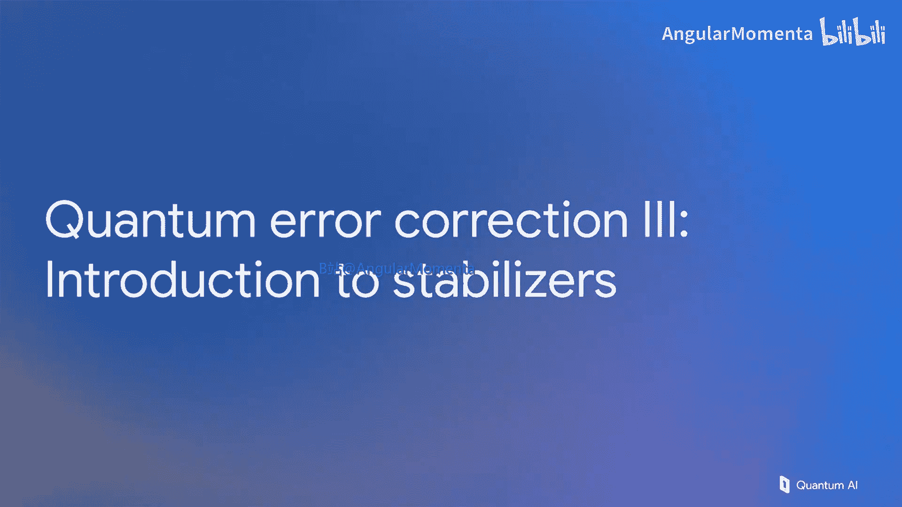

# 【谷歌量子人工智能】借助谷歌量子人工智能进行量子纠错实践-｜-Hands-on-quantum-error-correction-p06-01_06_01_quantum-error-correction-iii-introduction-to-stabilizers--BV1LirPBzEaJ_p6-

嗯。

In this video we'll take a step back and talk more of the theory of quantum error correction。

 we need to build this up as we'll be talking ultimately about very complicated quantum circuits and without some theoretical framework we won't be able to cope with their complexity。

So the theoretical framework we need is the framework of stabilizes。

 and this is what this video is about。So firstly， what is a stabilizer Well。

 we start with poly matrices， the following two by two matrices， the identity a bit flip。

 face flip and both at the same time So this is the Y matrix and you can guess an approximation of that by multiplying the X and Z together So we need to talk a little bit about linear algebra to have any hope of explaining this theory we're going to be talking about tens of products of these matrices and here is an example if this were a fivequbit system all this is really saying is that we're going to flip the first qubit do nothing to the second face flip the next two and then do both on the last one So a more compact version of that is shown here it means the same thing again if this was a five qubit system we would be doing those individual operations to those individual qubits So any signed tensor product of poly operators that's the mouthful that is this。

Slide we'll call simply an operator and we'll be working with those extensively。

What are some simple examples， Well， some very simple stabilizers are just individual poorly matrices。

 for example， a Z matrix， So when you apply this to the zero state。

 nothing happens and therefore we say the state zero is stabilized by the stabilizer said this also allows you to replace the state notation with the operator notation。

We'll come to that more later。 P more examples。 The state 1 is stabilized by the operator， Min said。

 apply that and you get back to where you started and so on for both x。

 which stabilizes plus and minus x， which stabilizes minus。

Some of the terminology we need to be comfortable with is the idea of an eigenstate。

 so these states here are eigenstate of their associated operator。

 they are states that remain unchanged under application of the operator。

So this suggests a substitution of notation if an operator has a well defined plus one eigen state to the state that is unchanged by its application。

 then instead of writing the state， we can simply write the operator at this point it may not seem like there's a good reason to do that after all writing this symbol seems just as hard as writing this symbol。

 but that will increasingly not be the case as we move to more complicated quantum error corrected states。

So let's step up away from single qubits to a multiqubit state。

 a three qubit state in particular this particular threequbit state is stabilized by three independent stabilizers so if we flip each one of the bits then these three zeros become three1s。

 these three1s become three zeros and we're left with what we started with so indeed this state psi is the plus eigen state of xxx and similarly it's plus eigen state of Z Z I and I Z Z you can and should apply these to this state and find that you get back to where he started in this case you may still say well this doesn't look much easier。

 this list of three stabilizers but let's keep going and see where it takes us。

Before we do that let's just really work through the math here to make sure that we're all on a solid footing so let's take one of those examples the Z Z I stabilizer and apply it to that state this is the state taken from the previous slide here is the operator that we're applying we distribute it across all of the states in the superposition Z does nothing to the state zeros and each time we apply a Z to one state we pick up on minus sign so there are two of those because we have two Z operators and that again gets us back to where we started and this is what you should have in your mind when you think about applying a stabilizer to a particular state that sequence of steps so how does that feed into what we're talking about quantum error correction in particular errors。

Well let's go back to this state but now apply an error to it and x2 error we're going to go and flip the qubit2 which now notation means the leftmost qubit so we now have100 plus011 what's changed let's go back and talk about the star we worked through in detail on the previous slide but now apply it to this statement with an error and see what that means well previously without the error we have the plus1 eigenstate of Z2 Z1 now when we work that through well x2 you can just pull through past the Z1 operator because these are different qubits that don't interact at all and then x2 and Z2 which touch the same qubit they anticommute pull it through pick up a minus sign and what we can now stay is the state x2 psi the one with the error is the minus1 eigenstate of the operator Z2 Z1 So after suffering an error we've changed the statement of whether。

We have the plus or minus one eigen state of a particular operator。

 so if we can work out how to measure whether we have the plus or minus one eigen state of our stabilizers。

 that wouldt be a way to detect errors and indeed that's what we're going to do。

So what circuit is capable of telling us whether a state is the plus or minus1 eigen state or the particular operator。

 well the answer is this circuit， and you should go and have a go at trying to work out the output of this circuit for the two possible measurements 0 and1。

Now， assuming you've had a go at doing that， let's now step through it together。

So in the beginning we're just going to have the state zero psi just what we had an input after applying the hadamama transform that's going to give us the plus state equals superupposition of0 and one on that first qubit we're now going to do a controlled a gate which means if the control is one apply the operator a to the state psi and if it's0 to nothing so in the zero case we do nothing in the one case we're going to have an a applied to state psi we then going to apply another hadamm gate so taking this state and applying that to0 we get another plus a applied to one we get a minus state and then if we rearrange those terms to really emphasize the two possible measurement outcomes this is the measure outcome0 will leave this state on the remainder of the qubits if we get a measurement outcome1 we be left with this state。

The remainder of the qubits and if you look at those two things with care。

 you'll see that this is the plus one eigen state of a。A psi plus a squared psi。

 given a squared is the identity is exactly what we started with。

 So not only does this circuit tell us whether we have the plus or minus-1 eigen state of a on the qubits it touches。

 given any input state， it will project that input onto one of those two eigenstate。

 either the plus one eigen state or the-1 eigenstate depending on the observed measurement。

 So this is the circuit we were looking for。 it tells us whether we have the plus or minus-1。

 and it also cleans up our state if our state was some deviant from one of those two possibilities after running this circuit。

 it will be cleaned up and only be one of those states or the other。

 fundamentalmently this is the circuit that keeps our forever wanting to be messed up quantum states clean。

So let's now run through a specific example locating that error with our stabilizers。

 continuing the example of the same state we had before where we applied a bit flip to the second qubit。

 the leftmost qubit， and then that flipped our stabilizer Z Z I to minus Z Z I a good exercises now to go away and ask。

 well what will the signs of the stabilizers be after these errors， and you again take a moment。

 look at the states work that out。What you'll find is that if you flip the middle bit is that then that flips both of these signs。

 this is the middle qubit， if we put an error that anticommutes with both of these and stabilizes both of their signs will be flipped。

 and last but not least if we just flip the rightmost qubit qubit0。

 that anticommutees only with the last stabilizer and its sign will be flipped。

Let's now present one more representation of this exact same state so we can represent psi as an explicit state。

 we can represent it as a list of stabilizers and we can represent that list of stabilizers as a picture so if we define this notation3 qubits。

01 and 2 a shape that connects them in this case a triangle which is white colored。

 this will be our x stabilizer， this is our x2 x1 x0 stabilizer in piicctoral4 also we can look at the two z stabilizes here which touches qubits 2 and1 that's this object and finally the third stabilizer touching qubits1 and0 this shape represents this piece of map。

So we can also then talk about errors on this， so if we have a phase error。

 something that flips the first stabilizer from positive to negative。

 we can represent that on our diagram as a flipping of the sign of this part of the picture。

 this is what we wish to build on when we start discussing the surface code and that will be the topic of the next lecture。

灯。

