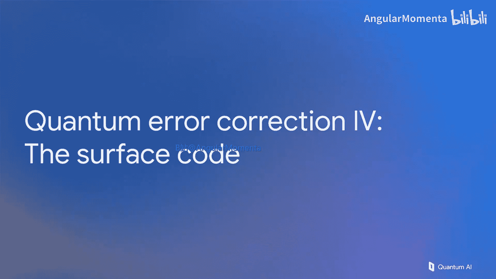
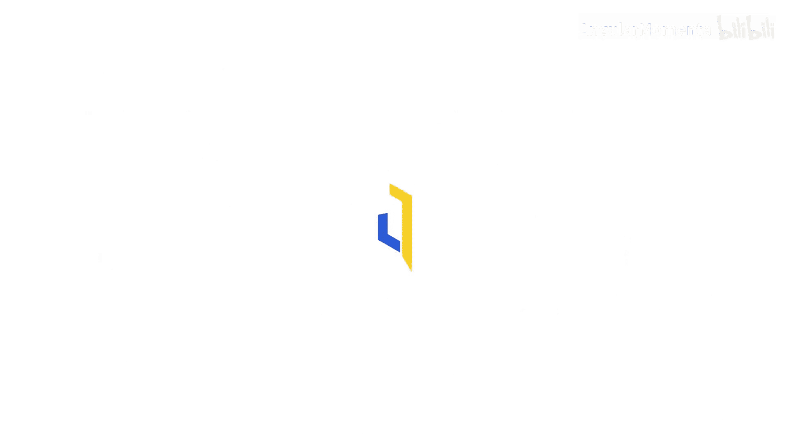

# 【谷歌量子人工智能】借助谷歌量子人工智能进行量子纠错实践-｜-Hands-on-quantum-error-correction-p07-01_07_01_quantum-error-correction-iv-the-surface-code--BV1LirPBzEaJ_p7-

嗯。

In the previous lecture we talked about the notation of stabilizers how to represent a complex quantum state as a list of stabilizers in that video the states weren't very complicated but as we'll see in this video when we start to talk about the surface code。

 the notation of stabilizers becomes very necessary indeed。So to recap。

 we talked about three ways of representing a state as an explicit state as a list of stabilizers or that same list of stabilizers but represented pictorially。

We like the picture approach because that lets us present the surface code。

 this is the smallest non trivialvial surface code nine data qubits in a square with an array checkboard of x and Z stabilizes。

So why do we prefer this versus any other representation， well， let's take a look。

So if we represented this as a list of stabilizers。

 it would already be a fairly unwieldy piece of math， if we were to represent as a state。

 well it would be even worse， this is the result of preparing your dataqubits all in the zero state and then measuring all those stabilizers to prepare the logical state。

 the state itself depends on the value of the measurements and is really not realistic to work with。

However， it is at least good to be aware that this can be written down and also to explicitly see how you do logical operations。

 so as an example we can bitflip this vertical line of qubits and what that will do is produce a new state that is our logical one now this is not the only way to get from logical zero to logical one。

We， however first to be able to discuss those other ways。

 we'll simplify the notation a little bit so our logical X operator for the moment is the flipping of this vertical line of qubits。

But it could also just as equally well have been this line of qubits provided it runs from the top edge to the bottom edge and that line of X operators commutes with all of the Z stabilizes which means it touches all of the dark squares on exactly two places or an even number of places。

 then that's a perfectly valid logical X operator， and this is why it's called a topological code。

 many of its properties only depend on whether we connect from one place to another place in this case from the top edge to the bottom edge using a line of X operators。

 not the specific details of the shape of that line。We can do the same thing with logical Z。

 which turns out to be a line of physical Z operators from left to right。

Here is an example touching exactly the middle row， but again。

 it's not the only way to do so once we accept that you can use arbitrary lines of operators connecting top to bottom left to right for our logical X and logical Z and don't really need to talk about which qubits are touched well then we can also drop the qubit numberings and that's very helpful because then we can start talking about larger lattices without getting overwhelmed with the notation。

We can go even further， let's suppress even the checkerboard pattern self and just focus on the fact that on the top we have an X boundary somewhere that a chain of X operators can end。

And at the bottom boundary， the same type。 And left and right， we have said boundaries。

 places where chains of Z operators can end。 What you can now see is that given an arbitrary line from top to bottom。

If we draw any line from left to right， it must cross that line an odd number of times。

 If we went directly， that would be a single time。 if we go past and then come back and go back again。

 or that's two more times and always will be an additional。

Pair of times so it's always an odd number of crossings。

 you always have an odd number of locations where you have a logical Z intersecting with a logical X operator。

 which means t'hou anti commmute and that's something we need to be true to have valid logical X and logical Z operators。

Al right， so those are the stabilizers of the surface code and we spent a bit of time talking recently about how to detect what the value of the stabilizer is and here are those explicit circuits written down so if you like this circuit down here has the closest form this is the controlled a gate we discussed earlier where a is X X Xx these are controlled not or controlled X gates。

This is an explicit representation of that circuit it will tell us whether。

In this location we have the plus or minus1 eigen state of x on these four neighboring qubits there is。

 however， a question， okay these circuits measure which eigen state we have we can use them in principle to detect errors but what's the order of the gates。

 we have many possible choices is there a preferred choice。

Before we talk about that we need to talk about how errors propagate through circuits so if I have a bitflip error on this qubit and then would like to know what does that bitflip error look like after the synO gate well we can calculate out that by putting an identity operation to synO gates before it and then just work out what this group of gates equates to and the answer is two bitfs so a bitflip propagated through the control of a synO gate leads to two bitfs Similarlyly a phase flip propagated through the target of a synO gate leads to two phase flips and this is important so we need to be careful that we don't arrange the order of our gates so that this copying process is dangerous。

So let's look at this explicitly， Z errors can become pairs of errors。

Bitflip errors can become pairs of bitf errors。We don't want this to break our code。

 We want all of our errors to be random independent along the path of a logical operator。 So。

 for example， if we arrange our circuit such that it could turn a single error into two errors along this line。

 That would be bad。 So here's an explicit example of it being bad。

 We've taken the example of face flip errors and we've built a circuit that touches these two qubits last。

 That means a single error on our measure qubit can become two correlated errors。On our data qubits。

 it now only takes two random events to cause a chain of errors that is very close to a logical operator and will confuse our decoder be corrected wrong。

 our decoder will think you must have had just a single error over here。

 and that will corrupt our data and our data will be lost。

 This doesn't meet the level of performance that we want。 This is a distance 5 code。

 If you count the number of qubits from corner to corner on this square。

 you'll find there are five qubits each way。What it should take is five errors to go undetectably from a logical zerotological one or at least three independent errors to get over halfway there and confuse the Dakota so that it introduces corrections that are wrong。

 This is the wrong order of circuits to achieve that level of performance。 Instead。

 it's very important that the last two qubits that are touched in this circuit。Propagate。

Face flip errors in a direction perpendicular to our logical operator。Previously。

 we saw what happened when they were parallel。 you degrade co distance。

 It takes fewer errors to break the code Here we maintain the cod。

 It's still going to take a number of errors equal to。Technically， the code distance plus one on2。

 in this case，3， three independent errors to break a distance5 code with the number growing by one every time we increase the coded by two。

 and that's true of both types of errors not just phase flips need to be oriented so their circuits propagate errors perpendicular to the logical operator。

 it's also true of our bit flips so this circuit must also be arranged so that its final two gates。

 touch qubits that are perpendicular， so this sets a constraint on the layout of the order of our operations so that we preserve the full strength of our carefully constructed code。

Once we work with that constraint we can find orderings that are consistent with perfect parallel application of these and still don't propagate errors badly so here is one such example ordering which is perfectly parallel you'll notice that everyday cuubators always touched by gates in separate time sequences it would not be legal to have a number here corresponding to a time step that was shared so this is a valid ordering。

 there is one more technical constraint that you must be able to say which one of these stabilizes is measured before any neighbor so if you look at this one you'll see that the one two gates are earlier than the two four gates so this one is measured earlier than this one in a nearest neighbor sense that's also an important property that you'll find as satisfied as you go around this checkerboard it's always possible to tell a pair of neighboring stabilizes which one came。

First， even though in some sense they measured at the same time。

 the gate ordering gives you that ability to say that。Alright。

 so we have a circuit that doesn't propagate errors badly can be implemented perfectly in parallel。

 So now let's start doing things more than just detecting errors。 How about some basic computation。

 what about initializing and measuring a surface code Well。

 if we want to prepare the logical zero state。 you actually have already seen an example of that。

 you simply start by initializing all the data qubits to0。

 And then once you start measuring all of the stabilizers， you'll have logical zero Similarlyly。

 if you would like the logical plus state。 Just start by physically initializing each data qubit2 plus at the other end。

 when it comes to measuring， it's just a simple want to measure the qubit in the logical Z basis meaning。

Ask whether it's in either the logical zero or the logical one state。

 then measure all the physical qubits in the regular way。Ask each one， are you a0。

 I your what last but not least if you wanted to measure that logical qubit in the logical x basis。

 meaning is it the plusstate state or is it the minus state。

 you can do that simply by measuring each data qubit in the physical Mx basis。

 meaning how do I transform and then do a regular measurement。

So those are the simplest logical operations， initialization， measurement。

 both in two possible basics。If we would like to do a bit of memory。

 so not just initializing that immediately measure。

 but in between actually run error detection multiple rounds。

 we'll end up with a circuit that looks like this this is just a slice through the surface code because it's simpler to talk about the full circuit for the entire surface code would be too complicated to write on a slide。

 so let's look at this as a proxy for the surface code and check that it works the way we expect so if we focus on the circuits to detect bit flips。

 the ones that measure Z stabilizes， then at the very beginning if you want to run a full circuit we have a single measurement that is going to tell us information about errors。

Because we expect this measurement to return the result0 in the absence of errors。

 the key difference between this on the slide and what we've talked about previously is this initial round of state preparation。

 So now we don't have to compare this measurement with previous measurement for a start there is no previous measurement where're already expecting it to be0。

 so it cuts one。 That's a detector all in its own right。Moving to the body of the circuit。

 we're back to what we've discussed earlier， we compare each measurement with the measurement before it。

 that's a detector。And there's one more case that's new。

 That's the final round of measurements here we're going to compare direct physical measurement of our data with the previous measurements。

 these two measurements are a direct measurement of the Z stabilizer because we measure each qubit individually and we can take the parodity of these two measurements and that will tell us whether we have the plus or minus1 eigen state if they're equal。

 we've got the plus  one eigen state if they're not equal。

 we've measured the minus1 eigenstate and that means that if we take the parody of all three of these measurements。

 that itself is a detector， it should be even in the absence of errors。

 it will be odd if there is an error nearby。So let's briefly look at a small piece of the three dimensional circuit that is the surface code and just really emphasize that nothing is different。

 It's more complicated。 You would typically do this analysis in software。

 not on a piece of paper or in a slide， but it's not different。

 You still fundamentally have a circuit consisting of initialization， See not gates and measurements。

 You have errors that propagate and trigger detection events。Fundamentally。

 you're going to use all of that information and you're going to build a graph that is now three dimensional where the diameter of the edges represents the total probability of all error processes leading to that edge。

 meaning detection events at the endpoint of that edge， and then when you run the actual experiment。

 you're going to hang those detection events on this graph。

Do men white perfect matching on the graph to work out the most likely underlying errors that explain the observed detection events。

So even for distance5 what's shown on the page5 by5 data qubits plus another 24 measure qubits。

 this is a 49 qubit circuit so if we actually want to run this circuit。

 analyze its output and work at how well this is going to perform。

 we're going to need some pretty advanced tools to do so that will be the topic the next video before we close out this one just note that if you're interested in more details about computation we' have only talked about memory in the surface code。

 there are a couple of references here that will take you through the details of doing CNO gates and other more complex multiquubbit and single qubit logical operations on the surface code but anyway till next time we'll get talking about our advanced tools to analyze the surface code specifically in the context of memory where you can still learn a very great deal。

嗯。

