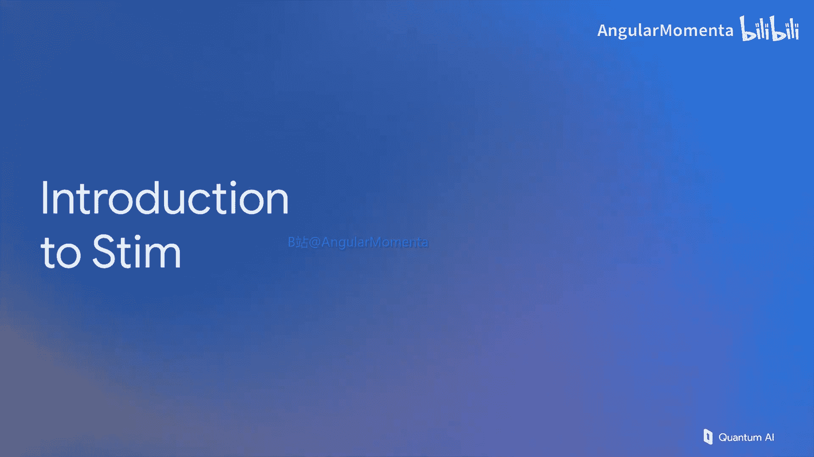

# 【谷歌量子人工智能】借助谷歌量子人工智能进行量子纠错实践-｜-Hands-on-quantum-error-correction-p08-01_08_01_introduction-to-stim--BV1LirPBzEaJ_p8-

嗯。

In this video we're going to start talking about STEM。

 which is a piece of software written by Craig Gdney that we use to simulate quantum circuits to generate output specifically for quantum error correction that we can then use to assess how well a particular protocol works。

This will be an interactive presentation at points where we'll ask you to actually go to the STM repository。

 download and make use of some of its getting started notebooks and actually go in and code a few examples as we go just to build familiarity with this tool and how to make use of it There'll be a lot of talking about syntax and file format and kinds of things you need to do to use STM and with that let's begin。

So just to recall， the last lecture ended with the surface code and the comment that even at distance 5。

 which is still a relatively small code， we're talking about a 49 qubit circuit， lots of gates。

 how are we going to actually simulate。So the answer is STM you can certainly check out the original reference for that and I encourage you to do so but the takeaway is that this is a piece of software that lets you simulate circuits 1000 plus times faster than any other tool out there to take an extreme example this is distance 5 on the screen Well imagine the distance 100 version of that 20 times wider and taller STM can simulate that circuit 100 rounds of it distance 100 in just 15 seconds and then sample shots of that experiment distance 100。

100 rounds， 100 times a second， so very powerful very useful tool and our goal is to get you using that tool today。

So here is what you get after using STEM so when you put in the right code software that defines the circuit that is the surface code for different distances and the error model that you wish to use you can then plot using the package of tools the logical error rate versus both physical error rate and code distance and produce something that looks like this there's a lot of information in here two of the most commonly talked about numbers are the error rate at which error correction doesn't help so at this error rate。

 the threshold error rate increasing the resources devoted to error correction making your code bigger does not lead to suppression of logical error at all useful for theory but in practice where you really want to know is something more like this number at what physical error rate do you get a factor of tense suppression for example in logical error every time you increase the code distance by2 so that。

Suppression factor， we typically call Lambda and achieving a piece of physical hardware with a good Lambda is the primary goal of hardware research in quantum computing and the goal when using a tool like STM is to work out what kinds of physical error rates and architectures and herocreation codes can ease the burden on the hardware and achieve high Lambda with less physical effort。

So。First we're going to talk about the syntax of STM and just as before we typically avoid talking about the entirety of the surface code circuit because it's a lot。

 we are going to focus on just a piece of the surface code which looks like the repetition code I' tried and true example that we keep coming back to because of its simplicity and being very representative of how the surface code works This circuit on the right is precisely this hut of qubits out of the surface code it only focuses on bitlip errors but it gives you all the flavor of everything that needs to be done so let's look at the specifics we want to define this circuit this repetition code circuit using the notation of ST fundamentally the input to STM is a text file that specifies all of the gates and all the error processes you wish to be on those gates and it starts with simply resetting all of the gates the notation is very compact so a single R followed by a list of numbers means reset each and every one。

Of those qubits that is this blue section of the circuit here moving on next。

 we're going to apply errors so we have to explicitly list these in ST。

 it doesn't assume a particular error model for any gate if you don't specify errors the gates are applied perfectly so we are going to go in and deliberately apply with probability P1 the minus3 in this case。

 a bitflip error to each and every one of those qubits。

 these will be random independent bitlips next we have some C gates and again the notation is compact a single cx then a list of gates。

 This is control0 target12 target 3 That's what you'll see here。 again。

 we need to go in by hand Add in the errors first two qubit noise to each of the two qubit gates and we can't forget the extra idle qubit we apply single qubit noise The depolarized means an equal chance of every possible error in the case of a single qubit equal chance of X。

Or Z errors in the case of two qubits equal chance of the 15 possible nontrivial products of I X Y and Z So IX I Z z y all of those non-trivial products equal chance of occurring and we can keep stepping through it a bit quicker now these are the C note gates pointing up the single qubit error for the idle two qubit errors for those two gates another point of note is that when you wish to simulate error prone measurements。

 you need to go in and put errors before the measurement gates after all。

 once the measurement is complete， there's no quantum of anything left So you have to model an error prone measurement as an error occurring for the gates。

 whereas with every other type of error we model as an error occurring after the gate So qubits1 and3 get a random chance of bitf before the measurement is then applied once again。

 depoizing noise for the idle qubits Now again， we have something new the concept of a detector we've talked about detectors。

Extensively through this video series now we have their explicit realization in code in STEM。

 The first part of the notation is an arbitrary coordinate as the user your free to specify this。

 it makes sense to specify it in some manner that relates to the qubits so it's easier to remember it's arbitrary and independent but it makes sense to do it in a sensible manner here we've chosen to represent these detectors as occurring in the coordinates 10。

 meaning you can think of this as qubit 1 and you can think of this as timeet0 where we're making time stepss the number of rounds These individual measurements are detectors all by themselves as we discussed in previous lecture by providing initialized states。

 we know what this measurement should be， it should be zero and if it's not that is a detection event so the individual measurement is itself a detector。

Alright so that's that block of the circuit One more thing you can do which helps STM display circuits nicely is you can add tick instructions so these just divide the circuit up into easy human comprehendible steps that make it easy for STM to then display it in a neat manner they don't do anything to a simulation and just make it easy to check that you've input the correct circuit we won't keep those just because we don't have enough screen space to do so Now let's move on to the next block so superficially it's similar it's a repetition of the first block it doesn't have the initialization gates。

 we also want to be able to repeat it multiple times and we'd certainly not want to have to explicitly write those gates out over and over again and you don't need to so STEM has the concept of a repeat block and there are a few things in here that are new so this is all common we're now only resetting two of the five qubits all the way down to when we get to here where we have something new。

The shift towardss instruction what this means is that every future detector is going to have its coordinate shifted by whatever is in here so we're saying shift space the xant not at all shift time by an increase of one so the future rounds of detectors will differ from the previous rounds by one extra unit of time and again this is arbitrary it just makes sense to choose numbers and relationships that are easy to remember and intuitive Now our detectors have two measurements where into the regime where to detect an error you have to compare it with the previous measurement and here it's good to emphasize that in STM the most recent measurement is stored in an array such that you access it by using minus1 minus1 is the most recent measurement minus two is the second oldest and so on these are further further back in time and in the file you need to untangle that linear array and work out which measurements you actually。

To compare， to construct your detectors。Moving on。The last piece of the puzzle is the final round of measurements。

 This is a much simpler circuit than previously。 The key thing that needs to be remembered， however。

 is that now we need to take pairs of measurements in the final round and compare them with a single measurement in the second last round。

 So the biggest thing that's new is we now have a detector with three measurements in it to form it。

Now one last piece that we need is well did our experiment succeed or not if we initialize our data qubits to all zeros and our experiment succeeds。

 then we should have the state zero at the end after all of our corrections which means any one of these measurements after being corrected should have the value0 if after corrections these measurements have the value1 our correction has failed at some point in the time our data has not been preserved that will be recorded as a logical error occurring since any one of these tells us that the observable that we tells S to track is any one of those final measurements we've chosen the minus1 measurements this one but it would have worked equally well to have chosen the minus-2 or minus-3 measurements that're all fine round measurements they all tell us whether we have successfully preserved state zero or erroneously been flipped to state1。

All right， now some exercises。 So this is where you really want to go pauseuse the video。

 Down the STM Github repository。Go and actually start coding and the first thing we want to code is just assemble all of the code from these slides into a single file。

 add tick instructions so it's clear which rounds are groups of gates gathered together and then modify it modify it in a small way just to get a bit of experience with the format modify it so that the last round of measurements doesn't occur here later than this round that actually occurs at the same time because it could。

 there's no reason to delay these measurements physically you might as well do them all at the same time。

 Once you've done that， what STM really means is not a single file with a single code distance you really want to create a python script that outputs that text file for an arbitrary code distance and an arbitrary error8 P there should be variables that you input and the output should be a STM file with the appropriate generated circuit and error model if this seems like a lot of work well it can be and there is certainly research on。

Going to try to make this easier and more intuitive and not require low levell programming to create the circuits。

 the detectors and everything else that goes with it so that you can run a STEM simulation。

 but for the moment that's the exercise， give it a go。

Once you've given that a go the answer the question becomes well where does that function go so here is an example of a similar thing that is already in STM so there is a function that you can go and use it to generate repetition code memory experiments so you might ask well why did we do the exercise on the previous slide and the answer is the built-in functions don't generate an error model identical to what we just did built-in functions don't put errors on the idle qubits so what we've built in the previous slide is an exercise that matches a very common error model in the literature where every qubit whether it's either doing a gate or not doing a gate is subjected to noise not the default in ST you have to code it now you have so what you want to do is you want to find this function in the STM getting started notebook。

You'll find it in section 7 and you want to replace it with the one you've hopefully written what will happen when you do that is you will be able to generate the output of simulations for various codistances and physical error ratess using your function that generates your circuit with your errorol。

And what you get is something similar to this for larger distances at low error rates。

 you will see rapid suppression of error。Let's take things one step further。

 keep working through the Getting started notebook and really take note that when you have bigger codes。

 you have to have an error rate below threshold to get an improvement This is common to all forms of quantum error correction there's always a threshold error rate the higher that error rate is the better the easier it is to build a device that can satisfy that constraint the less than it and actually get a benefit from Chmer correction Similarlyly。

 as mentioned earlier， while that's a great number the threshold error rate and even better number is the error rate where you get a factor of 10 suppression each time you increase the coded by two Also take the time to find that error rate for both your repetition code that you coded and the service code example in STEM once you have those numbers that gives you the foundation for a great deal of future work when you want to work out the overhead of an algorithm。

 you can take the rate of suppression of error with。

Memory and use that to calculate how much error is likely to accumulate in an algorithm throughout its full volume that will then tell you the strength。

 a error correction you need size the code distance that you' will need and then the overhead of the algorithm so you can work out exactly how many qubits how much time is required execute an algorithm at all starts with creating plots of this form for simple memory experiments with that we're going to close out and say that next time we're going to take a look at another tool written by Craig Gney this time crumble and that is for analyzing some of the most complex circuits in the surface code。

 the ones that actually let you do logical operations and more exotic things such as moving codes around。

