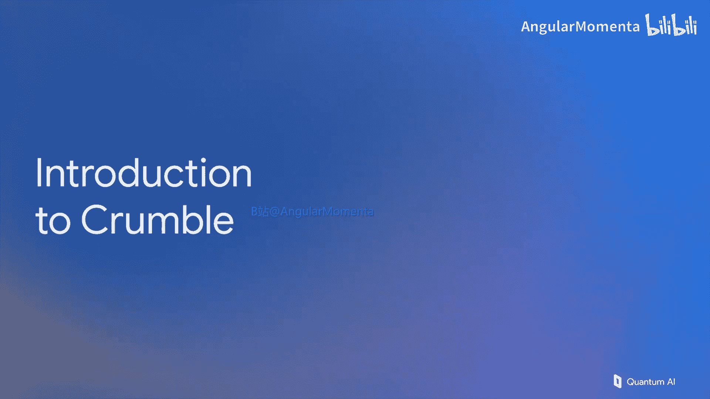
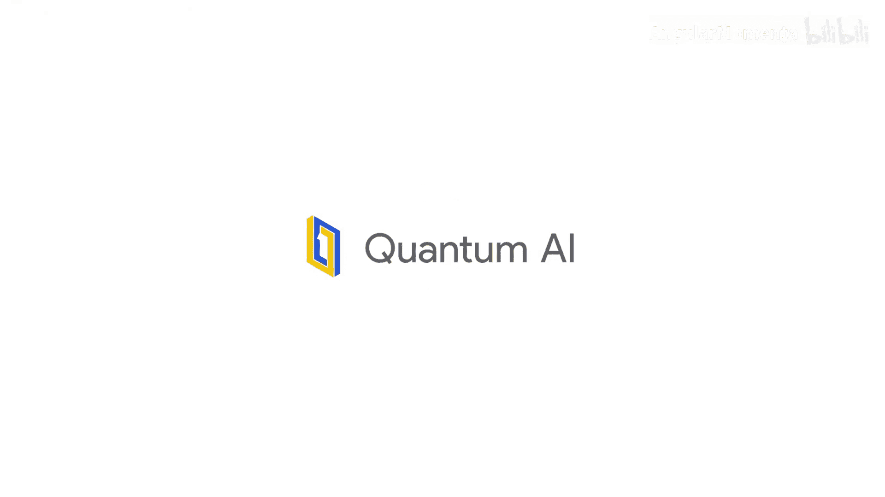

# 【谷歌量子人工智能】借助谷歌量子人工智能进行量子纠错实践-｜-Hands-on-quantum-error-correction-p09-01_09_01_introduction-to-crumble--BV1LirPBzEaJ_p9-

嗯。

In this video we're going to introduce another tool written by Craig Gney Crmble。

 so this is an advanced analysis tool to give you detailed understanding of how Pol operators propagate through circuits。

 and in particular give you insight into the detectors， where they are， what they are。

 it might seem strange that you would need such a tool but as we'll see there are some circuits where it is actually quite complicated to work out what the detectors are in the Quara corrections circuit and we'll go through in the very last stages of this video。

 one of those more advanced examples。So first things first what is crumble。

 so it's a tool that allows you to specify a very general circuit and then put in poorly operators and see how they propagate so on the screen you can see an example of an X error propagating through in red a bunch of CO gates and reaching a bunch of measurements and what we will talk about initially is what all that means。

 what do all these colored lines mean how is it actually making anything clearer to us whatsoever。

So first to recap， when we propagate errors through SO gates。

 if there's a Biler error on the control of the SO gate。

 we get two bitler errors at output in crumble， these are represented by colored lines。

 red for X would then split to two red lines out or the synO gate if it goes in on the control and similarly for Z they're represented by blue lines。

 if it enters the target of a synO gate， it's going to exit on both the control and the target。

If you have an error that goes through a Haamard gate or some other basis transforming gate。

 then for example you can have an X， a red line merging as a Z era。

 a blue line and silly there are Y errors， green lines as well that can occur if you put your errors through an appropriate gate。

 so those are our determined that's our basis set， colors， red for X， blue for Z， green for Y errors。

Now， meaning， let's really look at this at a low level and try to work out what it is that the tool is even telling us。

 so let's imagine you input this circuit into crumble and now let's trace some poly operators and see what that tells us let's in particular look at this poly operator So what is this telling us right now this circuit prepares the measure qubit in the state0。

 the state0 is the plus1 eigen state of the operator Z。

 So by putting a little bit of blue right here in the circuit。

 what we're saying is that at this point in time this place in the circuit。

 we know that we have the plus1 eigenstate of Z。 that's the zero state that's the plus1 eigenstate of Z。

 as we move forward through the Cn gate what we now know is that at this point in time we have the plus one eigenstate of ZZ on those two qubits。

 So as an exercise prove that this is true。It's not a hard proof。

 simply start with an arbitrary state that you know is a plus one eigen state of Z and then apply the SO gate and see what new eigenstate you have after doing so。

Moving past the next CO gate gives us yet another Z。

 and so now we know because we prepared the measure qubit in the zero state that by this point in circuit。

 we will have the plus1 eensai and Z Z set。But now we're going to measure out one of those qubits。

 so this measurement may return zero， may return 1 and may tell us whether we have the plus or minus1 eigensat of Z on this qubit。

But since we know that we had just before measurement， the plus one eigensstate of Z Z Z。

 knowing after measurement that we have the plus or minus1 eigenstate of Z just on that middle qubit tells us whether we have the plus or minus-1 eigensstate of Z Z on these two afterwards。

 so these are correlated， the eigenstate of Z Z after measurement will be the same as the eigensstate on the qubit measured。

 so we have still a known eigenstate up to the result of the measurement。Moving further。

 there's another reset gate here。 This introduces another piece of knowledge to our system。

 We know again that this middle qubit is in the plus eensstate of Z。 This is an isolated fact。

 but we can combine it with our knowledge of a known eigensstate of Z Z and say that now we have again a known eigens state of Z Z Z。

 and that known eensstate will be， whatever this measurement reported earlier。

Continuing after propagating that through this sea night gate。

 we collapse down to just a Z on this qubit。Continuing after propagating through this synaught gate。

 we collapse down to just a Z on this qubit。 What that is saying is that when we run this circuit in the absence of errors。

 whatever this measurement reports plus or minus-1 eigenstate will have that same plus or minus-1 eigenstate here。

 And since we're talking about single qubits， it means if we measure a0 here。

 then in the absence of errors will have a zero state here and one will imply a one state here。

 So that final measurement should give exactly the same result as this measurement。

 this is a way to trace operators through a circuit to discover what the detectors are。

 which set of measurements are detectors。So what about all of the blue。

 what does that mean it means that if any error that anticommutes with this type of operator blue means that。

 so any X error occurring anywhere on any of these places highlighted in blue that will lead to a change in whether these measurements are the same or not。

 so will detect it， so this is called the detection region we have a detection door。

 the set of measurements， a detection region， everything in blue and then finally a detection event is when you put experimental values into these measurements and you find that the parody is odd if they don't match that's a detection event。

 they should match in the absence of errors。All right。

So now let's round this out by actually doing this in practice， let's fire up。

 crumble and see how it works interactively。Okay， so this is crumble there are several things that you can do in crumble。

 you can define the circuits from scratch or you can simply click on one of these examples。

 which is what we've done here， we've chosen a surface code example， codedance 3， two rounds long。

The circuit for that is shown on the right and。As presented。

 it is perhaps not the most intuitive thing in the world。

 What we want to do is analyze that circuit using Sim to work out where the detectors are in exactly the same manner that we did by hand the simple example on the slides。

 So let's do that。 Let's choose a reset gate。 Let's put a Z operator on it。 you do Cy pressing Z1。

 The number is just a label。 There are many labels you can apply。 The operator is Al port de Z。

 So we've put a Z operator with label 1 on that reset gate。 And what you can see on the window。

On the right is that operator propagated through the circuit。And again， at any slice in time。

 what all of this blue means is that because we initialize this qubit to the state zero。

 we therefore know the eigen state of。Z operator is touching all the blue locations at that point in time。

 let's go all the way up to the next measurement and as before in the slides。

 we're going to click on that measurement。We're going to include it in our set of knowledge。

 we're chopping that qubit out of the operator， so now based on the knowledge of the result of this measurement。

 we will know what een state we have on this four body operator。Z， Z， Z， Z on these four qubits。

 and that is indeed what you see over here as well。

So the measurement and reset have worked together to a known eigen state of the stabilizer。

 said Zed Z Z on these four data qubits。We're not done yet。 we haven't found the detector。

 we keep going in the next round， there's another reset。

 as before we want to include that in the process。And you might say well how did we know to include that and the answer is we don't。

 sometimes it requires a bit of experimentation as to which resets。

 which measurements to include to extract useful information。

 you know you've extracted useful information when all of these lines on the screen form a closed region and we can do that by putting the final Z operator here on the final measurement。

And now look what we have， have a nice closed region， we have a detection region。

 which includes two measurements， and those measurements form a detector。

Now you could argue that this is perhaps not the most complicated example。

 this is the status surface code， it does the same thing over and over again。

 so we kind of knew that if we chose a sequence of resets and measurements all in one line。

 we would get a detector and we probably could have done that without any advanced tools。

 but let's take a look at something a bit more complicated。

This is a circuit that's used as just one part of the process of measuring a logical qubit in the y basis。

 it's not the complete circuit， just a small complicated piece of that procedure。

 and there are parts of this circuit， for example over in the corner。

That are extremely similar to just the regular surface code， for example。

 if I choose this reset here and I propagate it forward。Focusing on just these qubits。

 L key limits it to just those qubits， you'll see something extremely similar to what we had in that that part of the circuit prepares an eigen state of the full body Z stabilize around here。

But。😊，That's not true everywhere if we go to a more complicated part of the circuit， for example。

 if we zoom in on this region。And we do that same thing here。 put a Z operator on there。

 What you'll see is that you get a big mess。 It does not lead to a state that。

Can be measured easily these purple highlighted minus signs tell you that this measurement will give you random useless information so this on its own is not going to lead to a detector。

 it will just lead to random numbers。And so what you can do with this tool is you can play around and ask questions。

 well， maybe I need to include this reset as well and you can ask yourself does that work And the answer is no。

Still have a measurement that's going to lead to a random number。

So you've come back and you can erase that and try a different one。😊，Soy， well。

 what if we include this reset？And you have a look at it and you say， right。

 now I have information that is not going to lead to random measurements， indeed。

I can go to this measurement here。And put an X operator on it because it's red。

 and this measurement here put an X operator on it because it's red and this measurement here。

Because it's blue with Z Pro on it。And now what I've found is the combination of these two resets in the beginning。

These two resets。And these three measurements are all required just to work out a known eigen state of the usual。

😡，Surface code operator。The stabilizer and Z z set。And that's the power of crumble。

 allowing you to find these complicated structures that you may not otherwise be able to find。

And build some intuition as to how you actually build detectors。 As one more example。

 this showed us starting from resets and finishing with measurements with the output being a known stabilizer value here。

 Well， let's instead of just starting with the state on resets。

 let's start with that known stabilizer and see what this circuit does to it。 We clear everything。

We start with the known stabilizer from a previous round。

 imagine a previous round prepared a known eenai of this stabilizer and now we want to know how does this circuit measure that well again we can put the Z on here we can go through the final round and we can see that these two measurements here。

 this one in the Z basiss， and this one in the X bases， these are what are required to know。

What eigenstate of the four bodies ZZ Z Z stabilizebilr was so we can use those two measurements to compare with whatever prepared the known eigenstate in the previous round to form a detector so we've gone through two things just now starting with resets only and seeing what measurements need to be combined with those resets to prepare a known eigenstate of a stabilizebilr and then also started with a known eigen stabilr and seeing which resets and measurements need to be coupled together to measure that and these is sort of two halves of the puzzle though that information in two separate rounds allows you to form detectors even in very complex circuits of this nature。

And that brings us to the end of the course we've covered a lot of ground。

 we started off with quantum computer architectures and then we work through quantum circuits all the way through the types of errors they can suffer。

 stabilizes quantum error correction circuits that detect errors， repetition code， that surface code。

 how to simulate that in STM and finishing today with crumble。

 how you find detectors in complex quantum error correction circuits。This is， of course。

 not the end of the journey。 There are many exercises that come with this course。

 I hope you enjoy working through those。 Also， there's much further reading。

 There's a world of further reading in the latter surgery aspect taking you through how you do computation in the surface code and more advanced aspects with regards to crumble and advanced logic gates。

 the single qubbit gates S， the Y basis measurements that I hope you get your teeth into and explore further as well。

😊，On that note， it's been a pleasure presenting I'm Austin Fowler， thanks for your attention。

