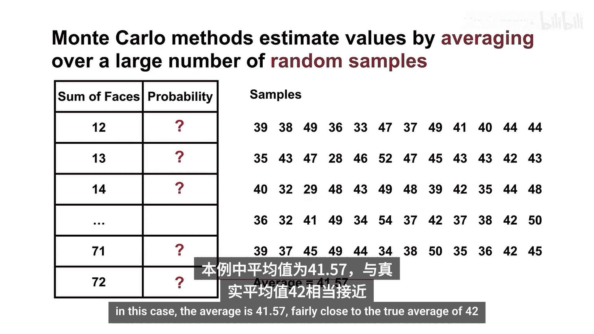
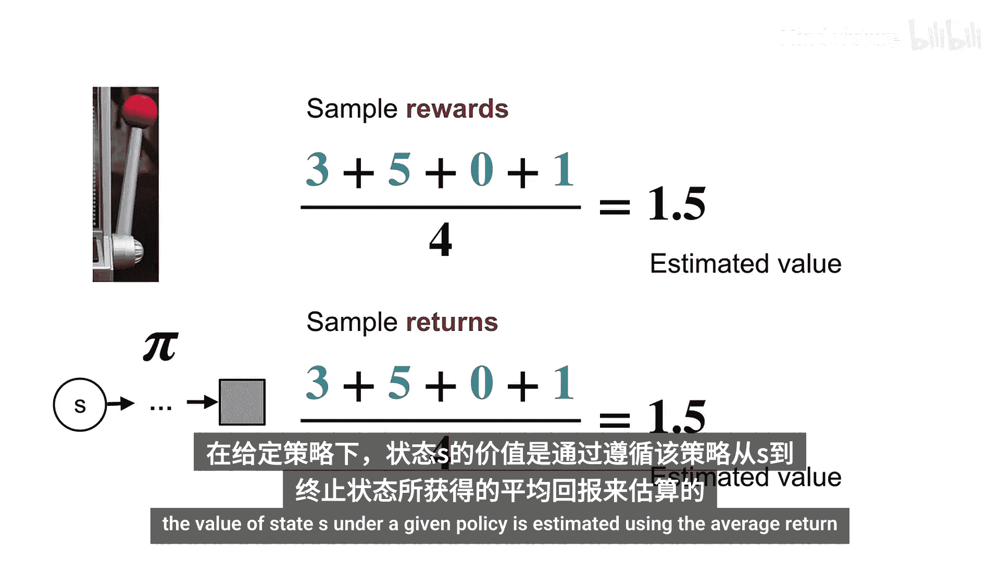
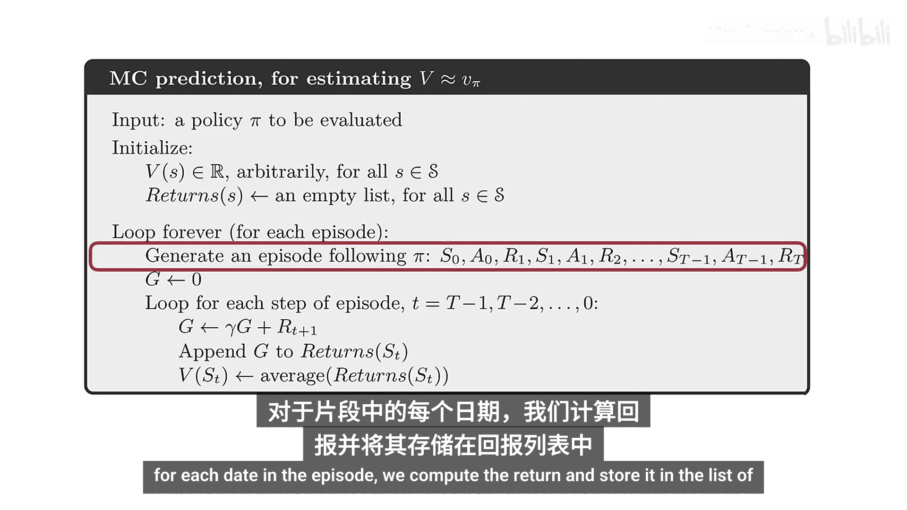
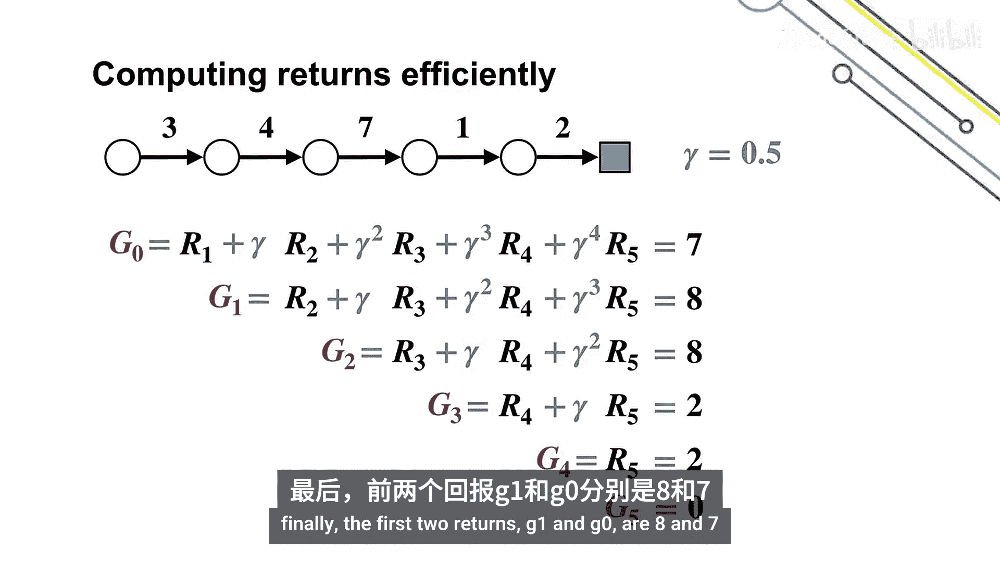
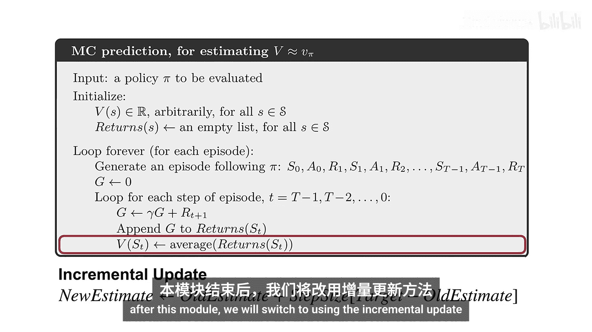

# 【阿尔伯塔大学】基于样本的学习方法 ｜ Sample Based Learning Methods p03 P03_什么是蒙特卡洛_02_01_03 -BV1GaYWzsEtR_p3-

The term Monte Carlo is often used more broadly for any estimation method that relies on repeated random sampling。

In RL， Monte Carlo methods allow us to estimate values directly from experience。

 from sequences of states， actions， and rewards， learning from experiences striking because the agent can accurately estimate a value function without prior knowledge of the environment's dynamics。

By the end of this video， you will be able to understand how Monte Carlo methods can be used to estimate value functions from sampled interaction。

And identify problems that can be solved using Monte Carlo methods。Earlier。

 we talked about how reinforcement learning is connected to dynamic programming。

To use a pure dynamic programming approach， the agent needs to know the environment's transition probabilities。

In some problems， we simply don't know these probabilities。

Imagine a meteorologist is trying to predict the weather。

 how the weather changes depends on a variety of environmental factors。

 we simply don't know the exact probability of weather patterns in the future。

Calculating the transition probabilities used in dynamic programming is difficult even for reasonable tasks。

 think about predicting the outcome of 12 rolls of dice。

 the sheer number and complexity of DP calculations makes them tedious and error prone。

 both in terms of coding and numerical precision。Here's where Monte Carlo methods can help。

Let's try to find the average sum of 12 dice rolls。

Montic Carlo methods don't exhaustively sweep through all possible outcomes， like the one shown here。

 in fact you don't need to know the probability of any outcomes to be able to use Monte Carlo methods。

Instead。Monte Carlo methods estimate values by averaging over a large number of random samples。

Let's roll 12 dice a few times and see the result。In this case， the average is 41。57。

 fairly close to the true average of 42。

In reinforcement learning， we want to learn a value function。

 value functions represent expected returns， so a Monte Carlo method for learning a value function would first observe multiple returns from the same state。

Then it could average those observed returns to estimate the expected return from that state。

As the number of samples increases， the average tends to get closer and closer to the expected return。

The more returns the agent observes from a state， the more likely it is that the sample average is close to the state value。

These returns can only be observed at the end of an episode。

 so we will focus on Monte Carlo methods for episodic tasks。

Montic Carlo methods and reinforcement learning look a bit like bandit methods in bandits。

 the value of an arm is estimated using the average payoff sampled by pulling that arm。

 Monte Carlo methods consider policies instead of arms。

The value of state S under a given policy is estimated using the average return sampled by following that policy from S to termination。

Now let's look at an algorithm for estimating the state value function of a policy。

The Monte Carlo algorithm has to keep track of multiple observed returns。

 let's introduce a list of returns， one for each state。

Each list holds the returns observed from state S。Then we generate an episode by following our policy。

For each date in the episode， we compute the return and start in the list of returns。

 but how can we do that efficiently？

Suppose the discount factor is 0。5 and imagine an episode ending at time step 5。

 where the reward sequence is3，4，7，1， and2。Let's find each return G0 to G5。

 starting by writing down the equation for each return。

Notice that each return is included in the equation for the previous time stepss return。

That means we can avoid duplicating computations by starting at G5 and working our way backwards。

Let's do that now。The episode ends at t equal to5， so G5 equals0 by definition。

G4 is equal to the reward at time5 plus gamma times the return at5， which adds to 2。

G3 is equal to the reward at time 4 plus gamma times the return at time 4。

The reward at time four is one， and we just calculated that the return at time four is two。

Solving the equation， we can see that the return at time three is also two。Continuing on。

 we can find the return at time2 is 7 plus gamma times 2， which is 8。Finally。

 the first two returns G1 and G0 are 8 and7。

By working backwards from the terminal time step， we can efficiently compute the returns for each state encountered during the episode。

The first return is just the last reward， so we add the last reward to the list of returns for ST minus1。

Then we set the value of ST minus1 to be the average of returns ST minus1。

On the previous time step t minus2， we calculate the return as before。

 then add it to the list of returns for ST minus2。Finally， we update the value of ST minus2。

If we continue this loop until the end， we'll have updated the values for all thes visited in the current episode。

Then we can repeat the whole process over many episodes and eventually learn a good estimate for the value function。

You might be wondering if we can avoid keeping all the sample returns in a list， in fact， we can。

 we can incrementally update the sample average estimate using the formula here。

Recall that we discussed using such incremental updates when estimating action values for bandits。

 we use the conceptually simpler sample average in this module to focus on the key ideas for Monte Carlo After this module we will switch to using the incremental update。

In this video we talked about how Monte Carlo methods learn directly from interaction。

 notably they don't need a model of the environment dynamics。

 we also showed a Monte Carlo algorithm for learning state values and episodic problems。

