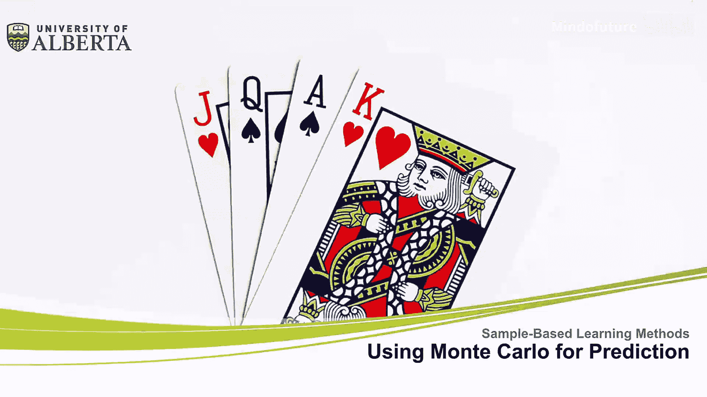
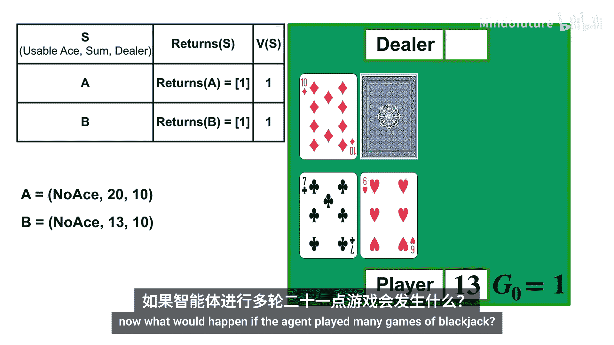

# 【阿尔伯塔大学】基于样本的学习方法 ｜ Sample Based Learning Methods p04 P04_使用蒙特卡洛进行预测_02_01_04 -BV1GaYWzsEtR_p4-

Imagine asking 1，000 people about their experience doing something and deciding to do that thing if most of their experiences turned out well。

That's the essential flavor of Monte Carlo Let's look at an example using Monte Carlo for prediction。

By the end of this video， you will be able to use Monte Carlo prediction to estimate the value function for a given policy。

Let's discuss the specifics of the Monte Carlo prediction algorithm using an example with a card game blackjack。

Blackjack is played with a standard deck of 52 cards。

The objective is to collect cards so that their sum is as large as possible without exceeding 21。

Face cards are counted as 10， while each ace can count as 11 or1 based on the player's preference。

The game begins with two cards dealt to both the player and the dealer。

 The player can see one of the dealer's cards， but the other is face down。

If the player immediately has 21， they win unless the dealer also has 21， in which case they draw。

If the player does not have 21 immediately， they can request more cards one at a time or hit。

If the sum of the player's cards ever exceeds 21， we say the player goes bust and loses。Otherwise。

 when the player decides to stop requesting cards or sticks， it becomes the dealer's turn。

The dealer only hits if the sum of their cards is less than 17， if the dealer goes bust。

 the player wins。Otherwise， the winner of the game is a player whose sum is closer to 21。

We can formulate this problem as an undiscounted MDP where each game of Blackjack corresponds to an episode。

Rewards are given at the end of the game with minus one for a loss， zero for a draw。

 and one for a win。The player has two actions， hit or stick。

 the player decides to hit or stick based on three variables， whether they have a usable ace。

 which is an ace that can count as 11 without their sum exceeding 21。

The sum of their cards and the card the dealer shows， there are 200 states in total。

We assume that cards are dealt from the deck with replacement。

 this means that there's no point in keeping track of the cards that have been dealt and that the state respects the markov property。

Let's use Monte Carlo to learn the value function for the policy that sticks when the player's sum is 20 or 21。

Suppose in the first date， the agent's card shows a total of 13 with no usable ace and the dealer's visible card shows 10。

Since the agent's policy is fixed， it hits and gets a7 moving it to 20。

The agent sticks because its sum is 20， and it's now the dealer's turn。

The dealer draws a nine and goes bust， losing the game。

 and resulting in plus one reward for the agent。Now that the first episode is over。

 the agent can perform a Monte Carlo update and so start learning。

The return from each state episode is plus one because the only non zero reward is plus one at the end of the episode and the discount factor is one。

Now let's look at the states starting from the end of the episode and working backwards。

In the last non terminal state， the card sum was 20 with no usable ace。

 and the dealer had a visible 10。 Let's call this state A。

We add plus1 to the list of returns for state A and set the value of state A equal to the average of the list。

Stepping back to the second last state， state B， the agent shows 13 with no usable ACce and the dealer has a visible 1。

Again， we add plus one to the list of returns now for state B and set the value of state B equal to the average of the list。

We've now processed every state in the first episode and completed the Monte Carlo updates for that first episode。

Now what would happen if the agent played many games of blackjack？

Let's look at the value function the agent learns after 10，000 episodes。

We'll plot one value function for states with a usable ace and one for states without a usable ace The three axes of the plot are the card the dealer is showing。

The agent some。And the value of that state。The plot with usable aEces is much more rough than the plot with no usable aE。

 that's because most blackjack games do not have a usable ace。

 so the usable ace values are estimated with far fewer samples。Both plots have a similar shape。

Looking at the values going across the plot， it looks like the card the dealer is showing doesn't impact the value function very much。

If we look at the agent some， however， the value function is much higher in states where the agent has a 20 or 21。

Why are these values so much higher than when the agent has a sum of 19？

The answer has to do with the policy the agent is following。

The policy always hits on sums of 19 or lower， so the agent is likely to bust when the sum is 19。

On the other hand， when the sum is 20 or 21， then the agent will stick and is likely to win。Now。

 let's look at the value estimates after 500000 episodes。

 and the estimates have nearly converged to the state values。 Notice the plots are much smoother now。

We see the same pattern as before， where the values are low unless the sum is 20 or 21。Now。

 what are some of the implications of Monte Carlo learning？First。

 Monte Carlo learns directly from experience， so there's no need to keep a large model of the environment。

Wanttic Collo methods can estimate the value of an individual state independently of the values of any other states。

 in dynamic programming， the value of each state depends on the values of other states。

 so this is a pretty big difference。Finally， the computation needed to update the value of each state along the way doesn't depend in any way on the size of the NDP。

Rather， it depends on the length of the episode。

In this video， we showed how to use Montecolor prediction to learn the value function of a policy。

And talked about how Monte Carlo learning doesn't need to sweep over the whole MDP。

