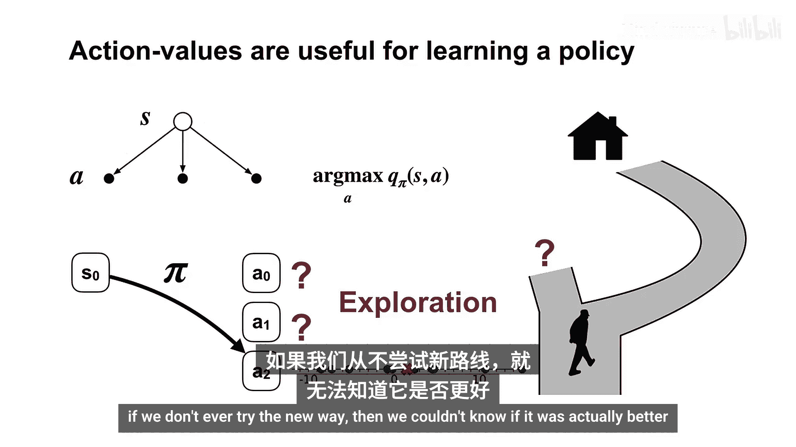
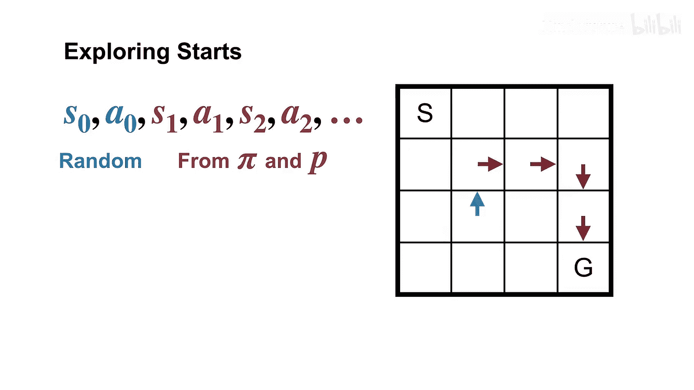

# 【阿尔伯塔大学】基于样本的学习方法 ｜ Sample Based Learning Methods p05 P05_使用蒙特卡洛进行动作价值评估_02_02_01 -BV1GaYWzsEtR_p5-

So far， we've talked about using Monte Carlo to learn state value functions for a fixed policy。

This time we'll focus on learning action values。🎼By the end of this video。

 you will be able to estimate action value functions using Monte Carlo and。

Understand the importance of maintaining exploration in Monte Carlo algorithms。

Learning action values is almost exactly the same process as learning state values。

Recall that we learn the value of a state by averaging sample returns from that state。Conveniently。

 the same process works for action values。We collect returns following a policy from a state action pair and then take their average。

But why do we care about learning action values at all？

Action values are useful for learning a policy。 They allow us to compare different actions in the same state。

 Then we can switch to a better action if one is available。

This is only possible if we have an estimate of the values of the other actions。

 but this can be tricky。Let's consider learning the action value function for a deterministic policy。

 Imaginem an action that is never selected by the policy。

The agent will never observe returns corresponding to that action。

We won't be able to form an accurate Monte Carlo estimate。

The agent must try all the actions in each state in order to learn their values。

 This is the problem of maintaining exploration and reinforcement learning。

Let's think about a real world example。Imagine walking home along the road you usually take Recently。

 a new road was built nearby。If we don't ever try the new way。

 then we couldn't know if it was actually better。

One way to maintain exploration is called exploring starts。In exploring starts。

 we must guarantee that episodes start in every state action pair。Afterwards。

 the agent simply follows its policy。Consider the grid rolled on the screen。

Let's see how exploringing Star works with a palsy shown in red。

Exploring starts will randomly sample a state in action at the start of an episode shown in blue。

In this case， the blue action is not the same as the red one。After the initial action。

 the agent will follow the red policy until the episode ends。

We must be able to set the start state in this way to evaluate a deterministic policy。

 like we can in this grid world。This may not always be possible。

Other exploration strategies like Epson greedy， can be used to evaluate stochastic policies。

We will talk more about that later。In this video， we describe the Monte Carlo algorithm for estimating action values and discuss the importance of maintaining exploration。

