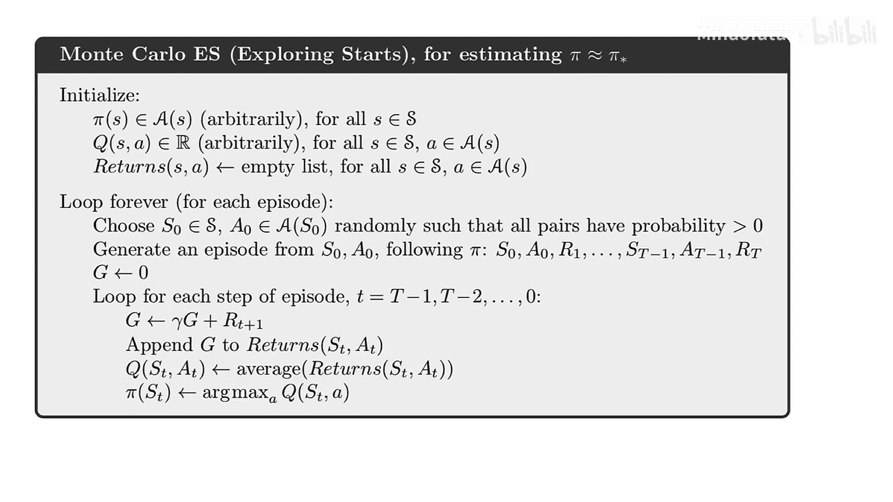

# 【阿尔伯塔大学】基于样本的学习方法 ｜ Sample Based Learning Methods p06 P06_使用蒙特卡洛方法进行广义策略迭代_02_02_02 -BV1GaYWzsEtR_p6-

Now that we can estimate action values using Monte Carlo。

 the next step is to build a generalized policy iteration algorithm。

Let's see how we can do that today。By the end of this video。

 you will understand how to use Monte Carlo methods to implement a GI algorithm。

GPI includes a policy evaluation and a policy improvement step。

GPI algorithms produce sequences of policies that are at least as good as the policies before them。

For the policy improvement step， we can make the policy greedy with respect to the agent's current action value estimates。

For the policy evaluation step， we will use a Monte Carlo method to estimate the action values。

Remember that in the GPI framework， the value estimates need only improve a little。

 not all the way to the correct action values。All that is required for convergence is that the estimates continue to improve。

Moonte Carlo control methods combined policy improvement and policy evaluation on an episode by episode basis。

Now let's put these two together in one algorithm。

Let's start with our Monte Carlo method for learning A values。

You use exploring starts so that each episode begins with a randomly selected state and action。

Then the agent generates an episode by following his policy。

 keeping track of the state's actions and rewards along the way。Once the episode is complete。

 it computes each return starting from the end of the episode。

Then it adds the return to the appropriate list。The lists of returns are then averaged to update the action value estimates for each state action pair。

This completes the policy evaluation step。After policy evaluation。

 it's time to do policy improvement。 We simply update the policy to take the greedy action with respect to our updated action values。

We do this in every state observed during the episode。

Isn't this so much easier than the way we did this step in dynamic programming？And that's it。

This is the generalized policy iteration algorithm， Mon Carlo with exploring starts。

In this video， we described how to use Monte Carlo methods within the GPI framework。

And discuss an example GPI algorithm called Mon Carlo with exploring starts。

