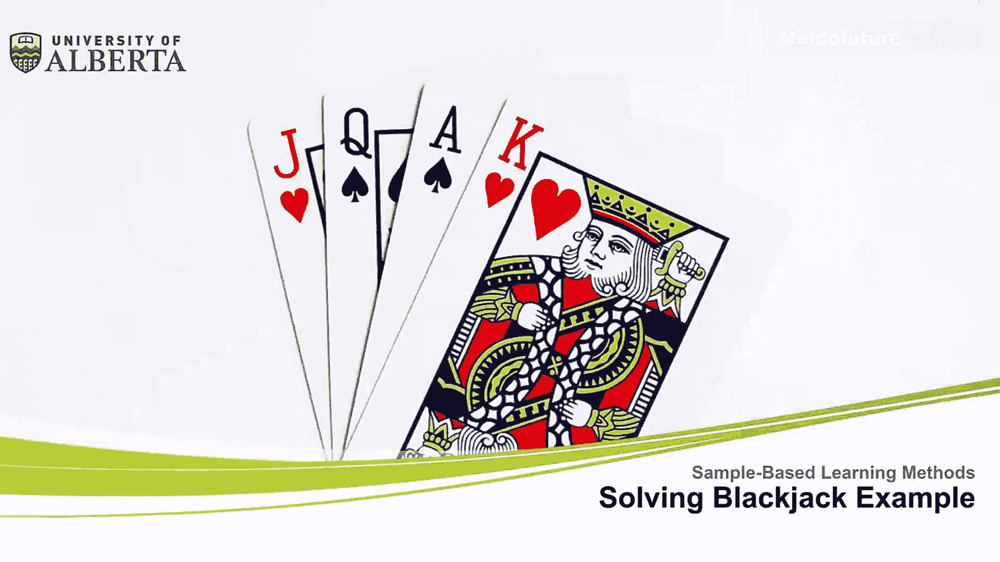
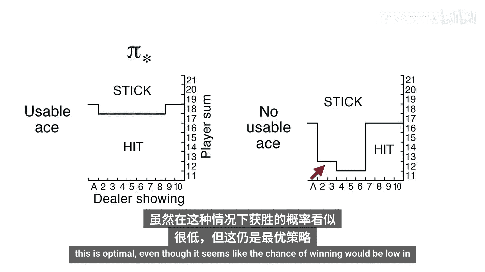

# 【阿尔伯塔大学】基于样本的学习方法 ｜ Sample Based Learning Methods p07 P07_解决二十一点示例_02_02_03 -BV1GaYWzsEtR_p7-

Now that we have a generalized policy eraeration a for Monte Carlo control。

 let's use it in an example and see how it works。By the end of this video。

 you'll be able to apply Monte Carlo with exploring starts to solve an example MDVP。

Let's learn a policy。We will train our agent to play Blackjack using Monte Carlo with exploring starts。

Exploring starts requires that episodes begin with a random state and action。Luckily for us。

 our version of Blackjack naturally starts in random states。

Then all we have to do is to randomly select the first action in each episode。That is。

 the agent ignores what it thinks is the best action in the first state and randomly chooses to hit or stick。

The initial policy is hit when the agent's sum is less than 20 and to stick when the sum is 20 or 21。

Let's step through a game and see what the algorithm would do。

Suppose the agent's card show a total of 13 with no usable ace， and the dealer's visible card is an8。

According to the randomly sampled first action， the agent hits。

The agent gets a 7 moving the sum to 20。On the next step。

 the agent chooses the action according to its policy， so it sticks。Now it's the dealer's turn。

The dealer draws a 9 and goes over 21， losing the game and resulting in a plus one reward for the agent。

 great。Now let's look at the state action pairs we saw during the game。

 starting from the end of the episode and working backwards。In the last non terminalmin state。

 the agent had a sum of 20， no usable ace， and the dealer had an eight。From that state。

 the agent chose to stick。The agent adds plus one to its list of returns corresponding to that state action pair。

The estimated value for the action stick in this state is simply one。

Let's look at the value of the two actions in this state。 The agent never tried the hit action。

 so its value is 0。The value of the stick action is one， we just computed that。

So the greedy action with respect to Q in this state is to stick。It has the highest estimated value。

Let's move back in time one more step to the start state。 The agent had 13 with no usable ace。

 and the dealer had an8。The randomly chosen action was to hit。 Again。

 the agent adds plus one to the list of returns following that state action pair。

The average of the list forms the estimate of the action value。Finally。

 the policy is updated in this state to be greedy with respect to the action value estimates。

In this state， we had never tried the stick action， and its value is zero。

But the hit action resulted in a return of one。 So the greedy action is to hit。

 and the policy is updated to reflect this。We then repeat this process over many episodes。

The action values and the policy will approach their optimal values。

Let's look at the A policy that the agent found after we ran it for a really long time。

Notice how the agent plays when it has a usable ace。For most dealer cards。

 the agent hits until it has a sum near 19。With the usable ace。

 the agent has a lot more flexibility in calculating the sum of its cards。

 so the policy is much more aggressive。Wai。Without a usable ace。

 the policy depends a lot more on the cards the dealer is showing。

The agent sticks when its sum is 13 or greater， and the dealer has a low card， like a two or a three。

This is optimal， even though its seemss like the chance of winning would be low in this situation。

That's all for this time in this video we showed you how to apply Monte Carlo with exploring starts to an example MDP。

