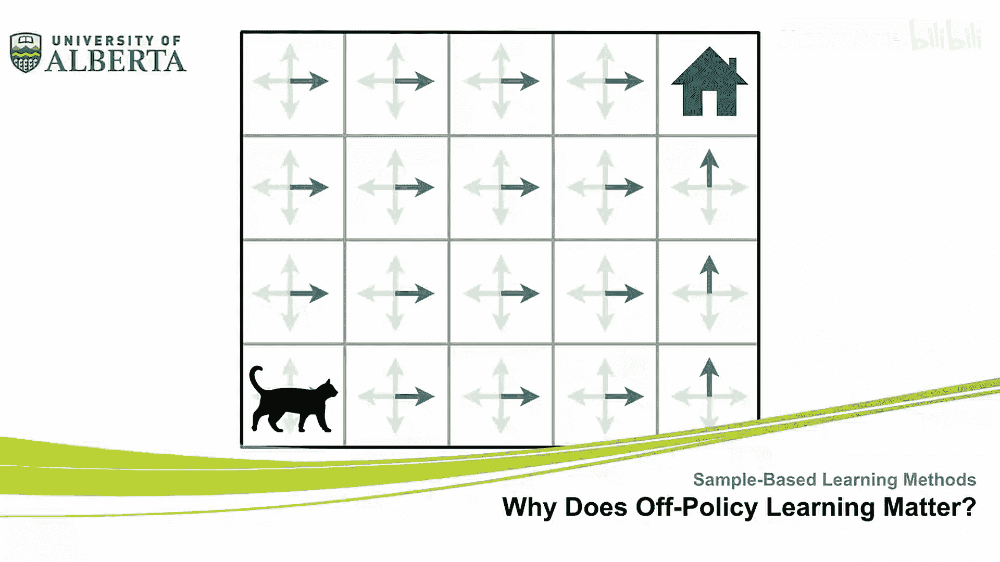

# 【阿尔伯塔大学】基于样本的学习方法 ｜ Sample Based Learning Methods p09 P09_为什么离线策略学习很重要_02_04_01 -BV1GaYWzsEtR_p9-

We've discussed the exploration exploitation trade off。

The key point is that the agent must occasionally take suboptimal exploratory actions。

 potentially receiving less reward， but maybe we do not need to make this trade off at all。

In this video， we'll discuss a new way of learning value functions called Off policy Learn。

By the end of this video， you will be able to understand how off policy learning can help deal with the exploration problem。

You'll also be able to produce examples of target policies and examples of behavior policies。

Epsilon saw policies help with the continual exploration problem by having some small probability of exploring on each time step。

The disadvantage of Epsilon soft policies is that they are suboptimal for both acting and learning。

EpsilonSo policies are neither optimal policies for obtaining reward。

 nor are they optimal for exploring to find the best actions。So far， throughout this course。

 we have implicitly been discussing on policy learning。

 though we have not yet made a big deal of that name。In on policy learning。

 the agent learns about the policy used to generate the data。

What does it mean to learn about a policy in policy evaluation。

 we simply mean learning the value function in control， we mean learning the optimal policy。

In off policy learning， the agent learns about a policy from data generated by following a different policy。

That is， the policy that we are learning is off the policy that we are using for action selection。

For example， you could learn the optimal policy while following a totally random policy。

We call the policy that the agent is learning the target policy because it is the target of the agent's learning。

The target policy is usually denoted by pi。The value function that the agent is learning is based on the target policy。

 One example of a target policy is the optimal policy。

 We call the policy that the agent is using to select actions， the behavior policy。

 because it defines our agent's behavior。The behavior policy is usually denoted by B。

The behavior policy is in charge of selecting actions for the agent。

The behavior policy shown here is the uniform random policy。

So why are we decoupling the behavior from the target policy？

Because it provides another strategy for continual exploration。

If our agent behaves according to the target policy。

 it might only experience a small number of states；

 if our agent can behave according to a policy that favors exploration。

 it can experience a much larger number of states。There are actually a few other useful applications of off policy learning such as learning from demonstration and parallel learning。

 but facilitating exploration is one of the main motivators。

One key rule of off policy learning is that the behavior policy must cover the target policy。

In other words， if the target policy says the probability of selecting an action A。

Given state S is greater than zero。Then the behavior policy must say the probability of selecting that action in that state is greater than zero。

There is a key mathematical reason for this that we will discuss in an upcoming video。

But there's also an intuitive reason that we show here。

Consider this state with the behavior policy always goes up， but the target policy goes to the right。

The agent cannot learn the correct action value for that state because it never observeds samples of what would happen if it goes right。

Maybe it gets a reward of plus1 million， it would never know。

It's worth noting that off policy learning is a strict generalization of on policy learning。

On policy is the specific case where the target policy is equal to the behavior policy。😊。

That's it for this video。The key points to take away from today are that off policy learning is another way to obtain continual exploration。

The policy that we are learning is called the target policy。

 and the policy that we are choosing actions from is the behavior policy。

