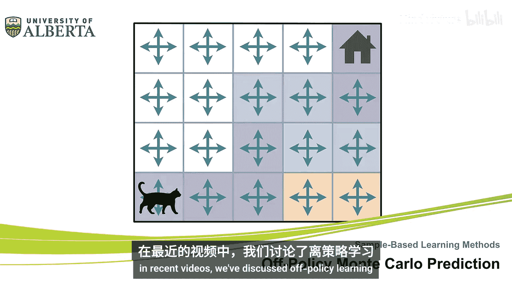
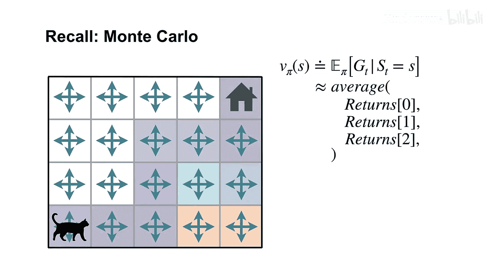
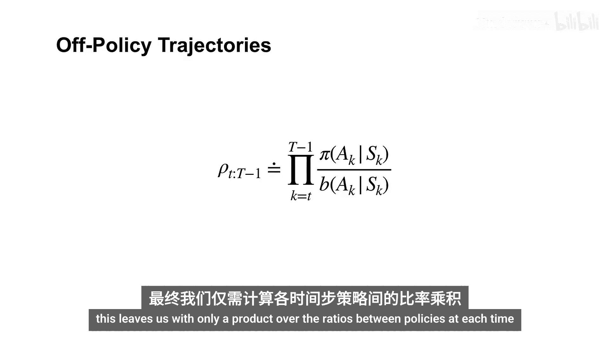
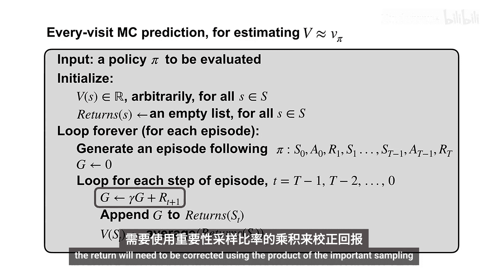
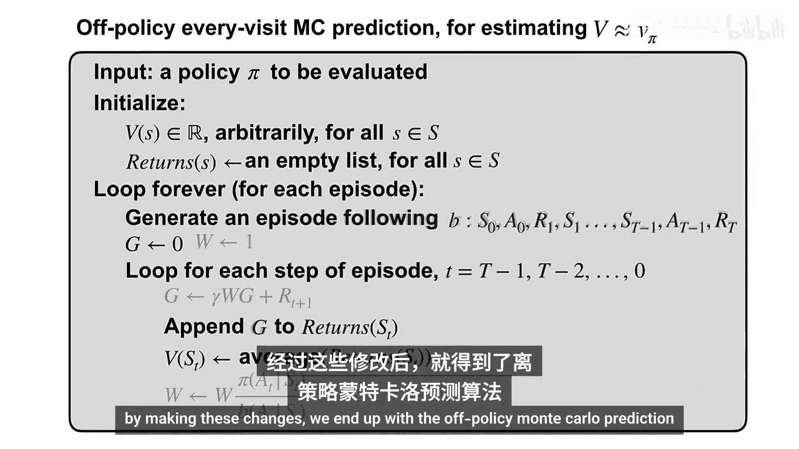
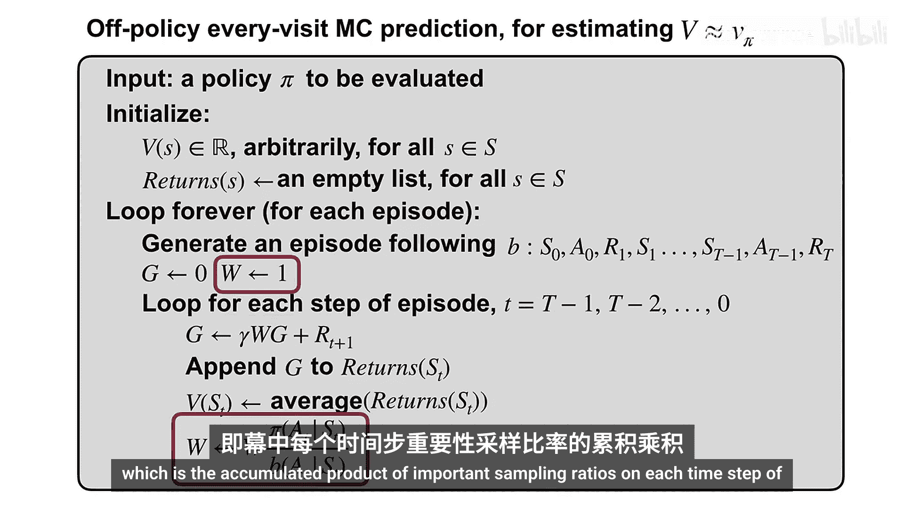
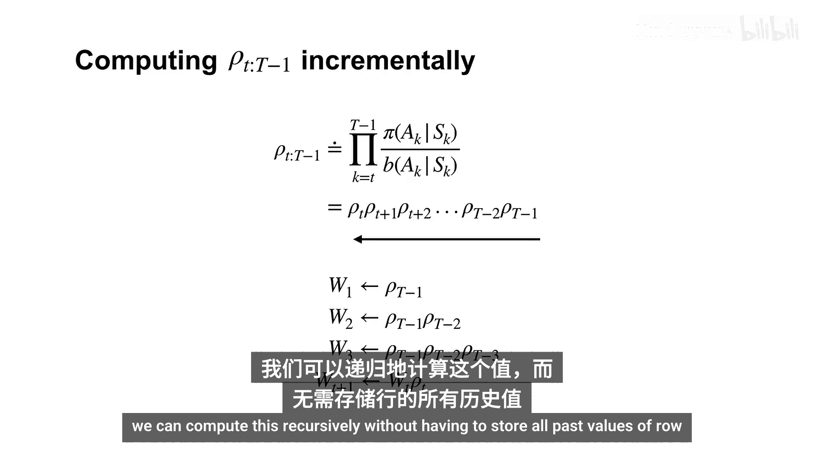

# 【阿尔伯塔大学】基于样本的学习方法 ｜ Sample Based Learning Methods p11 P11_离线策略蒙特卡洛预测_02_04_03 -BV1GaYWzsEtR_p11-

In recent videos， we've discussed off policy learning。In this video。

 we'll see how to do off policy prediction with Monte Carlo。By the end of this video。

 you will be able to understand how to use important sampling to correct returns。

And you will understand how to modify the Monte Carlo predictiondi algorithm for off policy learning。

Recall the goal of Monte Carlo estimation。We would like to estimate the value of each state by computing a sample average over returns starting from that state。

We run into an issue， however， when we try to estimate the value under target policy pi。

Using returns following a behavior policy B。If we simply average the returns we saw from state S under the behavior B。

 we will not get the right answer。We have to correct each return in the average。

 this is just what important sampling is for。All we have to do is figure out the value of row for each of the sampled returns。

Row here is the probability of the trajectory under pi。

 divided by the probability of the trajectory under B。

This row corrects the distribution over entire trajectories and so corrects the distribution over returns。

Using this correction， we get back what we want， the expectation of the return under P。

To compute row， we need to figure out how to compute the probability of a trajectory under a policy。

Let's consider the probability of distribution over trajectories。We read this probability as。

Given that the agent is in some state ST。What is the probability that it takes action  AT？

Then ends up in state ST plus1。Then it takes action  A+1 and ends up in ST plus 2 and so on。

Until termination at time big T。All of the actions are sampled according to Behavior B。

Because of the Markov property， we can break this probability distribution into smaller chunks。

The first chunk is the probability that the agent selects action AT in state ST。

Times the probability that the environment transitions into state ST+1。

The second chunk gives the probability of the next time step of experience and so on。

We can rewrite this list of producted probabilities using the product notation。

Now we've defined the probability of a trajectory under B。Remember where we are going。

 we would like to define row using the probability of the trajectory under pi and the probability of the trajectory under B Let's plug these probabilities into our definition of row。

As we saw in a previous video， we can take these probabilities and multiply them by the important sampling ratio。

The transition dynamics of the environment cancel out on each time step。

This leaves us with only a product over the ratios between policies at each time step。

Now let's get back to estimating VP off policy。The agent observes many returns each according to the behaviorhaor policy B。

We can estimate V Pi using these returns by correcting each return with row。

Now let's look at how we would implement this。First recall the on policy Monte Carlo prediction algorithm。

There are two changes that will need to be made here。First。

 the episode will not be generated following pi， but will be generated following B。And second。

 the return will need to be corrected using the product of the important sampling ratios。

By making these changes， we end up with the off policy Monte Carlo prediction algorithm。

Notice the episode is now generated following the behavior policy。

The return is corrected by a new termw。Which is the accumulated product of important sampling ratios on each time step of the episode。

We can compute row from T to big T minus1 incrementally。To see why。

 let's write out the product in each time step。Recall that the Monte Carlo algorithm loops over time steps backwards。

So on the first step of the algorithm， W is set to row on the last time step。On the next time step。

 W is the second last row， times the last row， and so on。

Each time step adds one additional term to the product and reuses all previous terms。

We can compute this recursively without having to store all past values of row。

And that's it for this video。In this video， we use the important sampling ratios to correct the returns generated by the behavior policy。

And we modify the on policy Monte Carlo prediction algorithm for off policy learning。

