# 【阿尔伯塔大学】基于样本的学习方法 ｜ Sample Based Learning Methods p12 P12_艾玛·布伦斯基尔-批量强化学习_02_04_04 -BV1GaYWzsEtR_p12-

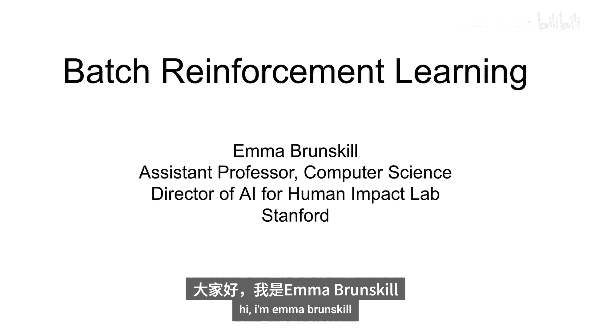

Hi， I'm Emma Bradskill， I'm an assistantant professor at Stanford University in the Computer Science Department。

 where we think about reinforcement learning for high stake scenarios。

 particularly focusing on applications that we hope can benefit society。

And what I'm excited to talk to you about today is back reinforcement learning。

But before we get started， I want to start with a brief motivation of saying that the tale of two hamburgers back in the 1980s。

 there's a fast food chain called A&W that is popular in the United States that was trying to compete with the quarter pounder of McDonald's。

 which is one of the most popular hamburgers。And so they thought they would introduce the third pounder。

 the taste tests were great， the beef was good， and they launched it and the product failed。

Unfortunately， even though the price of the third pounder was roughly similar to the price of the quarter pounder。

 people thought that they were getting less beef because three is less than four。

So I think this illustrates why mathematics education is extremely important and when I heard about this story and when I started to think about reinforcement learning and its potential applications to society。

 education seemed like a really compelling example。And so together with my colleagues。

 Zin Pavvic and our graduate students， we were thinking about how we could better teach people fractions。

 hopefully in a way that was engaging， effective and efficient。

The game that you're seeing right now is called refraction and it's been play by hundreds of thousands of students。

 but one of the big challenges we had was to think about what is the sequence of activities students should do to keep them engaged and motivated and make sure theyre were learning。

So for example， we can think of this as the decision policy。

 we're based on the sequence of interactions with the game the student has so far。

 what is the next activity to give them in order to maximize some outcome we care about this reward function could be something like persistence or the amount that they've learned。

And in particular， in our case， these were optional learning environments。

 so we were really interested in trying to maximize student persistence。

And so we started thinking about this about five years ago and it made me really interested in the problem I'm going to tell you about briefly today。

 but I want to highlight here that I'm certainly not the first one to have thought about doing reinforcement learning for applications that could hopefully benefit society。

 really since the very start of reinforcement learning。

 which we can trace back to sort of things like multi-armed mandateits as you heard about recently from the 1940s。

 there's been a parallel legacy of thinking about reinforcement learning to try to benefit humans。

 starting with things like teaching machines and then moving on to things like adaptive clinical trials。

Now I think this is both really exciting in terms of its societal impact。

 but it also introduces a lot of foundational questions for reinforcement learning。In particular。

 if we think about some of the extraordinary successes we see in reinforcement learning right now。

 they have tended to be in areas like robotics or game playing。And in those scenarios。

 we typically have access to a simulator where we can try things out。

 and even if our agent fails to learn for a long time， as long as it learns eventually we're happy。

In contrast， if we think about domains that involve interacting with people。

 we unfortunately do not yet have great simulators of how people learn or behave。

 which means that we have to rely on real data， but this is challenging because that real data involves interacting with real humans。

 which means that we need to be careful about the data we collect。

And so one of the key questions that I think about and together with my students in my lab is how do we develop reinforcement learning techniques to try to minimize the amount of data an agent would need to learn and what are the fundamental limits of how much information any agent would need to learn to make good decisions and I think that if we can answer these questions。

 not only will we make foundational improvements to reinforcement learning。

 but also will be able to help more people。

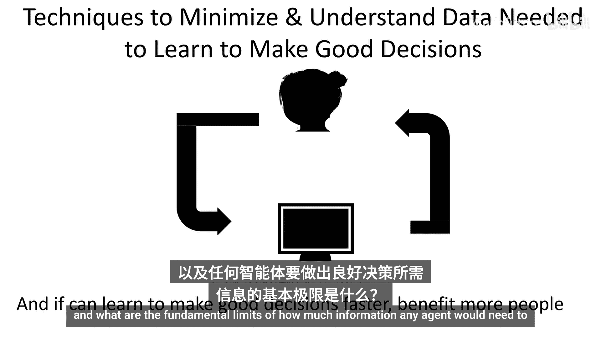

So I first just want to talk briefly about a quick refresher on MDP background。

 I think you're familiar with the notions of states and actions in next states as well as dynamics modelss and rewards。

And what I want to think about today is the counterfactual case。

 the idea that we're going to be getting data from the past。

 perhaps executed from a particular behavior policy。

 and we want to use that data in order to try to make better decisions going forward。

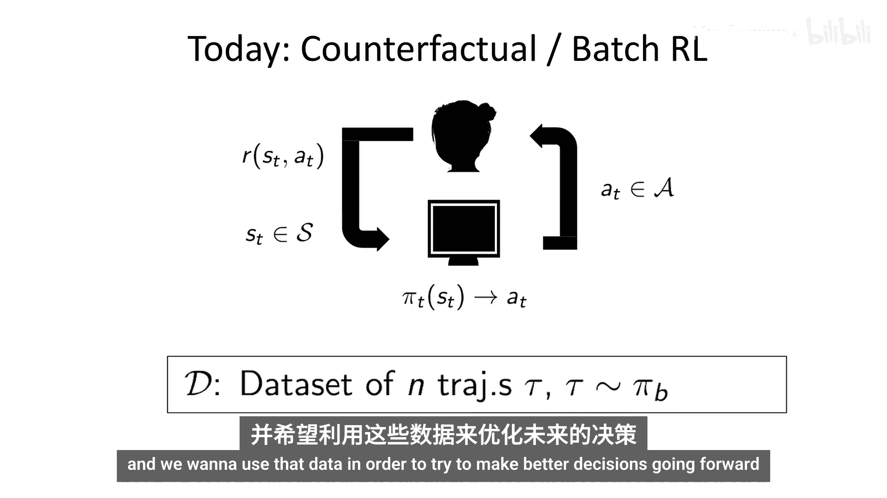

Now this is a challenging problem for a lot of reasons。

 in particular involves us thinking about what if reasoning。

 essentially you can imagine that we have an agent that's made sequences of decisions in the past and got some outcomes and maybe it's done this not just once but a number of times。

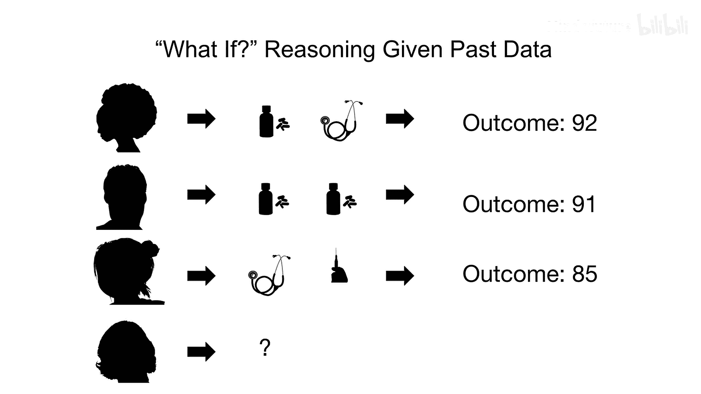

Now one of the challenges is you could never know what your life would have been like if you weren't watching this video right now。

 that's a counterfactual and you could never experience it。

 and so that's a key challenge when we try to think about using old data that try to make better different decisions in the future。

In particular， just like you saw in multiarm bandits， we have censored data。

 we can't see what an alternative action would have resulted in。

 what the rewards are that we would have obtained， so this is a challenge that even comes up in multiarm bandits。

 but when we think about using old data to do reinforcement learning。

 we actually have an additional challenge， which is the issue of generalization。

 so if you think about an agent making not just one decision but a sequence of decisions。

 then the combatorial possibilities of policies increases with the horizon。

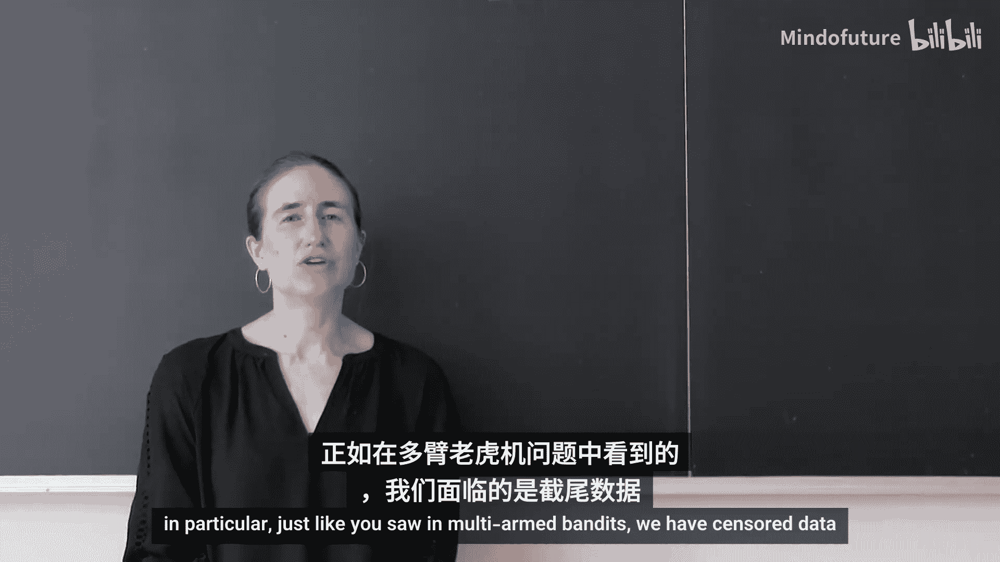

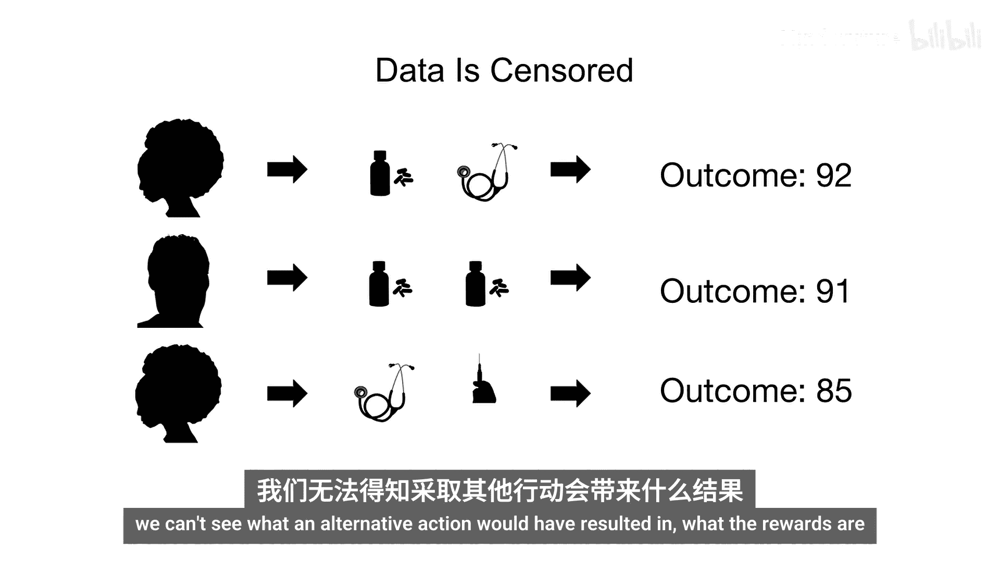

And so if we want to be able to generalize from our past data to think about what might happen under sequences of actions we've never experienced before。

 we're going to need some way to do generalization。

Now there are a number of us that are really excited about these problems of how to use old data to make better decisions in the future。

 and it's very closely related to things like causal reasoning and counterfactual reasoning。

 and these sorts of communities have a long history and other areas like its statistics。

 epidemiology and other aspects of computer science。

 but really over the last few years there's been a ton of excitement over trying to combine these ideas with machine learning methods and reinforcement learning in order to have more an impact。

So what I think that many of us would really love to be able to do is to do what's often called counterfactual or batch reinforcement learning。

 where we take old data， we figure out a new， we learn a new policy from it in a way that we know what that value will be will be deployed in the future and this is going to involve both doing way policy evaluation our ability to be able to evaluate how good an alternative policy would be。

 as well as policy optimization where we take a max or an arcax over that set of possible policies we。

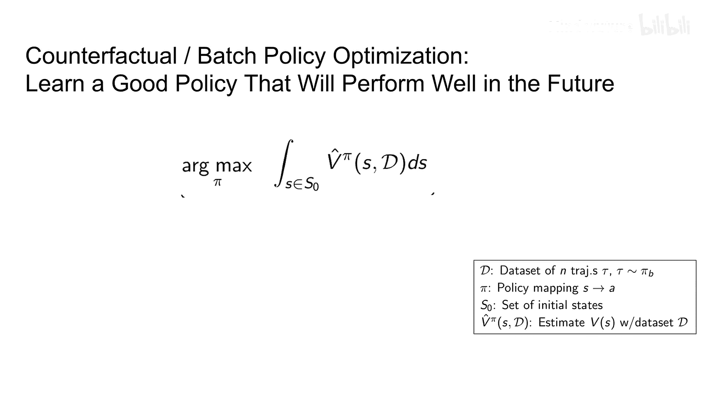

I want to first talk briefly about the policy evaluation question and I want to highlight that there's a huge literature on doing this。

 often called treatment effect estimation from other communities。

 people in econometrics have thought about this extensively through things like how can you evaluate whether or not a treatment is better than a control decision？

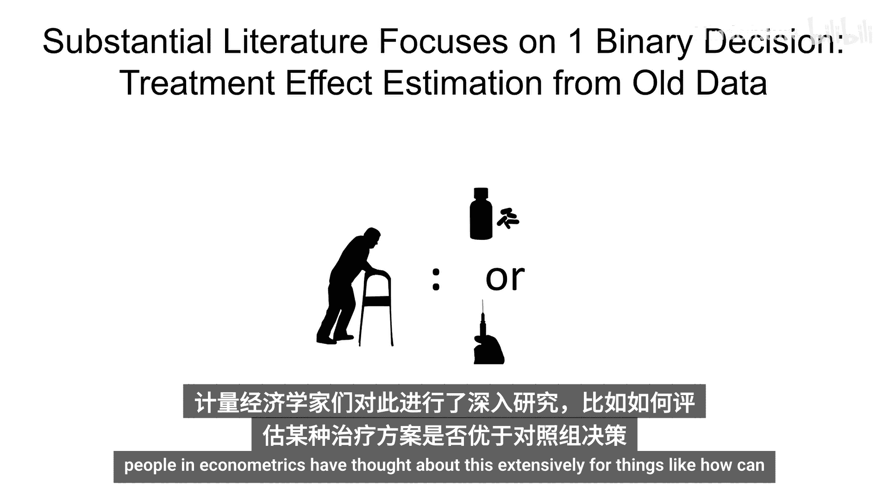

But again， when we think about sequences of decisions， we run into a challenge。

This is a recent very nice paper from some of my colleagues of David Soag I'malli Dahi Bazzlan。

 and what it illustrates is some of the challenges that come up when we start to use old data to try to make new decisions。

In particular， imagine if you have sort of a set of patients who've been treated in a particular way。

 and now you want to think about a particular sequence of ways to treat them。

So as we make decisions as we do things like choose whether or not to ventilate a patient or choose whether or not to use sedation。

 the number of previous patients who had a particular sequence of interventions or particular sequence of actions is going to be quite small。

 and so even if we start off with quite a large amount of data， say 1 hundred thousand patients。

 which is a reasonable number， we might only end up with say a few hundred patients who actually have received treatments that match the policy that we want to evaluate。

And essentially we can think of this as a challenge of covariate shift。

 but when we have different policies， those are generally going to be taking different actions and those different actions are going to lead to different state distributions and we really want to think about what would happen in terms of the resulting rewards under those differing state and action distributions that we expect to encounter。

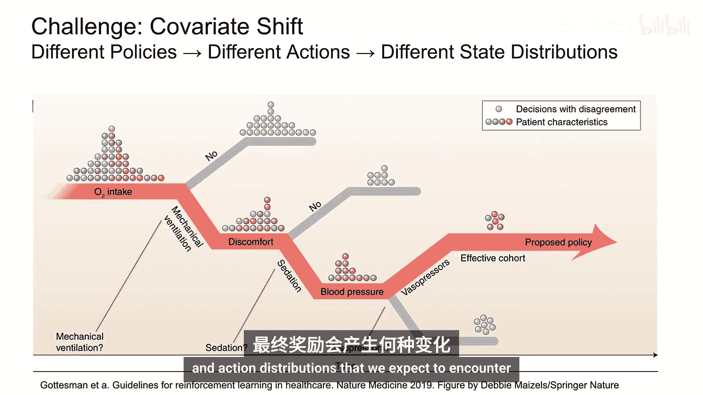

To try to tackle this problem of this distribution mismatch is important sampling which you recently heard about。

 so just as a refresher an important sampling we can think about the value of a policy as being the probability of observing a particular trajectory right now I'm thinking about the finite horizonor case so we can think of the probability of generating particular trajectory of states and actions times the reward of that particular trajectory and then averaging that over all the trajectoryjectories we might receive。

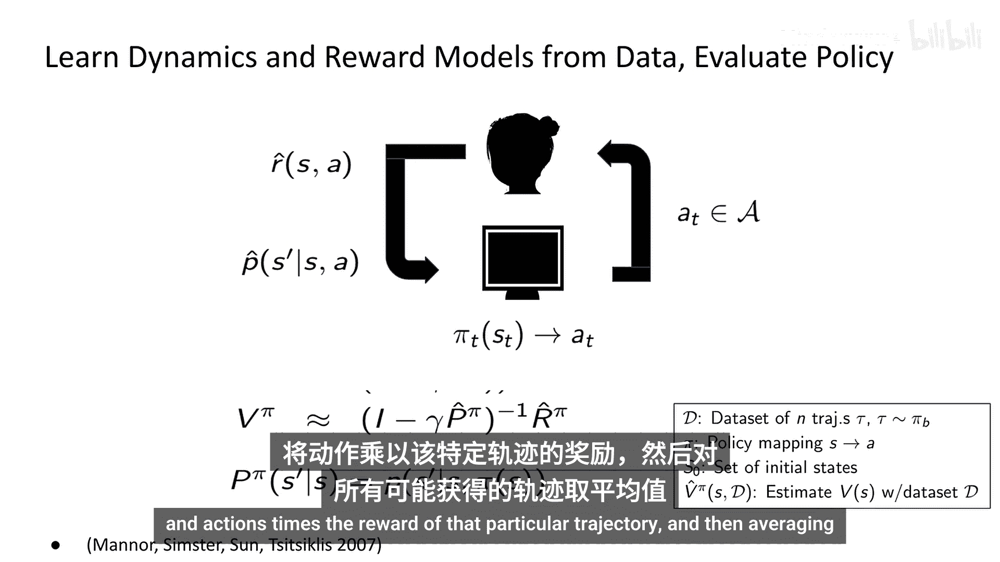

What important sampling allows us to do， as you saw previously。

 is that we can use data that was generated from a different policy and re it so that we could get a correct expectation and one of the beautiful aspects of this is that we don't actually have to know the dynamics model of the world because the dynamics model of the world is the same in the numerator and the denominator so it cancels。

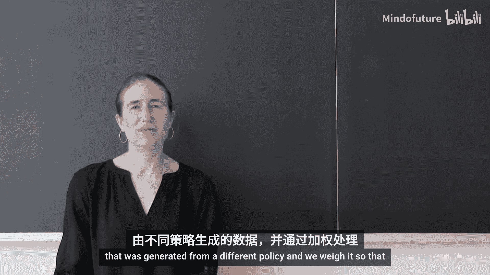

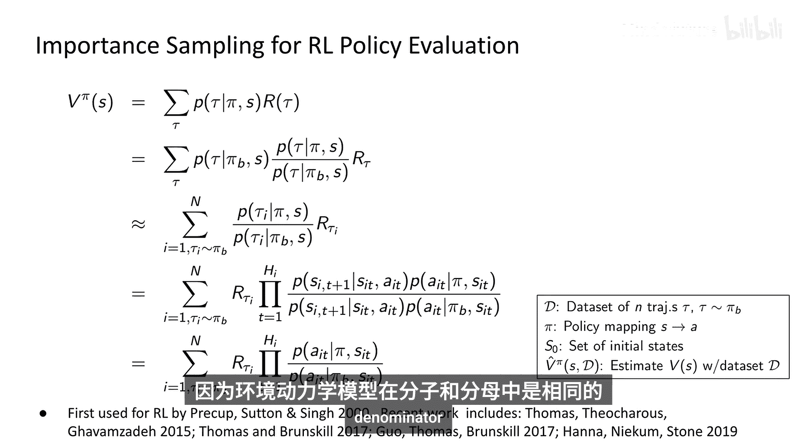

And there's been a lot of exciting work in this area since this was first brought over to reinforcement learning。

 and it's a key tool for policy evaluation because we can use it to take existing old data and use it to evaluate under certain assumptions。

 what would be the value of an alternative policy。

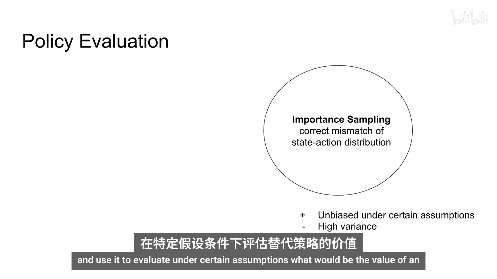

Now I just want to highlight that there are some challenges with using important sampling to do policy evaluation。

Important sampling provides us with an unbiased estimator。

 but it typically can be very high variances， in fact in some of our previous work we illustrated that the variance can scale sometimes exponentially with the horizon。

😊，And so that means that we don't have a lot of data or the horizon is long。

 that these estimators may be very poor appimmators of how good our new policy might do in the future。

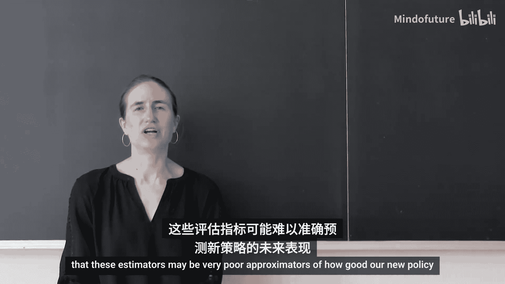

An alternative is to use things like parametric models。

 which you heard about a little bit in terms of the MDP planning sections so these models can have biass because sometimes the function appmators we're using or the model bestation we've chosen is not correct。

 it doesn't match really how the world generates data but they can have very low variances in return present some bias and so one of the exciting innovations we've seen over the last few years is the idea of doubly robust estimators。

 an idea that comes from statistics that has been ported over to reinforcement learning and bandits over the last 10 years and the idea is that can combine between the best of these two worlds of combining modelbased estimators with important sampling in order to get lower variance and lower bias。

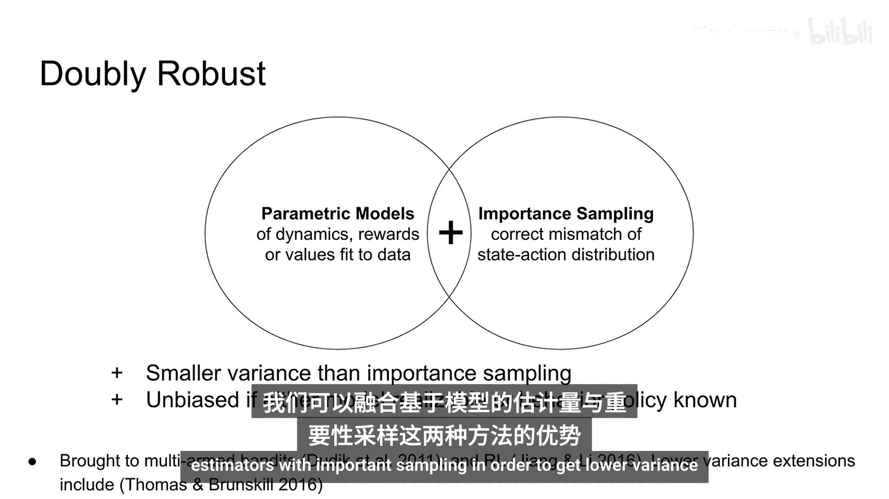

So this is a way for us to try to these are illustrations of the types of ways we can do policy evaluation。

 the thing that we would really like to do is to do policy optimization on top。

 and we have recent work that suggests that we can use these types of ideas like important sampling in order to actually make better decisions going forward。

In particular here I show an illustration from Cartpo。

 the bottom line is showing us how good the current behavior policy is。

 and by using sort of advanced techniques about building onim sampling。

 we can actually do policy optimization and learn far better policies than we were using to actually collect the data and I think this is very exciting in terms of the potential increases we could do by using these types of techniques。

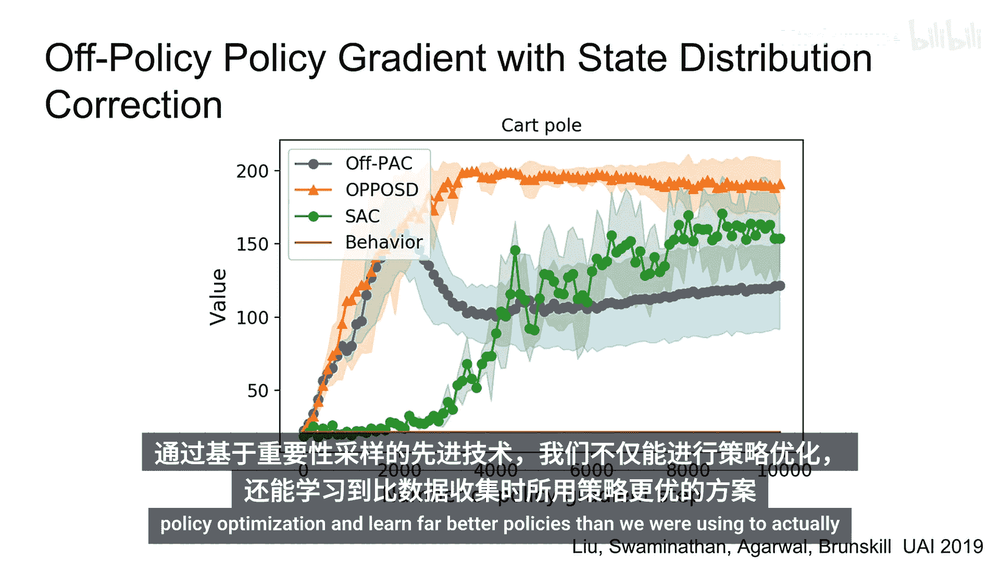

Now this is just one step I think that there's a huge amount of growth in open questions about how do we really solve this problem。

 particularly if we want formal guarantees on performance in my lab we've been doing a lot of work on the issues of policy evaluation。

 policy optimization and trying to start deriving formal bounds so that we can be confident when we deploy these policies and there's also a lot of really exciting work being done by my colleagues in these types of areas。

 so I think we have a long way to go， but before I close I want to give us a reason for optimism。

 which is if we go back to the example that I said at the beginning of looking at reraction。

 our goal there was to figure out if we could use old data from about 11。

000 students to figure out if there's a better way to teach people and keep them more engaged。

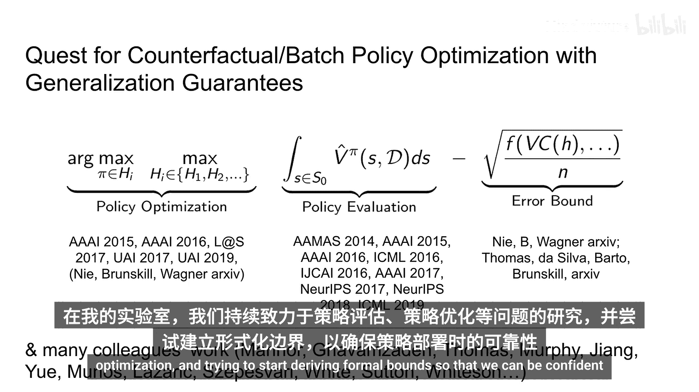

We used a method derived by important sampling to get a policy that we thought would do about 30% better in terms of increasing persistence。

We ran that study with another 2，000 students and we found that indeed it increased by about 30 to 32%。

 and so I think this is really exciting as an illustration that sometimes we can predict the future accurately with these types of methods and we really can make a difference thanks。

