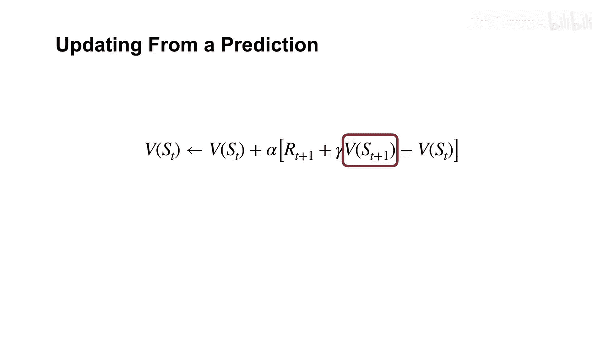
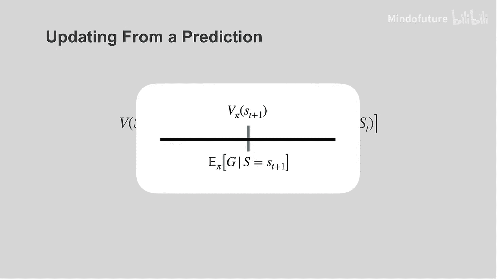
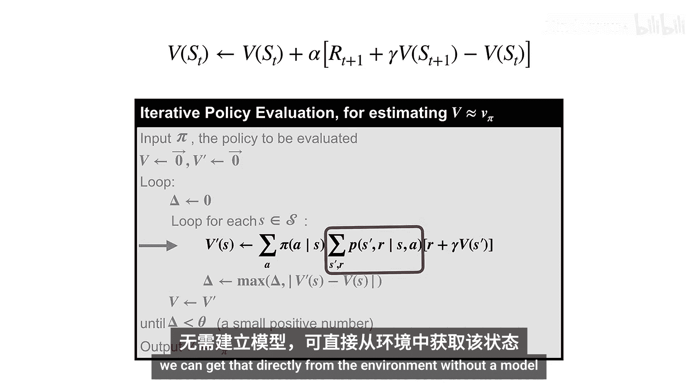
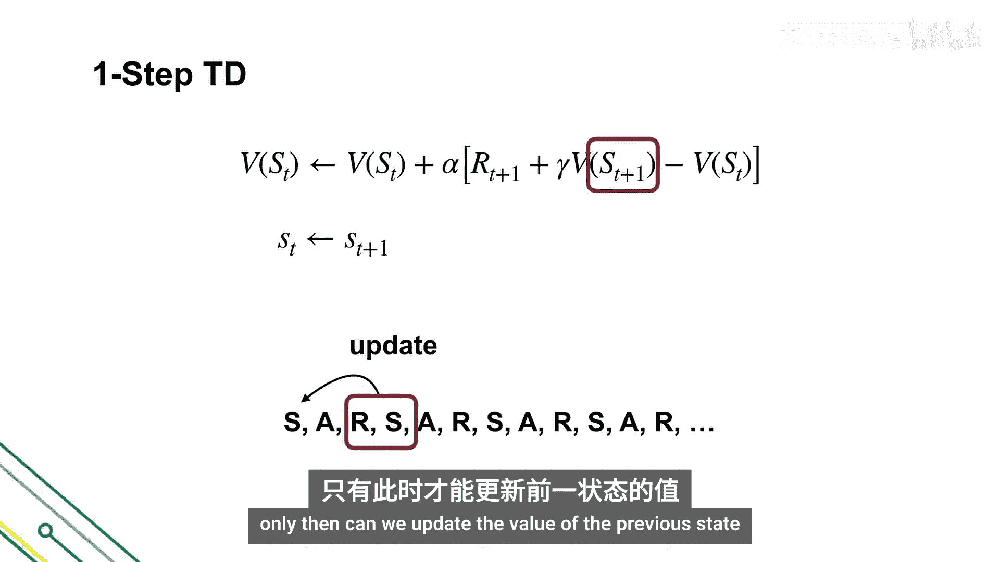
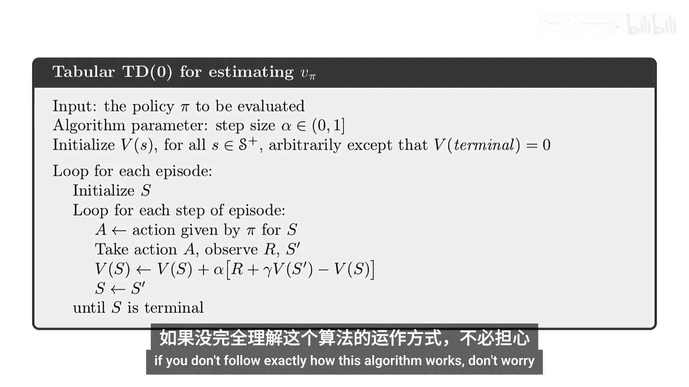

# 【阿尔伯塔大学】基于样本的学习方法 ｜ Sample Based Learning Methods p14 P14_什么是时序差分(TD)学习_03_01_03 -BV1GaYWzsEtR_p14-

Today we will discuss one of the most fundamental ideas in reinforcement learning。

To quote from the textbook， If one had to identify one idea as central and novel to reinforce learning。

 it would be temporal difference learning。By the end of this video。

 you will be able to define T difference learning。Define the temporal difference error。

And understand the TD0 algorithm。In the prediction problem。

 our goal is to learn a value function that estimates the return starting from a given state。

 but you already knew that。Before we get started， let's discuss a small modification to our Monte Carlo policy evaluation method。

We can use this formula to incrementally update our estimated value。

Notice that this uses a constant step size like our bandit learning algorithms。

That means this algorithm can form a Monte Carl estimate without saving lists of returns。

To compute the return， we have to take samples of full trajectories。

This means we don't learn during the episode。But we want to be able to learn incrementally before the end of the episode。

We must come up with a new update target to achieve this goal。

Recall the definition of the discounted return。We saw a while back that this can be written recursively。

 like so。The value of a state at time T is the expected return at time T。

We can replace the return inside this expectation with our recursive definition。

We can further split up this equation because the linearity of expectation。

We then get the expectation of the return on the next step。Which is just the value of the next state。

Now we have written the value function recursively as well。

Let's go back to our incremental Monte Carlo update rule。We want to update toward the return。

 but we don't want to wait for it。We can replace the return at time T with the reward plus the estimate of the return in the next state。

We can think of the value of the next state as a stand in for the return until the end of the episode。

So we don't have to wait until the end of the episode， but we still have to wait to the next step。

We call this the TD target。The terms inside the brackets resemble an error。

 which we call the TD error。We will often see the TDR denoted by Delta T。

The target of update might seem a little strange at first。

TD updates the value of one state towards its own estimate of value in the next state。

As the estimated value for the next state improves， so does our target。In fact。

 we've done something like this before in dynamic programming。

In DP， we updated toward the value of all possible next states。The primary difference is in DP。

 we used an expectation over all possible next states。

We needed a model of the environment to compute this expectation。In TD， we only need the next state。

We can get that directly from the environment without a model。

Let's talk about how we get that next day directly from the environment。

Think of time T plus1 as the current time step and time T as the previous time step。

So we simply store the state from the previous time step in order to make our TED updates。

We see a stream of experience， state， action， reward， next state， and so on。From the state of time T。

 we can take an action and observe the next state at time T plus 1。

Only then can we update the value of the previous state。

We can now fully describe the tabular TD0 algorithm。TD takes the policy to evaluate as input。

It also requires a step size parameter and an initial estimate of the value function。

Every episode begins in some initial state S。And from there。

 the agent takes actions according to its policy until it reaches the terminal state。

On each step of the episode， we update the values with the TD learning rule。

We only need to keep track of the previous date to make the update。And this is TD0。

Many algorithms in reinforcement learning are based on TD。

If you don't follow exactly how this algorithm works， don't worry， in the next few episodes。

 we will walk through several examples of TD in action。

That's all for today。In this video， we introduced temporal difference learning。

 which uses bootstpped estimates of the return。We learned about the TD error。

And we discussed the TD0 algorithm。