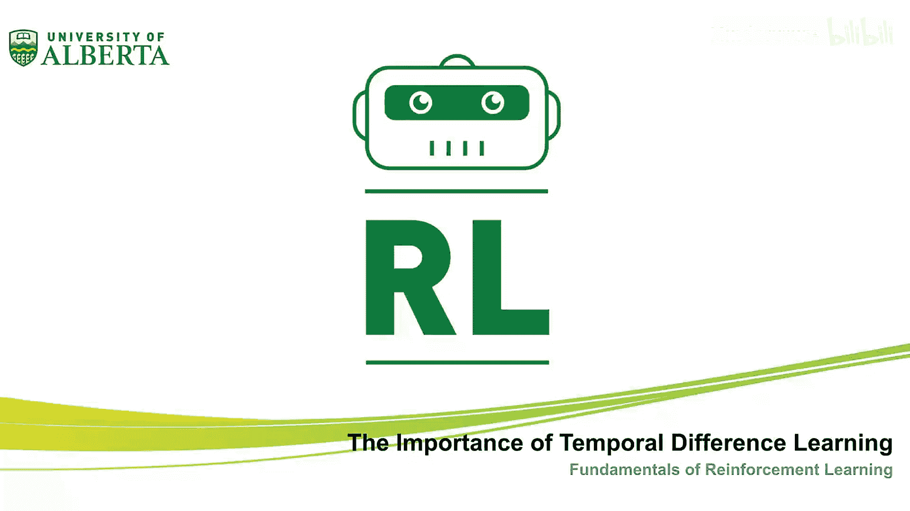
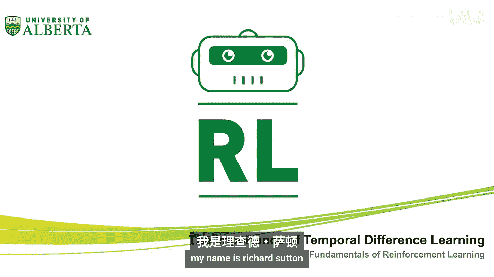

# 【阿尔伯塔大学】基于样本的学习方法 ｜ Sample Based Learning Methods p15 P15_里奇·萨顿-TD学习的重要性_03_01_04 -BV1GaYWzsEtR_p15-

My name is Richard Sutton。I'm a。A scientist studied reinforcement all my life。

 I'm at the University of Alberta， I'm in at deep Mind Alberta。And my spell， my name is SUTTLN。

 Richard S Sutton。Okay。Today I'm here to tell you about the importance of temporal difference learning。

Temple difference learning is a learning method that's specialized for prediction learning。

 and this makes it like the most important thing really for artificial intelligence in this century。

 as we know we focused on methods that scale with computation，InIn recent years。

 in the old days we had method very similar methods but now computation is so much greater and that because of that these methods are much more impactful so the kind of learning that scales the best most thoroughly and to a largest extent with computation is prediction learning。

 you think about it prediction learning means you trying to predict what will happen next you make a prediction。

 you wait and you see what happens and then when you find out what happens you learn and because of this because you just have to wait。

 you don't need training sets， you don't need people to do a lot of work and prepare things you don't even need an objective learning to predict is a single most scalable kind of learning。

Temporal difference learning is a kind of learning that's specializedize for learning to predict so what might that mean what's special about learning to predict Well one is time passes by and you make a prediction you actually make a series of predictions at every moment you make prediction after prediction after prediction and then you actually find out about what the correct answers were for all those predictions when you find out what actually happens and so to deal with the temporal the consequences of that temporal structure。

 you need to have specialized learning rules and that's why we have temporal difference learning。😊。

Now I'm sure you've already also learned or heard about methods for supervised learning。

 supervised learning means there's some kind of supervisor that tells you what the answer is。

Maybe that happens in school， but in normal life we don't have supervisors or instructors telling us what to do。

 but in prediction learning we do in prediction learning you make prediction and then you just wait and you find out what happens。

This is so special。You might say。啊。Prediction learning is supervised because you wait and you find what happens and that instructs you。

 but you might say it's also that it's unsupervised because you didn't have to have a supervisor。

 you just waited and you found out through the natural course of events what you should have said。

 so I like to think sometimes that prediction learning is the unsupervised supervised learning。嗯。

Terible difference learning。Remember is a method that specializedize for prediction learning。

 for multistep prediction learning。Now let me say one other thing about supervised learning you may often have heard supervised learning described as prediction learning and it is in a sense。

 but in the most important sense it's not it's when you make a prediction and then you're told what the answer is it's not where you actually have to wait and see what happens supervised learning is all from training sets or or you could you prediction learning in the special case when you're only trying to predict one step then you can make a prediction。

 wait one step see the result and you can treat it as a traditional supervised learning problem whenever most of our predictions are not one step predictions just in what happens like later in the day or a second from now。

 one step what is one step one step might be considered a tenth0 of a second and sure we make predictions at a tenth of a second but much more important in our lives are longerter predictions well if prediction learning and temporal difference learning so it's an important kind of learning。

 you might expect that it might。Arise in natural systems in animals and people。

And it's almost incidental to our development within the artificial intelligence。

 but it is true that。Temple difference learning has played a major role in the theory of how animals learn and particularly in the reward systems。

 a temporal difference model is now the standard model of the reward systems in the brain。

 we can see signals in the brain that correspond to the TR and these drive a appear to drive learning just as would be predicted by temporal difference learning models。

So you may have heard about dopamine， the stent in animals in mammals。

 the thing that carries the temporal difference error is the dopamine neurotransmitter。

In other animals， it's a different transmitter， like in bees， in bees。

 the signal that carries the temporal difference area is called  Otoppamine。

 but it's the same really， even in these very different systems of animals， insects。😊。

And mammals and primates， and even in sea slugs。So I guess I want to say a little bit more about I'm a little bit hesitant about talking about the relationships between engineering or AI models of learning psychological models of natural learning systems。

 this can be overdone， but I still I am proud of the fact that temporal difference learning is a serious important topic both in AI and in psychology and neuroscience because it is appreciated in each one of these separate fields for the very separate and different criteria that those fields have for success in AI we celebrate temporal difference learning because it's a powerful kind of learning that's very widely applicable and in neuroscience。

 they celebrate temporal difference learning because it accurately models and predicts animal behavior。

And so all these things are really prediction learning， prediction learning is the key。To AI。

 prediction learning is the most important single kind of learning。

 and temporal difference learning is a specialized methods that take advantage of the temporal structure of learning to predict。

Thank you very much。There's some material。