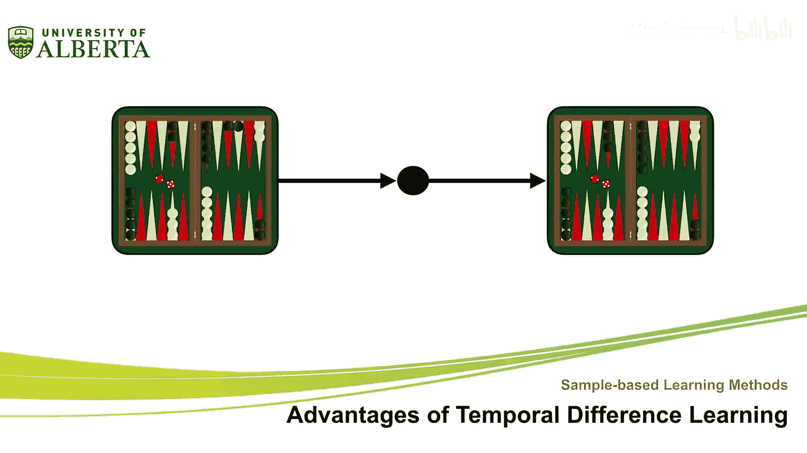

# 【阿尔伯塔大学】基于样本的学习方法 ｜ Sample Based Learning Methods p16 P16_时序差分学习的优势_03_02_01 -BV1GaYWzsEtR_p16-

In the previous video， we introduced temporal difference learning。

TD elegantly combines key ideas from dynamic programming and Monte Carlo methods。

Like dynamic programming， TD methods bootstrap。Like Monte Carlo methods。

 TD can learn directly from experience。The combination is more powerful than the sum of its parts。

By the end of this video， you will be able to understand the benefits of learning online with TD。

And identify key advantages of TD methods over dynamic programming and Monte Carlo。

Let's consider the example of driving home from work。

Each day you predict how long it will take to get home。You base your predictions on the time。

 the day of the week， the weather， and other factors。

Imagine that you have driven home many times before。

You have a good estimate of how long it takes to get home from various situations you might encounter on the way。

Let's look at these estimates for one trip home。One evening as you leave the office。

You predict it' will take 30 minutes to get home。In about five minutes。

 you exit the parking lot and notice that it is raining。Traffic is slower in the rain。

 so you estimate that it will take 35 minutes then on to get home。15 minutes later。

 you exit the highway earlier than you anticipated and estimate that it will now take you 15 minutes to get home。

30 minutes in your journey， you get stuck behind a slow truck and predict that it will take you an additional 10 minutes to get home 10 minutes later。

 you enter the home street from where it usually takes three minutes to arrive home。

Followingiling three minutes later， you are home。So the numbers in the circles represent our predictions of remaining driving time。

How can we improve these predictions to understand how to update our predictions。

 we need to specify the reward let's use the amount of time taken。

It took you five minutes to exit the parking lot， we can label this transition with a reward of five。

It took you another 15 minutes to exit the highway and so on and so forth。

You predicted that it would take you 30 minutes to get home， but it actually took you 43 minutes。

 perhaps you can learn from this experience。Let's first look at a Monte Carlo method。

 in particular we will use the constant alpha Monte Carlo method with alpha equal to1。

In Monte Carlo methods， you update your estimates towards the return。

 which is only available at the end of the episode。

We could only update the estimates for each of the states once we arrive home。

We can start from when we leave the office。From the office。

 it took you a total of 43 minutes to get home。Therefore， the return at time  zero is 43。

As alpha is one， we move our estimate completely towards the actual return。

From when you exit the parking lot， it took you 38 minutes to get home。

And we update our estimate accordingly。We update the estimates for the remaining states in the same way。

But is it really necessary to wait until the final outcome is known before learning can begin？

Let's remind the clock and look at how we would make updates with TD。From the office。

 it took you five minutes to eggs at the parking lot from where you made a prediction of 35 minutes。

 from the exit date， you can update the estimate for office。

Your current estimate from the office is 30 minutes。You get a reward of five。

The value of the next state is 35。So we update our estimate to 40 minutes。

Let's consider the next state。Your current estimate is 35 minutes。

 it took you 15 minutes from the parking lot to exit the highway。

The estimated time to get home for when you exit the highway is also 150 minutes。

 so we reduce the estimated time to go from when we exit the parking lot to 30 minutes。

This makes sense because we exited the highway earlier than expected。

We similarly update the estimates for the remaining states。As we make our way home。

 we can learn online without waiting to know the final outcome unlike Monte carlo。

Let's summarize the advantages of using TD。Unlike dynamic programming。

 TD methods do not require model the environment， they can learn directly from experience。

Unlike Monte Carlo， Td can update the values on every step。

 bootstrapping allows us to update the estimates based on other estimates。

TD asymptotically converges to the correct predictions In addition。

 TD methods usually converge faster than Monte Carlo methods we will see an example of this in the next video。

