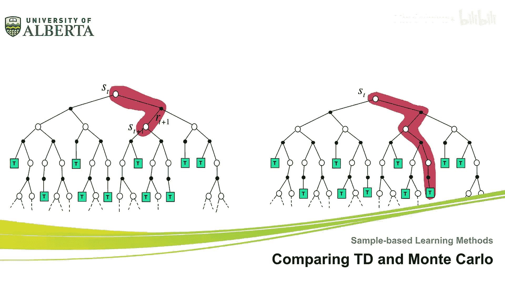
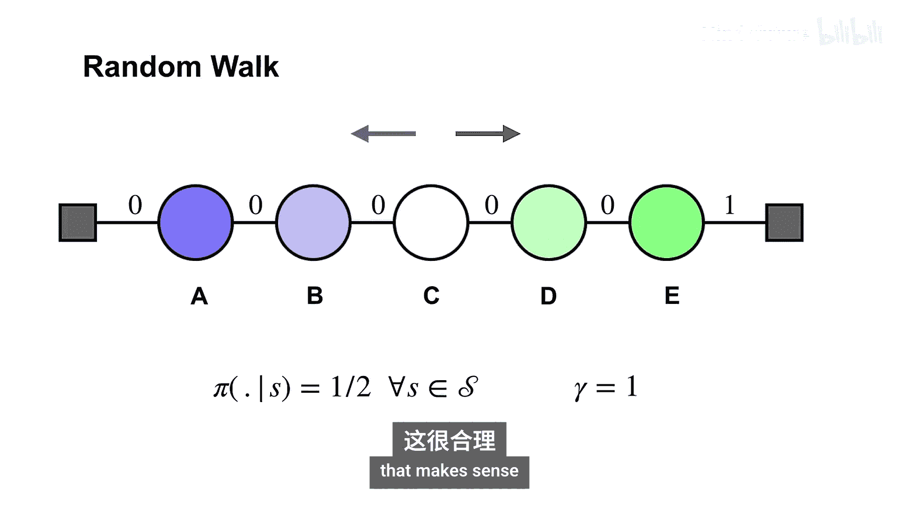
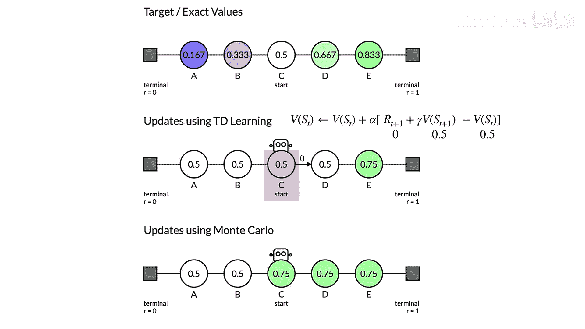
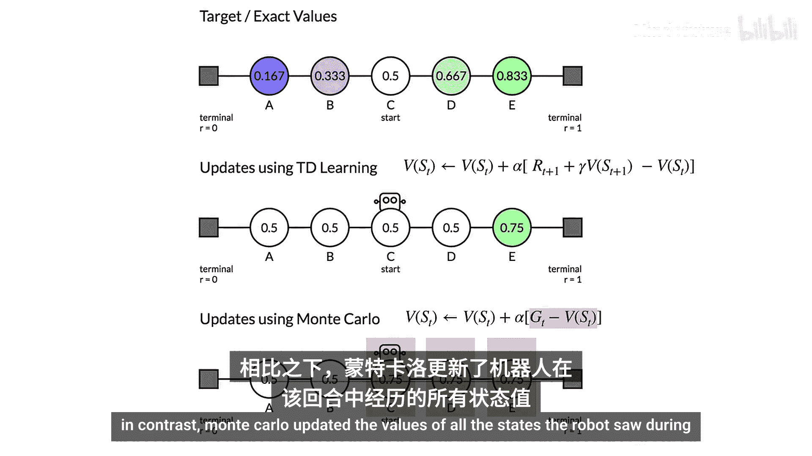
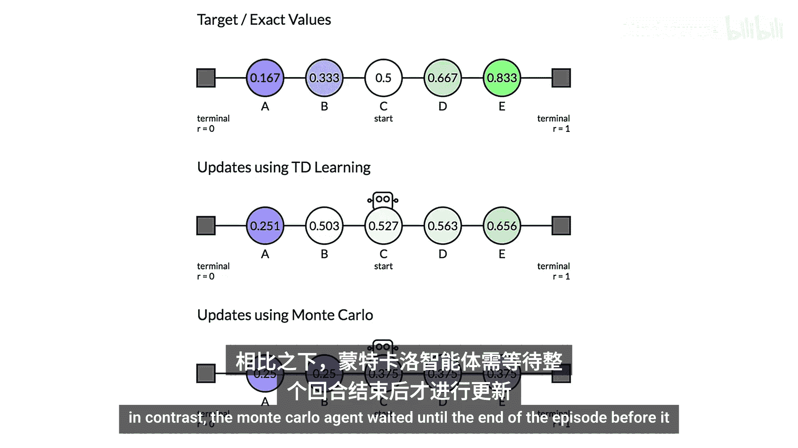
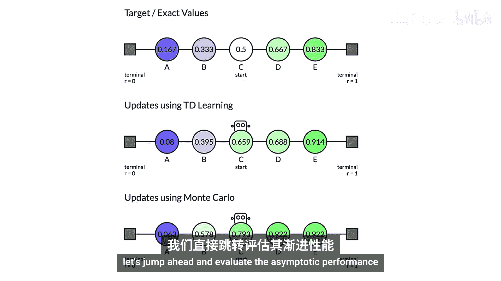
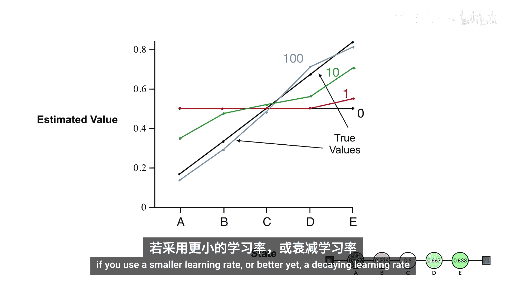
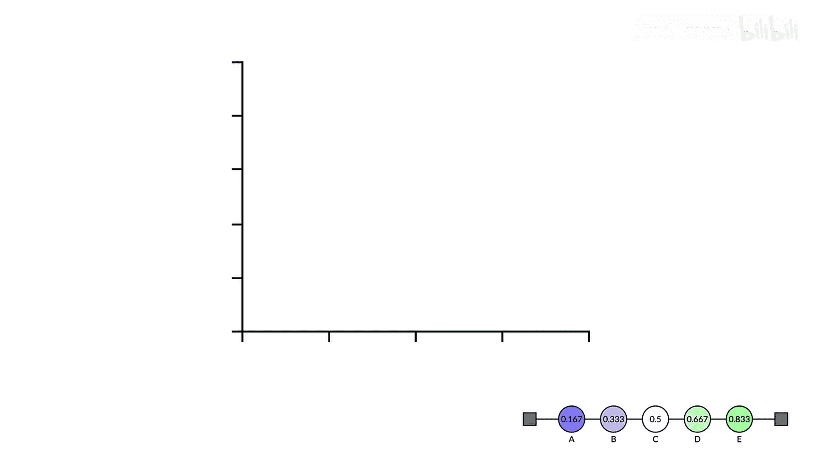
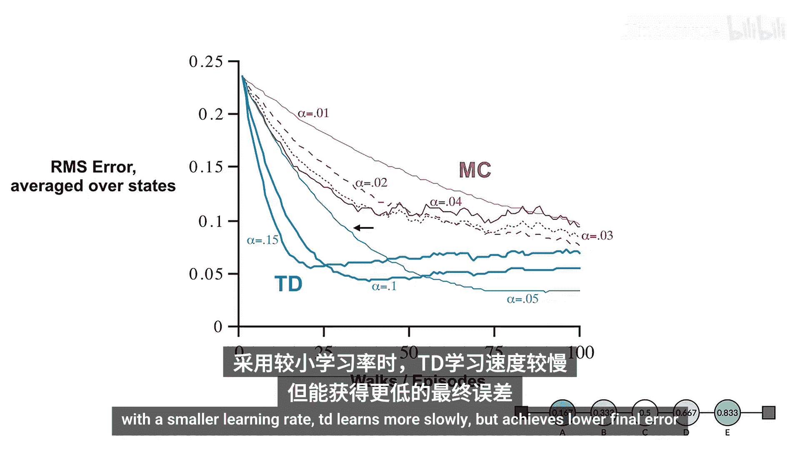
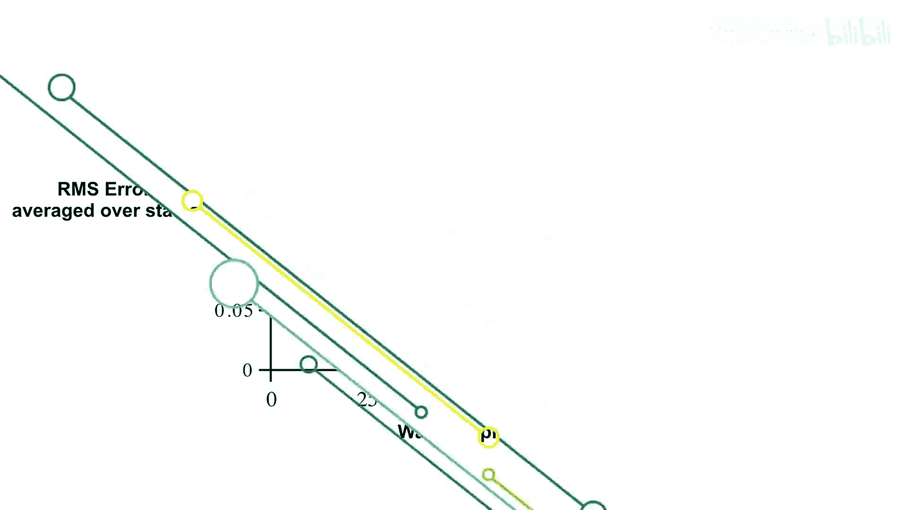

# 【阿尔伯塔大学】基于样本的学习方法 ｜ Sample Based Learning Methods p17 P17_比较TD和蒙特卡洛_03_02_02 -BV1GaYWzsEtR_p17-

🎼Mmm。In the last few videos， we introduced TD and discuss its advantages over dynamic programming and Monte Carlo。

In this video， we will dive deeper and compare TD and Monte Carlo in a carefully constructed scientific experiment。

By the end of this video， you will be able to identify the empirical benefits of TD learning。

Consider this simple NVP， we have five non terminal states。In each state。

 we have two deterministic actions， left and right。Let's evaluate the uniform random policy。

We want to estimate its value function。All episodes start in state C。

Episodes terminate either on the left or on the right。The reward is zero on all transitions。

Except plus one for terminating on the right。Let's set the discount factor to be one In this problem。

 the value has an intuitive meaning。 The value of each state is the probability of determining on the right when starting from each state。

The value of the start state is 0。5。 that means the probability of terminating from the center is a half。

Randomly wandering from the center has a 50-50 chance of terminating on either side。That makes sense。

Let's label the rest of the states with their values。Let's run an experiment right now。

We have labeled the MVP with the true values at the top of the slide。The agent。

 our cute little robot。Estimates the value function using TD。At the bottom。

 we have a Monte Carlo agent。L's initialize the approximate value function for both agents to 0。5。

Let's look at the performance of both agents during the first episode。

Notice the TD agent only updated the value of state E。To understand this。

 consider the transition from state C to D。The TD error is equal to the reward on the transition。

Plus， the value of the next state D minus the value of state C。

The reward is zero because this is a non terminal transition。The values of C and D are both 0。5。

 so the TD error is 0， and we make no change to the estimate for C。

The same thing happens on every step except the transition into this terminal state from state E。

In contrast， Montenie Carlo updated the values of all the states the robots saw during the episode。

Let's look at the next episode。Pay attention to how the values are updated during the episode。

Eventually， the TD agent makes updates to the values on every step。In contrast。

 the Monte Carlo agent waited until the end of the episode before it made its updates。

Let's look at a few more episodes。The value estimates of the TD agent seem to be moving towards the true values。

This is taking too long， let's jump ahead and evaluate the asymptotic performance。

Let's plot the estimated values at several points during learning。

The X axis represents each state in the MDP。On the Y axis， we have the estimated value。

Here are the true values。Let's also plot the initial value estimates。 recall。

 we initialize them to 0。5。The red curve shows the values learned after the first episode。

By the end of the first episode， TD only updated the value of a single state， as we discussed。

The estimates after 100 episodes are about as good as they're ever going to get。Remember。

 we're using a constant step size of 0。1。This means the values will fluctuate in response to the outcomes of the most recent episodes。

If we use a smaller learning rate or better yet a decaying learning rate。

 we might get a better estimate。

A natural next question is， does TD learn faster than Monte Carlo？

Let's compare the performance of TD and Monte Carlo on our example problem。

Here， the X axis represents the number of episodes。

The Y axis represents the root mean squared error between the value function and the learned estimates。

The red learning curves represent the performance of Monte Carlo for several values of alpha。

Each curve is averaged over 100 independent runs。For instance。

 this point represents the average error achieved after 50 episodes for the learning rate 0。01。

Now let's look at TD's performance。We see that TD performed consistently better than Monte Carlo。

 lets look a little more closely。Notice the error reduces faster with the learning rate of 0。15。

 but ultimately results in higher final error。With a smaller learning rate。

 TD learns more slowly but achieves lower final error。

In summary， we ran a careful experiment comparing TD and Monte Carlo。

And the results suggest that TD converges faster to a lower final error in this problem。

 See you next time。