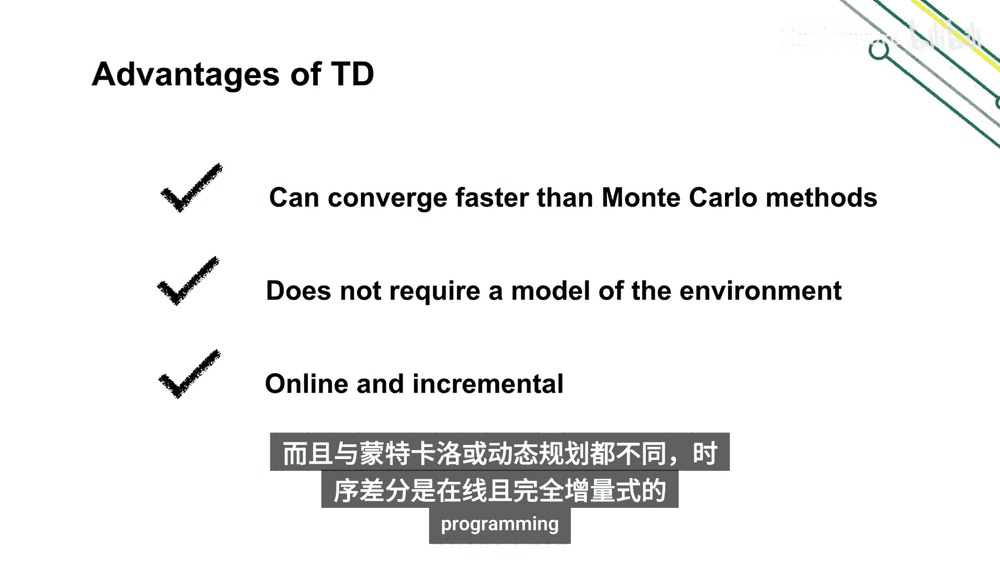

# 【阿尔伯塔大学】基于样本的学习方法 ｜ Sample Based Learning Methods p19 P19_第二周总结_03_02_04 -BV1GaYWzsEtR_p19-

Congrats， you are now an expert on TD。In previous modules。

 we discussed dynamic programming and Monte Carlo。In this module。

 we took some of the best of both with TD learning。

We started by borrowing an important concept from dynamic programming called Botrapping。

TD updates towards a bootstrap return。We can replace the return after time step T with the reward plus our estimate of the value in the next state。

We say TD updates a guess from a guess， it bootstrapps its value estimates towards the value of the next state。

Then we discuss the tabular TD0 algorithm。The main takeaway here is that TD can update its value estimates on each step of the episode。

It does not have to wait for the episode to complete。 It just has to remember the previous state。

How does TD compare to Monte Carlo and dynamic programming？Well。

 TD often converges faster than Monte Carlo。TD does not require a model unlike dynamic programming。

And TD is online and fully incremental， unlike either Monte Carlo or dynamic programming。

We learned how TD updates his predictions as it receives new information。

We demonstrated this by predicting how long it takes to get home from work。

We use TD to continually refine our predicted arrival time at each stage of our drive home。Finally。

 we ran an experiment comparing TD and Monte Carlo on a random walk。On every transition。

 TD updates its value function to reflect the most recent information。In contrast。

 Monte Carlo only updates his value function at the end of each episode。In the long run。

 TD learned more quickly than Monte Carlo and achieved better final error。🎼And that's it for today。

 In the coming weeks， we will build control algorithms using TD。 I can't wait to see you then。😊。

