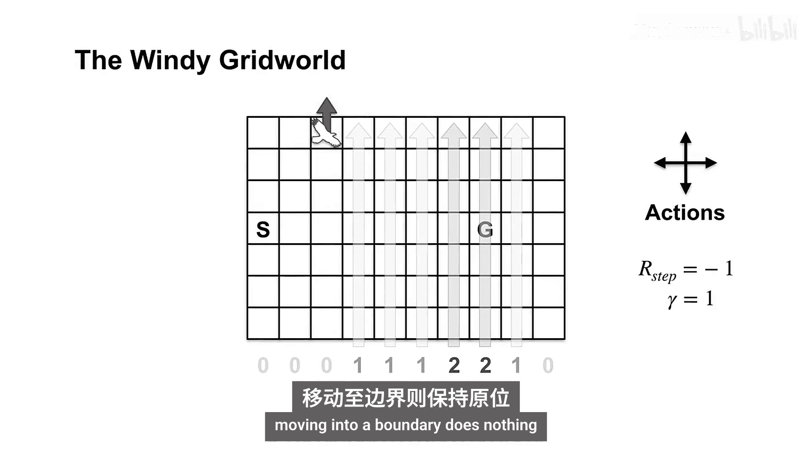
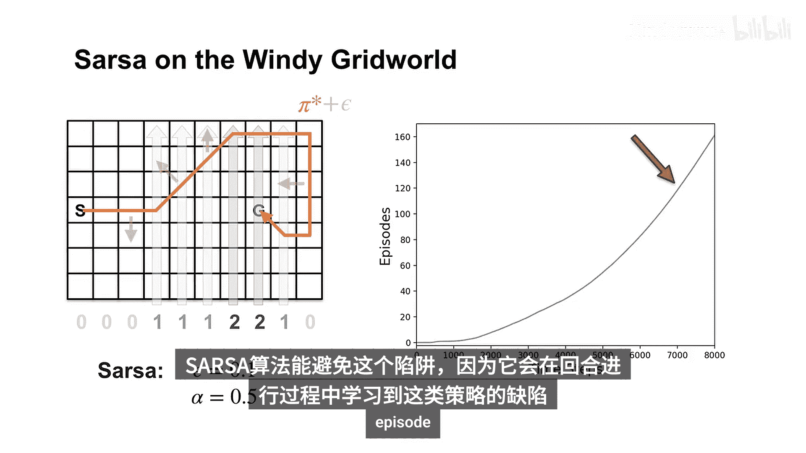

# 【阿尔伯塔大学】基于样本的学习方法 ｜ Sample Based Learning Methods p21 P21_有风网格世界中的Sarsa_04_01_04 -BV1GaYWzsEtR_p21-

🎼Mmm。🎼う。Now that we've talked about what SARSSA is。Let's see what happens when we actually run it。

By the end of this video， you will understand how the SARSA control algorithm operates in an example MVP。

You will also gain experience analyzing the performance of learning algorithm。

Let's look at a windy grid world， a grid world with a twist。

The states form a grid with a single start state and a terminal state。

The agent can move in the usual four directions。The agent receives a reward of minus1 per step。

This motivates the agent to escape as fast as possible。Since it's an episodic task。

 the discount factor gamma is one。Here's where the twist comes in。

 a wind blows the agent upwards when moving out of certain states。

 the wind strength in each state depends on the column。For example。

 if the agent is in a column with wind strength1 and takes the action left。

 it will move left and then up one cell。Moving into a boundary does nothing。

Let's apply SARSSA to this task。We will use Exon greedy action selection。In this example。

 we'll use an epsilon of 0。1。Alpha of 0。5 and initialize the values to 0。An epsilon of 0。

1 means we take a random action one in every 10 steps。The initial values are optimistic。

 encouraging systematic exploration。This plot shows the total number of episodes completed after each time step。

The results are averaged over 100 runs。Notice that the first few episodes take a couple thousand steps to complete。

The curve gradually gets steeper， indicating that episodes are completed more quickly。Around 7。

000 steps， the greedy policy stops improving。Notice the episode completion rate stops increasing。

This means the agent's policy hovers around the A policy。

And won't be exactly optimal because of exploration。

Notice that Monte Carlo methods would not be a great fit here。

This is because many policies do not lead determination。

Moonney Carlo methods only learn when an episode terminates。

So a determin policy might get trapped and never learn a good policy in this grid world。For example。

 if the policy took the left action in the start state， it would never terminate。

SarRSA avoids this trap because it would learn such policies are bad during the episode。

So it would switch to another policy and not get stuck。In this video。

 we showed an example of the SArsRSA control algorithm in an MDVP。

We also analyze SAarRSC's performance to better understand its learning process。

