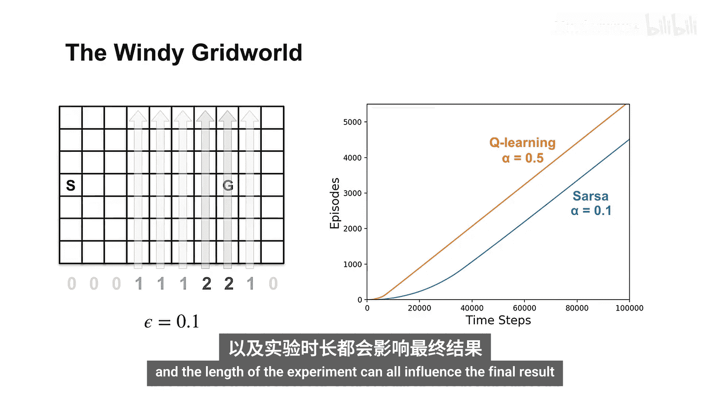

# 【阿尔伯塔大学】基于样本的学习方法 ｜ Sample Based Learning Methods p23 P23_有风网格世界中的Q-学习_04_02_02 -BV1GaYWzsEtR_p23-

🎼Mmm。

🎼う。We just introduce you to Q learning。You might not have a great intuition for why it works well。

In this video， we'll demonstrate how to use Q learning on the Winy Gr world and discuss the results。

By the end of this video， you will gain insight into how Q learning performs in an example MVP。

You will also gain insight into the differences between Q Learning and SARSSA。

Let's go back to the Winy Grd world。It's an undiscounted grid world with wind that blows the agent upwards as it moves through the windy states。

The wind strength is shown under each column of the grid。

The agent can move in four directions and receives a reward of minus1 on each step。For comparison。

 here is the performance of SArsRSa with an epsilon of 0。1 and an alpha of 0。5。Like before。

 this plot shows the number of episodes completed on the Y axis。

And the number of time steps on the X axis。Recall SArsRSA learned slowly for the first couple episodes。

Then it improved exponentially before plateauing。Let's use Q learning with the same parameter settings。

Before showing the results， let's think about what's going to happen。

Perhaps SARS' policy will perform better because his value function takes into account its epsilon greedy behavior。

Maybe Q learning will learn faster because it directly learns the optimal policy's value function。

What do you think will happen？Here are the results in the beginning the two algorithms learn at a similar pace。

Towards the end， Q learning seems to learn a better final policy。

Why is Q learninging doing so much better here？Without conducting more targeted experiments。

 we cannot know for sure。Perhaps the update target of Q learning is more stable。

Q learning takes the max over next action values， so it only changes when the agent learns that one action is better than another。

In contrast， SARSSA uses the estimate of the next action value and its target。

This changes every time the agent takes an exploratory action。

Perhaps you could design an experiment to get to the bottom of this。For now， let's move on。

How can we make SARSSA perform better？A step size parameter value of 0。

5 might be a bit high for this experiment。These large updates might be causing SARSA trouble when the agent takes exploratory actions。

SarRS's final policy certainly isn't optimal。Let's run the experiment a bit longer。

 and this time with alpha equal 0。1。We expect SARSA to learn more slowly with a smaller alpha。

 but find a better policy。Like， see what happens。Prediction confirmed。

SarRSa learns the same final policy key learning， but more slowly。

We know both algorithms have converged to the same policy because the slopes of the lines are equal。

Equal slopes mean that both agents are completing episodes at the same rate。

This experiment also highlights the impact of parameter choices in reinforcement learning。Alpha。

 epsilon， the initial values， and the length of the experiment can all influence the final result。

In this video， we evaluated Q learning in the windy Grd world。

Gain insight into the differences between Q learning and SARSA on this simple MDP。

