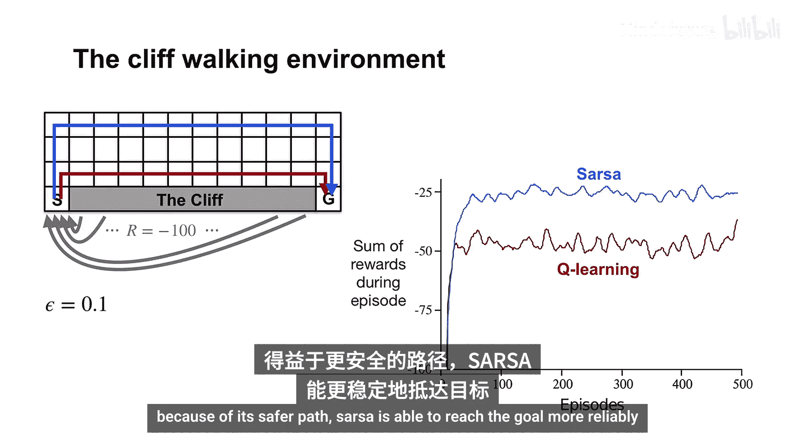

# 【阿尔伯塔大学】基于样本的学习方法 ｜ Sample Based Learning Methods p24 P24_Q-学习是如何成为离线策略的_04_02_03 -BV1GaYWzsEtR_p24-

🎼Mmm。🎼う。Q learning is an off policy algorithm， but so far we've only seen off policy algorithms that use important sampling。

How can Q learning be off policy without using important sampling Let's dive in and find out。

By the end of this video， you will understand how Q learning can be off policy without using important sampling。

And be able to describe how learning on policy or off policy might affect performance and control。

Recall that an agent estimates its value function according to expected returns under their target policy。

They actually behave according to their behavior policy。

 when the target policy and behavior policy are the same。 the agent is learning on policy。 Otherwise。

 the agent is learning off policy。 SArsRSA is an on policy algorithm In SArsSA。

 the agent bootstraps off of the value of the action it's going to take next。

 which is sampled from its behavior policy。Qe learning instead bootstraps off of the largest action value in its next state。

 this is like sampling an action under an estimate of the optimal policy。

 rather than the behavior policy。Since Q learning learns about the best action it could possibly take。

 rather than the actions it actually takes， it is learning off policy。

Whenever you see a reinforced learning algorithm， a natural question to ask is。

 what are the target and behavior policies？Cue Learnning's target policy is always greedy with respect to its current values。

However， its behavior policy can be anything that continues to visit all state action pairs during learning。

One possible policy is epsilon greedy。The difference here between the target and behavior policies confirms that key learning is off policy。

But if Q learning learns off policy， why don't we see any important sampling ratios？

It is because the agent is estimating action values with a known policy。

It does not need important sampling ratios to correct for the difference in action selection。

The action value function represents the returns following each action in a given state。

The agent's target policy represents the probability of taking each action in a given state。

 putting these two elements together， the agent can calculate the expected return under its target policy from any given state in particular the next state ST plus1。

Tue learning uses exactly this technique to learn off policy。

Since the agent's target policy is greedy with respect to its action values。

All non maximal actions have probability zero。As a result。

 the expected return from that state is equal to a maximal action value from that state。

Earlier we talked about how Q learning doesn't iterate between policy evaluation and policy improvement。

But rather learns the optimal values directly。Directly learning the optimal value function and policy sounds great。

 but there are some subtleties that make it less desirable in specific situations。

Let's look at this cliff walking example to understand some of those subtleties。

The cliff walking environment is an undiscounted episodic grid world with the cliff on the bottom edge。

On most steps， the agent receives a reward of minus1。Falling off the cliff， however。

 sends the agent back to the start and gives a reward of 100。

We compare Q learning and SARS in this environment with an epsilon of 0。1。

Here's the average performance of Q learning。Since Q learning learns the optimal value function。

 it quickly learns that an optimal policy travels right alongside the cliff。However。

 since its actions are epsilon greedy， traveling alongside the cliff occasionally results in falling off of the cliff。

SarRSa learns about his current policy， taking into account the effect of epsilon greedy action selection。

Accounting for occasional exploratory actions， it learns to take the longer but more reliable path that usually avoids randomly falling into the cliff。

Because of its safer path， SARS is able to reach the goal more reliably。

In this video， we showed that Q learning is off policy without using important sampling。

And that learning on policy or off policy may perform differently in control depending on the task。

