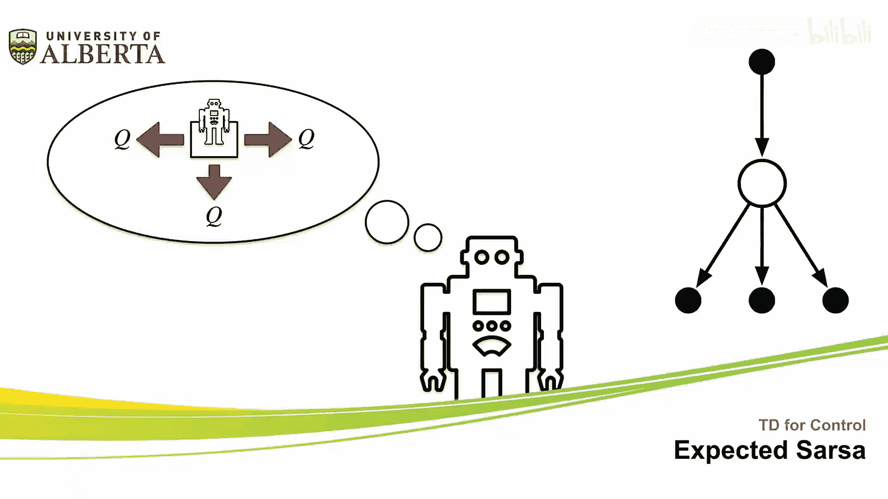
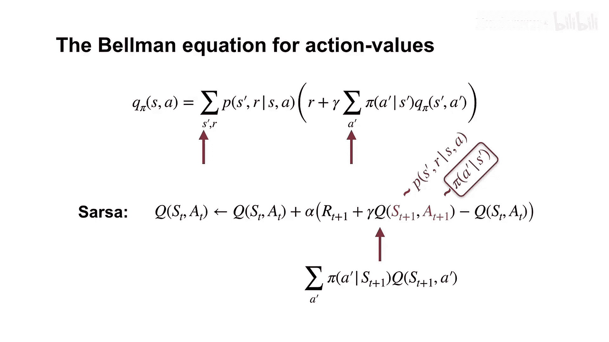
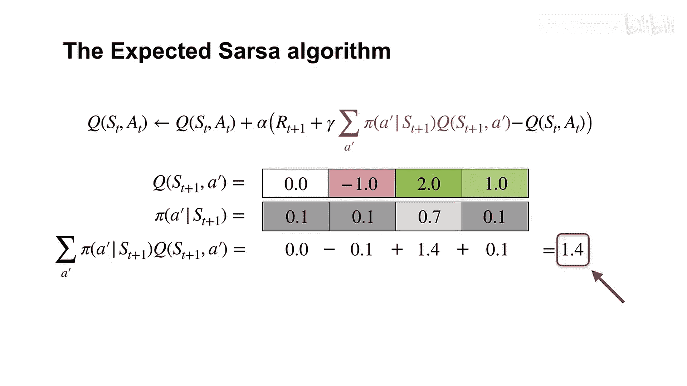
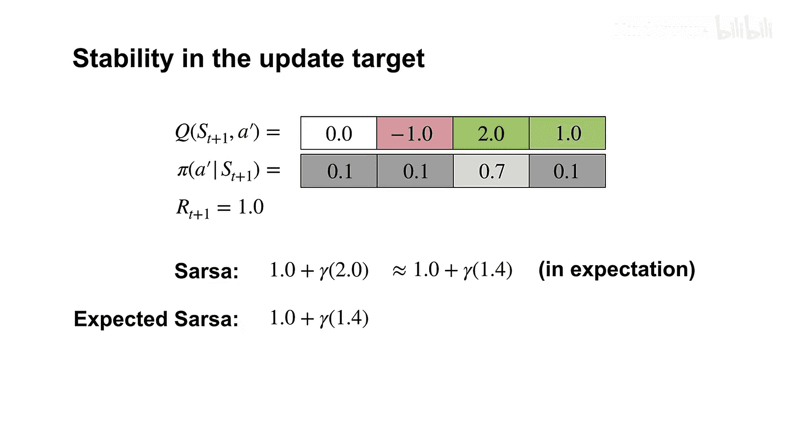
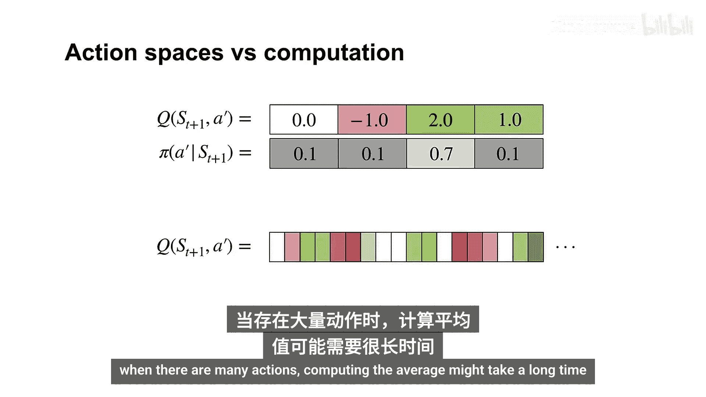
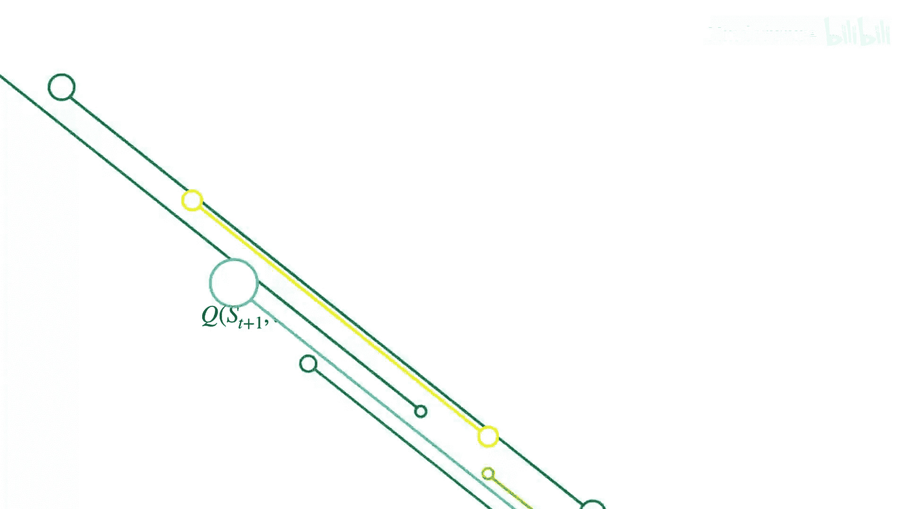

# 【阿尔伯塔大学】基于样本的学习方法 ｜ Sample Based Learning Methods p25 P25_期望Sarsa_04_03_01 -BV1GaYWzsEtR_p25-

We just discussed two TD control methods， SArsRSA and Q learning。In this lesson。

 we'll talk about another TD control method called Exp SARSA。By the end of this video。

 you will be able to explain the expected SARSSA algorithm。

Recall the Belman equation for A values here you can see the expectation over values of possible next state action pairs。

Breaking this expectation apart， we see a sum over possible next states as well as possible next actions。

SASA estimates this expectation by sampling the next state from the environment and the next action from its policy。

But the agent already knows its policy， so why should it have to sample its next action？Instead。

 it should just compute the expectation directly。In this case。

 we can take a weighted sum of the values of all possible next actions。

The weights are the probability of taking each action under the agent's policy。

Explicitly computing the expectation over next actions is the main idea behind the expected SArsRSA algorithm。

Now let's look at the expected SAarRSA's learning update。

Since expected SArsRSA is still based on the Belman equation for action values。

It uses the familiar form of learning update。The algorithm is nearly identical to SArsA。

 except the TD error uses the expected estimate of the next action value instead of a sample of the next action value。

That means that on every time step， the agent has to average the next state's action values according to how likely they are under the policy。

For example， with the following values in policy， expected SArsRSA would use a value of 1。

4 for its estimate of the expected next action value。

However， there is a huge upside to calculating the expectation explicitly。

Expected SArsSA has a more stable update target than SArsSA。

Let's look at an example to make this more clear。In this example。

 the media reward is deterministically won。Both SArsSa and expected SArsSA started with the true action values for the next state。

Even in this idealized case， the next action sampling that SArsSA does can cause it to update its values in the wrong direction。

It relies on the fact that in expectation across multiple updates the direction is correct；

 by contrast， expected SAARSA's update targets are exactly correct。

 and do not change the estimated values away from the true values。In general。

 expected SArs's update targets are much lower variance than SArss。

 The lower variance comes with a downside， though。

Computing the average over next actions becomes more expensive as the number of actions increases。

When there are many actions， computing the average might take a long time。

 especially since the average has to be computed every time step。

In this video， we showed that the expected SARSSA algorithm explicitly computes the expectation under its policy。

Which is more expensive than sampling， but has lower variance。

