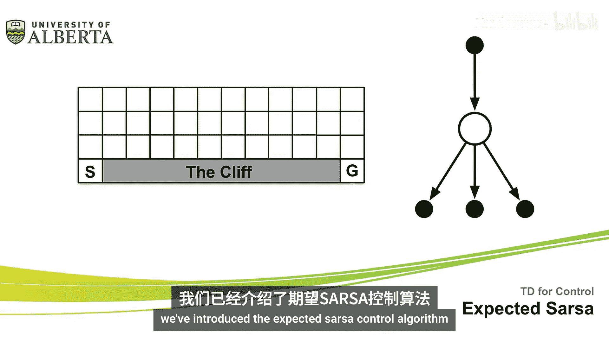
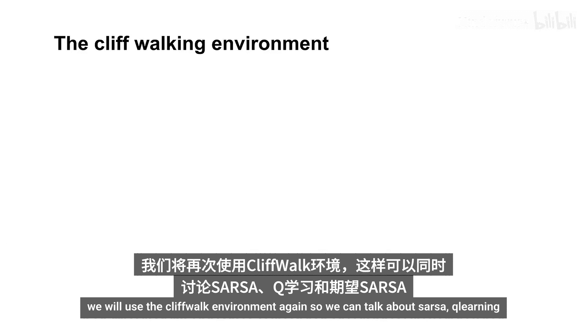
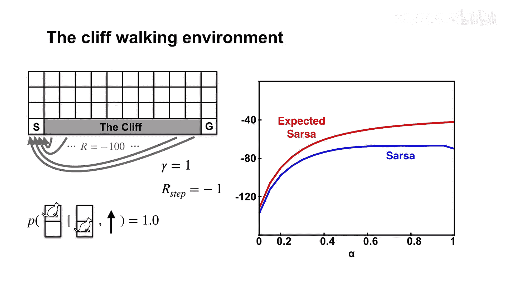
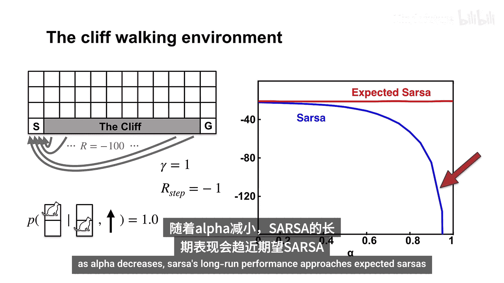

# 【阿尔伯塔大学】基于样本的学习方法 ｜ Sample Based Learning Methods p26 P26_悬崖世界中的期望Sarsa_04_03_02 -BV1GaYWzsEtR_p26-

We've introduced the expected SARSSA control algorithm。Now it's time to see it in action。

By the end of this video， you will be able to。Describe expected SArsRS' behavior in an example inVP。

And empirically compare expected SARSSA and SARSSA。

We will use the Cliffwalk environment again so we can talk about SARSSA， Q learning。

 and expected SARSSA all at once。

Let's recap。 This environment is an undiscounted episodic grid world with a cliff on the bottom edge。

Moving into the cliff moves the agent back to the start with a reward of minus 100。Otherwise。

 the reward is minus1 on each time step。SarSA performed better than Q learning on this domain because SAarRSA's policy accounted for its own exploration。

Today， we'll compare expected SARSA to SARSA with an epsilon of 0。1。

This plot was created by testing each agent with different values of the step size parameter alpha。

We did 100 episodes and averaged everything over 50，000 independent runs。

The Y axis shows the average return per episode， and the X axis shows the step size values。

SarRS's performance increases with larger step size values。But only up to a point。

The best alpha value for SARSa here was 0。9。Expected SArsSA outperformed SARSSA for almost all values of alpha。

Expected SARS is able to use larger alpha values more effectively。

This is because it explicitly averages over the randomness due to its own policy。

This environment is deterministic。So there are no other sources of randomness to account for。

This means expected SArs' updates are deterministic for a given state and action。SarrsRSA's updates。

 on the other hand， can vary significantly depending on the next action。

Now let's look at the average return per episode after 100，000 episodes。At this point。

 each algorithm has learned everything is going to learn。

Expected SArsRSis's long term behavior is unaffected by alpha。

Its updates are deterministic in this example。Therefore。

 the step size only determines how quickly the estimates approach their target values。

SarRSa behaves quite differently here。It even fails to converge for larger values of alpha。

As alpha decreases， SArsRSA's long run performance approaches expected SArsis。

In this video， we've seen that expected SARSSA was able to quickly learn a good policy in the Cl world and that expected SArsRSA is more robust than SARSA to large step sizes。

