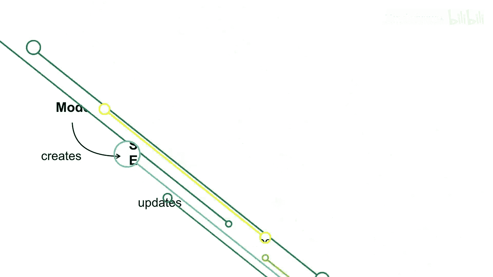
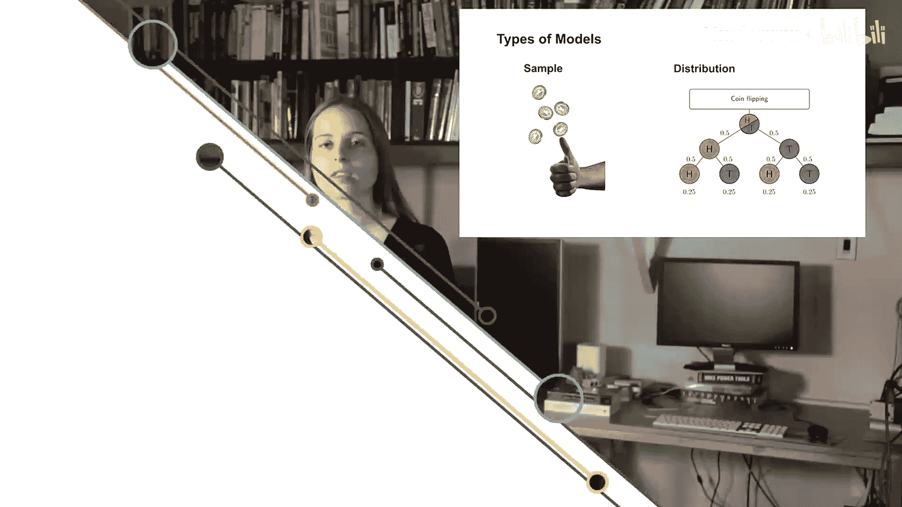
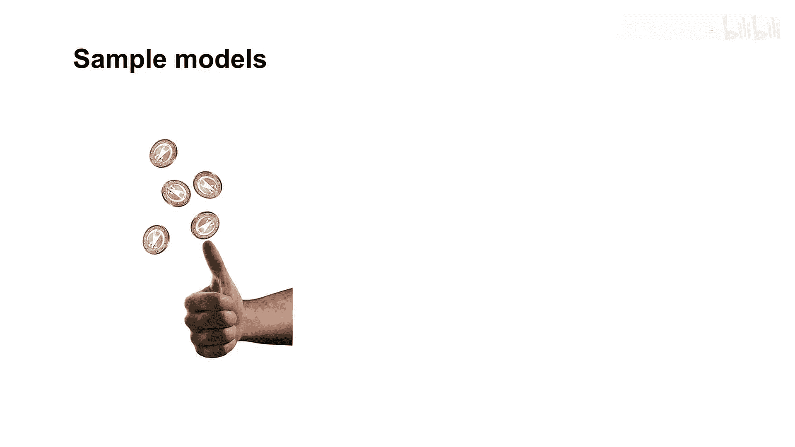
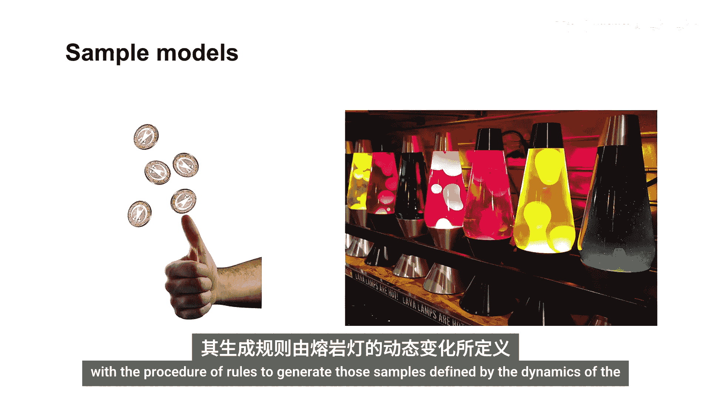
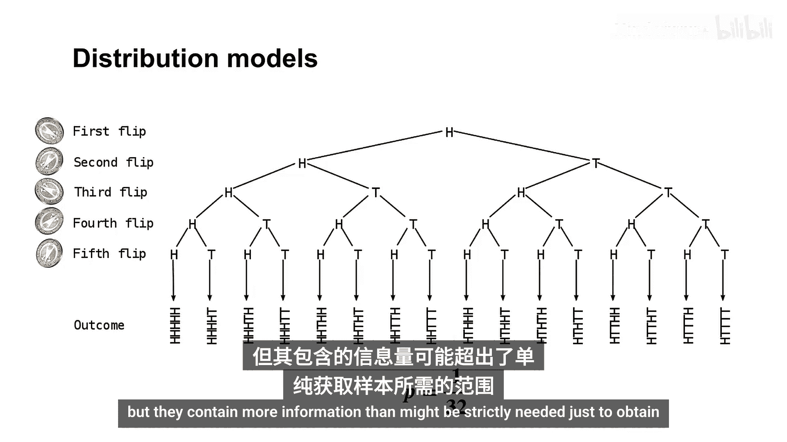

# 【阿尔伯塔大学】基于样本的学习方法 ｜ Sample Based Learning Methods p29 P29_什么是模型_05_01_03 -BV1GaYWzsEtR_p29-

Sometimes we make decisions without thinking too much about them。

 such as deciding how to drive to work。Other times。

 we sit and imagine many possible scenarios based on our understanding of the world。

We can use these imagined outcomes to decide what to do or what not to do。For example。

 if we carry a fragile object with one hand， we can imagine scenarios where it falls and breaks。

 and we can make a choices accordingly。We've seen sample based methods like TD。

 which learn only from sample experience， we've also seen methods like dynamic programming or DP。

 which plan by using complete information about how things work without having to make decisions。

It would be even better if you could obtain an intermediate method that can leverage the best of both extremes。

 This week， we will do just that and unify these strategies with the Dah architecture。

In this video we will talk about models。By the end of the video。

 you will be able to describe a model and how it can be used。

Classify models as distribution models or sample models。

And identify when to use a distribution model or sample model。

Models are used to store knowledge about the dynamics。

When imagining different scenarios to aid decision making。

 this is rooted in our knowledge about how the world works。From a particular state in action。

 the model should produce a possible next state and reward this allows us to see an outcome of an action without having to actually take it。

A model allows for planning planning refers to the process of using a model to improve a policy。

One way to plan with a model is to simulate experience and perform value function updates as if those experiences happened。

By improving the value estimates， we can make more informed decisions。

Simulating experience improves sample efficiency， the addition of simulated experience means the agent needs fewer interactions with the world to come up with the same policy。

Now let's talk about the different types of models that may be useful to us。One is a sample model。

 which produces an actual outcome drawn from some underlying probabilities。 For example。

 a sample model for flipping a coin can generate a random sequence of heads and tails。

Another type of model is a distribution model which completely specifies the likelihood or probability of every outcome。

In the coin flipping example， it would say that heads could occur 50% of the time and that tails could occur 50% of the time。

 it could also produce the odds of any sequence of heads and tails using this information。

Sample models can be computationally inexpensive because random outcomes can be produced according to a set of rules。

 for example， to flip five coins， a sample model can randomly pick zero or1 independently five times it only needs to produce a single outcome for each flip。

As an example of a sample model in practice， in 2017。

 the company Cloudfllaare used random patterns sampled from a wall of lava lamps to encrypt 10% of global internet traffic。

The samples are random configurations of the lava lamp wall at a given point in time。

 with the procedure of rules to generate those samples defined by the dynamics of the lava lamps。

Distribution models contain more information， but can be difficult to specify and can become very large。

 Let's go back to the example for flipping five coins。

A distribution model would enumerate every possible sequence of heads and tails you could get across the five coins and assign a probability to each sequence。

For this simple problem， that would consist of fully describing 32 possible outcomes。

 distributionion models can be used as sample models by drying outcomes according to explicit probabilities of each outcome。

But they contain more information than might be strictly needed just to obtain samples。

In this video， we talked about how models can be used to improve a policy through a process called planning。

 we discussed two different types of models， sample models and distribution models。

Next time we'll go into more depth on the differences between these models。

