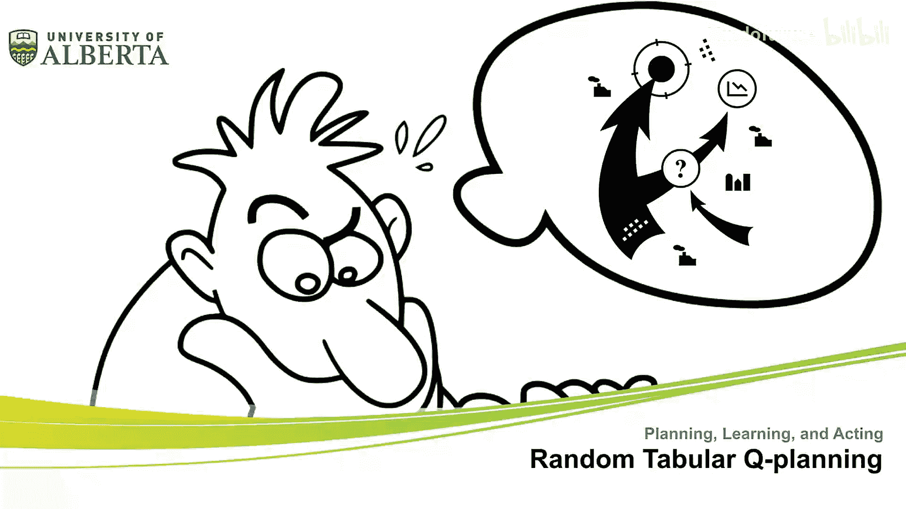
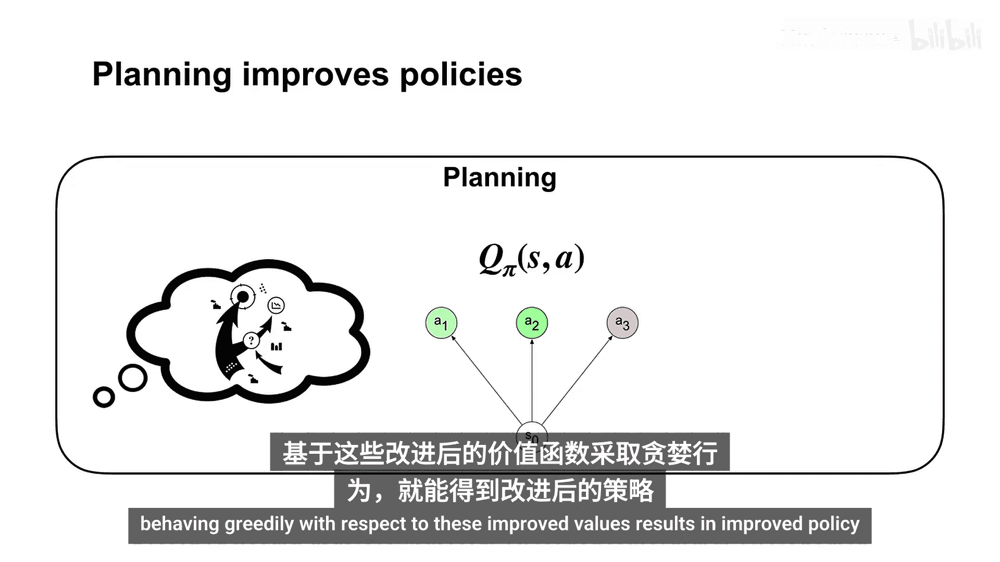
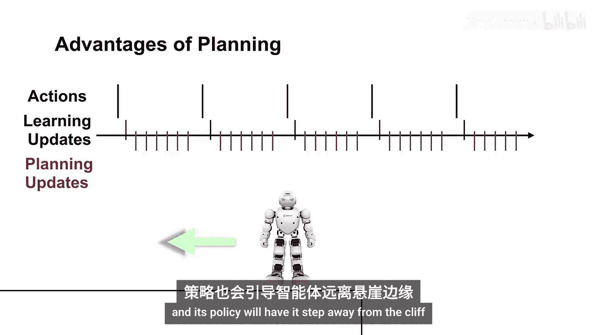

# 【阿尔伯塔大学】基于样本的学习方法 ｜ Sample Based Learning Methods p31 P31_随机表格Q-规划_05_02_01 -BV1GaYWzsEtR_p31-

Now that we know what models are， we can discuss how we might use them in reinforcement learning。

 that is how one can leverage a model to better inform decision making without having to interact with the world。

We call this process planning with model experience。In this video。

 we will talk about one particular view of planning。By the end of this video。

 youll be able to explain how planning is used to improve policies and describe one step tabular Q planning。

Planning is a process which takes a model's input and produces an improved policy。

One possible approach to planning is to first sample experience from the model。

This is like imagining possible scenarios in the world based on your understanding of how the world works。

This generated experience can then be used to perform updates to the value function as if these interactions actually occurred in the world。

Behaving greedily with respect to these improved values results in improved policy。

Recall that Q Learn uses experience from the environment and performs an update to improve a policy。

In C planning， we use experience from the model and perform a similar update to improve a policy。

Random sample one step tabular Q planning illustrates this idea This approach assumes we have a sample model of the transition dynamics。

 it also assumes that we have a strategy for sampling relevant state action pairs One possible option is to sample states and actions uniformly。

This algorithm first chooses a state action para at random from the set of all states and actions。

It then queries the sample model with this state action pair to produce a sample of the next state and reward。

It then performs a key learning update on this model transition。Finally。

 it improves the policy by gratifying with respect to the updated action values。

A key point is that this planning method only uses imagined or simulated experience。

 all of these updates can be done without behaving in the world or in parallel with the interaction loop。

Imagine that actions can only be taken at specific time points。

 but learning updates can be executed relatively fast。

This results in some waiting time from after the learning update and when the next action is taken。

We can fill in this waiting time with planning updates。

Imagine we have a robot that is standing near a cliff。

 Let's say its model knows about the outcome of stepping off of the cliff。

 but it is not accurately represented in its value function or policy。

It can generate simulated experience of stepping off of the cliff and perform many planning steps on these transitions。

Its value function will now better reflect that stepping off of the cliff is bad and its policy will have it step away from the cliff。

To summarize， we discussed how planning methods use simulated experience to improve policies。

 how random sample one step tabular Q planning uses a sample model to randomly generate experience。

And how the value function is then improved using a Q learning update。

