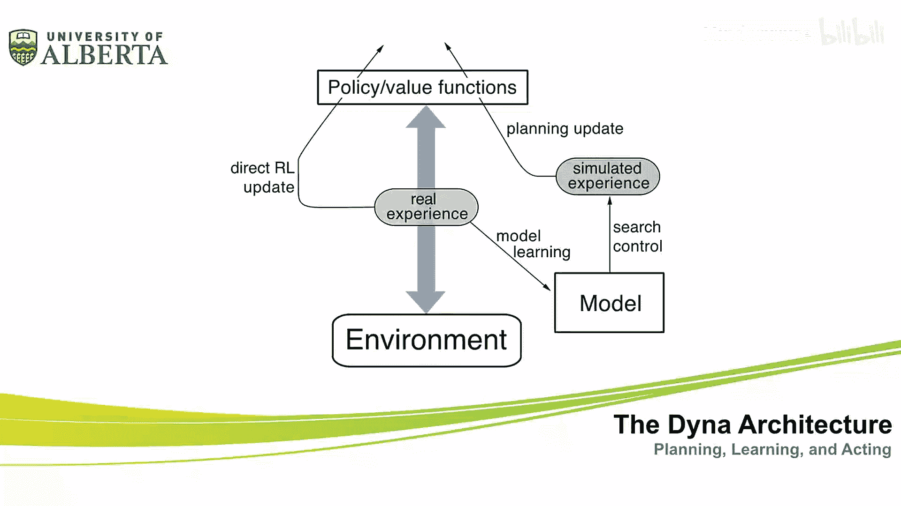
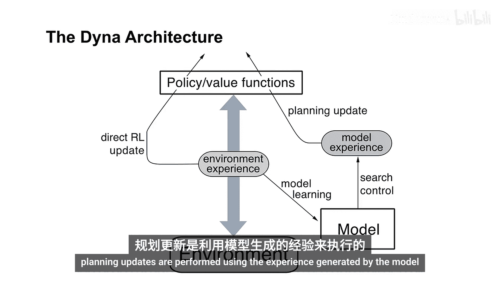
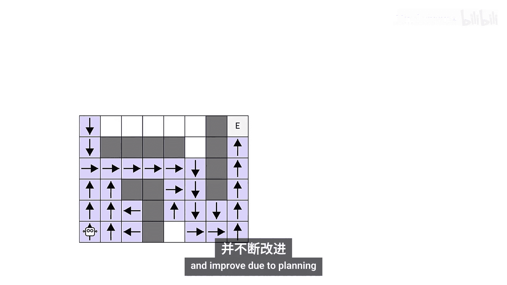

# 【阿尔伯塔大学】基于样本的学习方法 ｜ Sample Based Learning Methods p32 P32_Dyna架构_05_03_01 -BV1GaYWzsEtR_p32-

So far we've talked about two sources of experience， the environment and the model。In Direct RL。

 the agent learns from experience generated by interacting with the world。Like in Q learning。

But the agent can also generate simulateim experience from the model and use it for planning。

Today we will talk about one way to combine direct RL and planning called Dynina。

By the end of this video， you will be able to。Understand how simulate experience from the model differs from interacting with the environment。

You will also understand how the Dynner architecture mixes direct RL updates and planning updates。

We've seen Q learning which performs updates using environment experience。C Planning。

 on the other hand， performs updates using simulateimulant experience from the model。

We can combine these two ideas through the Dynah architecture。First。

 we will describe the main components of Dynina。We have the usual environment and policy。

They generate a stream of experience。We use this experience to perform direct RL updates。

To do planning， we need a model。The model has to come from somewhere。

The environment experience can be used to learn the model。

This model will be used to generate model experience。In addition。

 we want to control how the model generates this simulate experience。

 What states the agent will plan from。We call this process search control。

Planning updates were performed using the experience generated by the model。

Let's look at a cartoon of how Dynino works。Here we have a simple maze and a robot trying to find its way out。

It's a discounted problem。 The robot receives a reward of plus one at the goal and zero otherwise。

As usual， the robot starts out knowing nothing。It randomly traverses the maze until it stumbles on the goal for the first time。

Our robot only updates one action value depicted in blue。

This was the only transition that generated nonzero reward。This update is done by Direct RL。

Dynamics use of all the experience generated during the first episode to learn a model the environment。

 The yellow states correspond to states visited during the first episode。

The robot didn't visit all of them， but it visited most of them。

Dynina performs planning on every time step。However。

 planning has no impact on the policy during the first episode。

Even though the model became more accurate in each time step。After the first episode completes。

 planning can really shine。In our cartoon， the thought bubble represents planning happening in the robot's mind。

The grid rolled in the bubble represents the robot's model of the world。

The yellow states represent where the model knows what will happen next。

The model knows of what all the states the robot visited during the first episode。

Let's look what happens if we run the planning loop at the beginning of the second episode。

Dina can simulate transitions from any of the state action pairs the agent visited during the first episode。

In this case， there are a lot of them。Planning replays these simulate transitions as if they happened in the real world。

Each step of planning simply applies the Q learning update to a simulated transition and updates the value function。

With enough planning steps， the agent can approve the policy in all the states visited during the first episode。

Here， planning produce a pretty good policy。The policy is not perfect。

 Can you see where it takes suboptimal actions？The policy is still random in states that were not visited before。

We represent these states where the policy was not updated with white squares。

Let's see how the planned policy works in the real world。

The robot now knows how to get to the goal quickly after just one episode。In comparison。

 Q learning will require many episodes to achieve similar performance。

Dynd does more computation per step。But uses limit experience more efficiently。Remember。

 this is only a cartoon。Diny would act slightly differently than shown here。

The robot would continue exploring and planning on each step of the second episode。

 so the policy would take random actions once in a while。

 and the policy would continue to change and improve due to planning。

We will discuss how to implement Da next time。In this video， we introduce the D Arch。

 which uses direct R and planning updates to learn from both environment and model experience。

That's all for this video。 I hope you plan on coming back next time。

