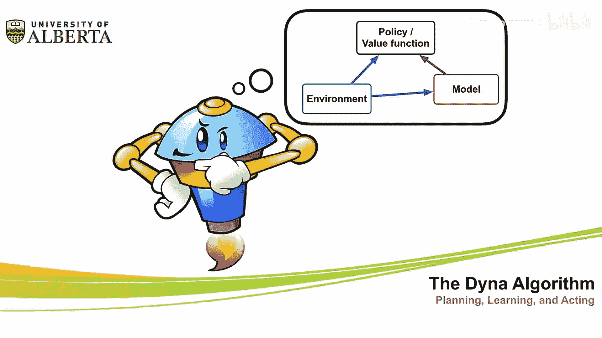
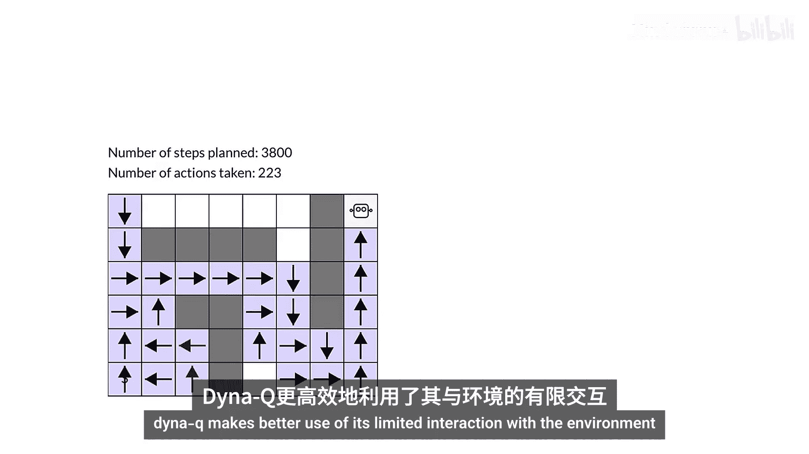

# 【阿尔伯塔大学】基于样本的学习方法 ｜ Sample Based Learning Methods p33 P33_Dyna算法_05_03_02 -BV1GaYWzsEtR_p33-

We discussed how Da unifies planning， learning， and acting。

This unification introduced some additional concepts like model learning and search control。

Today we will take a closer look at how all these pieces fit together。

In this video， we will discuss a specific instance of the Dah architecture called Tabular Dinina Q。

By the end of this video， you should be able to。Describe how tabular DnoQ works。

You will also be able to identify the direct RL， planning， model learning。

 and search control parts of DnaQ。Let's first discuss how tabular DonQ algorithm learns a model。

Tableler Donicu assumes deterministic transitions。For example。

 when this rabbit chooses to move right in state A。There is only one outcome。

The rabbit transitions to state B with the reward of zero。Likewise。

 if the rabbit moves right in state B， it stays in state B with a reward of one。

The left action in B always takes the rabbit to state A with a reward of zero。

After the rabbit has experienced these transitions。

 the model knows what happens in these state action pairs。If the transition occurred once。

 it will always unfold that way in the future。The model can be certain about this。

Let's look at the DnoQ algorithm in detail。First， we have the usual Age Enron interaction loop。

In the current state， the agent selects an action according to its epsilon greedy policy。

It then observes the resulting reward and next state。

It performs a Q learning update with this transition， what we call direct R L。

If we were to stop here， we would get exactly the Q learning algorithm。

This is where things start to differ from model free methods。

 DnaQ will take this transition and perform a model learning step with it。To do so。

 the algorithm memorizes the next state and reward for the given state actionction pair。

This works because we assume the environment is deterministic。

Dinina Q then performed several steps of planning。Each planning step consists of three steps。

 search control， model query and value update。In this algorithm。

 search control selects a previously visited state action pair at random。

It must be a state action pair the agent has seen before。Otherwise。

 the model would not know what happens next。Given the state action pair。

 we created the model for the next state and reward。We have now generated a model transition。Finally。

 Dno Q performs a Q learning update with this simulated transition。

The planning step is repeated many times。The most important thing to remember is that DnaQ performs many planning updates for each environment transition。

And that's tabular Dynah Q， a simple instance of the Dah architecture。

Let's revisit our robot friend to better understand the DnaQ algorithm。Remember。

 this is just a cartoon to build intuition。Like before。

 it starts out knowing nothing about the environment。

The robot gradually builds a model while interacting with the environment。

The first episode takes 184 steps in that time， the agent only changed the value of the state action pair beside the goal。

Without planning， the next few episodes would probably be just as long。

Let's look at the next episode and study the impact of doing 100 steps of planning on every time step。

The last time we talked about this robot， it was doing way more planning on each step。

 so this time around it will take longer for D a Q to find a good policy。After just one step。

 planning updated the values of two more states。Now the agent knows the correct actions in the final corridor。

Let's run DnoQ a bit longer。 the impact of planning is quite dramatic。

DininaQ propagates the reward information across the entire state space。Eventually。

 the agent knows an effective policy for navigating to the goal from most states。

The policy computed by planning only requires 18 steps to reach the goal after just two episodes。

That's more than 10 times shorter than the first episode。

Tabular DinaQ performed many more updates to the value function。Then it would have without planning。

DyninaQ makes better use of its limited interaction with the environment。

In this video， we learned how tabular DNQ mixes planning， learning。

 and acting through the value function。We also studied how DnaQ updates his value function in a small grid world。

