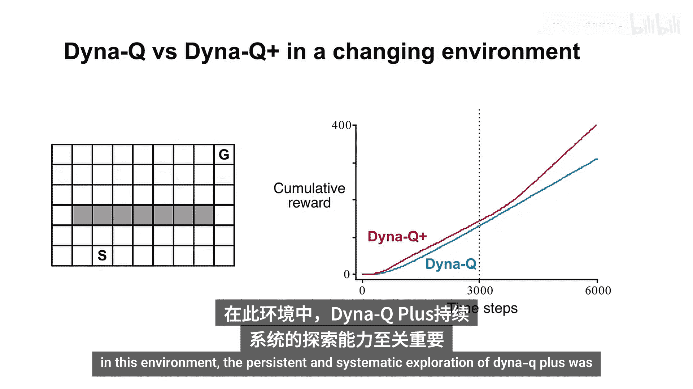

# 【阿尔伯塔大学】基于样本的学习方法 ｜ Sample Based Learning Methods p36 P36_深入了解变化的环境_05_04_02 -BV1GaYWzsEtR_p36-

We previously talked about how agents can plan with models that are incomplete。

Now let's discuss how agents can with models that are inaccurate because of changes in the environment。

By the end of this video， you'll be able to。Explain how model in acuracies produce another exploration exploitation trade off and describe how DnoQ addresses this trade off。

When the agent's model is inaccurate， planning will likely make the policy or value function worse with respect to the environment。

That means the agent has a vested interest in making sure its model stays accurate。In this example。

 the robust model initially says that the rabbit will go directly to the carrot if it chooses the move right。

However， after moving right， the rabbit finds itself in the middle square。

After experiencing this transition， the rabbit can update its model of the world。

The update reflects that choosing the move right action in the leftmost square will result in moving to the middle square。

We saw that the rabbit corrected its model。After experiencing a transition in the environment。

 in general， an agent might want to double check that all its model's transitions are correct。

However， double checking transitions with low valued actions will often lead to low reward。

In changing environments， the agent's model might become inaccurate at any time。

So the agent has to make a choice。Explore to make sure its model is accurate。

Or exploit the model to compute the optimal policy， assuming that the model is correct。

When the environment changes， the model will be incorrect。

 it will remain incorrect until the agent revisits that part of the environment that changed and updates the model。

This suggests that the agent should explore places it has not been to in a while。

Let's think about how that might work。Roughly speaking。

 the model is more likely to be wrong and states the agent has not visited in a long time。

For example， let's say the rabbit knows the turtle starts in the following cell。

Since the turtle moves slowly， it can't move very far in the first few time steps。However。

 after a long time， the turtle might be in a totally different cell than it started in。

 making the rabbits model incorrect。To encourage the agent to revisit stays periodically。

 we can add a bonus to the reward use and planning。

This bonus is to simply Kappa times the square root of tau。Where R is a reward from the model。

 and taO is the amount of time it's been since the state action pair was last visited in the environment。

To is not updated in the planning loop， that would not be a real visit。

Kappa is a small constant that controls the influence of the bonus on the planning update。

If Kappa were zero， we would ignore the bonus completely。

Adding this explorationiration bonus to the planning updates results in the DynAQ+ algorithm。

By artificially increasing the rewards use and planning。

 we increase the value of state action pairs that haven't been visited recently。

How exactly does this encourage exploration？Imagine a state action pair essay。

That has not been visited in a long time。 That means the ta will be large。As tau grows。

 the bonus becomes bigger and bigger。Eventually， planning will change the policy to go directly to S due to the large bonus。

When the agent finally visit state S。It might see a big reward， or it might be disappointed。

Either way， the model will be updated to reflect the dynamics of the environment。

Let's look at the shortcut mas to understand the difference between DnaQ and DnaQ+。In this example。

 the objective is to get to the goal from the start state as fast as possible。

The rewards are zero everywhere， except for the terminal transition， which emits a reward of plus1。

The discount factor is less than one because we want to encourage the agent to reach the goal quickly。

Both DnaQ and Dna Q+ use Epsilon greedy action selection。For the first half of the experiment。

 DnaQ and DnoQ+ behave very similarly。In this case。

 the increased expiration by Donna Q+ helps to find a good policy more quickly。

That is why Dyno Q plus line is above the Dynoq line。

Now we create a shortcut on the right side of the wall。

Let's see how Dno Q and Dno Q+ adapted that change。

 Can they find the shorter path to the goal through the right side of the wall？Here are the results。

 Dna Q+ finds a shortcut soon after the environment changes。 Dna Q， on the other hand。

 does not find the shortcut in the time allotted。Eventually。

 Donicue will find the shortcut by reexploring the entire state action space using Epsilon greedy。

 however， doing so would require at least seven exploratory actions in a row。

So it could take a very long time。In this environment。

 the persistent and systematic exploration of DynnoQ+ was key。

In this video， we talked about how model accuracy produces a new variant of the exploration exploitation trade off。

The agent has to explore to make sure its model is accurate。

We also talked about how DnaQ+ uses exploration bonuses to explore the environment。

