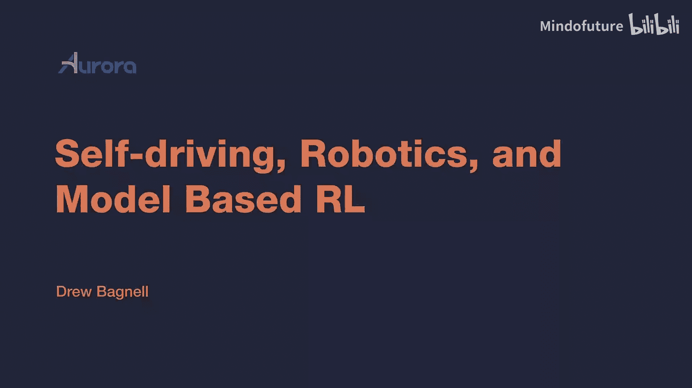
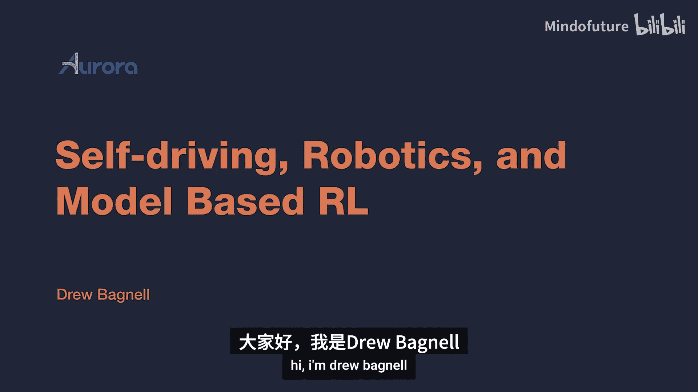

# 【阿尔伯塔大学】基于样本的学习方法 ｜ Sample Based Learning Methods p37 P37_德鲁·巴格内尔-自动驾驶机器人和基于模型的强化学习_05_04_03 -BV1GaYWzsEtR_p37-

Hi， I'm Drew Bell， I'm the Chief Technology Officer at Aurora Innovation。

I'm going to talk to you a little today about self driving， robotics。

 and model based reinforcement learning。You know， we're really in the beginning of a revolution in robotics。

 from manipulation to drones to self driving。these techniques are in general deeply dependent on machine learning。

 For instance， within the use of perception， we've had no credible story for how to do perception without machine learning for nearly two decades now。

What I'm showing in the video you're seeing is an autonomous vehicle。

 an a rural autonomous vehicle driving along in a scene of typical complexity for an urban environment。

In blue， you're seeing a machine learning based perception system detect and understand the motion of parked and moving vehicles in gold。

 cyclists sharing the road and in red dense crowds of pedestrians。

It's important these applications to achieve extreme accuracy in all weather and occlusion。

What's been interesting over the last safe decade is the increase of importance of using machine learning in the decision making process。

Decision making is very complex in urban environments， I'm showing here， for instance。

 an autonomous vehicle finding a gap in a dense flow of pedestrians。

 what makes this difficult is the importance of context and other actors in the scene。

 and it turns out to be very difficult to build and hand to rules for problems like the one being demonstrated here or even things as simple as the stop sign or emerge。

AndYou'll note in these examples that I'm talking about in robotics that they all rely on continuous states and actions。

I'm showing here a spectacular example of model based reinforcement learning applied to acrobatic autonomous helicopter control。

In this work by Peterveel and his colleagues， they demonstrated they could use model based reinforcement learning techniques on the continuous states and actions。

 the positions， velocities， and the controls of a model helicopter。

 and make it perform exceptional acrobatics。The key to making such techniques practical is the use of continuous state and action models of the helicopter dynamics。

So models， what do I mean by models？By a model， I mean a transition function or dynamics。

 a function that maps the current state and action to the next state。

 as well as a function that can evaluate the cost at a particular state in action。

A dirty secret in the field is that practically all robot learning problems that involve decisions are in some way model based。

And you might ask why is this true， well， fundamentally interactions between， for instance。

 robots in the world are expensive and time consuming。And it's often said that it's。

 say better to die in simulation than it is in the real world。

The way to formalize this intuition is to talk about sample complexity。

 how many interactions with the world are required to achieve high performance。

And what we've learned both practically and very recently， theoretically。

 is it can take exponentially fewer interactions to learn with a model than it does to learn without。

Okay， what I'm going to take you through now is how we take advantage of a continuous state and action model。

Using quadratic value function approximation， quadratic value function approximation is a powerful technique for model waste reinforcement learning that goes back to optimal control in the 1960s。

This class of techniques was the one used in the spectacular helicopter acrobatics you saw above。

 and it's widely used in creating trajectories from drones to medical robots。

 to manipulators to self driving vehicles。And this quadratic form approximation of a value function。

 again， continuous in state actions， is particularly elegant for a few reasons， one。

 for a simple class of systems， notably ones whose dynamics are linear and cost are quadratic。

 This value function quadratic value function approximation is exact， it's not an approximation。

From other problems where the action value function is convex or locally convex in the continuous states are actions。

 it turns out to be an excellent local approximation of the true action value function。

 and the key here is that given this approximation。

 we can rapidly compute the optimal policy in closed form even with continuous actions。Okay。

 so it's an interesting exercise to go through and actually try to compute what the optimal policy is。

It's worth doing this by hand for a single scalar variable X and state and for single scalar control or action A。

 if you're familiar with matrix calculus， this is a very quick computation， but if you're not。

 it's worth struggling for a while to understand how it works。

The nice part is once you compute this optimal policy。

 you can plug it back in to the action value function and extract the optimal value function V。

 and it'll turn out to be quadratic as well。The general family of techniques that take advantage of this are known as differential dynamic programming。

Once you have gone through the exercise we described above。

 you can pull it together with the techniques you've already learned in dynamic programming or in using the Belelmon equation and compute an optimalimum policy for all time stepss。

The idea is we go backwards in time in the standard dynamic programming form。

 we computed every time step a series， particularly Taylor series approximation of the model and the known cost function up to first or second order。

Then we use the Belelmon equation to back up a quadratic approximation of the action value function。

 given a quadratic approximation of the future value and the quadratic approximations we just computed of model and cost。

Then you use the exercise we did above to compute the optimal policy and thus the optimal value at time step t minus1。

 and this gets iterated backwards in time。Now it's very common and in fact。

 using the approach we described above to then go back and refine the Taylor series approximation by taking advantage of the new policy we have Think about this as giving us a new point to linearize the model about。

Okay， there's lots of details to both the algebra and to getting this to work and fortunately there's lots of great resources online that you can take advantage of to learn more about these techniques here you can find my notes on the techniques I applied that we discussed above as well as Kaarina Frdaki's lectures on the same I'll also note that youvoasa's paper on online trajectory optimization is particularly clear and easy to work through for this approach that I've just described。

Okay， now that we have a technique that can take advantage of a continuous state and action model and learn a policy which may be optimal or near optimal。

 we'll discuss next how to build models so we can solve RL problems。Thank you for your attention。

