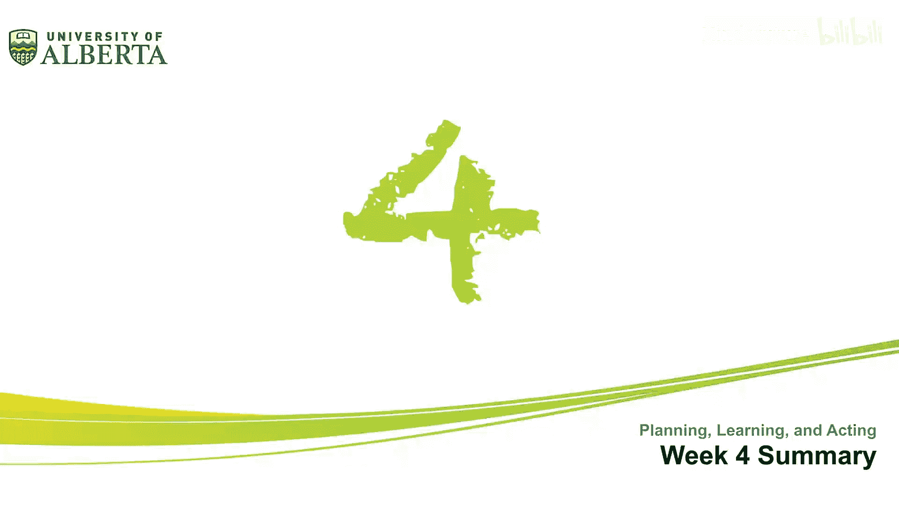
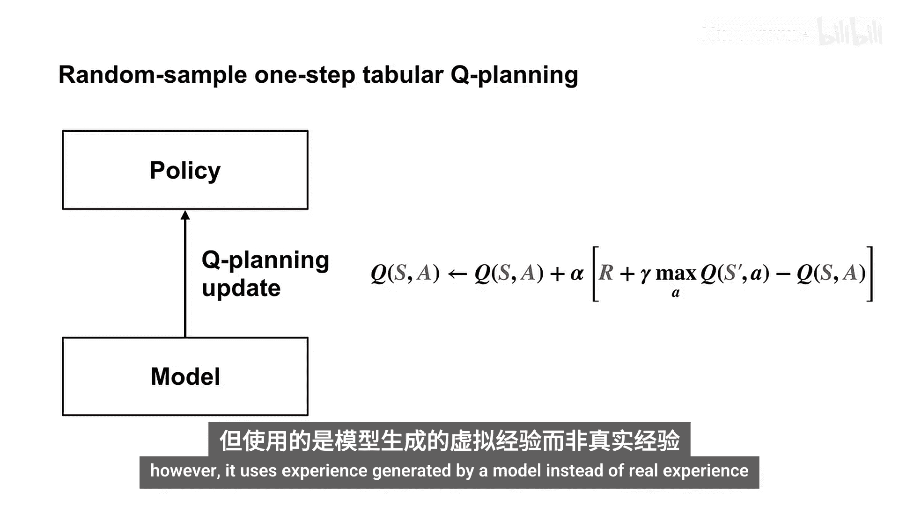
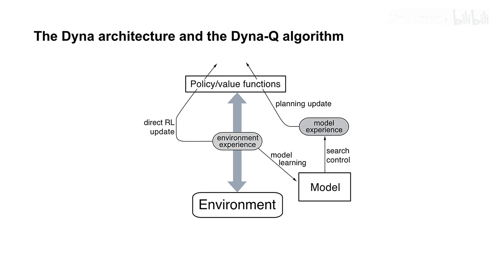
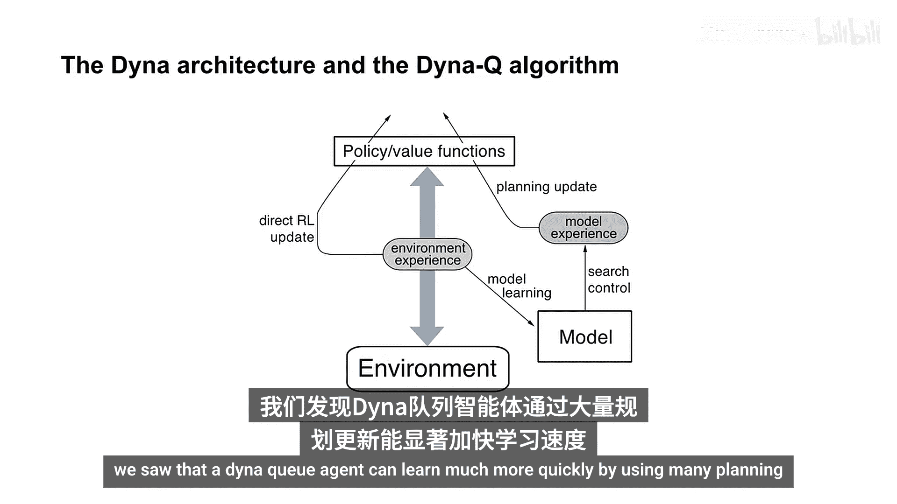
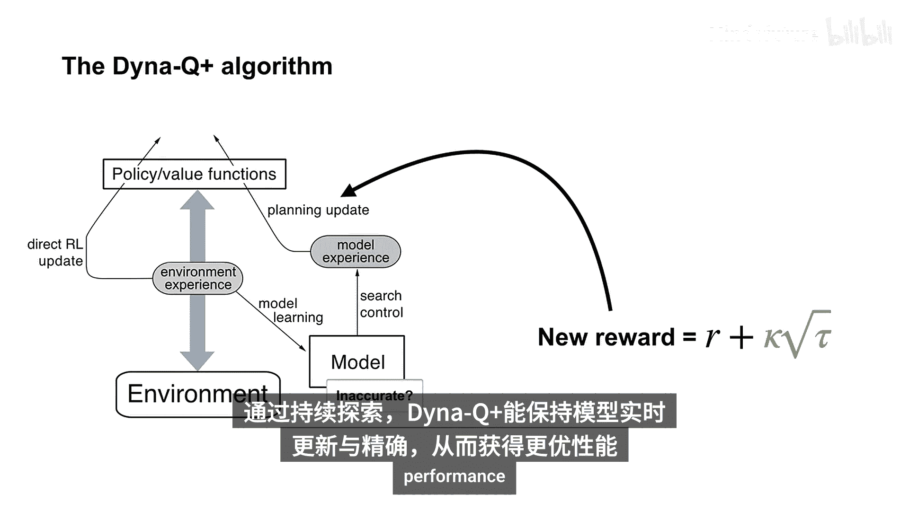

# 【阿尔伯塔大学】基于样本的学习方法 ｜ Sample Based Learning Methods p38 P38_第四周总结_05_04_04 -BV1GaYWzsEtR_p38-

Congratulations， you've just finished module4 where we learned about planning， learning and acting。

 let's go over the concepts and algorithms we've covered in this module。In lesson one。

 we introduced models and talked about the difference between distribution and sample models。

Distribution models store the probability of every possible outcome。However。

 this may require a large amount of memory。Sample models are usually much more compact than distribution models because they don't explicitly store the probability of each outcome。

In lesson two， we introduced one step Q planning。Ce Plan uses the same update as Q learning， however。

 it uses experience generated by a model instead of real experience。

In lesson three， we introduced the Dynah architectureecture。

Dina incorporates both planning and learning in a single agent。

We saw that a dining Q agent can learn much more quickly by using many planning updates。

Models aren't always accurate in lesson4， we talked about how inaccurate models affect planning。

 We pointed out how D Q can plan effectively using an incomplete model。

 but not if the model is wrong。Finally， we introduce DnaQ+ this algorithm uses a reward bonus in its planning updates to encourage exploration by exploring DynnaQ+ keeps its model up to date and accurate。

 resulting in better performance。

We covered a lot of material in this module， so well done keeping up。

