# 【阿尔伯塔大学】基于样本的学习方法 ｜ Sample Based Learning Methods p39 P39_恭喜_05_05_01 -BV1GaYWzsEtR_p39-

You've made it through the whole course on sample based learning methods。

 let's quickly review what we've covered。We talked about two approaches to learning from sampled experience。

 the first was Monte Carlo， which averages returns to estimate the value function。

The second was TD learning， which uses the estimated next day value in its target。

We saw that TD learns from sample experience like Monte Carlo。

 but also bootstraps like dynamic programming。

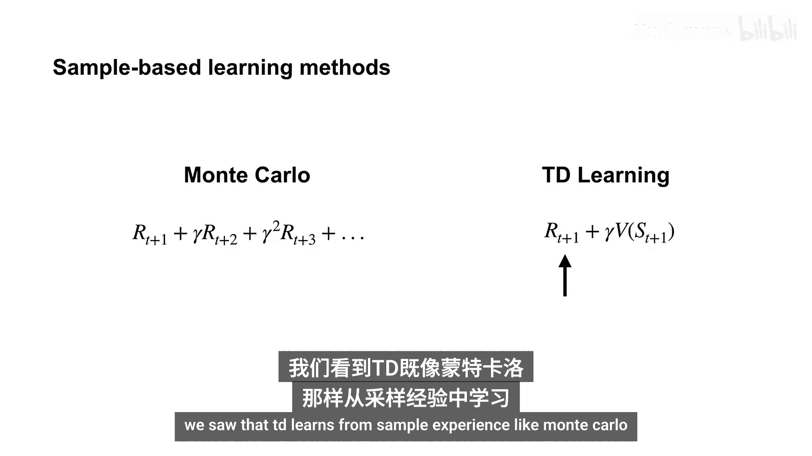

We showed you how to implement the TD algorithm to estimate both state value and action value functions。

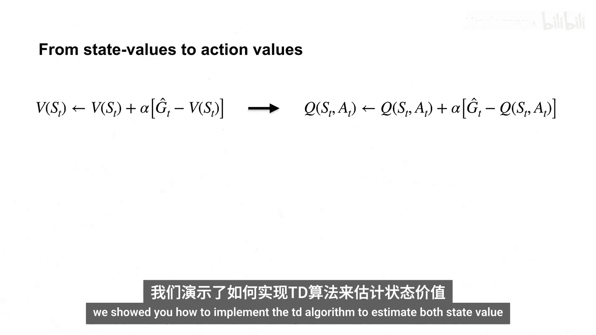

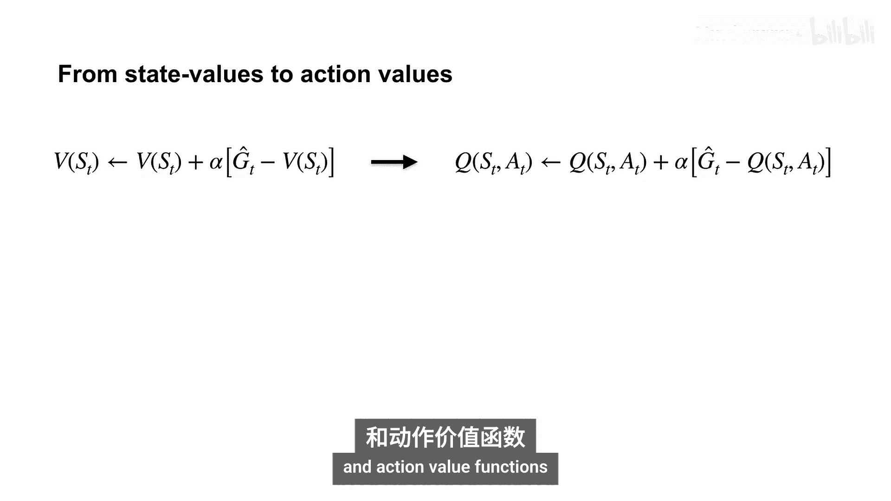

We then talked about control using SArsRSA， expected SArsSA， and Q learning。

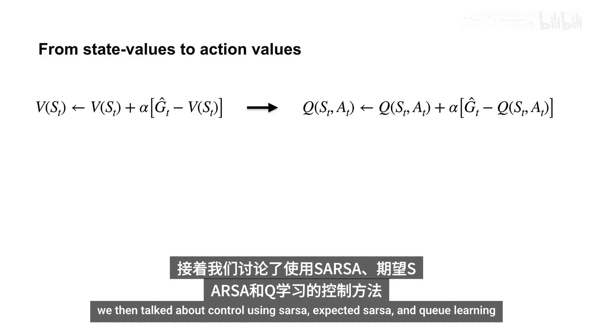

SARS says an on policy algorithm， it estimates the value of the policy it is following。

Qe learning is off policy， and estimates the value function for the optimal policy。

Expected SArsSA can be used on or off policy。 It explicitly calculates the expected next state value in its update target。

 This expectation can be conditioned on any policy， so expected SArsSA can be used off policy。

We show that Q learning is a special case of expected SArsSA。

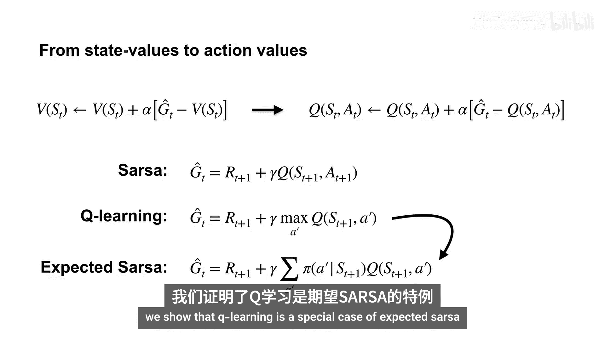

In the last module we talked about planning with model experience。

 we introduced the Dner architecture that incorporates both planning from model experience and learning from environment experience。

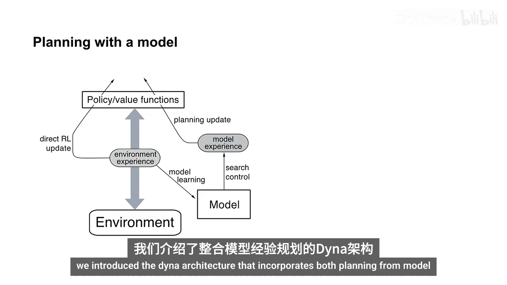

We discussed DahQ， which combines Q learning and Q planning。In an experiment。

 we saw that DN Q's planning updates make it more sample efficient than Q learning。

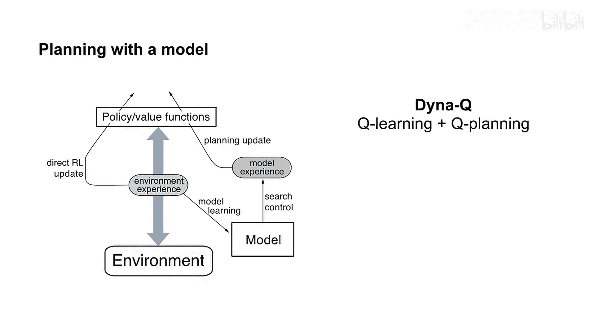

Finally， we consider what happens when the model is inaccurate。

We showed you how DnaQ+ adds an exploration bonus in the planning update to encourage exploration。

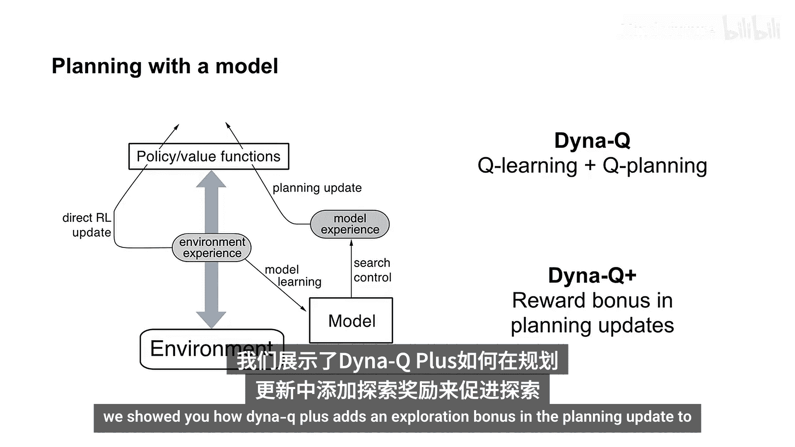

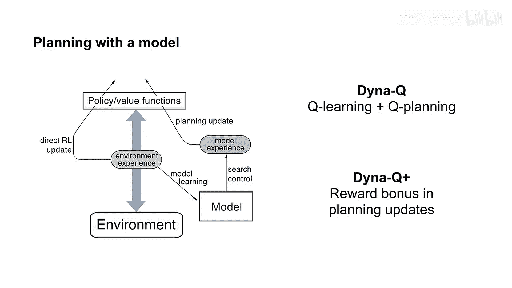

This bonus helps Dno Q+ notice changes in the environment that Dno Q would not。

We hope you've enjoyed learning about sample based learning methods。

 and the next course we'll see how to combine sample based learning with function approximation。

We will learn about generalization， a powerful tool to scale up reinforcement learning and dramatically improve sample efficiency many of the concepts you've learned will transfer。

 but there will be a few new challenges， stick around to find out how we resolve them。

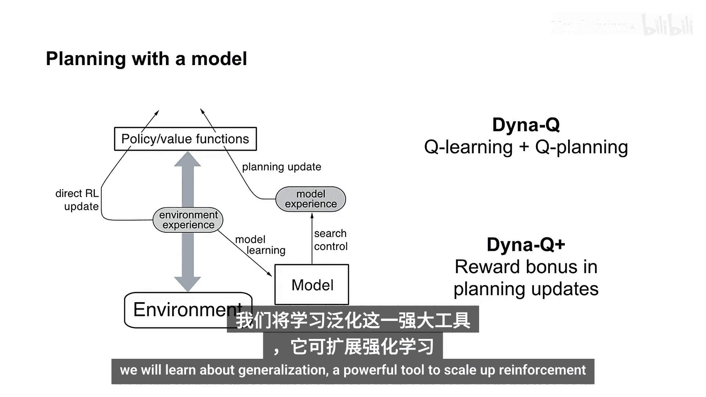

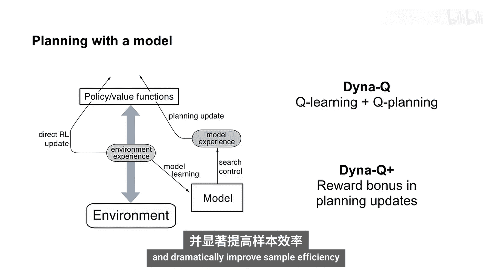