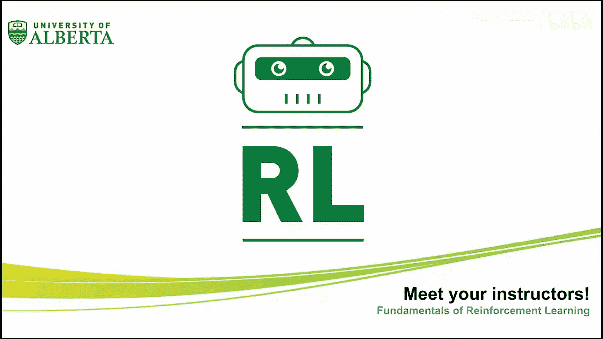

# 【阿尔伯塔大学】完整的强化学习系统 ｜ Complete Reinforcement Learning System p02 P02_认识你的导师_01_01_02 -BV1VHYJz1Ee8_p2-

🎼うふに。Hi I'm Martha， I'm an assistant professor at the University of Alberta。Hi， I'm Adam。

 I'm a research professor at the University of Alberta and a senior researcher at Deep Mind。

Adam is well known for his work on predictive knowledge for reinforcement learning several research groups around the world are building on these ideas I personally think it is some of the most important work in recent years and will only become more influential。

He's also an impressive empiricist， a real master of designing experiments to cut to the key issues。

 he's constantly trying to improve scientific understanding in the RL community。

Martha's algorithm contributions to reinforce and learning are too many to list here。

She has developed several new off policy learning algorithms， new approaches to policy gradient。

 and dozens of impressive contributions to representation learning。

She is truly one of the young rising stars in reinforced learning。

She also happens to be my most frequent coauor and my partner in life。

So how did you get into computer science？Well I grew up in the East Coast in high school I was really interested in the sciences。

 physics， chemistry， biology， but I couldn't really find a right fit。

 and so I kind of randomly took a course on computer science and programming actually in GW basicsic。

And it was really just a career defining moment for me because I just remember the first time implementing an if statement or a for loop。

 and it was just amazing to me that I could get a computer to execute a sequence of instructions for me。

And so from there， like there was no hope I was always going to do computer science in college。

and then from there， why do you start working on reinforcement learning？

So for graduate studies I moved E Alberta and I came out here to do parallel distributed computing。

 that's what I kind of focused on in my undergrad。So I had all my courses loaded up with systems courses and I had one more elective to fill。

 and so I was looking around for a course to take and I did a very reasonable strategy。

 I looked at the pictures of the professors and I picked the friendliest looking professor I could find。

And yeah， that turned out to be Rich Sutton， and it was introduction to reinforce learning。

And that course was amazing， it was really inspiring。

 it was my first introduction to artificial intelligence or machine learning of any kind。

And so I remember one of the early assignments in that course we were implementing SArsRSA to do a gridworld。

 and again it was another career defining moment for me just watching this agent learn to solve this maze and all look up was this reward signal minus one per step and somehow it figured out this amazingly efficient path in the maze and again。

 it just amazed me and I was hooked and I was going to keep doing that for the rest of my life。

So Martha， how did you end up doing research and machine learning and artificial intelligence Well I actually started in my undergrad in math。

 I've always thought functions and dynamical systems are beautiful。

And then I just took a CS course for fun and it really was very fun。

 so I just continued in both math and CS and those two topics go really well together for AI and machine learning actually。

 so and then I did some research in AI in the summertime and just continued from there。

And I really just stayed in the field because over time early it was more than just about functions in math。

 it's really a community where you get to collaborate a lot and you get to make a career where you help people。

So my day， I get to mentor a lot and I get to work in a big team working on hard problems。

 and it's really just very amazing to get to work on such interesting questions in a team。

So there's probably some people who are taking this RL course because they want to do graduate studies in RL。

 so what's one of the most important things you learned in your graduate studies？Well。

 maybe surprisingly enough， I learned a lesson that's useful across probably all the sciences and in fact。

 just any form of research， and that's to really love coming to understand the details of things to focus and do small problems and understand them really。

 really well and that's something that I think is really applicable across a wide range of things and it's something that I pass on in my students and my classes and I really focus on teaching my graduate students that and it's something that I hope to share to the people taking this specialization。

So what do you look about your job？Well， I love doing research。

 but sometimes that can kind of grind you down a little bit like it's really long hours。

The peer review process can be a little frustrating。

And so in those times when you kind of step back and look at your research。

 it can seem kind of small and a little bit insignificant and it's hard to see where that's going。

 how that's going to impact the world and make it a better place and so in those times you can always fall back and think about teaching and mentorship teaching is where you get to help people learn about things for the first time to come to understand how your field works and it's just so exciting and you're also being part of know the beginning of their careers whether they end up in academia or industry or starting their own companies。

It it's just such an amazing experience to be part of that process and you know throughout my week the best day for me is always the days when my schedule is full of meetings with my students and I get to help them work on their problems and come to understand reinforcement learning better。

So why do you think it's so important to work on reinforcement learning？

W' think the promise of RL is really big， but there are still a lot of open challenges。

 machine learning has started being used much more widely。

 but RL has kind of only been used in a few areas。But at the same time。

 I think RL can have a really big impact and I think within the next decade or so we're going to see more control engineers actually using RL in their systems。

 we're really just going to see that it's a tool that can help in automated decision making really within larger engineered systems。

 but I think for that to really happen， we need to make some advances in RL we need to start thinking more about how we're going to have robust algorithms and how we're going to get people to be comfortable using these algorithms so I think alongside adoption in industry。

 we're going to need to be thinking about how we can improve RL algorithms so that these two things can happen together。

So how about you， why do you think RL is good to work on？Well， naturally。

 I think reinforced learning is just the exact right framework to study AI and to make progress towards solving AI。

But RL is also really important to me because I'm very interested in developmental learning systems so you can think about。

 you know humans， you know， babies playing on the floor or young animals learning about the world。

I want to learn about those systems and how they work。And if you think about those systems。

 they learn an enormous amount in such a tiny amount of time。They learn how to crawl。

 they learn how their bodies work， they learn how to interact with their environment。

 manipulate objects， communicate with other agents in the world。

 and's just generally they're very competent learning systems and they do that over like a couple weeks to a couple months and it's just really astounding and it feels like we have so much work to do to get close to those kind of systems and so I really want to come to understand the algorithms and the representations that those systems might be using and I think reinforce learning is the right lens to look at those things and to come to understand those things。

So applications always kind of drive interest and excitement in the field and we've had a few of them in games and some industrial control problems。

 but what do you think is going to be the next big thing in reinforcement learning？Well。

 at his heart， I think RL is a general approach to automated decision making。

 It's a tool that's going to help us in a lot of our engineering systems。

 and so I think the place we're really going to see it take off is an industrial control。

In industrial control we have experts that are really looking for ways to improve the optimal how well their systems work and so we're going to see do things like reduce energy costs or save on other types of costs that we have in these industrial control systems and in the hands of experts we can really make these algorithms work well in the near future so I really see it as a tool that's going to facilitate experts in their work rather than say doing something like replacing people or automating them away。

