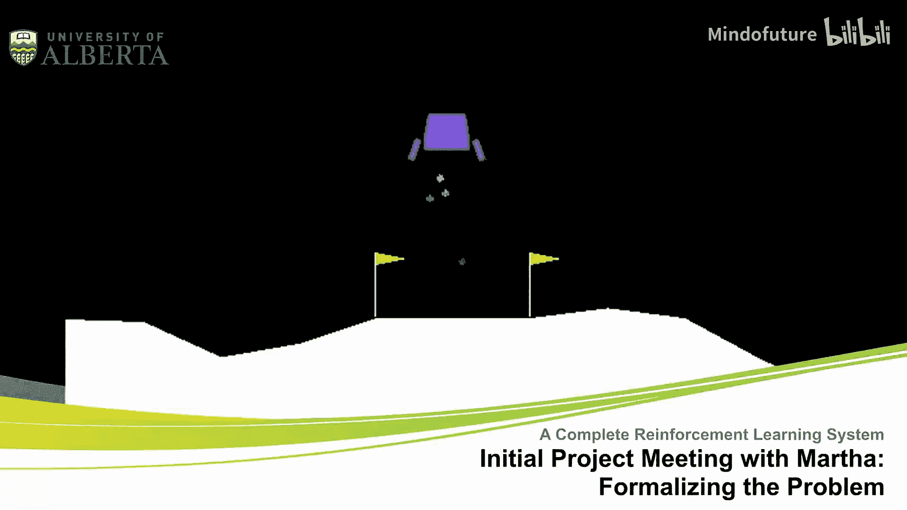
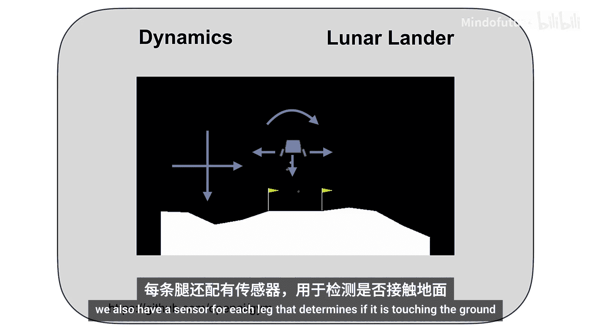
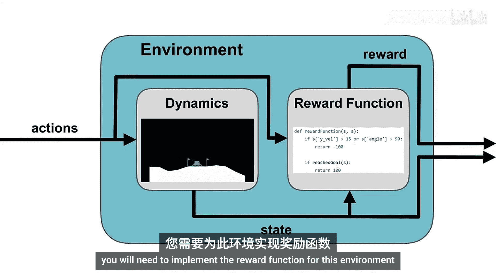
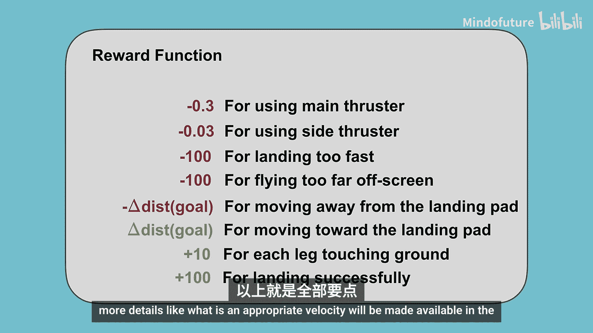

# 【阿尔伯塔大学】完整的强化学习系统 ｜ Complete Reinforcement Learning System p03 P03_与玛莎的初步项目会议-形式化问题_02_01_01 -BV1VHYJz1Ee8_p3-

Imagine that you would like to land on the moon this seems like a difficult task we would need to know loads of physics and control theory and we would have to anticipate countless things that could go wrong。

 but what if we framed this as a reinforce learning problem？

Our agent does not need to know the dynamics of the real world。

 it can learn simply through interaction。And your agent will do just that the lunar module will interact with the world unsure of the dynamics。

 but to get the module to do what you want， you will have to design the reward。

Of course it might be a little dangerous and costly to learn how to land a lunar module on the moon through trial and error。

 instead we will train our agent in a simulator to find a robust and efficient landing policy。

Then we could deploy the agent on the moon and then allow it to continue learning。

 adjusting its value function and policy， to account for the differences between our simulator and reality。

This means we do not have to worry about safety or money while training in the simulator。

But do keep in mind， we are using a very simple simulation here。

 it does not reflect all the complexities of outer space。

But we cannot use a high fidelity simulator since we do need your experiments to run reasonably quickly。

Even with our high fidelity simulator， our agent might still have issues in deployment。

There are many technical nuances required to get agents trained in simulators to transfer to the real world。

 but this topic is way outside the scope of this small project。

Our aim here is to help you tackle a moderately interesting problem and help you gain experience converting word descriptions of problems to a concrete solution。

In this video， we will introduce you to the environment that youll be working with。

You will understand the state and action space and the reward function that you need to implement。

This is what the lunar Lander environment looks like。

 and here are a few examples of an agent successfully landing。

Our goal is to land the lunar module in the landing zone located between the two yellow flags。

 the landing zone is always in the same location， but the shape of the ground around it may change。

We can fire the main thruster or either of the side thrusters to orient the module and slow its descent。

The state is composed of eight variables， it includes the Xy position and velocity of the module。

 as well as its angle and angular velocity with respect to the ground。

We also have a sensor for each leg that determines if it is touching the ground。

Let's take a deeper look at the part of the environment that you will be implementing。

The environment inputs the action， that action is given to the dynamics function along with the current state to produce a next state。

The next date in action will then be passed to a reward function that encodes the desired behavior。

Finally， the environment will emit the next state in the reward。

There are four actions that the agent can take。The agent can fire the main thruster。

 fire the left thruster， fire the right thruster， or do nothing at all on this time step。

You will need to implement the reward function for this environment。

Fuelel is expensive and the main thruster uses a lot of it。

 we want to discourage the agent from using the main thruster more than necessary。

 the side thrusters use less fuel so it is less bad for the agent to use those frequently we want to encourage the agent to move towards the goal。

 so it will lose some reward based on how far it moved from the goal since the last time step。

Let's try to discourage the agent from learning to pilot the module to the surface in ways that might damage the equipment and will also discourage flying off into outer space or a distant creator never to be seen again。

The agent will be rewarded for each leg that it manages to get touching the ground。

And the agent will receive a large reward for successfully landing in the landing pad at an appropriate velocity。

More details like what is an appropriate velocity will be made available in the notebooks。

And that's it in this video we introduce you to the Lunar Lander environment that you will be working with throughout this course your goal this week is to implement the reward function for this problem Good luck building your environment。

