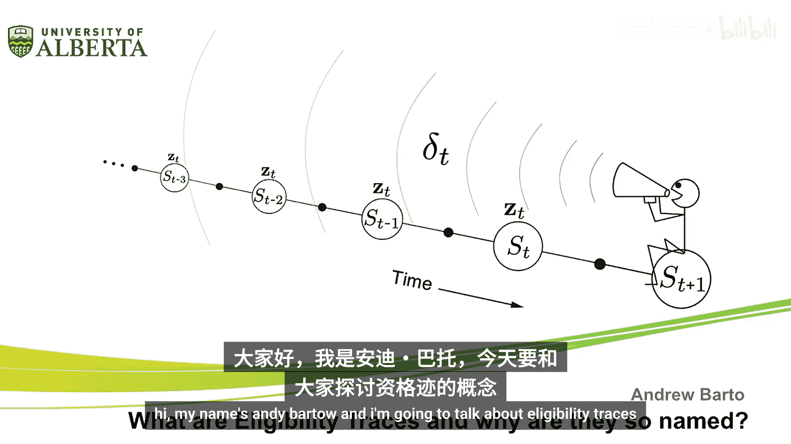

# 【阿尔伯塔大学】完整的强化学习系统 ｜ Complete Reinforcement Learning System p04 P04_论什么是资格迹以及它们为何如此命名_02_01_02 -BV1VHYJz1Ee8_p4-

Hi， my name is Andy Barto and I'm going to talk about eligibility traces。

 what are eligibility traces， and why do they have that name？

By the end of this video you'll understand the origin of the idea of eligibility traces and you'll actually see that you've been using them all along and I know that the course omits chapter 12 of the book which focuses on eligibility traces。

 but this little presentation will give you a bit of a head start in understanding that theory that occurs in chapter 12 so to begin the idea of eligibility traces comes from a hypothesis by Harry K。

 the Hedonistic neurourn Hy and Harry was a senior Sc at the avionics Directorate of the Air Force Office of scientific research。

He published a monograph in 1972 called The Hedonistic， well。

 I'm not sure what the title but it was about the hedonistic neuron in a book in '82 calledThe Hedonistic Neurn。

 and his idea， his hypothesis was that neurons are individually hedonists that work to maximize a local analog of pleasure while working to minimize a local analog of pain。

In other words。According to his idea， neurons are reinforcement learning agents。

 and the brain is a society of interacting reinforcement learning agents。Now。

 a little bit about neurons so that you can understand Cl's hypothesis and neurons's output or action is called an action potential。

Transmitted to other neurons by the neurons axon， when a neuron generates an action potential。

 it is said to fire。Action potentials act on other neurons via synapses。

 and synapses have eac or weights or strength。Which changed during learning。

Here is a sketch of a synapse。An action potential would arrive via the presynaptic terminal shown at the top。

 and it would affect the postsynaptic neuron shown at the bottom。

 and the synaptic weight or efficacy we tend to think resides in this connection。

 and often we think of eligibility as being something that is implemented by biochemistry within the axon。

 perhaps the presynaptic terminal as suggested here。

Cough's specific hypothesis then is that when a neuron fires an action potential。

 all the contributing synapses become eligible to undergo changes in their efficacy or weights。

If the action potential is followed within an appropriate time period by an increase in reward。

 the efficacy of all eligible synapses increase or decrease in the case of penalty。

So this raises a question of what should the shape of an eligibility trace be where the eligibility trace is the account of the memory that is stored at the synapse？

Based on previous activity of the neuron and Harry's idea was pointing out that neurons are embedded in a large number of feedback loops of varying durations。

 some feedback loops are within the nervous system and therefore very short。

 some go outside of the organism through the environment and back through sensory organs and therefore very much longer feedback loops。

 so the consequences of a neurons's activity returns to it with varying time delays。

And the shape of an eligibility trace is a kind of histogram of the durations of these feedback loops。

So here's a sketch of what one of these eligibility traces might look like might look。

 so at the time the neuron fires after that there are few very short feedback loops that return information。

 there may be a maximum number at some number like 600 milliseconds for of course it would be different for different neurons and then a few or very long feedback loops。

 and so the shape of an eligibility trace as cough。Iypothesize look something like this。

Now there are two kinds of eligibility traces， one we call contingent eligibility depends on preynaptic and postynaptic activity as hypothesized by class the presynaptic input needs to participate in generating the postynaptic activity and this leads to a threefactor learning rule preynaptic postynaptic and a reinforcement input arriving later。

 noncontingent eligibility is triggered only by the preynaptic activity leads to a twofactor learning rule。

 preynaptic and reinforcement and not dependent on the activity of the postynaptic neuron so here's a little sketch showing these ideas at the top are a few preynaptic action potentials the next curve the next。

Lion shows a few postsynaptic action potentials and you can see in two instances。

 they occur roughly together indicating that the presynaptic action potential is instrumental in causing the postynaptic action。

 and for the contingent eligibility traces， those are the only two cases that are trigger an eligibility trace。

 whereas a non-contingent trace will add that last one which is only triggered by a preynaptic impulse even though there is no postynaptic impulse at the same time。

Now， looking at the act of critical architecture， which you have studied in terms of。

Policy gradient methods， it turns out that the difference。

 the main difference between the actor and the critic is that the actor uses contingent eligibility traces and the critic uses non-contingent eligibility traces。

 so in the first case that the actor attempts to maximize reinforcement whereas in the critic case it attempts to predict reinforcement and it's really due to the main difference in these two types of eligibility traces now。

 the simplification of the kind of trace that Coff suggested is used in RL and it looks like this。

 an exponentially decaying trace。Instead of the more complicated trace that I showed earlier。

 this is much easier to implement。And to analyze， but it might be the case that traces more like cloths traces can sometimes perform better。

 and I don't know of work that really explores that question。

So you've actually been using eligibility traces all along。Although the most simple kind。

 just a one time step delay can be thought of as implemented with an eligibility trace so if here's the timeline and event curve at time T。

 then at T plus1 is the trace。And this means that。Fedback loop just takes one time step and that's the only one considered so this is a sort of degenerate case that nearly all the reinforcement learning algorithms that you've looked at use as part of their mechanism okay。

 a few takeaways， eligibility was proposed by Harry Cough as part of his hypothesis of the hedonistic neuron。

Eligibility traces a record of a synapses past activity so that feedback arriving after that activity can make changes in the synapses strength。

The main difference between the actor and the critic and the actor critic architecture is that eligibility traces our contingent for the actor but non contingent for the critic。

Eligibility is essential for taking into account the role of signal timing in synaptic learning rooms。

And finally， neuroscience is accumulating evidence。

That something very much like eligibility traces exist in the nervous system。Thank you。

