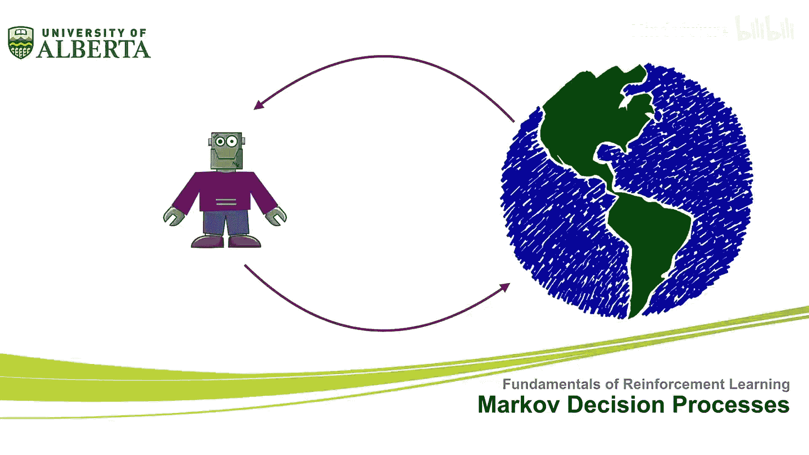
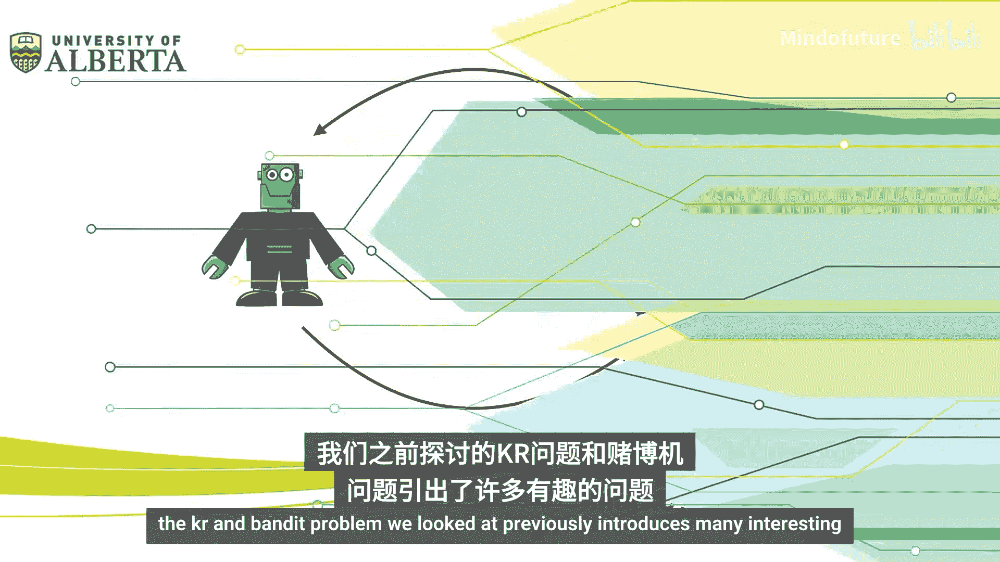
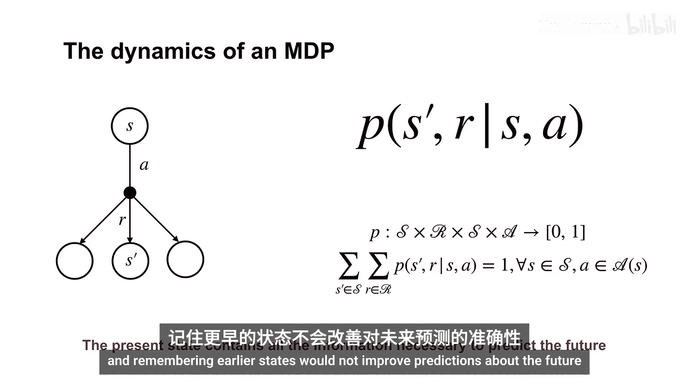

# 【阿尔伯塔大学】完整的强化学习系统 ｜ Complete Reinforcement Learning System p05 P05_让我们回顾马尔可夫决策过程_02_02_01 -BV1VHYJz1Ee8_p5-

The KR bandit problem we looked at previously introduces many interesting questions。 However。

 it doesn't include many aspects of real world problems。

The agent is presented with the same situation at each time， and the same action is always optimal。

In many problems， different situations call for different responses。

 The actions we choose now affect the amount of reward we can get into the future。

The Markov decision process formalism captures these two aspects of real world problems。

By the end of this video， you'll be able to understand Markov decision processes or MDPs and describe how the dynamics of an MDP are defined。

Let's start with a simple example to highlight how bandits and MDPs differ。

Imagine a rabbit is wandering around in a field， looking for food and finds itself in a situation where there is a carro to its right and broccoli on its left。

Our rabbit prefers carrots， so eating the carrot generates a reward of plus 10。Eating the broccoli。

 on the other hand， generates reward of only plus three。But what if later。

 the rabbit finds itself in another situation where there is broccoli on the right and car on the left。

Here， the rabbit would clearly prefer to go left instead of right。

The KR and bandit problem does not account for the fact that different situations call for different actions。

It's also limited in another way。Let's say we do account for different actions in different situations。

Here it looks like the rabbit would like to go right to get the carrot。However。

 going right will also impact the next situation the rabbit sees。

Let's say just to the right of the carrot， there is a tiger。If the rabbit moves right。

 it gets to eat the carrot。But afterwards， it may not be fast enough to escape the tiger。

If we account for the long term impact of our actions。

 the rabbit should go left and settle for broccoli to give itself a better chance to escape。

A band rabbit would only be concerned about immediate reward， and so would go for the carrot。

But a better decision can be made by considering the long term impact of our decisions。

Now let's look at how the situation changes as the rabbit takes actions。

 we will call these situations states。In each state， the rabbit selects an action。For instance。

 the rabbit can choose to move right。Based on this action。

 the world changes into a new state and produces a reward。In this case。

 the rabbit eats the carrot and receives a reward of plus 10。However。

 the rabbit is now next to the tiger。Let's say the rabbit chooses the left action。

The world changes into a new state where the tiger eats the rabbit。

 and the rabbit receives a reward of minus 100。From the original state。

 the rabbit could alternatively choose to move left， then the world transitions into a new state。

 and the rabbit receives a reward of plus3。The diagram now shows two potential sequences of states。

 the sequence that happens depends on the actions that the rabbit takes。

We can formalize this interaction with a general framework。In this framework。

 the agent in an environment interact at discrete time steps。 At each time。

 the agent receives a state S T。From the environment， from a set of possible states， script S。

The configuration shown on the slide is an example of a state。Based on this state。

 the agent selects an action AT from a set of possible actions。

Scrriipt A of ST is the set of valid actions in state ST。Moving right is an example of an action。

One time step later， based in part on the agent's action， the agent finds itself in a new state ST+1。

For example， this state or the rabbit is next to the tiger。

The environment also provides a scalar reward， RT+1， drawn from a set of possible rewards Sc R。

In this case， the reward is plus 10 for eating the carrot。

This diagram summarizes the Age environment interaction in the MDP framework the Age environment interaction generates a trajectory of experience consisting of states。

 actions and rewards。Actions influence immediate rewards as well as future states and through those future rewards。

😊，So how can we represent the dynamics of this interaction as in bandits。

 the outcomes are stochastic， and so we use the language of probabilities。

When the agent takes an action in a state， there are many possible next states and rewards。

The transition dynamics function P formalizes this notion。Given a state S and action A。

 P tells us the joint probability of next state S prime and reward R。In this course。

 we will typically assume that the set of states， actions and rewards are finite， but don't worry。

 you will learn about algorithms that can handle infinite sets and uncountable sets。

Since P is a probability distribution， it must be non negative。

 and its sum over all possible next states and rewards must equal 1。

Note that future state and reward only depends on the current state and action。

This is called the Markov property。It means that the present state is sufficient and remembering earlier states would not improve predictions about the future。

That's it for this video In summary， MDPs provide a general framework for sequential decision making and the dynamics of an MDP are defined by a probability distribution。

In the next video， we will discuss several decision making tasks and formalize each as an MDP。

