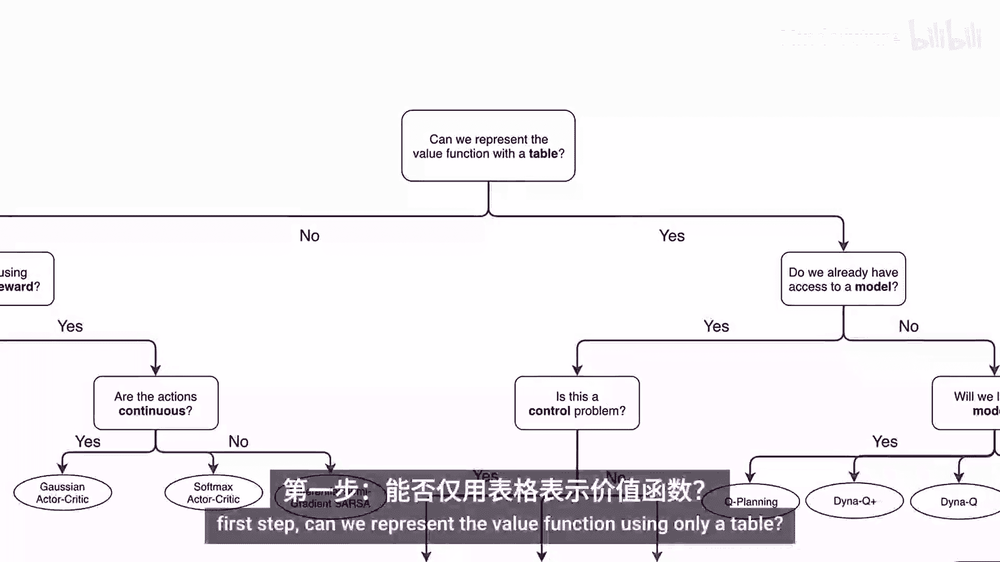
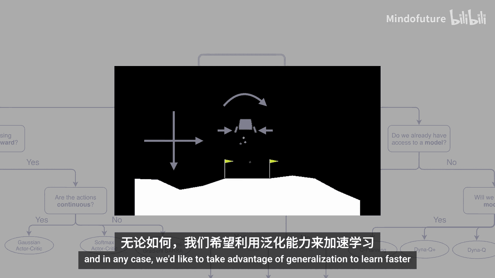
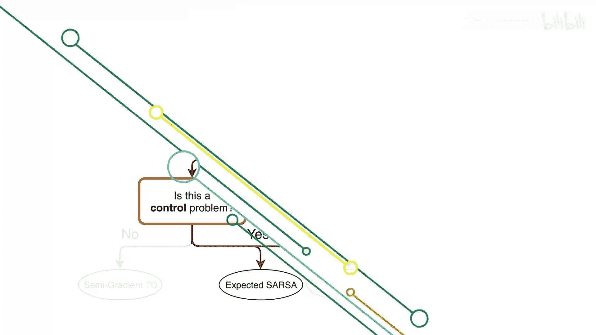

# 【阿尔伯塔大学】完整的强化学习系统 ｜ Complete Reinforcement Learning System p07 P07_与尼科的会议-选择学习算法_03_01_01 -BV1VHYJz1Ee8_p7-

嗯。Welcome to Week two of the Capstone Project。I'm Nikko Yasui。

 I'm a grad student here at the University of Alberta and I'm one of the creators of this specialization。

So far， we've discussed a fun problem， landing a shuttle on the moon。

We have formalized this problem as an MDP。This week we will begin discussing how to solve this MDP by deciding which of the many algorithms you have learned about are a good fit for this problem。

You might remember our course map that helped guide us through all the algorithms in course  three。

Let's use it to decide what algorithm to use for this capstone。First step。

 can we represent the value function using only a table？

Let's recall the state space of the lunar Lander problem。The agent observes the position。

 orientation， velocity， and contact sensors of the lunar module。

Six of the eight state variables are continuous， which means that we can not represent them with a table。

And in any case， we'd like to take advantage of generalization to learn faster。

Next， ask yourself would this be well formulated as an average reward problem。

 think about the dynamics of this problem。The lunar module starts in low orbit and descends until it comes to rest on the surface of the moon。

This process then repeats， with each new attempt at landing beginning independently of how the previous one ended。

This is exactly our definition of an episodic task。

We use the average reward formulation for continuing tasks so that is not the best choice here。

So let's eliminate that branch of algorithms。Next， we want to think about if it's possible and beneficial to update the policy and value function on every time step。

We can use Monte Carlo or TV。But think about landing your module on the moon。

If any of our sensors become damaged during the episode。

 we want to be able to update the policy before the end of the episode。

It's like what we discussed in the driving home example。

 We expect the TD method to do better in this kind of problem。 Finally。

 let's not lose sight of the objective here。We want to learn a safe and robust policy in our simulator so that we can use it on the moon。

We want to learn a policy that maximizes reward， and so this is a control task。

This leaves us with three algorithms， SArsRSA， expected SARSA， and Q learning。

Since we are using function approximation， learning an epsilon soft policy will be more robust than learning a deterministic policy。

Remember the example where due to state aliasing， a deterministic policy was suboptimal。

Expected SArsRSA and SArsSA both allow us to learn an optimal Epsilon soft policy。But cuing does not。

Now we need to choose between expected SArsRSA and SArsRSA。

We mentioned in an earlier video that expected SARSA usually performs better than SArsSA。

 so let's eliminate SArsA。

And that's it for this week we have now chosen an algorithm which will provide the foundation for our agent See you next week。

