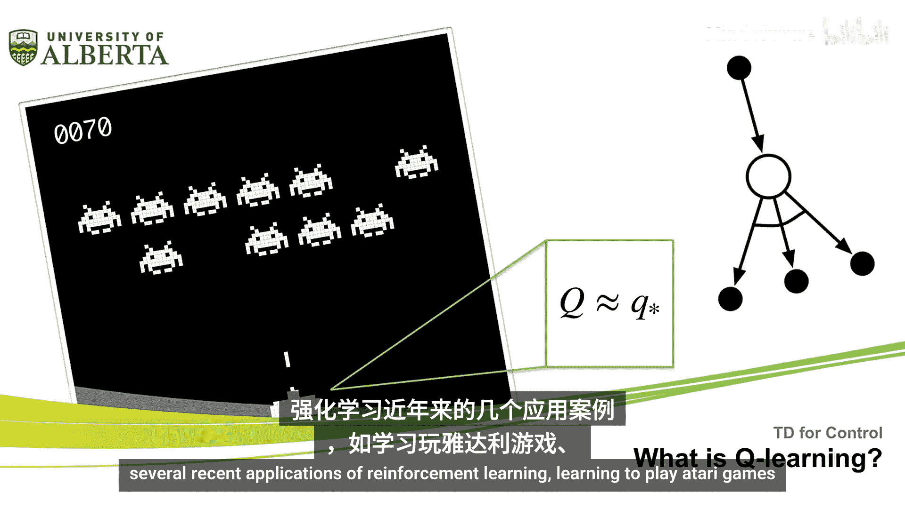
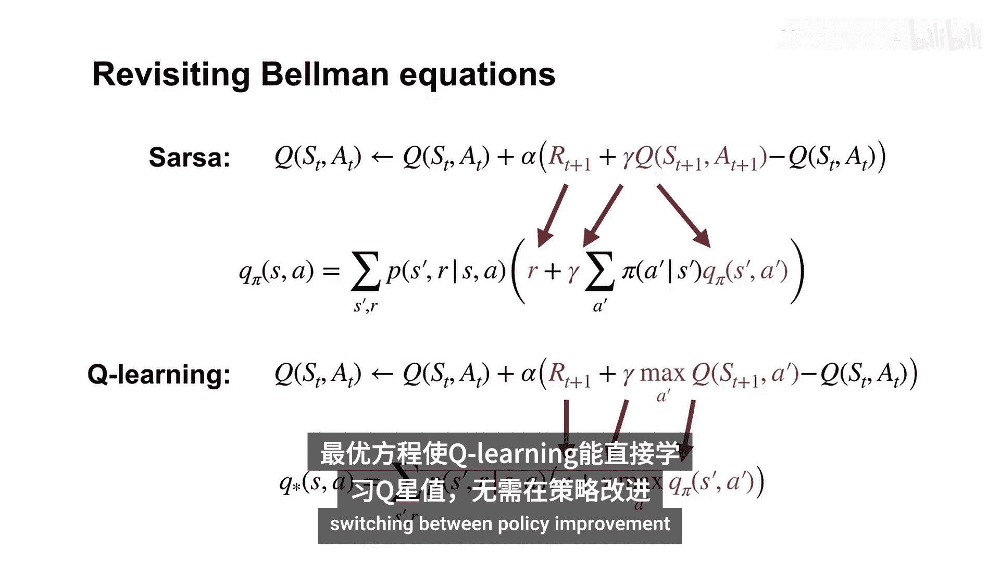

# 【阿尔伯塔大学】完整的强化学习系统 ｜ Complete Reinforcement Learning System p09 P09_让我们回顾什么是Q-learning_03_02_02 -BV1VHYJz1Ee8_p9-

Mm。うんうん。

うん。Several recent applications of reinforcement learning， learning to play Atari games。

 control traffic signals， or even automatically configuring web systems have been built on a single algorithm。

 this algorithm is called Q learning。By the end of this video。

 you will be able to describe the Q learning algorithm。

And explain the relationship between Q learning and the Bellman Opity equations。

Qu learning was developed in 1989 and is one of the first major online reinforcement learning algorithms。

Let's take a look at the pseudocode。We've seen this format before。

 the agent chooses an action in a state， takes the action， and observes the next state and reward。

Then the agent does an update and the cycle repeats。With so many familiar elements。

 what's new about Q learning Well the new element in Q learning is the action value update。Here。

 the target is the reward Rt plus1 plus gamma times the maximum action value in the following state。

This differs from SArsSA， which uses the value of the next state action pair in its target。

Why does Q learning use a max instead of the next state action pair？

This connection goes way back to the dynamic programming material。

If you look at the updated equation for SArsSA， it's suspiciously similar to the Bellman equation for action values。

In fact， SARSSA is a sample based algorithm to solve the Belmont equation for action values。

Q learning also solves a Belelman equation using samples from the environment。

But instead of using the standard Belman equation， Q learning uses the Belman optimality equation for action values。

The Opity equations enable Q learning to directly learn Q star instead of switching between policy improvement and policy evaluation steps。

Even though SARS and Q learning are both based on Belman equations。

 they're based on very different Belllman equations。

SARS has a sample based version of policy iteration。

 which uses Belman equations for action values that each depend on a fixed policy。

Q learning is a sample based version of value iteration。

 which iteratively applies the Bellman Opity equation。

Applying the Belmont optimality equation strictly improves the value function unless it is already optimal。

So value iteration continually improves its value function estimate。

 which eventually converges to the optimal solution。For the same reason。

 Q learning also converges to the optimal value function as long as the agent continues to explore and samples all areas of the state action space。

Let's review what we learned today。In this video， we introduced the Q learninging algorithm and described its connection to the Belman Opity equations。

