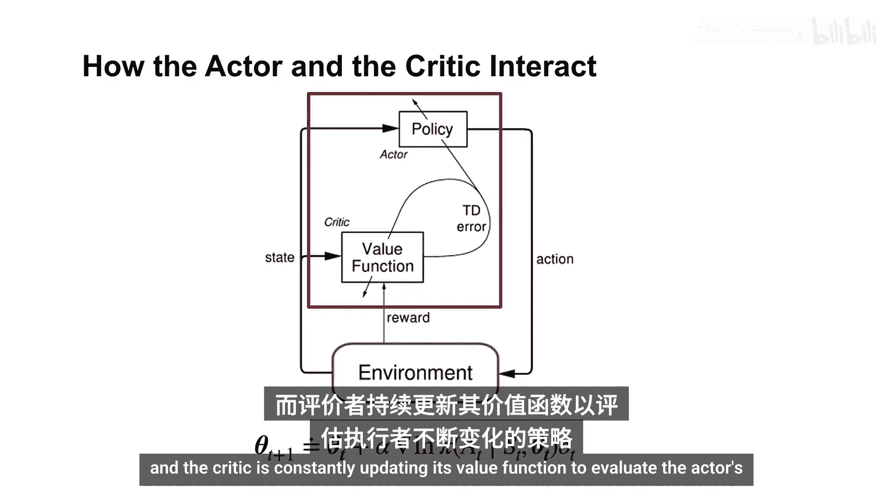
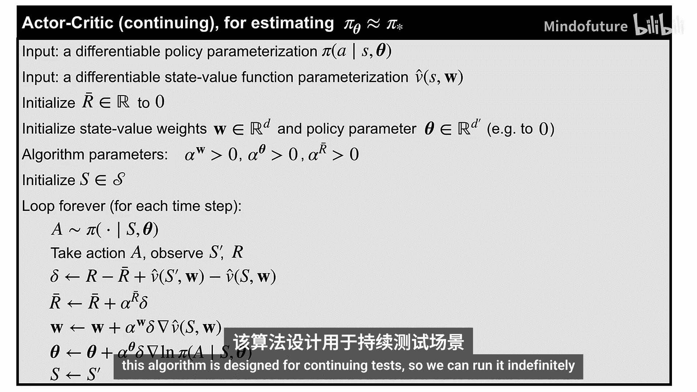

# 【阿尔伯塔大学】完整的强化学习系统 ｜ Complete Reinforcement Learning System p11 P11_让我们回顾Actor-Critic算法_03_02_04 -BV1VHYJz1Ee8_p11-

Do we have to choose between directly learning the policy parameters and learning a value function no？

Even within policy gradient methods， value learning methods like TD still have an important role to play in this setup。

 the parameter policy plays the role of an actor。While the value function plays a role of a critic。

 evaluating the actions selected by the actor。These so called actor critic methods were some of the earliest TD based methods introduced in reinforcement learning。

After watching this video， you will be able to describe the actor Critic algorithm for control with function approximation for continuing tasks。

We finished off the last video with this expression for the policy gradient learning Rule。

But we don't have access to QI， so you'll have to approximate it。We can do the usual TD thing。

 the one step Botrap return。That is the differential reward plus the value of the next state。

As usual， the parameter function V hat is a learned estimate of the value function。 In this case。

 V hat is the differential value function。This is the critic part of the actor critictic algorithm。

 the critic provides immediate feedback。To train the critic。

 we can use any state value learning algorithm。 We will use the average reward version of semi gradient TD。

The parameterized policy is the actor， it uses the policy grading update shown here。

We could use this form of the update， but there is one last thing we can do to improve the algorithm。

 we can subtract off what is called a baseline。Instead of using the one step value estimate alone。

 we can subtract the value estimate for the state ST to get the update that looks like this。

V hat of STT is the baseline in this case。Notice that this expression is equal to the TD error。

The expected value this update is the same as the previous one。Why is this？

Let's take the expectation of the update， condition on a particular state S at time T。

Taking the expectation of the sum is the same as the sum of the expectations。

We can use this to separate out the expectation of our original term from the expectation which involves the subtracted value function。

It turns out the expectation of the second term is0。

So we can add this baseline to the update without changing the expectation of the update。

You can verify this for yourself。To start， write the expectation as a sum of reactions and pull the V hat term out of the sum。

We'll leave this as an exercise。So why do we add this baseline if the update is the same in expectation？

Subtracting this baseline tends to reduce the variance of the update。

 which results in faster learning。This update makes sense intuitively After we execute in action。

 we use the TDR to decide how good the action was compared to the average for that state。

If the TDR is positive， that means the selected action resulted in a higher value than expected。

Taking that action more often should improve our policy。That is exactly what this update does。

 it changes the policy parameters to increase the probability of actions that were better than expected。

 according to the critic。Corspondingly， if the critic is disappointed and the TDR is negative。

 then the probability of the action is decreased。 the actor and the critic learn at the same time。

 constantly interacting。The actor is continually changing the policy to exceed the critic's expectation。

 and the critic is constantly updating its value function to evaluate the actor's changing policy。

With the policy update in place， we are ready to go through the full algorithm for average reward Actctor critictic。

To start， we specify the policy parameterization and the value function parameterization。For example。

 we might use tile coding to construct the approximate value function and a soft max policy parameterization。

We will need to maintain an estimate of the average reward。

 just like we did in the differential SARSA algorithm。We initialize this to zero。

We can initialize the weights and the policy parameters however we like。

 we initialize the step size parameters for the value estimate， the policy， and the average reward。

 and they could all be different， we get the initial state from the environment and then begin acting and learning。

On each time step， we choose the action according to our policy and receive the next state and reward from the environment。

Using this information， we compute the differential TDR and update our running estimate of the average reward。

We update the value function weights using the TD update。Finally。

 we update the policy parameters using our policy gradient update。And that's it。

 this algorithm is designed for continuing tests so we can run it indefinitely and continue to improve the policy forever。

That's it for this video， you should now understand that it is useful to learn a value function to estimate the gradient for the policy parameters。

And that the actor critic algorithm implements this idea with a critic that learns a value function for the actor。

Bye for now。