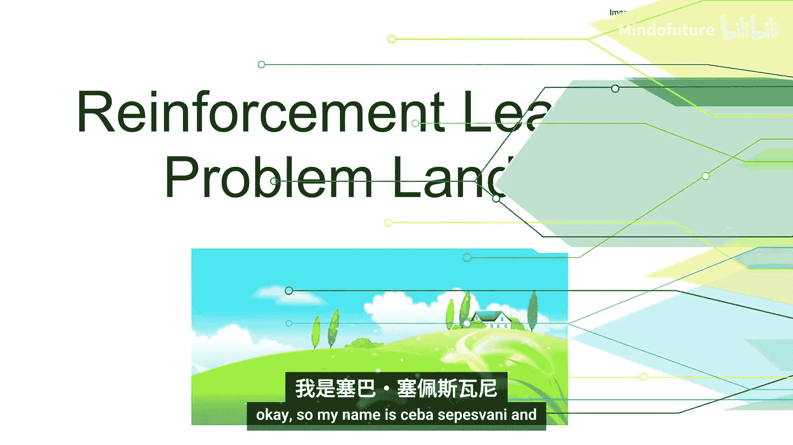

# 【阿尔伯塔大学】完整的强化学习系统 ｜ Complete Reinforcement Learning System p12 P12_论问题格局_03_02_05 -BV1VHYJz1Ee8_p12-

Okay， so my name is Chaba Sapeshfani and I'm a professor here at the U of A teaching Comp science。

So one of the things is that， of course， if you want to have a solution。

 then you should know what your problem is because your solution is going to be a function of the problem。

That you're working on and the other thing is that， well。

 you might think that this determines what you do always。

 but sometimes you just want to develop tools。And when you're developing tools。

 then you want to know which problems these tools fit。

🎼And which problems they fit well and which problems they are not feeling that well。

🎼So there are two important things that you should start with when thinking about problems to solving reinforcement learning。

First， you should be really clear about the goal that you have。

And you can have different types of goals， you can have a goal of solving a specific type of problem or just like some some particular problem。

Or you could be interested in developing some kind of tool and then in that case you should be clear about。

But are the goals in developing those tools so that you want to apply the tools far？嗯。

And when it comes to specifying a problem， the things you should be thinking about are the following。

 you should be thinking about how the data is going to be collected and how you're going to evaluateva the algorithm that you're going to develop and but the specific properties of the environment if any。

And I'm going to expand on these。 So when talking about the data that you're going to use in your argaom。

There are different types of problems depending on how you're acquiring the data。

 so maybe your system is going to interact with the real word。

Or maybe it's going to interact with a simulator or there will be no interaction at all and the data is going to sit on a disk and depending on which situation you are in you may need to choose very different tools and techniques and you will have different concerns So if your system is interacting with the real word then of course the real word is running at or own speed so data efficiency is going to be a major concern if you're interacting with a simulator then maybe all you care about is how much compute you're going to use why if there is no interaction at all then you have all the data saved on a disk then you care about how much information you can extract from this data so you will have different。

Goals depending on where the data is coming from and the algorithm that you will need to apply are going to you know change accordingly。

So the other aspect of specifying what。But first learning problem you have。

Is how you're going to evaluate your as right？ So do you care about efficient learning and if you do care about efficient learning as probably you should you。

You care about how well your system is going to do at the end of the learning or you're trying to develop a learning system that is also doing well during learning。

 so depending on the situation you are in， you might choose different aroms so the arutom for example that cares about like if you care about how well you're going to do at the end of learning。

 then your argom may do crazy exploration that may be very expensive in terms of reward。

While it's learning， but if you're in the second situation where you care about the reward collected during learning。

 then you may not want to do that that much right so you will need to choose different solutions again。

诶。And finally you will need to choose your performance metrics and there is a wide range of possibilities there as well。

 you might care about total reward， maybe you want to use a discount factor。

 maybe you care about thes sensitivityitivity of your solution。

 maybe you care about per across different environments in a birth case sense or average sense。

Maybe you don't care about the reward， maybe you care about how much knowledge is acquired or what skills are acquired at the end of the learning period。

 so in all these different settings you're going to evaluate your algorithmgatm differently and you might choose very different algorithms for different settings。

And finally， it's also very important to think a little bit about the specific aspects of the environment that you're interested in dealing with。

So the simplest of this is just like how many states and actions do you have in the environment？

So if you have。You know， like a large number of states。

 are there any irregularities between the states that you can exploit。

 if you have a large number of actions， then if you have continuously many actions。

 then some algorithms become unavailable because they are not able to deal with those settings。

 but if you have finite many actions， one number of actions。

 then maybe suddenly those algorithmrrogs become available， so you may want to choose them。And。

The other aspect could be that maybe the rewards in the environment or the cost can blow up so they can become unbounded and then you don't want to run the risk of having facing unbounded costs maybe the rewards are random or the environment is random or maybe it's not and again if the environment is not random you can have specialized algorithms that take advantage of that the problem is much simpler so all of these aspects of the environment are pretty important and。

You will choose your agatome based on what situation you are in。

And why is this important you may ask， well， just as an illustration。

 just think about a simple banded problem that you have maybe two arms and the underlying distribution of the arms。

 it's stochastic bandied， are unknown， but if you happen to know that the distribution comes belongs to a specific family like you have normal distributions。

 or you have binary distributions。Then you will choose argas that depend on these distributions and distribution depends on the knowledge that you have about these distributions and your agat will do much better if you exploit these properties。

So in the nutshell， it's important to be clear about what is the problem that you're solving for the sake of choosing the right arum and also for the sake of you know just for the sake of clarity of the scope of your solution is going to depend on this and you want to be clear about that。

