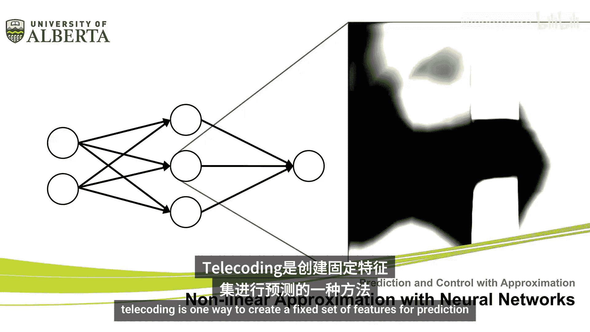
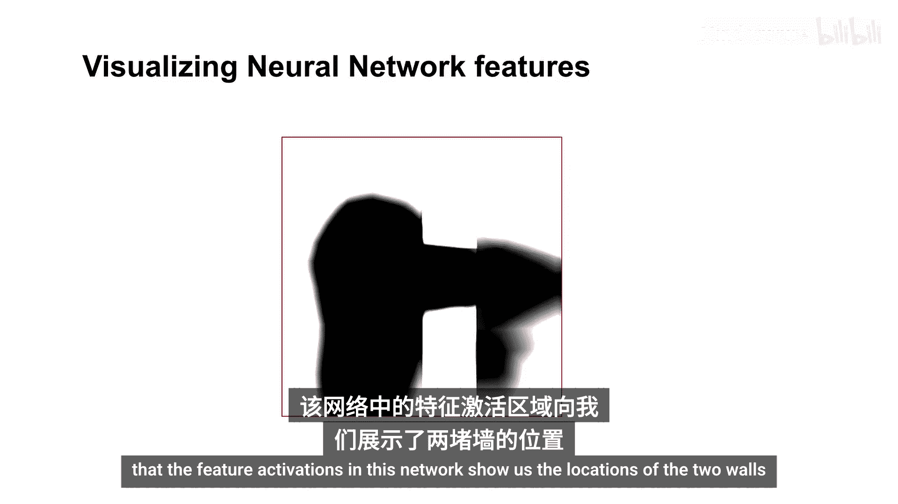

# 【阿尔伯塔大学】完整的强化学习系统 ｜ Complete Reinforcement Learning System p15 P15_让我们回顾使用神经网络的非线性近似_04_02_01 -BV1VHYJz1Ee8_p15-

Telecoding is one way to create a fixed set of features for prediction neural networks provide a strategy for learning a useful set of features Today we'll discuss how neural networks create these features。

By the end of this video， you will understand how neural networks do feature construction。

And you will understand how neural networks are a nonlinear function of state。

Let's revisit feed4 neural networks When we first build the neural network。

 we need to specify the initial weights， the way we initialize the weights is important。

 but more on this later for now， let's just assume they are drawn from some random distribution。

Let's take a look at what happens to a given input vector as we pass it through the network。

Let's start by looking at only one node of the network。

 each of the inputs are multiplied by their corresponding weights。

Then the weight of sum of these inputs is passed to a nonlinear activation function。

 resulting in a nonlinear function of the inputs。This process is done again and again for each of the nodes in the layer。

Each node has a different set of weights， so will produce a different output。

 which we call a feature。All of these new features collectively are considered the new representation。

This process is actually not that different from telecoding。

 we pass inputs to a tcoder and get back a new representation。So in both cases。

 we construct a nonlinear mapping of the inputs to produce the features。In both cases。

 we take a linear combination of the representation to produce the output。

 the approximate value of the current state。Let's get more insight into the neural network representation by contrasting with tile coding。

Recall that when we created the tilecoder， we had to set several parameters。

 the size and shape of the tiles， and the number of tilings。

 these parameters were fixed before learning。In a neural network。

 we have similar parameters corresponding to the number of layers， the number of nodes in each layer。

 and the activation functions。These are all typically fixed before learning。In this sense。

 both use prior knowledge to help in constructing features。However， in addition。

 the neural network also has adjustable parameters that change the features's during learning。

The neural number can use data to improve the features。

 whereas the tacoder can incorporate new information from data。

Both telecoding and neural networks produce features that are nonlinear in the input space we can understand this better by visualizing the hidden layer of a pretrained neural network we trained an agent in a continuous 2D space that contains a narrow corridor between two walls。

Here we've plotted the receptive field for an individual feature learned by the network。

The axes correspond to XY locations， which is the state space of the MDP。

Each point in the plot corresponds to the feature value for that Xy state。

 darker means larger activation。If it is white， the feature is not active for that state。

So what does this plot mean？This plot shows for which state this feature is active。

 meaning the feature's magnitude is above a small threshold。So at a higher level。

 this plot shows you how this feature generalizes， updates to its weight change the values for all these states。

Looking at the receptive fields for several features。

 we can see that different features generalize in different ways and form complex nonlinear shapes。

The activations do not have hard boundaries like in codinging。

These learned features can have boundaries that change smoothly。

 this feature has different degrees of generalization depending on the state。

It's also kind of fun that the feature activations in this network show us the locations of the two walls。

That's it for this video， you learned how neural networks can be viewed as a way to construct features and that neural networks are nonlinear functions of state bye for now。

