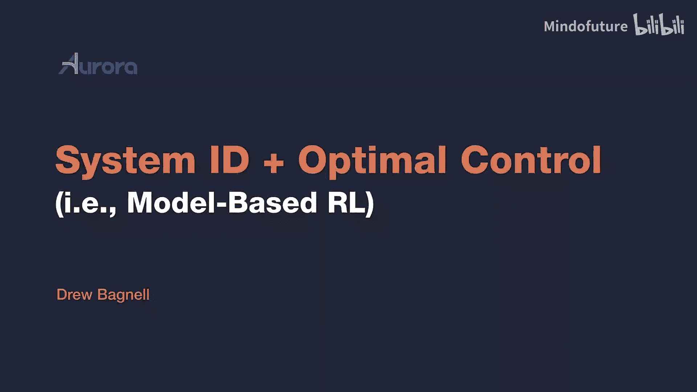
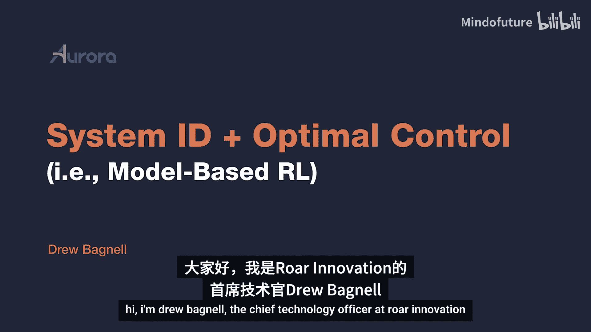

# 【阿尔伯塔大学】完整的强化学习系统 ｜ Complete Reinforcement Learning System p16 P16_Drew Bagnell论系统识别最优控制_04_02_02 -BV1VHYJz1Ee8_p16-

Hi， I'm Drew Magnell， the Chief Technology Officer at Ra Innovation。In the second lecture。

 I'll give you a quick introduction to the process of learning models within model basedase reinforcement learning。

 with an emphasis on approaches you might find practical。Okay。

 last time we discussed the key benefits of using a model， the ability to learn in simulation。

 and thus greatly reduce the expense and time of real world interaction。Of course。

 the key to make that happen is we need the ability to learn a model。For the rest of this lecture。

 we're going to use as an example， the problem of。Auttonomous telecom control in this case。

 what's known as a nose in funnel， and we want to learn a model from observations so that we can apply optimal control to。

 for instance， this given task。The traditional view of this is known as a system identification。

 and taught in engineering statistics is essentially a supervised learning approach。

We have some way of collecting data using exploration policy， for instance。

 for a pilot that controls the helicopter and induces deviations in those controls to explore the space of states。

 We then take that observed data and we apply a supervised learning algorithm， imagine。

 for instance applying linear regression。Given that supervised learning algorithm， the data。

 we're learning a model here called THt。Which maps states and actions to next states？

We take that model， we take a cost function， we combine them together using planning or optimal control synthesis algorithms。

 reinforcement learning algorithms， if you will， and we output a learned policy。

 which is hopefully optimal in the actual world。In practice。

 what we find is this is not actually what good engineers do。

 instead they tend to take an iterative approach to building the model。Let's see why。In this example。

 we begin by collecting data from expert demonstration of this nose in funnel。

And we collect a variety of examples of it doing this task。

Then we apply the class of optimal control algorithms we talked about in the last lecture to try to generate a policy。

What you find is unfortunately， it fails pretty spectacularly。And why does this go wrong， Well。

 fundamentally， the problem of system identification is really a chicken or the egg problem。

 We really want to learn a model that's good where the RL algorithm or optimal control synthesis algorithm is likely to visit as it learns a policy。

Unfortunately， if we learn a model and then plan or optimize against it。

 we'll almost certainly visit states in the process where the model was inaccurate that were undersampled during the data collection procedure。

And then the RO algorithm can find any way to exploit that in accuracycur and it'll learn a policy that doesn't perform well because the real world doesn't match the model in those states。

This general problem is sometimes known as covariate or distributional shift。

 and it's really a fundamental problem whenever we blend statistical learning with decision making。

The result is both in theory and practice， you can build statistical models and dynamics with very low error。

 apply a good optimizer or RL algorithm to that mode and still get bad performance in the real world that's really a bonus。

I find a really useful way to think about model based reinforcement learning is as a two player gain between the optimizer and RL algorithm and the model learning and the world together。

As I learned years ago from Chris Akinson， the best way to find an inaccuracy in your simulator is to let an RL algorithm try to exploit it。

 the final a loophole in your model， a glitch in the matrix， if you will。

We thus need approaches that are more robust and fundamentally interactive to find good models and good controllers。

I'll take you through an approach here which is fundamentally interactive。

The idea is that we will collect data from our purported current optimal policy。

 as well as that exploration policy I described before。

We'll get transitions that describe the way the helicopter goes from the state。

 takes an action and goes to the next state， we'll aggregate that together with all the previous transitions that we've had。

 again this is an iterative algorithm， we'll fit a model again I'm showing you're fitting linear regression。

Then we'll hand this off to an optimal control synthesis approach or a planner or a reinforcement learning algorithm。

 if you will， and the result will be a new policy， a new purported optimal policy。

And then we run this loop again， collecting data from the new policy。

 together mixed with some data from the exploration policy。

All of those transitions are aggregated together with everything we've previously seen before。

We fit the model， hand it off to the synthesis， which hands back a reported new policy and continue in this loop。

It turns out if you run this loop， Stefan Ross demonstrated that this kind of interactive approach。

 which turns out to much more closely match the style used by expert engineers。

 works really well in practice， and it can provide stronger theoretical guarantees。

If you learn a low error model across iterations of interaction using a stable function appximator。

 and you generate policies using a good optimal control solver， you must achieve good performance。

And put in the contrapoitive to not get good real world performance using a no regret learning algorithm。

 the class of algorithm we're talking about for learning， a good optimizer against that model。

 it must be the case that at some point you fail to build a low error model of how the world works。

There's lots of details to these fiscal guarantees。

 but they indicate that stable learning and on policy model learning are probably on the right track。

I mentioned briefly this idea of no regret learning。

It's a powerful concept worth learning about and it's very useful in any context which seems gamelike。

You can simplify it in your head to the class of algorithms that don't change the model they return much in response to the small perturbations in their training data。

And which achieve good performance in the limit of large data。Okay。We can take that same inverted。

 or rather nose and phone problem I described before。And apply this loop we described。

 and here's the results。We'll collect the same number of samples using this data aggregation approach。

And in this case we'll be able to actually solve the problem so this is interesting。

 the only thing that's different， same synthesis algorithm， same number of samples。

 all that's different is we've collected data in an interactive way where we've proposed optimal controllers。

 tried them， collected more data and then rebuild the model。

 and the result is we're successfully able to execute the nodes in funnel。

I thank you for your attention， and I really hope these lectures give you a head start on ideas for applying models and reinforcement learning in the real。

